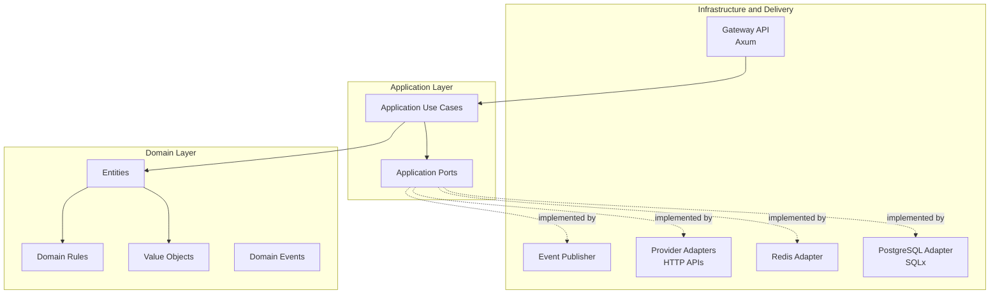

# ADR-0001: Clean Architecture and Dependency Direction

- **Status:** Proposed
- **Date:** 2026-11-03
- **Decision Owner:** Engineering
- **Project:** `llm-gateway`
- **Related Documents:** `docs/architecture.md`, `docs/domain-model.md`, `docs/data-model.md`, `docs/specification-consistency-review.md`

## 1. Context

The LLM Gateway integrates multiple external and internal systems:

- LLM providers.
- PostgreSQL.
- Redis.
- Secret managers.
- Event transport.
- Observability platforms.
- Evaluation services.
- HTTP and streaming interfaces.

Without explicit architectural boundaries, business logic can become tightly coupled to infrastructure implementations.

Examples of undesirable coupling:

- Domain entities depending on SQLx models.
- Routing decisions depending directly on provider SDKs.
- Budget calculations depending on Redis.
- Application use cases depending on Axum request objects.
- Provider adapters implementing tenant authorization.

The system needs an architecture that supports:

- Provider independence.
- Testability.
- Infrastructure replacement.
- Independent domain evolution.
- Clear security boundaries.
- Maintainable Rust workspace organization.

## 2. Decision Drivers

The architecture must:

1. Separate business rules from infrastructure.
2. Support multiple provider implementations.
3. Support deterministic financial accounting.
4. Allow independent testing of domain logic.
5. Support asynchronous and streaming execution.
6. Avoid unnecessary abstraction.
7. Enable incremental development.
8. Support production observability and security.
9. Maintain explicit dependency direction.
10. Keep infrastructure concerns out of domain models.

## 3. Considered Options

### Option A: Layered Architecture

Traditional presentation, business, and data-access layers.

Advantages:
- Simple to understand.
- Fast initial development.
- Familiar structure.

Disadvantages:
- Business logic can become coupled to persistence.
- Infrastructure dependencies may leak into application services.
- Provider abstractions can become difficult to isolate.

### Option B: Clean Architecture

Organizes the system around domain rules and application use cases.

Advantages:
- Business rules remain independent.
- Infrastructure is replaceable.
- Dependencies point inward.
- Strong testability.
- Suitable for provider-independent systems.

Disadvantages:
- Requires explicit interfaces.
- Can introduce additional types and abstractions.
- Requires discipline to avoid unnecessary layers.

### Option C: Microservices Architecture

Separates business capabilities into independently deployed services.

Advantages:
- Independent deployment.
- Independent scaling.
- Strong service ownership.

Disadvantages:
- Distributed transaction complexity.
- Higher operational overhead.
- More difficult local development.
- Unnecessary complexity for the initial portfolio implementation.

## 4. Decision

Adopt **Clean Architecture with modular monolith deployment** for the initial release.

The system will be implemented as a Rust workspace with independently testable modules and selected crate boundaries.

The gateway will initially deploy as one primary Rust service.

The Python evaluation worker will run as a separate process.

The architecture will follow this dependency direction:



**Dependency rule:**

Outer layers may depend on inner layers. Inner layers must never depend on outer layers.

## 5. Architectural Layers

### 5.1 Domain Layer

Owns business concepts and invariants.

Responsibilities:

- Tenant and project rules.
- API key domain state.
- Model capabilities.
- Routing constraints.
- Budget and reservation rules.
- Financial accounting invariants.
- Inference execution state.
- Provider attempt state.
- Domain events.
- Value objects.

Must not depend on:

- Axum.
- SQLx.
- Redis clients.
- Reqwest.
- Provider SDKs.
- OpenTelemetry exporters.
- Environment variables.
- HTTP request or response types.

### 5.2 Application Layer

Coordinates business workflows.

Responsibilities:

- Authenticate and authorize inference operations through application ports.
- Validate normalized requests.
- Coordinate admission controls.
- Evaluate policies.
- Coordinate routing.
- Reserve budgets.
- Execute provider attempts.
- Reconcile usage.
- Publish application events.
- Manage cancellation and execution lifecycle.

Application services define interfaces for external operations.

Example:

```rust
#[async_trait::async_trait]
pub trait BudgetRepository: Send + Sync {
    async fn reserve(
        &self,
        command: ReserveBudgetCommand,
    ) -> Result<BudgetReservation, BudgetError>;

    async fn settle(
        &self,
        command: SettleBudgetCommand,
    ) -> Result<Settlement, BudgetError>;
}
```

### 5.3 Infrastructure Layer

Implements external dependencies.

Responsibilities:

- PostgreSQL repositories.
- Redis rate limiting.
- Distributed concurrency coordination.
- Provider HTTP clients.
- Secret manager integrations.
- Event publishing.
- OpenTelemetry export.
- External evaluation integration.

Infrastructure must implement application-defined interfaces.

### 5.4 Presentation Layer

Exposes the gateway to clients.

Responsibilities:

- HTTP endpoints.
- Authentication middleware integration.
- Request deserialization.
- Response serialization.
- SSE streaming.
- HTTP error mapping.
- API versioning.
- OpenAPI documentation.

Axum-specific types must not leak into domain entities.

## 6. Rust Workspace Structure

Initial workspace:

```text
llm-gateway/
├── Cargo.toml
├── Cargo.lock
├── rust-toolchain.toml
├── crates/
│   ├── gateway-api/
│   ├── gateway-core/
│   ├── domain/
│   ├── infrastructure/
│   ├── provider-core/
│   ├── provider-adapters/
│   └── shared-kernel/
├── services/
│   └── evaluation-worker/
├── migrations/
├── config/
├── docs/
├── tests/
├── evals/
├── docker-compose.yml
├── Dockerfile
├── .env.example
└── README.md
```

### Crate responsibilities

| Crate | Responsibility |
|---|---|
| `gateway-api` | HTTP, Axum handlers, middleware, SSE |
| `gateway-core` | Application use cases and orchestration |
| `domain` | Entities, value objects, domain services, invariants |
| `infrastructure` | Database, Redis, secrets, event transport |
| `provider-core` | Canonical provider interfaces and normalized types |
| `provider-adapters` | OpenAI, Anthropic, Gemini, compatible providers |
| `shared-kernel` | Shared identifiers and carefully selected primitives |

Do not create a new crate for every logical module.

Create separate crates only when they provide meaningful dependency isolation or independent ownership.

## 7. Dependency Rules

Expected dependency direction:

| Component | May Depend On | Must Not Depend On |
|---|---|---|
| `domain` | Standard library, domain-level dependencies | Axum, SQLx, Redis, Reqwest |
| `provider-core` | Domain-compatible shared types | Provider SDK implementations |
| `gateway-core` | Domain, provider contracts, application interfaces | Axum handlers, concrete database clients |
| `infrastructure` | Application interfaces, domain, infrastructure libraries | Presentation handlers |
| `provider-adapters` | Provider contracts, HTTP libraries | Tenant budget and authorization rules |
| `gateway-api` | Application interfaces, HTTP libraries | Direct financial business logic |
| `shared-kernel` | Minimal foundational dependencies | Feature-specific modules |

The exact Cargo dependency graph must be validated during workspace setup.

## 8. Application Port Examples

The application layer owns interfaces such as:

```rust
#[async_trait::async_trait]
pub trait InferenceRepository: Send + Sync {
    async fn create_execution(
        &self,
        execution: NewInferenceExecution,
    ) -> Result<InferenceExecution, RepositoryError>;
}

#[async_trait::async_trait]
pub trait RateLimiter: Send + Sync {
    async fn check(
        &self,
        request: RateLimitRequest,
    ) -> Result<RateLimitDecision, RateLimitError>;
}

#[async_trait::async_trait]
pub trait ProviderGateway: Send + Sync {
    async fn execute(
        &self,
        request: ProviderRequest,
    ) -> Result<ProviderResponse, ProviderError>;
}
```

Concrete implementations live in infrastructure or provider adapter crates.

The domain remains independent of these external mechanisms.

## 9. Testing Strategy

### Domain tests

- Pure unit tests.
- State-transition tests.
- Property-based tests.
- Financial invariant tests.

### Application tests

- Mocked ports.
- Workflow tests.
- Failure-path tests.
- Idempotency tests.
- Routing orchestration tests.

### Infrastructure tests

- PostgreSQL integration tests.
- Redis integration tests.
- Provider contract tests.
- Outbox delivery tests.

### API tests

- HTTP contract tests.
- Authentication tests.
- SSE streaming tests.
- Error mapping tests.

## 10. Consequences

### Positive

- Business rules remain isolated.
- Provider integrations are replaceable.
- Financial logic is independently testable.
- Infrastructure failures can be tested without changing domain logic.
- Rust workspace boundaries provide compile-time dependency control.
- Modular monolith deployment reduces initial operational complexity.

### Negative

- Additional interfaces and mapping code.
- More deliberate dependency management.
- Some types may need conversion between API, application, domain, and provider representations.

### Risks

- Excessive abstraction.
- Over-fragmentation into crates.
- Duplicated models across layers.
- Application services becoming overly complex.

Mitigations:

- Start with the minimum necessary interfaces.
- Use domain types for business meaning.
- Keep transport DTOs separate from domain entities.
- Extract crates only when justified.
- Refactor orchestration into focused use cases.

## 11. Implementation Notes

During implementation:

1. Create the Rust workspace.
2. Establish `domain` with no infrastructure dependencies.
3. Implement foundational identifiers and value objects.
4. Establish application interfaces.
5. Add the first Axum endpoint.
6. Add a mock provider implementation.
7. Add PostgreSQL and Redis adapters incrementally.
8. Enforce dependency boundaries in CI.
9. Add integration tests for external adapters.

Useful quality checks:

```bash
cargo fmt --all -- --check
cargo clippy --workspace --all-targets --all-features -- -D warnings
cargo test --workspace
cargo tree --workspace
```

Consider dependency-graph checks as the workspace matures.

## 12. Validation Criteria

ADR-0001 is validated when:

- The Rust workspace compiles.
- Domain tests run without infrastructure.
- Domain has no dependencies on infrastructure crates.
- Application workflows can be tested with mocks.
- Provider adapters implement canonical interfaces.
- Axum types do not leak into domain models.
- PostgreSQL and Redis can be replaced without rewriting business rules.
- Dependency direction is demonstrable through the Cargo dependency graph.

## 13. Related ADRs

- ADR-0002: Rust Workspace Structure and Crate Boundaries.
- ADR-0003: PostgreSQL as the Authoritative Data Store.
- ADR-0004: Redis for Distributed Coordination and Caching.
- ADR-0006: Canonical Provider Adapter Interface.
- ADR-0009: Budget Reservation and Financial Settlement.

## 14. References

- `docs/architecture.md`
- `docs/domain-model.md`
- `docs/data-model.md`
- `docs/specification-consistency-review.md`
- `docs/build-plan.md`
