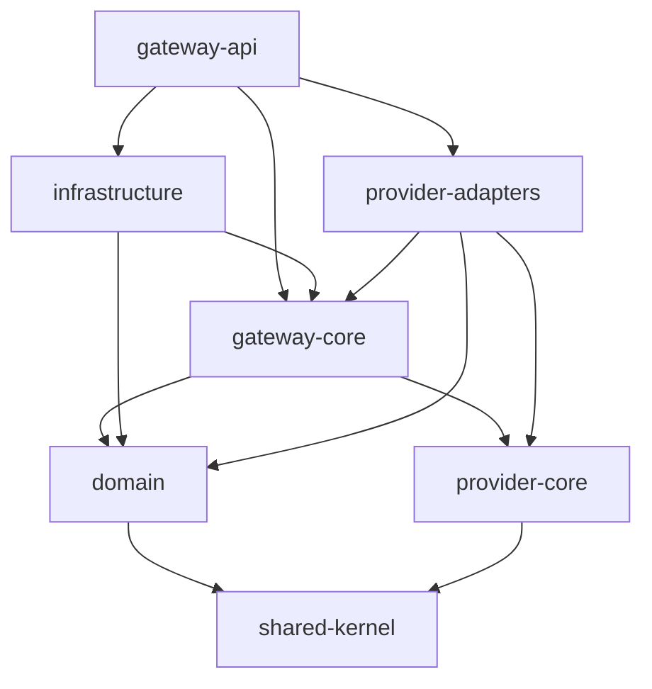

# ADR-0002: Rust Workspace Structure and Crate Boundaries

- **Status:** Proposed
- **Date:** 2026-11-03
- **Project:** `llm-gateway`
- **Related ADRs:** ADR-0001

## 1. Context

`llm-gateway` is a Rust-based enterprise LLM gateway with multiple architectural capabilities:

- HTTP API and streaming.
- Authentication and authorization.
- Tenant and project management.
- Rate limiting and concurrency control.
- Budget reservation and financial accounting.
- Model routing.
- Provider integrations.
- Caching.
- Observability.
- Asynchronous event processing.

A single Rust crate could initially implement these capabilities, but would eventually create tightly coupled modules and make dependency boundaries difficult to enforce.

Conversely, creating a separate crate for every feature would introduce unnecessary complexity.

The project therefore needs a deliberate workspace structure that reflects meaningful architectural boundaries.

## 2. Decision Drivers

The workspace must:

1. Enforce Clean Architecture dependency direction.
2. Keep domain logic independent of infrastructure.
3. Separate application orchestration from HTTP concerns.
4. Support multiple provider implementations.
5. Support independent testing.
6. Minimize circular dependencies.
7. Support incremental implementation.
8. Allow future extraction of services when justified.
9. Avoid unnecessary crate fragmentation.
10. Keep build and dependency management manageable.

## 3. Considered Options

### Option A: Single Rust crate

Advantages:
- Simple setup.
- Fast initial compilation and development.
- Minimal workspace configuration.

Disadvantages:
- Weaker dependency isolation.
- Greater risk of module coupling.
- Difficult to enforce architectural boundaries.

### Option B: One crate per business capability

Examples:
- `identity`
- `budget`
- `routing`
- `rate-limiter`
- `cache`
- `observability`

Advantages:
- Fine-grained modularity.
- Potential independent ownership.

Disadvantages:
- Large number of crates.
- More complex dependency management.
- Risk of unnecessary abstraction.
- Slower initial development.

### Option C: Layer-oriented modular workspace

Advantages:
- Clear architectural boundaries.
- Enforces dependency direction.
- Supports focused testing.
- Allows modules to grow without immediate crate extraction.

Disadvantages:
- Requires deliberate ownership of interfaces.
- Some application and infrastructure modules remain grouped initially.

## 4. Decision

Adopt a **layer-oriented Rust workspace with a small number of meaningful crates**.

Use a modular monolith for the initial deployment.

Do not split business capabilities into separate deployable microservices during the initial release.

## 5. Proposed Workspace Structure

```text
llm-gateway/
├── Cargo.toml
├── Cargo.lock
├── rust-toolchain.toml
│
├── crates/
│   ├── domain/
│   │   ├── Cargo.toml
│   │   └── src/
│   │       ├── lib.rs
│   │       ├── identity/
│   │       ├── tenancy/
│   │       ├── policy/
│   │       ├── model/
│   │       ├── inference/
│   │       ├── routing/
│   │       ├── accounting/
│   │       ├── admission/
│   │       ├── cache/
│   │       └── audit/
│   │
│   ├── gateway-core/
│   │   ├── Cargo.toml
│   │   └── src/
│   │       ├── lib.rs
│   │       ├── ports/
│   │       ├── use_cases/
│   │       │   ├── inference/
│   │       │   ├── identity/
│   │       │   ├── routing/
│   │       │   ├── budgets/
│   │       │   └── administration/
│   │       └── services/
│   │
│   ├── provider-core/
│   │   ├── Cargo.toml
│   │   └── src/
│   │       ├── lib.rs
│   │       ├── request.rs
│   │       ├── response.rs
│   │       ├── streaming.rs
│   │       ├── errors.rs
│   │       └── capabilities.rs
│   │
│   ├── provider-adapters/
│   │   ├── Cargo.toml
│   │   └── src/
│   │       ├── lib.rs
│   │       ├── registry.rs
│   │       ├── openai/
│   │       ├── anthropic/
│   │       ├── gemini/
│   │       └── openai_compatible/
│   │
│   ├── infrastructure/
│   │   ├── Cargo.toml
│   │   └── src/
│   │       ├── lib.rs
│   │       ├── persistence/
│   │       ├── redis/
│   │       ├── secrets/
│   │       ├── events/
│   │       ├── observability/
│   │       └── configuration/
│   │
│   ├── gateway-api/
│   │   ├── Cargo.toml
│   │   └── src/
│   │       ├── main.rs
│   │       ├── app.rs
│   │       ├── routes/
│   │       ├── middleware/
│   │       ├── dto/
│   │       ├── error.rs
│   │       └── streaming/
│   │
│   └── shared-kernel/
│       ├── Cargo.toml
│       └── src/
│           ├── lib.rs
│           ├── ids.rs
│           ├── time.rs
│           └── primitives.rs
│
├── services/
│   └── evaluation-worker/
│       ├── pyproject.toml
│       ├── src/
│       └── tests/
│
├── migrations/
├── config/
├── docs/
├── evals/
├── tests/
├── scripts/
├── Dockerfile
├── docker-compose.yml
└── README.md
```

The structure is an initial target. Directories should be introduced as implementation requires them; empty modules should not be created merely to match the tree.

## 6. Crate Responsibilities

### 6.1 `domain`

Owns business rules and domain invariants.

Examples:

- `InferenceExecution`
- `BudgetAccount`
- `BudgetReservation`
- `ProviderAttempt`
- `RoutingDecision`
- `ModelCapability`
- `Tenant`
- `APIKey`

Rules:

- No Axum dependency.
- No SQLx dependency.
- No Redis client dependency.
- No provider SDK dependency.
- No direct network access.
- No infrastructure configuration.

### 6.2 `gateway-core`

Owns application workflows and ports.

Examples:

- `ExecuteInference`
- `ReserveBudget`
- `SettleUsage`
- `ResolveModelRoute`
- `CreateApiKey`
- `RevokeApiKey`

It defines interfaces for external operations, including:

- `ProviderGateway`
- `BudgetRepository`
- `ExecutionRepository`
- `RateLimiter`
- `ConcurrencyController`
- `Cache`
- `SecretProvider`
- `EventPublisher`
- `PolicyRepository`

Use cases coordinate these ports without knowing their concrete implementations.

### 6.3 `provider-core`

Owns provider-neutral contracts and normalized provider types.

Examples:

- `ProviderRequest`
- `ProviderResponse`
- `ProviderError`
- `ProviderStreamEvent`
- `ProviderCapabilities`
- `ProviderUsage`

It must not contain OpenAI-, Anthropic-, or Gemini-specific HTTP implementations.

### 6.4 `provider-adapters`

Implements provider integrations.

Initial adapters:

- OpenAI.
- Anthropic.
- Gemini.
- OpenAI-compatible endpoints.

Responsibilities:

- HTTP communication.
- Provider request mapping.
- Provider response normalization.
- Provider error normalization.
- Stream event normalization.
- Provider usage extraction.
- Provider-specific capability mapping.

It must not implement tenant authorization, budget policy, or financial accounting.

### 6.5 `infrastructure`

Implements application ports using external technologies.

Examples:

| Module | Implementation |
|---|---|
| `persistence` | PostgreSQL and SQLx |
| `redis` | Redis rate limiting, cache, concurrency |
| `secrets` | Local and production secret managers |
| `events` | Outbox and event publishing |
| `observability` | OpenTelemetry exporters |
| `configuration` | Environment and configuration loading |

### 6.6 `gateway-api`

Owns the HTTP delivery mechanism.

Responsibilities:

- Axum application.
- Routes and handlers.
- Middleware.
- HTTP DTOs.
- SSE response delivery.
- Authentication integration.
- Error-to-HTTP mapping.
- Application dependency wiring.

The `gateway-api` binary is the initial composition root.

### 6.7 `shared-kernel`

Contains only small, genuinely shared primitives.

Potential examples:

- Strongly typed identifiers.
- Clock abstraction types, if shared across boundaries.
- Carefully selected common primitives.

It must not become a dumping ground for business logic.

If a type belongs naturally to `domain` or `provider-core`, keep it there rather than moving it into `shared-kernel`.

## 7. Dependency Graph

The intended compile-time dependency graph is:



Important rules:

1. Dependencies must remain acyclic.
2. Domain must not depend on infrastructure.
3. Application use cases must not depend on Axum.
4. Provider adapters must not own business policies.
5. Infrastructure implementations must implement application-owned ports.
6. The API composition root wires concrete implementations together.
7. Shared kernel remains small and stable.

The graph is a target dependency model, not permission to introduce unnecessary dependencies. For example, `provider-adapters` should depend on `gateway-core` only where it needs to implement a port defined there.

## 8. Provider Contract Ownership

To avoid circular dependencies:

- `provider-core` owns canonical provider request, response, usage, error, and streaming types.
- `gateway-core` owns the application-facing `ProviderGateway` port.
- `provider-adapters` implements that port using `provider-core` contracts.
- `gateway-core` may depend on `provider-core`.
- `provider-core` must never depend on `gateway-core`.

This establishes one direction for provider contracts and application orchestration.

## 9. Cargo Workspace Configuration

Initial root `Cargo.toml`:

```toml
[workspace]
resolver = "2"
members = [
    "crates/domain",
    "crates/gateway-core",
    "crates/provider-core",
    "crates/provider-adapters",
    "crates/infrastructure",
    "crates/gateway-api",
    "crates/shared-kernel",
]

[workspace.package]
edition = "2024"
license = "MIT"
version = "0.1.0"

[workspace.dependencies]
async-trait = "0.1"
serde = { version = "1", features = ["derive"] }
serde_json = "1"
thiserror = "2"
tokio = { version = "1", features = ["full"] }
tracing = "0.1"
uuid = { version = "1", features = ["v4", "serde"] }
```

Dependency versions are initial examples. Verify current compatible releases and commit `Cargo.lock` before implementation.

Example internal dependency:

```toml
[dependencies]
domain = { path = "../domain" }
provider-core = { path = "../provider-core" }
```

Each crate should declare only the dependencies it actually uses.

## 10. Dependency Injection

Use constructor-based dependency injection.

Example application service:

```rust
pub struct ExecuteInference {
    executions: Arc<dyn InferenceRepository>,
    budget: Arc<dyn BudgetRepository>,
    provider: Arc<dyn ProviderGateway>,
}

impl ExecuteInference {
    pub fn new(
        executions: Arc<dyn InferenceRepository>,
        budget: Arc<dyn BudgetRepository>,
        provider: Arc<dyn ProviderGateway>,
    ) -> Self {
        Self {
            executions,
            budget,
            provider,
        }
    }
}
```

The composition root constructs the concrete adapters and injects them into use cases.

Avoid global mutable service registries and hidden service locators.

## 11. Error Ownership

Errors should be translated at architectural boundaries.

| Layer | Error ownership |
|---|---|
| Domain | Business rule violations |
| Application | Workflow and port failures |
| Provider adapter | Provider-specific failures |
| Infrastructure | Database, Redis, secret and event failures |
| API | HTTP status and public error contract |

Never expose raw SQL, provider response bodies, secret values, or internal stack traces to API clients.

## 12. Testing Boundaries

| Crate | Primary tests |
|---|---|
| `domain` | Unit, property-based, invariant |
| `gateway-core` | Use-case tests with fake ports |
| `provider-core` | Serialization and contract tests |
| `provider-adapters` | Provider contract and mock HTTP tests |
| `infrastructure` | PostgreSQL, Redis and event integration |
| `gateway-api` | HTTP, authentication and streaming |
| Evaluation worker | Python unit, dataset and evaluator tests |

## 13. Crate Extraction Rules

Create a new crate only when at least one condition applies:

- It provides a meaningful architectural boundary.
- It has an independent dependency set.
- It needs separate testing or reuse.
- It has a distinct lifecycle or deployment requirement.
- It is becoming difficult to maintain within its current crate.

Do not create a separate crate solely because a feature has its own directory.

## 14. Consequences

### Positive

- Clear compile-time dependency boundaries.
- Easier independent testing.
- Provider integrations remain replaceable.
- Domain logic remains isolated.
- Modular monolith can evolve without premature microservices.

### Negative

- More Cargo manifests.
- Explicit cross-crate type ownership is required.
- Some conversions between provider, application, and domain types are unavoidable.

### Risks and Mitigations

| Risk | Mitigation |
|---|---|
| Circular dependencies | Enforce an acyclic Cargo graph |
| Excessive crate fragmentation | Apply extraction criteria |
| Shared-kernel bloat | Require architectural justification |
| Duplicate models | Assign one authoritative owner per type |
| Infrastructure leakage | Keep application ports inward-facing |

## 15. Validation Criteria

ADR-0002 is validated when:

- The workspace compiles.
- Every crate has a documented responsibility.
- The dependency graph is acyclic.
- Domain does not depend on infrastructure.
- Application use cases can be tested independently.
- Provider adapters implement canonical contracts.
- Concrete dependencies are wired in the composition root.
- CI verifies formatting, linting, and tests.

Suggested commands:

```bash
cargo metadata --format-version 1
cargo tree --workspace
cargo fmt --all -- --check
cargo clippy --workspace --all-targets --all-features -- -D warnings
cargo test --workspace
```

## 16. Related ADRs

- ADR-0001: Clean Architecture and Dependency Direction
- ADR-0003: PostgreSQL as the Authoritative Data Store
- ADR-0004: Redis for Distributed Coordination and Caching
- ADR-0006: Canonical Provider Adapter Interface
- ADR-0008: Constraint-Based Model Routing

