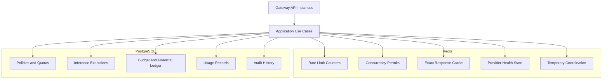

# ADR-0004: Redis for Distributed Coordination and Caching

- **Status:** Proposed
- **Date:** 2026-11-03
- **Project:** `llm-gateway`
- **Related ADRs:** ADR-0001, ADR-0002, ADR-0003

## 1. Context

The LLM Gateway will run multiple instances to support horizontal scaling.

Several capabilities require low-latency shared state across instances:

- Distributed request rate limiting.
- Token-based rate limiting.
- Distributed concurrency control.
- Exact response caching.
- Temporary execution coordination.
- Provider health and circuit-breaker state.
- Short-lived operational metadata.

An in-memory implementation is insufficient because each gateway instance would maintain independent counters and state.

PostgreSQL remains the authoritative data store, but using it for every high-frequency operational operation could create unnecessary database contention.

Redis provides low-latency shared state and atomic operations suitable for these workloads.

## 2. Decision Drivers

The Redis architecture must:

1. Support multiple gateway instances.
2. Provide atomic distributed operations.
3. Support low-latency rate limiting.
4. Coordinate distributed concurrency.
5. Support exact response caching.
6. Support expiration and lease recovery.
7. Protect tenant isolation.
8. Define failure behavior explicitly.
9. Avoid losing authoritative financial data.
10. Support local Docker development and production deployment.

## 3. Considered Options

### Option A: In-memory state

Advantages:
- Simple implementation.
- No additional infrastructure.
- Very low local access latency.

Disadvantages:
- State is not shared across instances.
- Restart loses state.
- Cannot reliably enforce distributed quotas.
- Not suitable for distributed concurrency control.

### Option B: PostgreSQL for all operational state

Advantages:
- Single authoritative database.
- Transactional guarantees.
- Fewer infrastructure dependencies.

Disadvantages:
- Higher contention for high-frequency counters.
- More database writes.
- Less suitable for ephemeral coordination.
- Cache workloads compete with financial transactions.

### Option C: Redis

Advantages:
- Low-latency access.
- Atomic scripts and operations.
- TTL and expiration.
- Shared state across gateway instances.
- Suitable for caching and distributed coordination.

Disadvantages:
- Additional operational dependency.
- Persistence and eviction configuration require care.
- Redis failure affects operational controls.
- Distributed coordination still requires explicit lease and recovery semantics.

## 4. Decision

Adopt **Redis for distributed operational state and caching**.

Use PostgreSQL for authoritative business and financial records.

Redis is not the source of truth for:

- Budget balances.
- Financial ledger entries.
- Actual usage records.
- API key lifecycle.
- Tenant ownership.
- Durable audit history.
- Authoritative execution history.

The initial implementation will use Redis for rate limiting, concurrency coordination, exact caching, and selected short-lived operational state.

Semantic caching will be considered separately under ADR-0016.

## 5. Responsibilities

| Capability | Redis usage | Authoritative source |
|---|---|---|
| Request rate limiting | Token-bucket counters | Policy configuration in PostgreSQL |
| Token rate limiting | Rolling counters/reservations | Usage records in PostgreSQL |
| Distributed concurrency | Permits and leases | Execution lifecycle in PostgreSQL |
| Exact response cache | Cached response entries | No authoritative cache record required |
| Provider health | Shared temporary health state | Provider configuration in PostgreSQL |
| Circuit breaker | Shared breaker state | Runtime state, reconstructable |
| Temporary coordination | Short-lived keys | Durable execution state in PostgreSQL |
| Financial budget | Optional admission acceleration only | PostgreSQL |
| Audit history | Not authoritative | PostgreSQL |

## 6. Logical Architecture



## 7. Redis Key Design

Keys must have explicit namespaces and tenant isolation.

Example conventions:

```text
llm-gateway:rate:{tenant_id}:{project_id}:{api_key_id}
llm-gateway:tokens:{tenant_id}:{project_id}:{api_key_id}
llm-gateway:concurrency:{scope_id}:{permit_id}
llm-gateway:cache:exact:{tenant_id}:{cache_key}
llm-gateway:provider-health:{provider_id}:{region}
llm-gateway:circuit-breaker:{provider_id}:{model_id}
llm-gateway:execution-lock:{execution_id}
```

Requirements:

- Use a consistent key naming convention.
- Include tenant and project scope where relevant.
- Avoid raw API keys in Redis keys.
- Apply explicit TTL policies.
- Avoid storing sensitive prompts by default.
- Use bounded key sizes and validate key inputs.
- Use Redis Cluster hash tags where multi-key atomic scripts require keys in the same hash slot.

## 8. Distributed Rate Limiting

Redis will coordinate distributed rate limits.

Supported dimensions:

- Requests per second.
- Requests per minute.
- Input tokens per minute.
- Output or total tokens per minute.
- Tenant quotas.
- Project quotas.
- API key quotas.
- Provider-specific quotas.

Use Token Bucket as the default algorithm.

Use Lua scripts or equivalent atomic Redis operations to ensure concurrent requests cannot bypass the same quota.

The rate limiter must distinguish request admission from financial budget reservation.

A request can satisfy its rate limit and still be rejected for insufficient budget.

Detailed algorithm and admission semantics are defined in ADR-0011.

## 9. Distributed Concurrency Control

Redis will coordinate active inference permits across gateway instances.

A permit should contain:

- Permit ID.
- Scope ID.
- Execution ID.
- Owner instance ID.
- Creation timestamp.
- Lease expiry.
- Fencing or generation information where required.

Required lifecycle:

1. Acquire permit atomically.
2. Associate permit with execution.
3. Renew lease for long-running executions when needed.
4. Release on completion, failure, cancellation, or timeout.
5. Recover expired permits.
6. Reject stale release or renewal operations.

A local Tokio semaphore may protect an individual process, but it cannot replace distributed concurrency control.

Redis coordination must be designed for lease expiry, process crashes, and stale ownership.

Detailed behavior is defined in ADR-0012.

## 10. Exact Response Caching

Redis will initially provide exact response caching.

Cache lookup occurs only after:

1. Authentication.
2. Authorization.
3. Tenant and project validation.
4. Request validation.
5. Applicable policy evaluation.
6. Cache eligibility checks.

The cache fingerprint must include all response-affecting inputs, including:

- Tenant and project.
- Model and model version.
- Prompt or application version.
- Messages and content.
- Generation parameters.
- Tools and tool configuration.
- Response format.
- Relevant policy version.

Cache entries must be tenant-isolated.

Do not cache:

- Sensitive account operations by default.
- Requests with non-idempotent tool execution.
- Incomplete streaming responses.
- Failed provider executions.
- Responses that fail required validation.
- Requests whose policy explicitly prohibits caching.

The exact cache implementation is specified in ADR-0015.

## 11. Provider Health and Circuit Breaker State

Redis may hold shared runtime state such as:

- Recent provider failure counts.
- Circuit breaker state.
- Last health-check timestamp.
- Provider cooldown expiry.
- Shared failure windows.

The reliability engine owns the decision logic.

Redis stores coordination state; it does not own provider configuration or routing policy.

If Redis is unavailable, the gateway must apply an explicit degraded-mode policy rather than silently assuming every provider is healthy.

Detailed breaker behavior is defined in ADR-0013.

## 12. Expiration and Eviction

Every Redis data category must have a deliberate expiration policy.

| Data | Expiration approach |
|---|---|
| Rate-limit counters | Algorithm-specific window or bucket expiry |
| Concurrency permits | Lease-based expiry |
| Exact cache entries | Configured TTL |
| Provider health state | Rolling-window expiry |
| Circuit breaker state | State-specific expiry and recovery |
| Temporary coordination | Short, explicit TTL |

Do not apply one global TTL to every key category.

Redis memory usage must be monitored.

For the initial deployment, use a dedicated Redis instance or separately managed logical deployment with an eviction policy suitable for its workload.

Do not allow cache eviction policy to silently erase active concurrency permits.

Where necessary, separate cache and coordination workloads into distinct Redis deployments or instances.

## 13. Failure Behavior

Redis is an operational dependency. Its failure must not compromise authoritative financial records.

| Capability | Redis failure behavior |
|---|---|
| Exact cache | Treat as cache miss |
| Rate limiting | Fail closed for strict quotas; controlled local emergency limit only if policy permits |
| Concurrency control | Fail closed for strict distributed limits |
| Budget accounting | Continue using PostgreSQL authoritative transactions |
| Provider health | Use conservative degraded behavior |
| Circuit breaker | Avoid assuming providers are healthy |
| Temporary coordination | Fail or recover using durable execution state |
| Audit history | Continue using PostgreSQL |

The gateway must not bypass strict security or financial controls because Redis is unavailable.

For availability-sensitive workloads, any emergency local rate limit must be explicitly configured, bounded, observable, and documented as an approximate fallback.

## 14. Persistence and Durability

Redis persistence requirements depend on the data category.

- Cache entries may be disposable.
- Rate-limit counters are operational and may have a defined reset/degradation policy.
- Concurrency permits require lease recovery and stale-owner protection.
- Provider health and breaker state may be reconstructed conservatively.

PostgreSQL remains responsible for durable execution and financial history.

Redis snapshots or append-only persistence must not be treated as a replacement for PostgreSQL financial durability.

## 15. Security

Redis deployment requirements:

- Private network access only.
- Authentication enabled.
- TLS where required by the deployment environment.
- Least-privilege credentials and ACLs.
- No public exposure.
- Separate credentials by service role where practical.
- Sensitive values excluded from keys and logs.
- Explicit connection and command timeouts.
- Memory and command-rate monitoring.

Redis key construction must prevent cross-tenant access.

A cache key must not be guessable in a way that allows a tenant to access another tenant's cached content.

## 16. Rust Integration

Use a Redis client behind infrastructure interfaces.

Potential crate choices:

- `redis` for Redis operations.
- `deadpool-redis` or an equivalent pool where justified.
- Tokio for asynchronous execution.

Logical structure:

```text
crates/infrastructure/src/redis/
├── mod.rs
├── connection.rs
├── rate_limiter.rs
├── concurrency.rs
├── exact_cache.rs
├── provider_health.rs
├── circuit_breaker.rs
└── scripts/
    ├── token_bucket.lua
    ├── acquire_permit.lua
    ├── renew_permit.lua
    └── release_permit.lua
```

Keep Redis-specific types out of domain entities and application use cases.

The application layer should depend on interfaces such as:

```rust
#[async_trait::async_trait]
pub trait ExactCache: Send + Sync {
    async fn get(
        &self,
        key: &str,
    ) -> Result<Option<CachedResponse>, CacheError>;

    async fn set(
        &self,
        key: &str,
        response: CachedResponse,
        ttl_seconds: u64,
    ) -> Result<(), CacheError>;
}
```

Use atomic scripts for operations that require multiple Redis commands to behave as one operation.

## 17. Observability

Required metrics:

- Redis connection pool utilization.
- Command latency.
- Command error rate.
- Memory utilization.
- Evictions.
- Cache hit and miss rate.
- Rate-limit rejection count.
- Concurrency permit acquisition failures.
- Lease expiry count.
- Stale permit recovery count.
- Circuit breaker state transitions.

Logs must not include raw prompts, credentials, or sensitive cached values.

Redis failures must be correlated with inference execution traces.

## 18. Testing Requirements

### Unit tests

- Key construction.
- TTL selection.
- Cache fingerprint generation.
- Failure mapping.
- Rate-limit decisions.

### Integration tests

- Concurrent rate-limit operations.
- Distributed permit acquisition.
- Permit renewal and release.
- Lease expiration and recovery.
- Cache tenant isolation.
- Cache invalidation.
- Redis restart behavior.
- Connection pool exhaustion.

### Failure tests

- Redis unavailable.
- Redis timeout.
- Eviction under memory pressure.
- Network partition.
- Process crash while holding permit.
- Stale permit owner attempts release.
- Redis state lost and reconstructed.

## 19. Consequences

### Positive

- Shared low-latency operational state.
- Distributed rate limiting.
- Distributed concurrency control.
- Efficient exact caching.
- Reduced pressure on PostgreSQL for high-frequency ephemeral operations.

### Negative

- Additional infrastructure.
- More complex failure handling.
- Lease and eviction semantics require careful design.
- Redis state must be monitored and recovered.

### Risks and Mitigations

| Risk | Mitigation |
|---|---|
| Redis outage bypasses controls | Explicit fail-open/fail-closed policies |
| Cache leaks tenant data | Tenant-scoped keys and authorization checks |
| Permit lost through eviction | Separate coordination capacity and monitor eviction |
| Stale permit release | Ownership checks and fencing |
| Cache stampede | Single-flight or bounded refresh coordination |
| Financial data loss | PostgreSQL remains authoritative |
| Memory exhaustion | TTL, capacity planning, alerting |

## 20. Validation Criteria

ADR-0004 is validated when:

- Redis is used only for approved operational state.
- PostgreSQL remains authoritative for financial data.
- Rate limits work across gateway instances.
- Concurrency permits have recoverable lease semantics.
- Exact cache entries are tenant-isolated.
- Cache failures do not bypass authorization.
- Redis failure policies are implemented and tested.
- Coordination state cannot be silently lost through cache eviction.
- Redis access is private and authenticated.
- Operational metrics and alerts are available.

## 21. Related ADRs

- ADR-0001: Clean Architecture and Dependency Direction
- ADR-0002: Rust Workspace Structure and Crate Boundaries
- ADR-0003: PostgreSQL as the Authoritative Data Store
- ADR-0005: Transactional Outbox and Event Delivery
- ADR-0011: Distributed Rate Limiting
- ADR-0012: Distributed Concurrency Control
- ADR-0013: Provider Retry and Circuit Breaker Strategy
- ADR-0015: Exact Cache Architecture
- ADR-0016: Semantic Cache Activation Criteria
