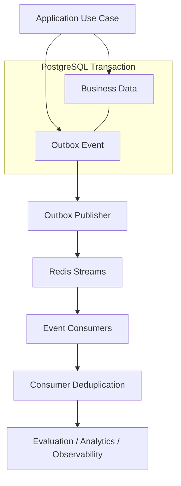

# ADR-0005: Transactional Outbox and Event Delivery

- **Status:** Proposed
- **Date:** 2026-11-03
- **Project:** `llm-gateway`
- **Related ADRs:** ADR-0001, ADR-0002, ADR-0003, ADR-0004

## 1. Context

The LLM Gateway performs business operations that must produce corresponding events.

Examples include:

- Inference execution created.
- Budget reservation completed.
- Usage settlement completed.
- Financial ledger entry created.
- Provider attempt completed.
- API key created or revoked.
- Policy updated.
- Evaluation requested.
- Audit event recorded.

These events support:

- Observability.
- Cost analytics.
- Evaluation.
- Usage reporting.
- Audit processing.
- Asynchronous workflows.
- Operational monitoring.

A direct database write followed by event publication introduces a dual-write problem.

For example:

```text
1. PostgreSQL transaction commits.
2. Gateway attempts to publish an event.
3. Event broker becomes unavailable.
4. Business data exists, but the event is lost.
```

Reversing the order is also unsafe:

```text
1. Event is published.
2. PostgreSQL transaction fails.
3. Consumers receive an event for a transaction that never committed.
```

The system needs a durable mechanism that connects database transactions with asynchronous event delivery.

## 2. Decision Drivers

The event architecture must:

1. Prevent lost events after committed business transactions.
2. Avoid publishing events for rolled-back transactions.
3. Support retries.
4. Support duplicate delivery.
5. Support idempotent consumers.
6. Preserve event identity and traceability.
7. Support asynchronous processing.
8. Avoid coupling business operations to broker availability.
9. Provide operational visibility.
10. Support a future transition to a dedicated message broker.

## 3. Considered Options

### Option A: Direct event publication

The application writes to PostgreSQL and publishes directly to the event broker.

Advantages:
- Simple implementation.
- Low initial complexity.
- No outbox polling.

Disadvantages:
- Dual-write failure window.
- Events can be lost.
- Business transactions become coupled to broker availability.

### Option B: Database polling without an outbox

Consumers periodically query business tables for changes.

Advantages:
- No separate event table.
- Can work for simple workflows.

Disadvantages:
- Polling business tables is inefficient.
- Event intent is implicit.
- Difficult to represent multiple event types.
- Consumers become coupled to database structure.

### Option C: Transactional Outbox

Business data and an event record are committed in one database transaction.

A separate publisher delivers committed events.

Advantages:
- Atomic business update and event creation.
- Recoverable publication.
- Explicit event contracts.
- Broker independence.
- Supports idempotent processing.

Disadvantages:
- Additional table and publisher.
- Event delivery is asynchronous.
- Duplicate publication must be handled.
- Requires cleanup and monitoring.

## 4. Decision

Adopt the **Transactional Outbox Pattern**.

PostgreSQL is the authoritative store for pending event publication.

The initial implementation will use PostgreSQL outbox records and Redis Streams as the event transport.

The architecture must keep the event publisher independent of the specific transport so Redis Streams can later be replaced with Kafka or another broker.

**Delivery guarantee:** at-least-once publication, with idempotent consumer processing.

The system will not claim exactly-once event delivery.

## 5. Architecture



## 6. Transactional Write Flow

Every business operation that requires durable asynchronous event delivery must write the business change and outbox event in the same PostgreSQL transaction.

Example:

```sql
BEGIN;

UPDATE accounting.budget_reservations
SET status = 'settled',
    settled_at = NOW()
WHERE id = $1;

INSERT INTO accounting.financial_ledger_entries (
    id,
    reservation_id,
    amount,
    currency,
    created_at
)
VALUES ($2, $1, $3, $4, NOW());

INSERT INTO events.outbox_events (
    id,
    event_type,
    aggregate_type,
    aggregate_id,
    payload,
    status,
    created_at
)
VALUES (
    $5,
    'BudgetSettled',
    'BudgetReservation',
    $1,
    $6,
    'pending',
    NOW()
);

COMMIT;
```

The actual implementation must validate affected row counts, enforce idempotency, and ensure all related accounting operations are consistent.

If any required write fails, the entire transaction rolls back.

## 7. Outbox Event Schema

Initial logical schema:

```sql
CREATE TABLE events.outbox_events (
    id UUID PRIMARY KEY,

    event_type TEXT NOT NULL,
    event_version INTEGER NOT NULL DEFAULT 1,

    aggregate_type TEXT NOT NULL,
    aggregate_id UUID NOT NULL,

    tenant_id UUID,
    project_id UUID,

    payload JSONB NOT NULL,
    metadata JSONB NOT NULL DEFAULT '{}',

    status TEXT NOT NULL DEFAULT 'pending',

    created_at TIMESTAMPTZ NOT NULL DEFAULT NOW(),
    published_at TIMESTAMPTZ,

    attempt_count INTEGER NOT NULL DEFAULT 0,
    next_attempt_at TIMESTAMPTZ,

    locked_by TEXT,
    locked_until TIMESTAMPTZ,

    last_error_code TEXT
);
```

Recommended indexes:

```sql
CREATE INDEX idx_outbox_pending
ON events.outbox_events (created_at)
WHERE status = 'pending';

CREATE INDEX idx_outbox_retry
ON events.outbox_events (next_attempt_at)
WHERE status = 'retry';

CREATE INDEX idx_outbox_aggregate
ON events.outbox_events (
    aggregate_type,
    aggregate_id,
    created_at
);
```

The final schema must also enforce valid states and safe publisher ownership.

Do not store secrets, unrestricted prompts, or unnecessary sensitive data in event payloads.

## 8. Event Envelope

All published events must use a versioned envelope.

Example:

```json
{
  "event_id": "uuid",
  "event_type": "InferenceCompleted",
  "event_version": 1,
  "occurred_at": "2026-11-03T15:30:00Z",
  "tenant_id": "uuid",
  "project_id": "uuid",
  "aggregate": {
    "type": "InferenceExecution",
    "id": "uuid"
  },
  "correlation_id": "uuid",
  "causation_id": "uuid",
  "trace_id": "trace-id",
  "payload": {
    "execution_id": "uuid",
    "provider_id": "provider-id",
    "model_id": "model-id",
    "status": "completed"
  }
}
```

Required fields:

- Unique event ID.
- Event type.
- Event version.
- Occurrence timestamp.
- Aggregate identity.
- Correlation identity.
- Trace context where available.
- Versioned payload.

Consumers must not assume that event payloads remain identical across versions.

## 9. Event Categories

Initial event catalog:

| Category | Events |
|---|---|
| Identity | `ApiKeyCreated`, `ApiKeyRevoked` |
| Tenant | `TenantCreated`, `ProjectCreated` |
| Policy | `PolicyUpdated` |
| Inference | `InferenceAdmitted`, `InferenceStarted`, `InferenceCompleted`, `InferenceFailed` |
| Provider | `ProviderAttemptStarted`, `ProviderAttemptFailed`, `ProviderAttemptCompleted` |
| Routing | `RoutingDecisionMade`, `ModelFallbackSelected` |
| Accounting | `BudgetReserved`, `BudgetSettled`, `UsageRecorded`, `LedgerEntryCreated` |
| Cache | `CacheEntryCreated`, `CacheEntryInvalidated` |
| Evaluation | `EvaluationRequested`, `EvaluationCompleted` |
| Audit | Security-relevant audit events |

Not every domain event must be published externally.

Use integration events for cross-component communication. Keep internal domain events internal when external consumers do not need them.

## 10. Publisher Lifecycle

The publisher is responsible for:

1. Finding pending events.
2. Claiming events atomically.
3. Publishing to the configured transport.
4. Recording successful publication.
5. Scheduling retry after failure.
6. Recovering expired claims.
7. Recording publication errors.
8. Applying bounded retry and dead-letter policies.

Multiple publisher instances may run concurrently.

Use PostgreSQL row claiming with `FOR UPDATE SKIP LOCKED` to distribute work.

Conceptual query:

```sql
WITH claimed AS (
    SELECT id
    FROM events.outbox_events
    WHERE status IN ('pending', 'retry')
      AND (
          next_attempt_at IS NULL
          OR next_attempt_at <= NOW()
      )
      AND (
          locked_until IS NULL
          OR locked_until < NOW()
      )
    ORDER BY created_at
    FOR UPDATE SKIP LOCKED
    LIMIT 100
)
UPDATE events.outbox_events AS event
SET status = 'publishing',
    locked_by = $1,
    locked_until = NOW() + INTERVAL '30 seconds',
    attempt_count = attempt_count + 1
FROM claimed
WHERE event.id = claimed.id
RETURNING event.*;
```

Use a transaction for claiming.

Do not hold a database transaction open while waiting for a remote broker response.

After successful publication, mark the event as published only if the publisher still owns the claim.

If the publisher crashes after broker publication but before recording success, the event may be published again. This is expected under at-least-once delivery.

## 11. Retry and Dead-Letter Policy

Publication failures must be classified.

Retryable examples:

- Temporary Redis outage.
- Network interruption.
- Broker timeout.
- Temporary capacity exhaustion.

Non-retryable or operator-review examples:

- Invalid event envelope.
- Unsupported event version.
- Serialization failure.
- Invalid routing configuration.

Use:

- Exponential backoff.
- Jitter.
- Maximum retry count.
- Maximum event age.
- Dead-letter or failed-event state.
- Operator inspection and controlled replay.

Never silently discard a failed financial or audit-related event.

The original business record remains authoritative even when publication fails.

## 12. Consumer Idempotency

Every consumer must assume duplicate delivery.

Maintain a processed-event record or equivalent idempotency mechanism.

Example:

```sql
CREATE TABLE events.processed_events (
    consumer_name TEXT NOT NULL,
    event_id UUID NOT NULL,
    processed_at TIMESTAMPTZ NOT NULL DEFAULT NOW(),

    PRIMARY KEY (consumer_name, event_id)
);
```

Consumer processing pattern:

```text
BEGIN TRANSACTION

1. Check whether event was already processed.
2. If processed, acknowledge duplicate.
3. Apply consumer-side business update.
4. Record event ID as processed.

COMMIT

5. Acknowledge event to transport.
```

The processed-event record and consumer-side database update must be in the same transaction when they share a database.

For external side effects, use the downstream system's idempotency mechanism or another durable workflow.

## 13. Redis Streams Integration

Use Redis Streams as the initial event transport.

Expected features:

- Consumer groups.
- Pending-entry tracking.
- Acknowledgment.
- Claiming abandoned messages.
- Consumer recovery.

Suggested stream names:

```text
llm-gateway:events:inference
llm-gateway:events:accounting
llm-gateway:events:evaluation
llm-gateway:events:audit
```

Stream partitioning must preserve the ordering requirements of each event category.

Do not assume global ordering across streams.

Where aggregate ordering is required, define an aggregate sequence number or another explicit ordering mechanism.

Redis Streams are transport, not the durable source of truth.

The PostgreSQL outbox must retain unpublished events until successful publication and configured retention requirements are satisfied.

## 14. Event Consumers

Initial consumers:

| Consumer | Responsibility |
|---|---|
| Evaluation consumer | Schedule asynchronous quality evaluation |
| Observability consumer | Process enriched telemetry events |
| Analytics consumer | Build usage and routing analytics |
| Audit consumer | Process approved security audit integrations |

Financial ledger writes should remain part of the originating authoritative database transaction. Do not defer authoritative financial accounting to an asynchronous consumer.

## 15. Ordering and Consistency

The system guarantees:

- Business update and outbox creation are atomic.
- Publication is at least once.
- Consumer processing is idempotent.
- No global ordering guarantee is assumed.

Where ordering is required:

- Use aggregate identity.
- Assign a monotonically increasing aggregate sequence.
- Publish related events consistently.
- Reject or defer stale sequence numbers where appropriate.

Consumers must tolerate delayed delivery and duplicate events.

## 16. Observability

Required metrics:

- Outbox pending event count.
- Oldest unpublished event age.
- Publication throughput.
- Publication failures.
- Retry count.
- Dead-letter count.
- Publisher claim expiry.
- Consumer lag.
- Duplicate event count.
- Consumer processing latency.

Alerts should cover:

- Growing outbox backlog.
- Oldest event exceeding the publication SLO.
- Repeated publication failure.
- Dead-letter growth.
- Consumer lag.
- Redis Streams availability.

Event payloads must be redacted before logging.

## 17. Security

Requirements:

- Validate event payloads.
- Restrict publisher and consumer database permissions.
- Restrict stream access through Redis ACLs.
- Include tenant identity only where needed.
- Do not publish raw API keys or provider credentials.
- Avoid unnecessary prompt and response content.
- Protect audit-related event records from unauthorized modification.
- Validate event version and schema before processing.
- Prevent replay from causing duplicate side effects.

## 18. Rust Implementation

Suggested structure:

```text
crates/infrastructure/src/events/
├── mod.rs
├── outbox_repository.rs
├── outbox_publisher.rs
├── event_envelope.rs
├── redis_streams.rs
├── retry_policy.rs
└── consumers/
    ├── evaluation.rs
    ├── analytics.rs
    └── observability.rs
```

Application-owned port:

```rust
#[async_trait::async_trait]
pub trait EventPublisher: Send + Sync {
    async fn publish(
        &self,
        event: IntegrationEvent,
    ) -> Result<(), EventPublishError>;
}
```

The outbox publisher should be an infrastructure/background component.

Business use cases write the outbox event as part of their transaction; they must not depend on successful broker delivery to report a committed transaction.

## 19. Testing Requirements

### Transaction tests

- Business update and outbox event commit together.
- Rollback removes both.
- Duplicate event creation is prevented where required.

### Publisher tests

- Multiple publishers claim different events.
- Publisher crashes after claiming.
- Publisher crashes after publication but before status update.
- Expired claims are recovered.
- Retry schedule is respected.
- Dead-letter behavior is observable.

### Consumer tests

- Duplicate delivery.
- Consumer crash before commit.
- Consumer crash after commit but before acknowledgment.
- Event version compatibility.
- Out-of-order events.
- Idempotent external side effects.

### Failure tests

- Redis outage.
- Network partition.
- PostgreSQL outage.
- Stream trimming or loss.
- Consumer lag and recovery.

## 20. Consequences

### Positive

- Durable event intent.
- Reduced dual-write risk.
- Broker-independent application workflows.
- Recoverable publication.
- Idempotent consumer processing.
- Clear separation of synchronous inference and asynchronous processing.

### Negative

- Additional database writes.
- Publisher and consumer lifecycle management.
- Event schema evolution.
- Duplicate delivery handling.
- Event backlog monitoring and retention management.

### Risks and Mitigations

| Risk | Mitigation |
|---|---|
| Lost event after transaction commit | Transactional outbox |
| Duplicate publication | Idempotent consumers |
| Publisher crash | Claim leases and recovery |
| Consumer crash | Pending-entry recovery |
| Event schema incompatibility | Versioned envelopes |
| Financial inconsistency | Keep ledger writes synchronous and authoritative |
| Growing backlog | Backlog monitoring and alerts |
| Sensitive data exposure | Minimal payloads and redaction |

## 21. Validation Criteria

ADR-0005 is validated when:

- Business updates and outbox events are committed atomically.
- Multiple publishers can operate safely.
- Publication retries are bounded and observable.
- Consumers process duplicate events idempotently.
- Publisher crashes do not permanently lose pending events.
- Event schemas are versioned.
- Redis Streams can be replaced without changing business use cases.
- Financial accounting remains authoritative in PostgreSQL.
- Outbox backlog and consumer lag are observable.

## 22. Related ADRs

- ADR-0001: Clean Architecture and Dependency Direction
- ADR-0002: Rust Workspace Structure and Crate Boundaries
- ADR-0003: PostgreSQL as the Authoritative Data Store
- ADR-0004: Redis for Distributed Coordination and Caching
- ADR-0017: OpenTelemetry Observability Architecture
- ADR-0018: Asynchronous Evaluation Architecture
- ADR-0026: Financial Data Retention and Auditability
