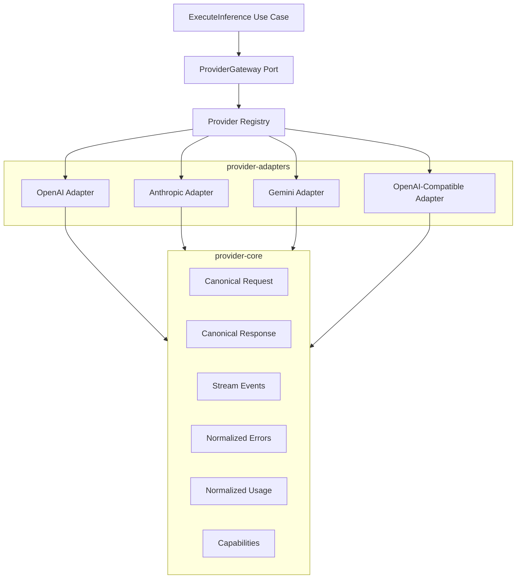

# ADR-0006: Canonical Provider Adapter Interface

- **Status:** Proposed
- **Date:** 2026-11-03
- **Project:** `llm-gateway`
- **Related ADRs:** ADR-0001, ADR-0002, ADR-0005

## 1. Context

The gateway must integrate multiple LLM providers without coupling application workflows to vendor-specific APIs.

Providers differ in:

- Authentication mechanisms.
- Request and response schemas.
- Model naming conventions.
- Supported capabilities.
- Token usage reporting.
- Pricing structures.
- Error formats.
- Rate-limit behavior.
- Streaming protocols.
- Tool-calling semantics.
- Multimodal support.

Directly integrating each provider into application use cases would create tight coupling and make routing, fallback, testing, and cost accounting difficult to maintain.

The gateway needs a canonical provider abstraction that normalizes provider-specific behavior while preserving capabilities that cannot be represented identically across providers.

## 2. Decision Drivers

The provider integration architecture must:

1. Support multiple commercial and self-hosted providers.
2. Expose a consistent application-facing contract.
3. Normalize provider errors.
4. Normalize token usage.
5. Support streaming.
6. Preserve provider-specific capability differences.
7. Support cancellation and deadlines.
8. Support retries and fallback through a separate reliability component.
9. Protect provider credentials.
10. Enable mock-provider testing.
11. Avoid vendor SDK dependencies in the domain layer.
12. Support provider and model version evolution.

## 3. Considered Options

### Option A: Direct provider SDK integration

Each application use case integrates directly with vendor SDKs.

Advantages:
- Simple initial implementation.
- Full access to provider-specific features.
- Minimal abstraction.

Disadvantages:
- Vendor lock-in.
- Duplicated request handling.
- Inconsistent error processing.
- Difficult provider replacement.
- Application code becomes provider-dependent.

### Option B: OpenAI-compatible API only

Use one common API format across providers.

Advantages:
- Simpler adapter implementation.
- Familiar request and response structures.
- Convenient for compatible local models.

Disadvantages:
- Not all providers implement the same semantics.
- Native provider capabilities may be lost.
- Streaming and tool calling may differ.
- Compatibility does not guarantee identical behavior.

### Option C: Canonical provider adapter interface

Define provider-neutral contracts and implement adapters for each provider.

Advantages:
- Provider independence.
- Consistent error handling.
- Unified usage normalization.
- Easier testing.
- Supports native and compatible providers.

Disadvantages:
- Requires careful canonical type design.
- Some provider-specific features need extensions.
- Normalization can hide important differences if poorly designed.

## 4. Decision

Adopt a **canonical provider adapter interface**.

The provider abstraction will be divided into:

1. `provider-core`: canonical request, response, usage, error, and streaming contracts.
2. `gateway-core`: application-owned `ProviderGateway` port.
3. `provider-adapters`: concrete provider implementations.

Provider adapters translate between canonical contracts and vendor-specific APIs.

The application layer owns routing, authorization, budget enforcement, retry decisions, and fallback policy.

Provider adapters must not own those business decisions.

## 5. Architecture



## 6. Supported Provider Categories

### 6.1 Commercial providers

Initial candidates:

- OpenAI.
- Anthropic.
- Google Gemini.

Each adapter must use the provider's supported native API where necessary.

### 6.2 OpenAI-compatible providers

Initial candidates:

- vLLM.
- Ollama.
- LocalAI.
- Other compatible endpoints.

Compatibility must be validated rather than assumed.

### 6.3 Custom providers

The architecture must allow additional adapters without changing application use cases.

## 7. Canonical Provider Contracts

### 7.1 Provider Identity

Provider identity is distinct from model identity.

Example:

```rust
pub struct ProviderId(pub uuid::Uuid);

pub struct ModelId(pub uuid::Uuid);

pub struct ProviderModelName(pub String);
```

A public gateway model identifier may map to a provider-specific model name.

Do not expose provider credentials or internal endpoint configuration in public model responses.

### 7.2 Provider Request

The canonical request should contain:

- Execution ID.
- Provider attempt ID.
- Provider model name.
- Normalized messages.
- Generation parameters.
- Response format.
- Tool definitions.
- Streaming preference.
- Timeout/deadline information.
- Request metadata required by the provider.

Example:

```rust
pub struct ProviderRequest {
    pub execution_id: uuid::Uuid,
    pub attempt_id: uuid::Uuid,
    pub model: String,
    pub messages: Vec<ProviderMessage>,
    pub parameters: GenerationParameters,
    pub tools: Vec<ProviderTool>,
    pub response_format: Option<ResponseFormat>,
    pub stream: bool,
}
```

Use typed content parts to support text and multimodal extensions.

Do not assume every provider supports every canonical field.

### 7.3 Provider Response

A normalized response should contain:

- Provider ID.
- Provider model name.
- Generated content.
- Finish reason.
- Usage.
- Provider request ID, where available.
- Provider metadata that is safe to retain.

Example:

```rust
pub struct ProviderResponse {
    pub provider_request_id: Option<String>,
    pub model: String,
    pub content: Vec<ProviderContent>,
    pub finish_reason: FinishReason,
    pub usage: Option<ProviderUsage>,
}
```

Provider-specific raw response bodies must not be returned directly to clients.

### 7.4 Usage Normalization

Normalize:

- Input tokens.
- Output tokens.
- Total tokens.
- Cached input tokens.
- Reasoning tokens where reported.
- Image/audio usage where supported.
- Usage source.

Example:

```rust
pub enum UsageSource {
    ProviderReported,
    GatewayEstimated,
    Reconciled,
}
```

The adapter extracts provider-reported usage.

The accounting domain owns cost calculation.

Missing usage must not silently become zero.

### 7.5 Finish Reasons

Define canonical finish reasons:

```rust
pub enum FinishReason {
    Stop,
    Length,
    ToolCalls,
    ContentFiltered,
    ProviderSpecific(String),
    Unknown,
}
```

Preserve meaningful provider-specific information when normalization would otherwise lose it.

## 8. Streaming Contract

Streaming must use a normalized event model.

Initial event types:

```rust
pub enum ProviderStreamEvent {
    MessageStart,
    ContentDelta(String),
    ToolCallDelta(ToolCallDelta),
    MessageEnd(FinishReason),
    Usage(ProviderUsage),
    Error(ProviderError),
}
```

The adapter must support:

- Incremental content delivery.
- Tool-call fragments.
- Usage reporting where available.
- Provider errors during streaming.
- Cancellation.
- Connection closure.
- Idle timeout.
- Partial output tracking.

The gateway translates canonical events into its public SSE contract.

### Streaming fallback rule

Before any output has been delivered to the client, a retry or fallback may be considered if policy permits.

After output has been delivered, the gateway must not transparently restart generation on another provider because that could duplicate or contradict user-visible output.

## 9. Error Normalization

Provider-specific failures must map to a canonical taxonomy.

| Error | Meaning |
|---|---|
| Authentication | Provider credentials invalid |
| Authorization | Provider access denied |
| RateLimited | Provider quota exceeded |
| InvalidRequest | Provider rejected request |
| ContextExceeded | Model context limit exceeded |
| ModelUnavailable | Model unavailable |
| Timeout | Provider deadline exceeded |
| Connection | Network or connection failure |
| ServerError | Provider server failure |
| ContentFiltered | Provider safety filtering |
| Cancelled | Execution cancelled |
| Unknown | Unclassified provider failure |

The normalized error must preserve:

- Retryability classification.
- Provider request ID.
- HTTP status, when available.
- Retry-After, when available.
- Safe diagnostic metadata.

Retry and fallback decisions belong to the reliability engine, not the adapter.

Never expose raw provider response bodies or credential information to API clients.

## 10. Provider Capabilities

The provider registry must describe model-level capabilities.

Initial capability dimensions:

- Text input.
- Text output.
- Streaming.
- Tool calling.
- Structured output.
- JSON mode.
- Vision.
- Audio input.
- Audio output.
- Embeddings.
- Context window.
- Maximum output tokens.

Capabilities must be represented at the model level because models offered by one provider may differ.

An adapter must not advertise a capability solely because the provider supports it in another model.

## 11. Authentication and Secret Management

Provider credentials must be resolved through the secret-management abstraction.

Rules:

- No provider API keys in source code.
- No provider API keys in ordinary model registry records.
- No secrets in logs or traces.
- No secrets in error messages.
- Support credential rotation.
- Resolve secrets only when needed.
- Restrict provider endpoint configuration.
- Validate TLS and outbound network destinations.

Provider adapters receive a short-lived or appropriately scoped credential value from infrastructure.

They must not manage tenant virtual API keys.

## 12. Provider Configuration

Provider configuration should be separate from model capability and pricing configuration.

Example:

```yaml
providers:
  openai:
    enabled: true
    type: commercial
    endpoint: https://api.openai.com
    credential_ref: secrets/providers/openai

  anthropic:
    enabled: true
    type: commercial
    endpoint: https://api.anthropic.com
    credential_ref: secrets/providers/anthropic

  local-vllm:
    enabled: false
    type: openai-compatible
    endpoint: http://vllm:8000
    credential_ref: null
```

This is an illustrative configuration shape.

Production endpoint validation must prevent SSRF and unauthorized network access.

Do not store provider secrets in this configuration.

## 13. Application Interface

`gateway-core` owns the application-facing port.

Example:

```rust
#[async_trait::async_trait]
pub trait ProviderGateway: Send + Sync {
    async fn execute(
        &self,
        request: ProviderRequest,
    ) -> Result<ProviderResponse, ProviderError>;

    async fn execute_stream(
        &self,
        request: ProviderRequest,
    ) -> Result<
        Box<dyn futures::Stream<Item = ProviderStreamEvent> + Send + Unpin>,
        ProviderError,
    >;

    async fn health_check(
        &self,
    ) -> Result<ProviderHealth, ProviderError>;
}
```

The exact streaming return type may be adjusted during implementation to support cancellation and pinned streams cleanly.

The port should remain independent of Reqwest and vendor SDK types.

## 14. Provider Registry

The registry maps provider and model identities to their configured adapter and model metadata.

Responsibilities:

- Provider registration.
- Model-to-provider mapping.
- Adapter selection.
- Enable/disable state.
- Configuration version.
- Capability lookup.
- Provider endpoint metadata.

The registry must not decide which model is best for a particular inference request. That decision belongs to the routing engine.

## 15. Reliability Integration

Provider adapters normalize errors and expose execution outcomes.

The reliability engine owns:

- Retry policy.
- Circuit breaker.
- Provider health decisions.
- Fallback selection.
- Deadline management.
- Attempt limits.
- Backoff and jitter.
- Unknown execution outcome handling.

Adapters must not implement independent retry loops that conflict with gateway-level reliability policy.

Use shared HTTP connection pools and explicit request deadlines.

## 16. Rust Implementation

Suggested structure:

```text
crates/
├── provider-core/
│   └── src/
│       ├── lib.rs
│       ├── request.rs
│       ├── response.rs
│       ├── content.rs
│       ├── streaming.rs
│       ├── usage.rs
│       ├── errors.rs
│       └── capabilities.rs
│
└── provider-adapters/
    └── src/
        ├── lib.rs
        ├── registry.rs
        ├── openai/
        ├── anthropic/
        ├── gemini/
        └── openai_compatible/
```

Potential dependencies:

- `reqwest`
- `tokio`
- `serde`
- `serde_json`
- `futures`
- `async-trait`
- `rustls`
- `tracing`

Avoid introducing provider SDK dependencies into `domain` or `gateway-core`.

## 17. Testing Requirements

### Contract tests

Every adapter must pass the same canonical contract suite.

Test:

- Request mapping.
- Response mapping.
- Error normalization.
- Usage extraction.
- Capability mapping.
- Streaming event normalization.
- Cancellation.
- Timeout behavior.

### Provider-specific tests

Use mock HTTP servers and recorded sanitized fixtures.

Test:

- Authentication headers.
- Endpoint construction.
- Request serialization.
- Response parsing.
- Rate-limit responses.
- Provider server failures.
- Malformed responses.
- Partial streaming responses.

### Integration tests

- Mock provider execution through the gateway.
- Multiple providers with identical public API requests.
- Provider outage and fallback.
- Provider credential rotation.
- Provider model disablement.

Live-provider tests must be opt-in and must not run in ordinary CI without explicit credentials and spending limits.

## 18. Observability

Every provider attempt should expose:

- Provider ID.
- Model ID.
- Attempt ID.
- Provider request ID where available.
- Time to first token.
- Total latency.
- Input and output tokens.
- Usage source.
- Error category.
- Retry count.
- HTTP status where available.

Never expose provider credentials or unredacted sensitive content.

## 19. Consequences

### Positive

- Provider independence.
- Consistent application behavior.
- Easier routing and fallback.
- Reusable provider contract tests.
- Easier addition of local and commercial models.

### Negative

- More normalization code.
- Canonical contracts require versioning.
- Some provider-specific features require extensions.
- Adapter maintenance is necessary as APIs evolve.

### Risks and Mitigations

| Risk | Mitigation |
|---|---|
| Loss of provider-specific capability | Typed extensions and explicit capability metadata |
| Incorrect usage normalization | Adapter contract tests and usage-source tracking |
| Provider API changes | Versioned fixtures and integration tests |
| Credential leakage | Secret abstraction and redaction |
| Conflicting retry behavior | Central reliability engine |
| Streaming incompatibility | Explicit canonical event contract |

## 20. Validation Criteria

ADR-0006 is validated when:

- At least two different provider adapters implement the canonical contract.
- Application use cases do not import vendor SDK types.
- Provider errors are normalized.
- Usage is normalized without inventing missing values.
- Streaming works through the canonical event interface.
- Provider cancellation and deadlines are supported.
- Provider secrets are resolved through the secret-management abstraction.
- Contract tests run for every adapter.
- Reliability decisions remain outside provider adapters.

## 21. Related ADRs

- ADR-0001: Clean Architecture and Dependency Direction
- ADR-0002: Rust Workspace Structure and Crate Boundaries
- ADR-0007: Model Registry and Capability Representation
- ADR-0008: Constraint-Based Model Routing
- ADR-0013: Provider Retry and Circuit Breaker Strategy
- ADR-0014: Streaming and Provider Fallback Semantics
- ADR-0021: Provider Secret Management
