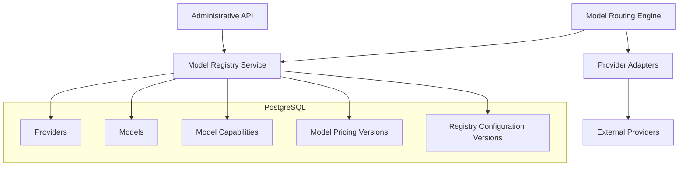
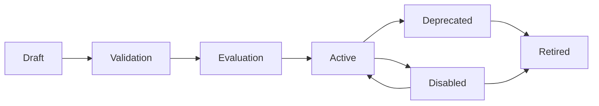

# ADR-0007: Model Registry and Capability Representation

- **Status:** Proposed
- **Date:** 2026-11-03
- **Project:** `llm-gateway`
- **Related ADRs:** ADR-0003, ADR-0006

## 1. Context

The LLM Gateway supports multiple providers, each exposing different models and capabilities.

The gateway must maintain a central model registry that describes:

- Provider identity.
- Public gateway model identifiers.
- Provider-specific model identifiers.
- Model capabilities.
- Context limits.
- Output limits.
- Pricing.
- Availability.
- Deprecation status.
- Configuration versions.

Applications should use gateway model identifiers rather than hardcoding provider-specific model names.

The routing engine needs trustworthy model metadata to determine which models are eligible for a request.

Without a central registry, model configuration would become duplicated across application code, provider adapters, routing rules, and deployment configuration.

## 2. Decision Drivers

The registry must:

1. Separate public model IDs from provider model IDs.
2. Support multiple providers.
3. Represent model capabilities explicitly.
4. Support model versioning.
5. Maintain historical pricing.
6. Support model availability and deprecation.
7. Provide reliable routing metadata.
8. Support administrative configuration.
9. Prevent unsupported capability assumptions.
10. Avoid coupling registry data to provider SDKs.
11. Support local and self-hosted models.
12. Maintain auditable configuration changes.

## 3. Considered Options

### Option A: Hardcoded model configuration

Store model definitions in source code or static YAML.

Advantages:
- Simple initial setup.
- Easy to review.
- No registry database required.

Disadvantages:
- Requires deployments for configuration changes.
- Pricing updates become operationally difficult.
- Historical pricing is difficult to preserve.
- Administrative management is limited.

### Option B: Provider-specific model discovery

Query provider APIs dynamically to discover models and capabilities.

Advantages:
- Can reflect provider availability.
- Reduces manual model registration.

Disadvantages:
- Providers expose inconsistent metadata.
- Capability information may be incomplete.
- Pricing is not consistently available.
- Runtime discovery adds dependency and latency.
- Provider model listings do not necessarily imply gateway eligibility.

### Option C: Centralized Model Registry

Maintain normalized model metadata in PostgreSQL and use provider discovery as an optional synchronization mechanism.

Advantages:
- Consistent routing metadata.
- Versioned pricing.
- Explicit capabilities.
- Administrative control.
- Historical configuration.
- Provider independence.

Disadvantages:
- Requires registry maintenance.
- Metadata can become stale.
- Capability and pricing changes need governance.

## 4. Decision

Adopt a **centralized Model Registry backed by PostgreSQL**.

The registry is the authoritative source for:

- Provider registration.
- Model registration.
- Public gateway model identifiers.
- Provider model identifiers.
- Capability declarations.
- Context and output limits.
- Model lifecycle state.
- Pricing versions.
- Routing eligibility metadata.

Provider discovery may assist registration and synchronization, but discovered metadata must be validated before becoming active.

Redis may cache registry reads, but PostgreSQL remains authoritative.

## 5. Architecture



## 6. Provider and Model Identity

Provider identity and model identity must remain separate.

Example:

| Field | Example |
|---|---|
| Gateway model ID | `fast-text` |
| Provider ID | `openai` |
| Provider model name | Provider-specific model identifier |
| Model version | Registry-controlled version |
| Model status | Active |

A gateway model ID is a stable public identifier.

The underlying provider model can change only through a controlled configuration change with versioning, audit history, and appropriate evaluation.

The gateway must not silently change the meaning of a public model identifier.

## 7. Provider Registry

A provider record describes an integration endpoint.

Suggested fields:

| Field | Description |
|---|---|
| `id` | Internal provider UUID |
| `provider_key` | Stable unique identifier |
| `display_name` | Administrative display name |
| `provider_type` | Commercial, compatible, or self-hosted |
| `endpoint_ref` | Approved endpoint configuration reference |
| `credential_ref` | Secret-manager reference |
| `enabled` | Administrative enablement |
| `region` | Provider deployment region |
| `configuration_version` | Configuration version |
| `created_at` | Creation timestamp |
| `updated_at` | Last update timestamp |

Credentials must never be stored directly in registry records.

## 8. Model Registry

Suggested fields:

| Field | Description |
|---|---|
| `id` | Internal model UUID |
| `public_model_id` | Gateway-facing identifier |
| `provider_id` | Provider relationship |
| `provider_model_name` | Provider-specific identifier |
| `model_version` | Registry version |
| `display_name` | Human-readable name |
| `model_family` | Text, reasoning, embedding, multimodal |
| `context_window` | Maximum supported context |
| `max_output_tokens` | Maximum generation output |
| `status` | Model lifecycle status |
| `enabled` | Routing availability |
| `created_at` | Creation timestamp |
| `updated_at` | Last update timestamp |

Suggested model states:

- Draft.
- Active.
- Disabled.
- Deprecated.
- Retired.

Only eligible active models may be selected for new inference requests.

## 9. Capability Representation

Capabilities must be represented explicitly.

Initial capability dimensions:

| Capability | Type | Meaning |
|---|---|---|
| Text input | Boolean | Accepts text input |
| Text output | Boolean | Generates text |
| Streaming | Boolean | Supports streaming output |
| Tool calling | Boolean | Supports tool/function calls |
| Structured output | Boolean | Supports constrained structured output |
| JSON mode | Boolean | Supports JSON response mode |
| Vision | Boolean | Supports image input |
| Audio input | Boolean | Accepts audio |
| Audio output | Boolean | Generates audio |
| Embeddings | Boolean | Generates embeddings |
| Batch inference | Boolean | Supports batch execution |

Additional metadata may include:

- Supported content types.
- Supported tool-call formats.
- Maximum image dimensions.
- Audio input formats.
- Embedding dimensions.
- Context limits.
- Maximum output tokens.

A model must not advertise a capability merely because its provider supports that capability on another model.

Capability declarations must be validated through provider documentation, integration tests, or controlled experiments.

### Capability matching

The router must reject a model if it does not satisfy a mandatory request capability.

For example:

```text
Request:
- text input
- vision input
- streaming output

Model A:
- text input: yes
- vision input: no
- streaming: yes

Result: Model A is ineligible.
```

Capability eligibility is a hard constraint, not a ranking preference.

## 10. Pricing Registry

Pricing must be independently versioned from model identity.

A pricing record should include:

- Model ID.
- Input token price.
- Output token price.
- Cached input token price, where applicable.
- Image/audio pricing, where applicable.
- Currency.
- Pricing unit.
- Effective start timestamp.
- Effective end timestamp.
- Pricing source.
- Pricing version.
- Verification timestamp.

Use PostgreSQL `NUMERIC` for monetary values.

Example:

```text id="3p3z2x"
Model: fast-text
Pricing version: 3
Input price: configured amount / 1M tokens
Output price: configured amount / 1M tokens
Currency: USD
Effective from: configured timestamp
```

The example intentionally does not assert current vendor prices.

Every inference execution must preserve the pricing version used for its cost calculation.

Historical usage must not be recalculated using today's pricing unless a separately identified reconciliation process requires it.

Unknown pricing must never be interpreted as zero.

## 11. Model Lifecycle and Governance

Model registration follows a controlled lifecycle:



Activation requirements:

1. Provider configuration validated.
2. Provider connectivity tested.
3. Capabilities verified.
4. Pricing configured.
5. Security and residency policies checked.
6. Evaluation completed where required.
7. Administrative approval recorded.

A deprecated model must have a migration or retirement plan.

## 12. Registry Versioning

Configuration changes must be auditable.

Version relevant registry records when changing:

- Provider endpoint.
- Provider model mapping.
- Capabilities.
- Context limits.
- Output limits.
- Pricing.
- Model availability.
- Routing eligibility.

Every routing decision should preserve enough metadata to reconstruct the decision later:

- Model registry version.
- Model version.
- Pricing version.
- Policy version.
- Routing configuration version.

Use immutable historical versions for pricing and important configuration changes.

## 13. Registry Query Interface

`gateway-core` should access model metadata through an application-owned interface.

Example:

```rust id="p1e5aa"
#[async_trait::async_trait]
pub trait ModelRegistry: Send + Sync {
    async fn get_model(
        &self,
        model_id: &ModelId,
    ) -> Result<Option<ModelDefinition>, RegistryError>;

    async fn list_eligible_models(
        &self,
        query: ModelRegistryQuery,
    ) -> Result<Vec<ModelDefinition>, RegistryError>;
}
```

The implementation may use PostgreSQL and a short-lived Redis cache.

The routing engine must not query provider APIs directly to determine model eligibility.

## 14. Administrative Operations

The registry should support:

- Register provider.
- Update provider configuration.
- Enable or disable provider.
- Register model.
- Update model metadata.
- Update capabilities.
- Add pricing version.
- Deprecate model.
- Retire model.
- Validate provider connectivity.
- Review configuration history.

Every administrative mutation must be authorized and audited.

Pricing changes require explicit permission.

## 15. Database Design

Suggested PostgreSQL tables:

```text id="nd65cp"
registry.providers
registry.provider_versions
registry.models
registry.model_capabilities
registry.model_pricing
registry.model_versions
registry.model_status_history
```

Important constraints:

- Unique public model identifier.
- Unique provider/model mapping within the appropriate version scope.
- Foreign keys for provider ownership.
- Non-negative pricing.
- Valid pricing effective intervals.
- No overlapping active pricing intervals for the same pricing scope unless an explicit precedence rule exists.
- Valid context and output limits.
- Auditable lifecycle changes.

Use database constraints in addition to application validation.

## 16. Security

Requirements:

- Provider credentials are referenced, not stored.
- Only authorized administrators can change registry configuration.
- Provider endpoints are validated against SSRF controls.
- Tenant-facing model discovery exposes only permitted models.
- Internal provider identifiers and secret references are not exposed unnecessarily.
- Pricing changes are audited.
- Registry cache keys are invalidated after configuration changes.
- Configuration history is retained according to audit policy.

## 17. Observability

Track:

- Number of registered providers.
- Number of active models.
- Disabled and deprecated model counts.
- Registry lookup latency.
- Registry cache hit rate.
- Pricing version changes.
- Capability validation failures.
- Provider connectivity validation results.
- Registry configuration changes.

Routing traces must record the model and registry versions used.

## 18. Testing Requirements

### Unit tests

- Capability matching.
- Model lifecycle transitions.
- Pricing validation.
- Registry version resolution.
- Model identifier uniqueness.

### Integration tests

- PostgreSQL registry persistence.
- Registry cache invalidation.
- Concurrent registry updates.
- Pricing effective-date selection.
- Provider/model relationship constraints.

### Governance tests

- Unauthorized model updates.
- Unauthorized pricing changes.
- Invalid provider endpoint rejection.
- Disabled model exclusion from routing.
- Deprecated model behavior.
- Historical routing decision reconstruction.

## 19. Consequences

### Positive

- Centralized model metadata.
- Reliable routing eligibility.
- Provider-independent public model identifiers.
- Versioned pricing.
- Auditable model changes.
- Support for commercial and self-hosted providers.

### Negative

- Registry maintenance overhead.
- Capability metadata requires ongoing validation.
- Pricing changes require controlled updates.
- Cache invalidation must be reliable.

### Risks and Mitigations

| Risk | Mitigation |
|---|---|
| Stale capabilities | Validation and versioned metadata |
| Incorrect pricing | Effective-dated pricing and audit |
| Silent model substitution | Stable public identifiers and version history |
| Disabled model still routed | Registry eligibility checks |
| Unauthorized configuration changes | RBAC and audit events |
| Provider discovery inconsistency | Human-approved registration |

## 20. Validation Criteria

ADR-0007 is validated when:

- Providers and models have distinct identities.
- Public model identifiers are stable.
- Model capabilities are explicit and validated.
- Pricing is versioned.
- Model lifecycle transitions are controlled.
- Historical routing decisions can be reconstructed.
- Disabled models cannot receive new requests.
- Registry changes are authorized and audited.
- Routing can operate using registry data without querying provider APIs directly.

## 21. Related ADRs

- ADR-0003: PostgreSQL as the Authoritative Data Store
- ADR-0006: Canonical Provider Adapter Interface
- ADR-0008: Constraint-Based Model Routing
- ADR-0013: Provider Retry and Circuit Breaker Strategy
- ADR-0015: Exact Cache Architecture
- ADR-0021: Provider Secret Management
