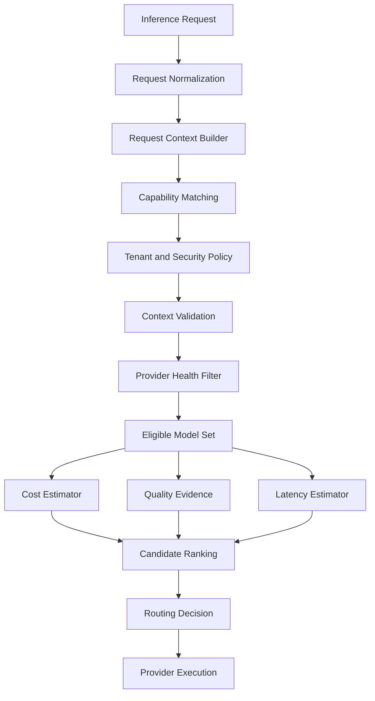

# ADR-0008: Constraint-Based Model Routing

- **Status:** Proposed
- **Date:** 2026-11-03
- **Project:** `llm-gateway`
- **Related ADRs:** ADR-0006, ADR-0007, ADR-0009, ADR-0013

## 1. Context

The gateway integrates multiple LLM providers and models.

Different models offer different:

- Capabilities.
- Quality levels.
- Pricing.
- Latency.
- Context limits.
- Availability.
- Security and data residency characteristics.
- Rate limits.

Applications should not need to select provider-specific models manually for every request.

The gateway must provide an intelligent routing mechanism that selects a suitable model based on request requirements and tenant policies.

A simple cheapest-model strategy is insufficient because the cheapest model may not support the required capability, meet quality expectations, or satisfy security constraints.

Similarly, selecting the most capable model for every request creates unnecessary cost.

The routing engine must therefore separate mandatory eligibility constraints from model ranking preferences.

## 2. Decision Drivers

The routing engine must:

1. Enforce mandatory model capabilities.
2. Respect tenant and project policies.
3. Enforce security and data residency constraints.
4. Respect context and output limits.
5. Consider provider health.
6. Estimate request cost.
7. Consider latency requirements.
8. Use quality evidence where available.
9. Respect budget constraints.
10. Provide explainable decisions.
11. Support explicit model selection.
12. Support controlled fallback.
13. Preserve routing configuration versions.
14. Avoid hardcoding provider-specific logic into application use cases.

## 3. Considered Options

### Option A: Static model mapping

Each application explicitly selects a provider and model.

Advantages:
- Predictable behavior.
- Simple implementation.
- Easy debugging.

Disadvantages:
- Provider lock-in.
- No centralized optimization.
- Applications must maintain model knowledge.
- Difficult global policy enforcement.

### Option B: Cheapest-model routing

Select the least expensive available model.

Advantages:
- Simple cost optimization.
- Easy to understand.

Disadvantages:
- Ignores capability differences.
- Ignores quality requirements.
- Can select unreliable providers.
- Can violate security or residency requirements.

### Option C: Constraint-based routing

First eliminate ineligible models, then rank eligible candidates according to configured objectives.

Advantages:
- Enforces hard requirements.
- Supports cost optimization.
- Supports quality and latency preferences.
- Provides explainable decisions.
- Supports multiple routing strategies.

Disadvantages:
- More complex metadata and policy requirements.
- Quality evidence requires evaluation.
- Cost and latency estimates may be imperfect.

## 4. Decision

Adopt **constraint-based model routing**.

The routing engine will use two distinct stages:

1. Eligibility filtering: eliminate models that violate mandatory constraints.
2. Candidate ranking: rank eligible models using the selected routing strategy.

The default optimization objective is:

**Choose the lowest-cost eligible model that satisfies mandatory capability, quality, security, reliability, latency, and budget constraints.**

Formally:

\[
M^* = \arg\min_{m \in E(r)} Cost(m,r)
\]

Where:

- \(r\) is the inference request.
- \(E(r)\) is the set of models eligible for request \(r\).
- \(Cost(m,r)\) is the estimated cost of executing request \(r\) on model \(m\).

If the eligible set is empty, the gateway rejects the request with an explainable error. It must not silently violate a hard constraint.

## 5. Routing Architecture



The diagram shows logical responsibilities. Implementations may combine steps where appropriate, provided their decisions remain independently testable.

## 6. Routing Input

The routing engine receives a normalized request and execution context.

### Request attributes

- Requested public model identifier or `auto`.
- Task type.
- Messages and content types.
- Estimated input tokens.
- Requested maximum output tokens.
- Streaming requirement.
- Tool definitions.
- Structured output requirements.
- Vision/audio requirements.
- Explicit latency constraints.
- Requested response quality profile.

### Execution context

- Tenant ID.
- Project ID.
- API key identity and permissions.
- Tenant policy version.
- Budget availability.
- Rate-limit decision.
- Concurrency admission state.
- Security and residency requirements.
- Provider health snapshot.
- Model registry version.
- Routing configuration version.

Sensitive request content must not be unnecessarily copied into routing logs.

## 7. Eligibility Filtering

Eligibility filtering applies hard constraints.

A model is eligible only if it satisfies every mandatory requirement.

### 7.1 Capability constraints

Examples:

- Vision request requires vision capability.
- Tool-calling request requires compatible tool calling.
- Streaming request requires streaming support.
- Embedding request requires embedding capability.
- Structured response request requires supported structured output.

### 7.2 Context constraints

The model must support the estimated input context and requested output limit.

\[
InputTokens + ReservedOutputTokens \leq ContextWindow
\]

The gateway must account for model-specific tokenization and context semantics.

If token estimation is uncertain, use a conservative margin or provider-specific validation.

### 7.3 Tenant policy constraints

Examples:

- Approved provider list.
- Approved model list.
- Maximum cost per request.
- Allowed regions.
- Allowed model families.
- Restricted model capabilities.
- Required quality profile.
- Explicit model pinning.

### 7.4 Security constraints

Examples:

- Data residency.
- Approved provider.
- Sensitive-data restrictions.
- Approved endpoint.
- Required encryption and transport controls.

### 7.5 Provider health constraints

Exclude providers that are unavailable or whose circuit breaker prohibits new attempts.

Health filtering must distinguish:

- Provider-wide outage.
- Region-specific outage.
- Model-specific failure.
- Temporary rate limiting.
- Configuration failure.

### 7.6 Budget constraints

Reject a candidate when its estimated cost exceeds the applicable per-request or remaining budget constraints.

The budget manager remains authoritative.

The routing engine may use budget availability as an input, but it must not replace atomic reservation with a routing-time estimate.

## 8. Request Classification

Classification helps identify the appropriate task and routing profile.

Initial task categories:

| Task | Example |
|---|---|
| Simple generation | Short response |
| Classification | Intent classification |
| Extraction | Structured data extraction |
| Summarization | Document summary |
| Reasoning | Multi-step analysis |
| Coding | Code generation |
| Vision | Image understanding |
| Embeddings | Vector generation |
| Tool execution | Function or tool selection |

Classification may use:

- Explicit API request metadata.
- Application-provided task hints.
- Deterministic request features.
- A lightweight classifier, when justified.

Do not rely solely on prompt length or an LLM classifier to determine model complexity.

Classification should not be permitted to override hard tenant policies.

## 9. Quality Evidence

Quality is task-dependent.

A model's general benchmark score does not guarantee quality for a specific workload.

Quality evidence should include:

- Task-specific evaluation datasets.
- Evaluation dataset version.
- Evaluator version.
- Quality metric.
- Confidence or sample size where available.
- Evaluation timestamp.
- Model and configuration version.

Examples of metrics:

- Correctness.
- Relevance.
- Faithfulness.
- Structured output compliance.
- Tool selection accuracy.
- Safety compliance.

A quality threshold may be a hard constraint for regulated or high-risk workloads.

For other workloads, quality may be a ranking preference.

LLM-as-judge scores must not be treated as ground truth.

## 10. Cost Estimation

The cost estimator uses versioned model pricing.

For a text request:

\[
EstimatedCost =
\frac{InputTokens \times InputPrice}{1{,}000{,}000}
+
\frac{OutputTokens \times OutputPrice}{1{,}000{,}000}
\]

The calculation may be extended for:

- Cached input tokens.
- Image usage.
- Audio usage.
- Reasoning tokens.
- Tool or batch charges.
- Provider-specific surcharges.

The estimator must:

- Use the correct pricing version.
- Use conservative output reservations.
- Preserve currency.
- Use decimal arithmetic.
- Record estimation assumptions.

Missing pricing must never be interpreted as zero.

## 11. Latency Estimation

Latency estimation may consider:

- Provider historical latency.
- Model-specific latency.
- Region.
- Time to first token.
- Total completion time.
- Queueing and admission delays.
- Current provider health.

Historical measurements should use bounded rolling windows and sufficient sample sizes.

Latency estimates are preferences unless the request or policy defines a hard deadline.

The gateway must not claim that an estimated latency is guaranteed.

## 12. Routing Strategies

The routing engine supports configurable strategies.

### 12.1 Cheapest Eligible

Select the lowest-cost eligible model.

Use cases:
- Cost-sensitive classification.
- Simple extraction.
- Low-risk generation.

### 12.2 Lowest Latency

Select the eligible model with the best expected latency.

Use cases:
- Interactive applications.
- Strict response-time requirements.

### 12.3 Quality First

Select the model with the strongest applicable quality evidence among eligible candidates.

Use cases:
- High-value analysis.
- Complex reasoning.
- Critical document processing.

### 12.4 Balanced

Rank candidates using configured normalized cost, latency, and quality weights.

Illustrative score:

\[
Score(m) =
w_c C(m) +
w_l L(m) +
w_q QPenalty(m)
\]

Where:

- \(C(m)\) is normalized cost.
- \(L(m)\) is normalized latency.
- \(QPenalty(m)\) represents quality shortfall.
- \(w_c,w_l,w_q\) are configured weights.

Lower scores are preferred.

Weights must be configurable and validated. Hard constraints must always be applied before this ranking.

### 12.5 Explicit Model

If the client explicitly requests a model:

- Verify that the model is permitted.
- Verify its capabilities.
- Verify its context limits.
- Verify budget and policy eligibility.
- Do not silently substitute another model.

If the selected model is unavailable, return an appropriate error unless the request or policy explicitly permits fallback.

## 13. Routing Decision Explainability

Every routing decision must produce a structured explanation.

Example:

```json
{
  "routing_decision_id": "uuid",
  "requested_model": "auto",
  "selected_model": "fast-text",
  "selected_provider": "provider-a",
  "strategy": "cheapest_eligible",
  "reason": "Lowest estimated cost among eligible candidates",
  "registry_version": 12,
  "policy_version": 7,
  "pricing_version": 3,
  "eligible_candidates": [
    {
      "model_id": "fast-text",
      "estimated_cost": "0.0021",
      "eligible": true
    },
    {
      "model_id": "reasoning-model",
      "estimated_cost": "0.0120",
      "eligible": true
    }
  ],
  "excluded_candidates": [
    {
      "model_id": "vision-model",
      "reason": "Required tool-calling capability unavailable"
    }
  ]
}
```

This is an illustrative shape, not a fixed API contract.

Persist sufficient information to reconstruct the decision without retaining unnecessary sensitive prompt content.

## 14. Routing and Budget Reservation

Routing and budget reservation must cooperate without creating a financial race condition.

Recommended execution sequence:

1. Authenticate and authorize.
2. Validate and normalize request.
3. Apply abuse and rate-limit controls.
4. Apply concurrency admission.
5. Evaluate mandatory tenant and security policies.
6. Identify eligible model candidates.
7. Estimate cost for candidate selection.
8. Select a candidate.
9. Atomically reserve budget using the selected model's pricing.
10. If reservation fails, re-evaluate another eligible candidate only when policy allows.
11. Execute the provider attempt.
12. Reconcile actual usage and cost.

The routing estimate is not a financial reservation.

The budget manager must verify the reservation against authoritative PostgreSQL records before provider execution.

Any candidate change must result in a fresh cost estimate and reservation attempt.

## 15. Fallback Integration

Fallback is a reliability operation that must preserve routing eligibility.

When a provider attempt fails:

1. Classify the error.
2. Determine whether retry is allowed.
3. Check provider and model health.
4. Recompute eligible candidates.
5. Respect tenant policies.
6. Recalculate estimated cost.
7. Reserve any incremental budget required.
8. Record a new provider attempt.
9. Execute the fallback candidate.

Never use fallback to bypass a security, residency, quality, or budget constraint.

Do not transparently switch providers after client-visible streaming output has been delivered.

Detailed behavior is governed by ADR-0013 and ADR-0014.

## 16. Rust Implementation

Suggested structure:

```text
crates/gateway-core/src/
├── routing/
│   ├── mod.rs
│   ├── context.rs
│   ├── classifier.rs
│   ├── eligibility.rs
│   ├── capability_matcher.rs
│   ├── policy_evaluator.rs
│   ├── cost_estimator.rs
│   ├── latency_estimator.rs
│   ├── quality_evidence.rs
│   ├── candidate_ranker.rs
│   ├── decision_engine.rs
│   └── explanation.rs
```

Application-facing interface:

```rust
#[async_trait::async_trait]
pub trait ModelRouter: Send + Sync {
    async fn route(
        &self,
        request: RoutingRequest,
        context: RoutingContext,
    ) -> Result<RoutingDecision, RoutingError>;
}
```

Keep the ranking algorithm independent of provider SDKs and database implementations.

Use deterministic routing policies where possible. Inject clocks and measurement sources for reproducible tests.

## 17. Testing Requirements

### Eligibility tests

- Missing capability.
- Unsupported streaming.
- Context overflow.
- Disabled model.
- Disallowed provider.
- Data residency violation.
- Provider circuit breaker open.
- Budget constraint violation.

### Ranking tests

- Cheapest eligible model.
- Lowest-latency strategy.
- Quality-first strategy.
- Balanced strategy.
- Explicit model selection.
- Deterministic tie-breaking.

### Financial tests

- Pricing version selection.
- Missing pricing rejection.
- Reservation failure.
- Alternative candidate selection.
- Incremental fallback reservation.

### Explainability tests

- Selected candidate reason.
- Excluded candidate reason.
- Configuration version preservation.
- No sensitive prompt leakage.

### Evaluation tests

- Routing quality by task.
- Cost-quality frontier.
- Quality regression.
- Latency comparison.
- Routing stability under provider failures.

## 18. Observability

Required metrics:

- Routing decisions.
- Model selection frequency.
- Candidate eligibility counts.
- Candidate exclusion reasons.
- Estimated cost by model.
- Actual cost by model.
- Cost estimation error.
- Routing latency.
- Routing strategy usage.
- Fallback selection frequency.
- Quality by model and task.
- Policy rejection count.

Avoid unbounded metric labels such as raw prompts, user IDs, or request IDs.

Detailed routing explanations belong in traces or structured records rather than metric labels.

## 19. Security

Requirements:

- Tenant policies must be enforced before selection.
- Client-supplied model IDs must be validated.
- Provider allowlists must be respected.
- Residency constraints are hard constraints.
- Routing explanations must not expose secrets.
- Model registry access must be authorized.
- Cost and quality metadata must be versioned.
- Fallback must not weaken security constraints.

## 20. Consequences

### Positive

- Centralized model selection.
- Cost optimization without ignoring quality.
- Explicit capability and policy enforcement.
- Provider-independent applications.
- Explainable routing.
- Controlled fallback integration.

### Negative

- More complex routing logic.
- Quality evidence requires ongoing evaluation.
- Cost and latency estimates can be inaccurate.
- Registry and policy freshness become important.

### Risks and Mitigations

| Risk | Mitigation |
|---|---|
| Cheapest model produces poor output | Task-specific quality constraints |
| Stale model capabilities | Versioned registry validation |
| Incorrect cost estimate | Pricing versioning and reconciliation |
| Provider outage | Reliability-aware candidate filtering |
| Tenant policy bypass | Mandatory eligibility filtering |
| Unexplainable decisions | Persist structured routing explanations |
| Routing instability | Deterministic ranking and tie-breaking |

## 21. Validation Criteria

ADR-0008 is validated when:

- Eligibility and ranking are separate components.
- Mandatory constraints cannot be overridden by ranking preferences.
- Model capabilities come from the registry.
- Pricing is versioned.
- Tenant policies are enforced.
- Routing decisions are explainable.
- Budget reservations remain authoritative in the budget manager.
- Fallback re-evaluates eligibility.
- Routing can be tested deterministically.
- Quality and cost are evaluated together.

## 22. Related ADRs

- ADR-0003: PostgreSQL as the Authoritative Data Store
- ADR-0006: Canonical Provider Adapter Interface
- ADR-0007: Model Registry and Capability Representation
- ADR-0009: Budget Reservation and Financial Settlement
- ADR-0013: Provider Retry and Circuit Breaker Strategy
- ADR-0014: Streaming and Provider Fallback Semantics
- ADR-0017: OpenTelemetry Observability Architecture
- ADR-0018: Asynchronous Evaluation Architecture
