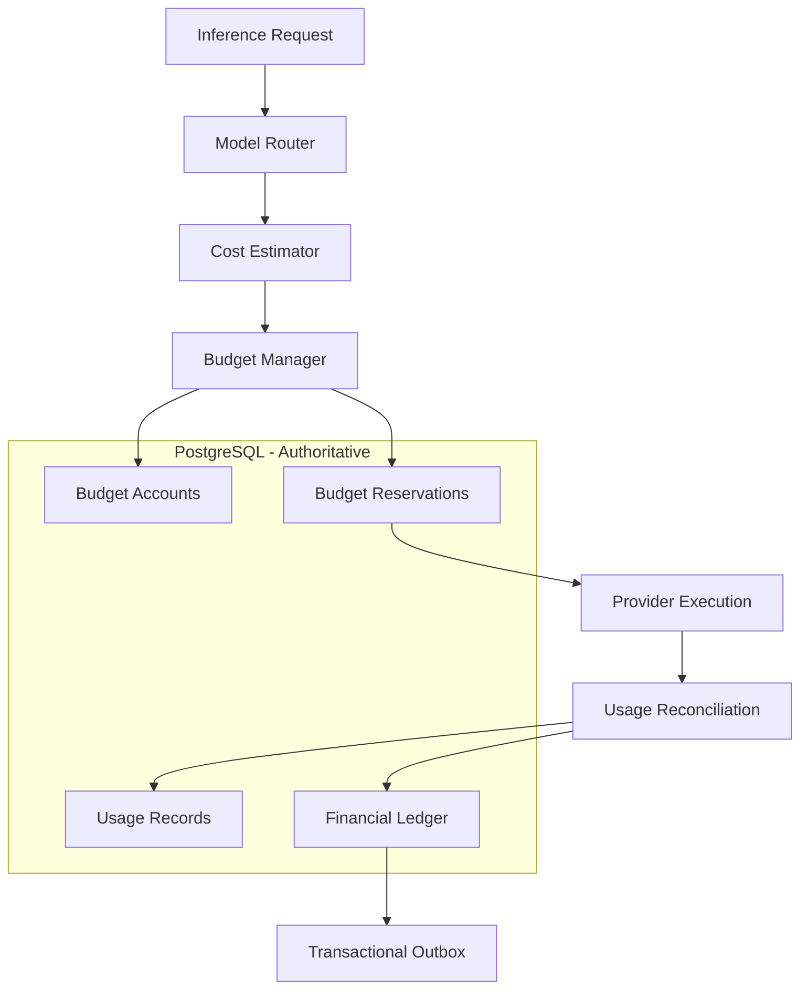
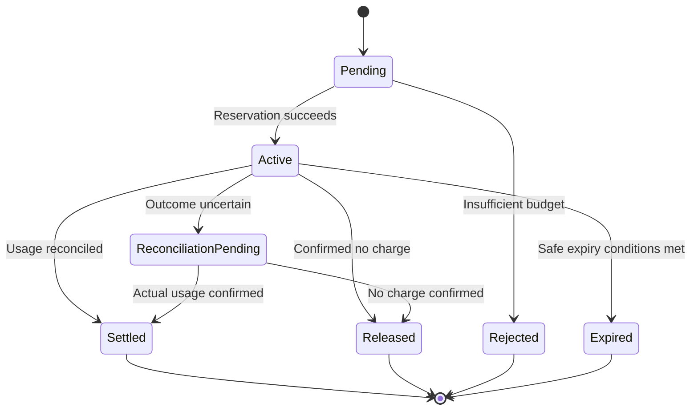

# ADR-0009: Budget Reservation and Financial Settlement

- **Status:** Proposed
- **Date:** 2026-11-03
- **Project:** `llm-gateway`
- **Related ADRs:** ADR-0003, ADR-0005, ADR-0007, ADR-0008

## 1. Context

The LLM Gateway must control inference expenditure across multiple tenants, projects, API keys, providers, and models.

LLM requests have uncertain final costs because:

- Input token counts may be estimated before execution.
- Output token counts are unknown until generation completes.
- Provider pricing differs by model.
- Cached input, image, audio, and other modalities may have different prices.
- Provider failures may occur after the provider has processed a request.
- Multiple requests may execute concurrently against the same budget.
- Provider usage reports may arrive late or require reconciliation.

A simple balance check before inference is insufficient.

For example, suppose a tenant has a budget of $10 and two requests each estimate a cost of $7.

If both requests read the same available balance before either writes a reservation, both could be admitted, creating a potential $14 exposure.

The gateway therefore needs atomic budget reservations and idempotent settlement.

## 2. Decision Drivers

The budget system must:

1. Prevent concurrent requests from overspending through admission races.
2. Reserve estimated costs before provider execution.
3. Reconcile reservations against actual usage.
4. Maintain an auditable financial ledger.
5. Support hierarchical budgets.
6. Support multiple billing periods.
7. Handle uncertain provider outcomes.
8. Support retries and fallback.
9. Preserve historical pricing.
10. Use precise monetary arithmetic.
11. Support idempotent settlement.
12. Recover from partial failures.
13. Expose budget status and usage reporting.
14. Separate financial accounting from operational rate limiting.

## 3. Considered Options

### Option A: Redis-only budget accounting

Maintain balances and reservations in Redis.

Advantages:
- Fast operations.
- Atomic Lua scripts.
- Easy integration with distributed coordination.

Disadvantages:
- Financial durability and auditability are harder to guarantee.
- Eviction or data loss can affect accounting.
- Historical ledger requirements are difficult to satisfy.
- Financial reconciliation becomes more complex.

### Option B: PostgreSQL-only accounting

Use PostgreSQL transactions for budget checks, reservations, and settlements.

Advantages:
- Durable financial records.
- Strong transactional guarantees.
- Clear auditability.
- Easier reconciliation.

Disadvantages:
- More database contention under high concurrency.
- Requires careful indexing and transaction design.

### Option C: PostgreSQL authoritative accounting with Redis operational support

Use PostgreSQL for financial records and Redis for non-authoritative operational coordination or caching.

Advantages:
- Durable financial accounting.
- Atomic reservations.
- Clear reconciliation.
- Redis can improve operational performance without becoming the financial source of truth.

Disadvantages:
- Requires coordination between components.
- PostgreSQL remains a critical dependency.

## 4. Decision

Adopt **PostgreSQL as the authoritative financial accounting system**.

Redis may cache budget information or assist with operational admission control, but no Redis balance or cache entry may override PostgreSQL financial records.

The gateway must:

1. Estimate the selected model's cost.
2. Reserve the required amount transactionally.
3. Execute the provider only after successful reservation.
4. Record actual usage.
5. Settle the reservation idempotently.
6. Write immutable ledger entries.
7. Reconcile uncertain or incomplete executions.

The system must never claim exactly-once provider execution. It can guarantee idempotent financial processing within its own accounting boundaries.

## 5. Budget Architecture



The budget manager owns financial admission and settlement. The router supplies the selected model and its applicable pricing information.

## 6. Budget Hierarchy

Support hierarchical budgets:

```text
Platform
  └── Tenant
       └── Project
            └── API Key
```

A request may be subject to multiple simultaneous budget constraints.

Example:

| Scope | Monthly limit |
|---|---:|
| Platform | 100,000 |
| Tenant | 10,000 |
| Project | 2,000 |
| API key | 500 |

A request must satisfy every applicable budget account.

The system must not assume that a child budget increases its parent's limit.

Budget ownership and inheritance must be explicit.

## 7. Budget Periods

Supported periods:

- Hourly.
- Daily.
- Weekly.
- Monthly.
- Custom period.

Each budget account should include:

| Field | Description |
|---|---|
| `id` | Budget account UUID |
| `scope_type` | Platform, tenant, project, API key |
| `scope_id` | Scope owner |
| `limit_amount` | Maximum allowed spend |
| `currency` | Account currency |
| `period_type` | Hourly, daily, weekly, monthly, custom |
| `period_start` | Period start |
| `period_end` | Period end |
| `status` | Active, suspended, disabled |
| `created_at` | Creation timestamp |

Use explicit timezone and period-boundary rules.

A budget period must not silently change its accounting timezone.

## 8. Available Budget Calculation

For an account:

\[
Available =
Limit - ActualSpend - ActiveReservations
\]

Where:

- `Limit` is the configured budget limit.
- `ActualSpend` is settled financial expenditure for the period.
- `ActiveReservations` is the outstanding reserved amount.

A request may be admitted only if the required reservation can be secured across every applicable account.

Reservations must not be counted as actual spend.

The system should expose separately:

- Budget limit.
- Actual spend.
- Active reservations.
- Available budget.
- Pending reconciliation exposure.

## 9. Cost Estimation

Cost estimation uses the model's effective pricing version.

For a basic text request:

\[
EstimatedCost =
\frac{InputTokens \times InputPrice}{1{,}000{,}000}
+
\frac{ReservedOutputTokens \times OutputPrice}{1{,}000{,}000}
\]

The estimator must support additional pricing dimensions:

- Cached input tokens.
- Image input.
- Audio input.
- Audio output.
- Reasoning tokens.
- Batch processing.
- Tool-related charges.
- Provider-specific surcharges.

Requirements:

1. Use decimal arithmetic.
2. Preserve currency.
3. Record the pricing version.
4. Use conservative estimates.
5. Never interpret unknown pricing as zero.
6. Reject requests requiring financial control when no valid pricing can be established, unless an explicitly approved policy defines a safe alternative.

## 10. Reservation Strategy

Reservations must occur before provider execution.

A reservation includes:

- Reservation ID.
- Execution ID.
- Tenant ID.
- Project ID.
- API key ID, where applicable.
- Model ID.
- Pricing version.
- Estimated input cost.
- Reserved output cost.
- Total reserved amount.
- Currency.
- Expiration policy.
- Reservation state.

### Reservation lifecycle



Do not automatically release an active reservation merely because a client timed out or disconnected.

The provider may still have processed the request.

### Reservation amount

The reservation should cover:

- Estimated input cost.
- Maximum or policy-defined output reservation.
- Applicable modality charges.
- A configurable safety margin, where justified.

Safety margins must be configurable and measured. They should not become arbitrary permanent over-reservation.

## 11. Atomic Reservation

Use PostgreSQL transactions.

For each request:

1. Identify all applicable budget accounts.
2. Lock them in deterministic order.
3. Read actual spend and active reservations.
4. Calculate available budget.
5. Verify all applicable accounts.
6. Insert reservation records.
7. Commit.

Illustrative SQL pattern:

```sql
BEGIN;

SELECT id, limit_amount
FROM accounting.budget_accounts
WHERE id = ANY($1)
ORDER BY id
FOR UPDATE;

-- Calculate available amounts for every applicable account.
-- Reject if any account cannot cover the reservation.

INSERT INTO accounting.budget_reservations (
    id,
    execution_id,
    amount,
    currency,
    status
)
VALUES (
    $2,
    $3,
    $4,
    $5,
    'active'
);

COMMIT;
```

This is an illustrative transaction pattern. The final implementation must also handle period-specific account records, duplicate reservation attempts, active reservation aggregation, and all applicable hierarchical scopes.

Use deterministic lock ordering to reduce deadlocks.

Add unique constraints to prevent duplicate reservations for the same logical execution and budget scope.

If reservation fails, no provider execution may begin.

## 12. Usage Normalization

Provider usage must be normalized into a common representation.

Example:

```rust
pub struct UsageRecord {
    pub execution_id: ExecutionId,
    pub provider_id: ProviderId,
    pub model_id: ModelId,
    pub input_tokens: u64,
    pub output_tokens: u64,
    pub cached_input_tokens: Option<u64>,
    pub reasoning_tokens: Option<u64>,
    pub image_units: Option<u64>,
    pub audio_units: Option<u64>,
    pub usage_source: UsageSource,
}
```

Possible usage sources:

- ProviderReported.
- GatewayEstimated.
- Reconciled.

Provider-reported usage is preferred when trustworthy and available.

Estimated usage must be distinguishable from confirmed provider usage.

## 13. Settlement

After execution, the budget manager calculates actual cost using the applicable pricing version and normalized usage.

Settlement must:

1. Verify execution identity.
2. Verify reservation ownership.
3. Determine actual usage.
4. Calculate actual cost.
5. Record normalized usage.
6. Record financial ledger entries.
7. Reconcile the reservation.
8. Commit atomically.

If actual cost is lower than the reservation, release the unused amount.

If actual cost exceeds the reservation:

- Record the actual expenditure.
- Record the reservation shortfall.
- Apply the configured overrun policy.
- Trigger alerts where appropriate.

Never suppress actual provider charges to make a budget appear compliant.

## 14. Idempotent Settlement

Settlement must be idempotent.

Use the execution ID and appropriate unique accounting keys to prevent duplicate settlement.

Illustrative SQL:

```sql
INSERT INTO accounting.usage_records (
    id,
    execution_id,
    input_tokens,
    output_tokens,
    actual_cost,
    currency
)
VALUES (
    $1, $2, $3, $4, $5, $6
)
ON CONFLICT (execution_id)
DO NOTHING;
```

The final implementation must ensure that duplicate delivery cannot create duplicate ledger entries or inconsistent reservation transitions.

Use database constraints and transactional state checks rather than relying only on application-level checks.

## 15. Financial Ledger

The financial ledger is the durable audit record of budget movements.

Ledger entries must be append-only.

Suggested entry types:

- ReservationCreated.
- ReservationReleased.
- UsageCharged.
- BudgetAdjustment.
- ReconciliationAdjustment.
- RefundOrCredit.

Do not modify historical ledger entries to correct accounting mistakes.

Create compensating entries instead.

Suggested fields:

| Field | Description |
|---|---|
| `id` | Ledger entry UUID |
| `execution_id` | Associated execution |
| `reservation_id` | Associated reservation |
| `budget_account_id` | Affected budget |
| `entry_type` | Financial movement type |
| `amount` | Signed monetary amount |
| `currency` | Currency |
| `idempotency_key` | Duplicate protection |
| `created_at` | Ledger timestamp |

Financial records must retain enough provenance to explain each adjustment.

## 16. Unknown Provider Outcomes

A provider timeout does not prove that no charge occurred.

Example:

```text
Gateway sends request
        |
Provider processes request
        |
Provider generates output
        |
Network connection fails
        |
Gateway receives timeout
```

The gateway cannot safely assume the request was never processed.

Required behavior:

1. Mark the execution as `UnknownOutcome`.
2. Preserve its reservation.
3. Record the provider attempt.
4. Attempt provider-side usage reconciliation when supported.
5. Use provider request identifiers where available.
6. Reconcile when trustworthy usage evidence becomes available.
7. Release the reservation only when the no-charge outcome is sufficiently established under policy.

If usage cannot be recovered, follow an explicit financial uncertainty policy.

Do not silently classify unknown charges as zero.

## 17. Fallback and Additional Reservations

Fallback can select a more expensive model than the original candidate.

Before executing fallback:

1. Re-evaluate the selected model.
2. Estimate its cost.
3. Calculate incremental exposure.
4. Reserve the additional amount transactionally.
5. Execute only after reservation succeeds.

The original reservation must remain associated with the original execution and attempt history.

Do not double-count actual charges.

A fallback attempt is part of the same logical execution but must have a distinct provider attempt ID.

## 18. Database Schema

Suggested tables:

```text
accounting.budget_accounts
accounting.budget_periods
accounting.budget_reservations
accounting.usage_records
accounting.financial_ledger_entries
accounting.budget_alerts
accounting.reconciliation_jobs
```

Important constraints:

- Monetary amounts use `NUMERIC`.
- Currency is explicit.
- Reservations reference executions.
- Ledger entries are append-only.
- Settlement is idempotent.
- Reservation transitions are validated.
- Period-specific accounting is explicit.
- Foreign keys preserve financial provenance.

## 19. Transactional Outbox

Financial events that require asynchronous processing must be written to the outbox in the same transaction as their corresponding business changes.

Examples:

- Budget reservation completed.
- Usage settled.
- Budget threshold reached.
- Reconciliation required.

The event publisher uses the transactional outbox defined in ADR-0005.

Financial ledger writes must not depend on successful delivery to Redis Streams or another message broker.

The broker is for event distribution, not authoritative accounting.

## 20. Budget APIs

Suggested endpoints:

| Method | Endpoint | Purpose |
|---|---|---|
| GET | `/v1/budgets` | List accessible budgets |
| GET | `/v1/budgets/{id}` | Budget details |
| GET | `/v1/budgets/{id}/usage` | Budget consumption |
| GET | `/v1/budgets/{id}/reservations` | Active reservations |
| GET | `/v1/usage` | Usage reporting |
| GET | `/v1/usage/{execution_id}` | Execution usage |
| POST | `/v1/admin/budgets` | Create budget |
| PATCH | `/v1/admin/budgets/{id}` | Update budget |
| GET | `/v1/admin/ledger` | Authorized ledger inspection |

Budget mutation and financial reporting require appropriate administrative permissions.

Budget values should be represented as decimal strings in JSON APIs to avoid floating-point ambiguity.

## 21. Alerts and Thresholds

Support configurable thresholds, for example:

- 50% consumed.
- 75% consumed.
- 90% consumed.
- 100% consumed.

Thresholds are configuration, not fixed business rules.

Alerts may be triggered by:

- Budget threshold.
- Repeated reservation rejection.
- Unexpected cost increase.
- Pricing changes.
- Usage reconciliation failure.
- Unknown provider outcomes.
- Reservation age exceeding policy.

Alert delivery must not block inference settlement.

## 22. Rust Implementation

Suggested structure:

```text
crates/gateway-core/src/
├── budget/
│   ├── mod.rs
│   ├── budget_manager.rs
│   ├── reservation.rs
│   ├── cost_calculator.rs
│   ├── usage_normalizer.rs
│   ├── settlement.rs
│   ├── ledger.rs
│   ├── reconciliation.rs
│   └── budget_policy.rs

crates/infrastructure/src/
├── persistence/
│   └── accounting/
│       ├── budget_repository.rs
│       ├── reservation_repository.rs
│       ├── usage_repository.rs
│       └── ledger_repository.rs
```

Application-owned interfaces:

```rust
#[async_trait::async_trait]
pub trait BudgetManager: Send + Sync {
    async fn reserve(
        &self,
        command: ReserveBudgetCommand,
    ) -> Result<BudgetReservation, BudgetError>;

    async fn settle(
        &self,
        command: SettleBudgetCommand,
    ) -> Result<SettlementResult, BudgetError>;

    async fn release(
        &self,
        command: ReleaseReservationCommand,
    ) -> Result<(), BudgetError>;
}
```

Domain types should use strongly typed identifiers and decimal monetary values.

The domain layer must not depend on SQLx or Redis.

## 23. Observability

Required metrics:

- Reservation attempts.
- Reservation rejections.
- Active reservation amount.
- Reservation age.
- Settlement latency.
- Settlement failures.
- Actual versus estimated cost.
- Cost overrun frequency.
- Unknown outcome count.
- Reconciliation backlog.
- Duplicate settlement attempts.
- Budget utilization.

Financial telemetry must not rely on sampled traces.

Ledger and usage records are the authoritative financial evidence.

## 24. Testing Requirements

### Unit tests

- Cost calculation.
- Pricing version resolution.
- Reservation state transitions.
- Settlement calculation.
- Currency validation.
- Budget period calculation.

### Concurrency tests

- Two simultaneous reservations against one budget.
- Multiple hierarchical budget reservations.
- Concurrent settlement attempts.
- Duplicate settlement messages.
- Reservation expiration races.
- Deadlock recovery.

### Failure tests

- PostgreSQL unavailable.
- Redis unavailable.
- Provider timeout.
- Provider returns incomplete usage.
- Gateway process crashes after provider execution.
- Outbox publishing fails.
- Settlement retries.

### Financial correctness tests

- Actual cost lower than reservation.
- Actual cost equal to reservation.
- Actual cost higher than reservation.
- Unknown provider outcome.
- Duplicate usage report.
- Pricing version changes during execution.
- Historical ledger reconstruction.

Financial correctness tests must verify database state, not just API responses.

## 25. Consequences

### Positive

- Prevents concurrent reservation races.
- Durable financial accounting.
- Idempotent settlement.
- Historical cost reconstruction.
- Hierarchical budget control.
- Reliable financial auditability.
- Explicit treatment of uncertain provider outcomes.

### Negative

- PostgreSQL transactions add admission latency.
- Lock contention can increase under high concurrency.
- Reconciliation requires background processing.
- Financial correctness requires extensive testing.

### Risks and Mitigations

| Risk | Mitigation |
|---|---|
| Concurrent overspending | Atomic PostgreSQL reservation |
| Duplicate settlement | Unique constraints and idempotency |
| Provider timeout | Unknown outcome state |
| Incorrect pricing | Versioned pricing |
| Ledger corruption | Append-only ledger and restricted DB permissions |
| Excessive reservation | Conservative but measured estimation |
| Fallback overspend | Incremental reservation |
| Delayed reconciliation | Reconciliation jobs and alerts |

## 26. Validation Criteria

ADR-0009 is validated when:

- Every applicable budget scope is checked.
- Reservations are atomic.
- No provider execution starts before required reservation succeeds.
- Pricing versions are preserved.
- Actual usage is normalized.
- Settlement is idempotent.
- Ledger entries are append-only.
- Duplicate events cannot create duplicate charges.
- Unknown outcomes remain financially visible.
- Concurrent reservation tests prove budget correctness.
- Financial reporting can be reconstructed from durable records.

## 27. Related ADRs

- ADR-0003: PostgreSQL as the Authoritative Data Store
- ADR-0005: Transactional Outbox and Event Delivery
- ADR-0007: Model Registry and Capability Representation
- ADR-0008: Constraint-Based Model Routing
- ADR-0010: Inference Idempotency and Execution Lifecycle
- ADR-0011: Distributed Rate Limiting
- ADR-0012: Distributed Concurrency Control
