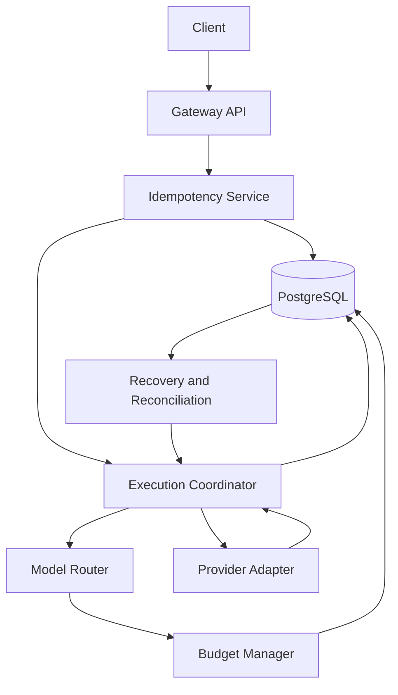
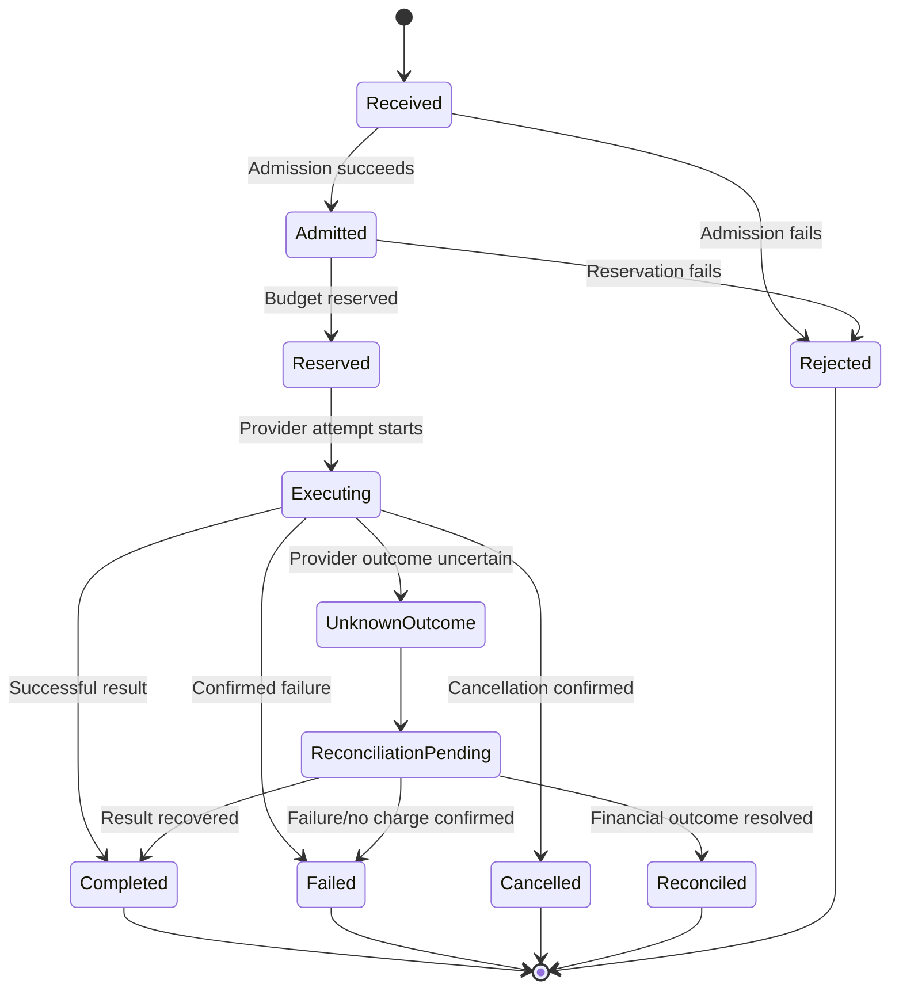

# ADR-0010: Inference Idempotency and Execution Lifecycle

- **Status:** Proposed
- **Date:** 2026-11-04
- **Project:** `llm-gateway`
- **Related ADRs:** ADR-0003, ADR-0005, ADR-0006, ADR-0008, ADR-0009, ADR-0013, ADR-0014

## 1. Context

An inference request may experience:

- Client retries after a timeout.
- Gateway process failure.
- Provider timeout after processing has begun.
- Provider retry or fallback.
- Client disconnection during streaming.
- Duplicate event delivery.
- Budget reservation or settlement retries.
- Delayed provider usage reports.

The gateway must distinguish the logical request from individual execution attempts.

A client retry must not automatically create duplicate financial reservations or duplicate provider execution when the original request is still being processed.

However, the gateway cannot guarantee exactly-once execution at an external provider unless that provider offers suitable idempotency guarantees and the gateway uses them correctly.

The design must therefore provide **gateway-side idempotency, durable execution state, attempt tracking, and explicit handling of uncertain outcomes**.

## 2. Decision Drivers

The execution system must:

1. Distinguish request, execution, and provider attempt identifiers.
2. Support client-provided idempotency keys.
3. Prevent duplicate gateway-side admission for the same idempotency scope.
4. Persist execution state transitions.
5. Track retries and fallback attempts separately.
6. Coordinate with budget reservations and settlement.
7. Represent uncertain provider outcomes.
8. Support streaming and cancellation.
9. Recover from gateway process crashes.
10. Preserve execution history for audit and troubleshooting.
11. Avoid claiming exactly-once provider execution.
12. Support configurable idempotency retention.

## 3. Considered Options

### Option A: No idempotency

Every request creates a new execution.

Advantages:
- Simple implementation.
- No idempotency storage required.

Disadvantages:
- Client retries can duplicate provider calls.
- Duplicate financial exposure.
- Poor recovery behavior.
- Difficult troubleshooting.

### Option B: In-memory idempotency

Store idempotency keys in gateway process memory.

Advantages:
- Fast.
- Simple for a single process.

Disadvantages:
- Not shared across replicas.
- Lost during restart.
- Cannot coordinate distributed requests.

### Option C: Durable PostgreSQL idempotency

Persist idempotency records and execution state in PostgreSQL.

Advantages:
- Durable.
- Supports multiple gateway replicas.
- Can enforce uniqueness transactionally.
- Integrates with financial records and audit history.

Disadvantages:
- Adds database operations.
- Requires retention and conflict semantics.
- Does not guarantee exactly-once execution at external providers.

## 4. Decision

Adopt **PostgreSQL-backed idempotency and a durable inference execution lifecycle**.

The system will use three distinct identifiers:

| Identifier | Purpose |
|---|---|
| `request_id` | Identifies an HTTP/API request |
| `execution_id` | Identifies the logical inference execution |
| `attempt_id` | Identifies one provider execution attempt |

A single logical execution may contain multiple provider attempts due to retries or fallback.

Client idempotency keys are scoped to the authenticated tenant and project, with API-key identity retained for audit and policy evaluation.

The same idempotency key with the same normalized request returns the existing execution state or result.

The same key with a different normalized request returns an idempotency conflict.

## 5. Architecture



PostgreSQL stores durable execution and idempotency state. Redis may support operational coordination but is not the authoritative execution record.

## 6. Identifier Semantics

### 6.1 Request ID

A request ID identifies one inbound API request.

- Generated by the gateway unless a validated client correlation ID is accepted.
- Used in logs and traces.
- A retry may have a new request ID while referencing the same execution.

### 6.2 Execution ID

An execution ID identifies one logical inference operation.

- Generated when a new idempotent execution is admitted.
- Stable across provider retries and fallback attempts.
- Links budget reservations, usage records, routing decisions, and evaluations.
- Used for execution recovery and client status lookup.

### 6.3 Attempt ID

An attempt ID identifies one provider call.

- Created for each provider execution attempt.
- Distinguishes retries and fallback.
- Records provider, model, start time, result, and normalized error.
- Must not be reused across attempts.

## 7. Idempotency Key Contract

The inference API supports an optional `Idempotency-Key` header.

Example:

```http
POST /v1/chat/completions
Authorization: Bearer lg_live_...
Idempotency-Key: client-operation-123
Content-Type: application/json
```

### Scope

The uniqueness scope is:

```text
tenant_id + project_id + idempotency_key
```

The gateway must verify authorization on every replay. Possession of an idempotency key is not authorization to access an execution.

### Request fingerprint

The gateway computes a fingerprint from the normalized request and relevant execution semantics, including:

- Public model identifier or `auto`.
- Messages and content.
- Generation parameters.
- Tools and tool choice.
- Response format.
- Streaming mode.
- Relevant policy and routing inputs.
- API contract version.

Exclude volatile fields such as request IDs and timestamps.

The fingerprint must use a canonical serialization and a cryptographic hash.

Sensitive request content must not be stored in the idempotency table as plaintext solely for fingerprinting.

### Duplicate behavior

| Condition | Behavior |
|---|---|
| New key | Create execution |
| Same key, same fingerprint, execution in progress | Return existing execution status or documented conflict |
| Same key, same fingerprint, completed execution | Return stored result when replay is supported |
| Same key, different fingerprint | Return `409 idempotency_conflict` |
| Existing execution has uncertain outcome | Return its status; do not silently create a new execution |

The API contract must define replay behavior for streaming responses separately.

## 8. Execution Lifecycle



The state machine is logical. The implementation may include additional intermediate states, such as `Routing` or `SettlementPending`, if they improve recovery and observability.

### State definitions

| State | Meaning |
|---|---|
| `Received` | Request accepted for processing |
| `Admitted` | Authentication, authorization, policy, and admission checks passed |
| `Reserved` | Required budget reservation succeeded |
| `Executing` | A provider attempt has started |
| `Completed` | A valid response was obtained and execution completed |
| `Failed` | Execution failed with a sufficiently known outcome |
| `Cancelled` | Execution was cancelled under defined semantics |
| `UnknownOutcome` | Provider may have processed the request, but outcome is uncertain |
| `ReconciliationPending` | Recovery or usage reconciliation is required |
| `Reconciled` | Uncertain execution has been resolved according to policy |
| `Rejected` | Request failed before provider execution |

## 9. Provider Attempt Lifecycle

Each provider attempt has its own state:

- `Pending`
- `Started`
- `Succeeded`
- `Failed`
- `TimedOut`
- `Cancelled`
- `UnknownOutcome`

A retry or fallback creates a new attempt record.

The execution record retains:

- Attempt sequence.
- Provider and model.
- Routing decision.
- Pricing version.
- Provider request ID, where available.
- Start and end timestamps.
- Normalized error.
- Usage result.
- Whether client-visible output was emitted.

## 10. Execution Coordination

The execution coordinator owns the lifecycle.

Recommended sequence:

1. Authenticate and authorize.
2. Validate and normalize the request.
3. Compute the idempotency fingerprint.
4. Atomically create or retrieve the idempotency record.
5. Apply policy and admission controls.
6. Select a model.
7. Reserve budget.
8. Persist execution and attempt state.
9. Call the provider.
10. Persist the provider result or uncertain outcome.
11. Normalize usage.
12. Settle budget.
13. Persist the final execution state.
14. Return the result.
15. Publish asynchronous events through the outbox.

The implementation must define transaction boundaries explicitly. Do not hold a PostgreSQL transaction open across a network call to a provider.

## 11. Provider Idempotency

Where a provider supports idempotency keys:

- Derive a provider idempotency key from the logical execution and provider contract.
- Use the same provider idempotency key only when retrying the same provider operation under that provider's documented semantics.
- Use a distinct key for a different provider or materially different operation.
- Record whether the provider accepted the key.
- Do not assume provider idempotency support without verification.

Provider idempotency reduces duplicate execution risk but does not replace gateway-side execution tracking.

## 12. Streaming Semantics

Streaming introduces additional replay constraints.

The gateway must record whether any output has been delivered to the client.

Rules:

- Before output is emitted, a retry or fallback may be considered under reliability policy.
- After output is emitted, transparent provider switching is prohibited.
- Client disconnect does not prove provider execution stopped.
- Provider cancellation should be attempted when supported.
- Usage and budget reconciliation must continue when the provider may have incurred charges.
- A completed stream may be replayed only if the gateway has safely retained the complete response and replay is permitted by policy.

The gateway must not store sensitive streaming output by default unless response replay or retention policy explicitly requires it.

## 13. Crash Recovery

On restart, the recovery worker identifies executions that remain in nonterminal states.

Examples:

- `Reserved` with no provider attempt started.
- `Executing` with expired worker lease.
- `UnknownOutcome`.
- `ReconciliationPending`.
- Settlement pending after a provider response was received.

Recovery actions must depend on persisted evidence.

### Recovery rules

- If no provider attempt started, the execution may be safely resumed or rejected according to policy.
- If a provider attempt started and outcome is uncertain, do not blindly re-execute.
- If the provider supports status lookup, attempt reconciliation.
- If a response was durably stored but settlement was incomplete, resume settlement.
- If the execution is known to have failed without charge, release the reservation.
- If the financial outcome remains uncertain, preserve the reservation and escalate according to policy.

## 14. Database Design

Suggested tables:

```text
inference.requests
inference.idempotency_records
inference.executions
inference.provider_attempts
inference.routing_decisions
inference.execution_events
```

### Idempotency record fields

- `id`
- `tenant_id`
- `project_id`
- `idempotency_key_hash`
- `request_fingerprint`
- `execution_id`
- `status`
- `created_at`
- `expires_at`

Store a hash of the idempotency key rather than the raw key where practical.

### Execution fields

- `id`
- `request_id`
- `tenant_id`
- `project_id`
- `status`
- `requested_model_id`
- `selected_model_id`
- `routing_decision_id`
- `reservation_id`
- `response_reference`
- `error_code`
- `created_at`
- `started_at`
- `completed_at`
- `updated_at`

### Constraints

- Unique idempotency scope and key hash.
- Unique attempt sequence per execution.
- Unique provider attempt identifier.
- Valid state transitions.
- Foreign keys to tenant, project, model, reservation, and usage records.
- Durable association between execution and pricing version.

## 15. Retention and Expiration

Idempotency retention must be configurable.

Requirements:

- Retain keys long enough to cover expected client retry windows.
- Do not expire records for executions with unresolved financial outcomes.
- Preserve execution and accounting records according to audit and retention policies.
- Expire or purge response payloads separately from financial metadata.
- Ensure an expired key cannot collide with a still-active execution.
- Document behavior when a client retries after the idempotency retention window.

Idempotency record retention and financial record retention are separate policies.

## 16. API Behavior

Suggested execution status endpoint:

```http
GET /v1/executions/{execution_id}
```

Example response:

```json
{
  "execution_id": "uuid",
  "status": "reconciliation_pending",
  "requested_model": "auto",
  "selected_model": "fast-text",
  "attempt_count": 1,
  "created_at": "2026-11-04T13:00:00Z",
  "updated_at": "2026-11-04T13:00:05Z"
}
```

The response must expose only information authorized for the caller's tenant and project.

For uncertain outcomes, return a stable status and error code rather than encouraging clients to submit a new request with a different idempotency key.

## 17. Rust Implementation

Suggested structure:

```text
crates/gateway-core/src/
├── execution/
│   ├── mod.rs
│   ├── coordinator.rs
│   ├── lifecycle.rs
│   ├── idempotency.rs
│   ├── attempt.rs
│   ├── recovery.rs
│   └── cancellation.rs

crates/infrastructure/src/
├── persistence/
│   └── inference/
│       ├── execution_repository.rs
│       ├── idempotency_repository.rs
│       └── attempt_repository.rs
```

Application-owned interfaces:

```rust
#[async_trait::async_trait]
pub trait ExecutionRepository: Send + Sync {
    async fn create_or_get_idempotent(
        &self,
        command: CreateExecutionCommand,
    ) -> Result<CreateExecutionResult, ExecutionRepositoryError>;

    async fn update_state(
        &self,
        command: UpdateExecutionStateCommand,
    ) -> Result<(), ExecutionRepositoryError>;

    async fn get(
        &self,
        execution_id: &ExecutionId,
    ) -> Result<Option<InferenceExecution>, ExecutionRepositoryError>;
}
```

Keep provider-specific retry semantics in the reliability and provider integration layers.

## 18. Observability

Required metrics:

- New executions.
- Idempotency hits.
- Idempotency conflicts.
- Duplicate provider attempts prevented.
- Execution duration.
- Attempts per execution.
- Unknown outcome count.
- Reconciliation backlog.
- Recovery actions.
- Client cancellation count.
- Streaming replay count.
- Executions stuck in nonterminal states.

Trace identifiers must include:

- `request_id`
- `execution_id`
- `attempt_id`
- `trace_id`

Do not use these high-cardinality identifiers as metric labels.

## 19. Testing Requirements

### Idempotency tests

- Same key and same request.
- Same key and different request.
- Concurrent duplicate submissions.
- Retry after completion.
- Retry while execution is in progress.
- Retry after retention expiry.
- Cross-tenant key collision attempts.

### Lifecycle tests

- Valid state transitions.
- Invalid state transitions.
- Duplicate provider response.
- Duplicate settlement event.
- Provider timeout with uncertain outcome.
- Crash recovery from every nonterminal state.

### Streaming tests

- Retry before first token.
- Failure after first token.
- Client disconnect.
- Provider cancellation.
- Replay of completed stream.
- No fallback after output delivery.

### Financial integration tests

- Duplicate submission creates one reservation.
- Duplicate settlement creates one charge.
- Unknown outcome retains reservation.
- Recovered response resumes settlement.
- Execution history reconstructs attempts and charges.

## 20. Consequences

### Positive

- Prevents duplicate gateway-side execution for idempotent requests.
- Improves retry safety.
- Provides durable execution history.
- Supports crash recovery.
- Integrates cleanly with budget accounting.
- Makes uncertain provider outcomes explicit.

### Negative

- Adds PostgreSQL state management.
- Requires lifecycle transition validation.
- Requires retention and recovery workers.
- Cannot guarantee exactly-once execution at providers without provider support.
- Streaming replay requires careful response-retention decisions.

### Risks and Mitigations

| Risk | Mitigation |
|---|---|
| Duplicate client submission | Durable idempotency records |
| Same key with changed payload | Request fingerprint conflict |
| Provider processed request but timed out | `UnknownOutcome` and reconciliation |
| Duplicate settlement | Unique accounting keys |
| Crash during execution | Durable lifecycle and recovery worker |
| Unsafe stream fallback | Track whether output was emitted |
| Cross-tenant execution access | Authorization on every lookup |

## 21. Validation Criteria

ADR-0010 is validated when:

- Request, execution, and attempt IDs are distinct.
- Idempotency keys are scoped and durable.
- Duplicate requests cannot create duplicate reservations.
- Same-key payload changes return a conflict.
- Every provider attempt is recorded.
- Uncertain provider outcomes are explicit.
- Crash recovery does not blindly repeat uncertain provider calls.
- Settlement is idempotent.
- Streaming fallback respects output-delivery state.
- Execution history can be reconstructed from PostgreSQL.

## 22. Related ADRs

- ADR-0003: PostgreSQL as the Authoritative Data Store
- ADR-0005: Transactional Outbox and Event Delivery
- ADR-0006: Canonical Provider Adapter Interface
- ADR-0008: Constraint-Based Model Routing
- ADR-0009: Budget Reservation and Financial Settlement
- ADR-0011: Distributed Rate Limiting
- ADR-0012: Distributed Concurrency Control
- ADR-0013: Provider Retry and Circuit Breaker Strategy
- ADR-0014: Streaming and Provider Fallback Semantics
