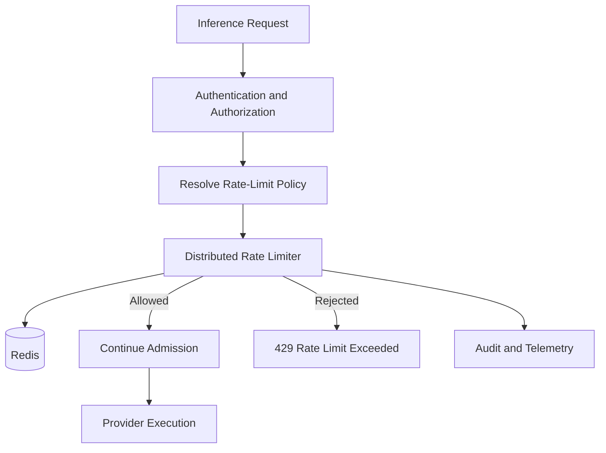

# ADR-0011: Distributed Rate Limiting

- **Status:** Proposed
- **Date:** 2026-11-04
- **Project:** `llm-gateway`
- **Related ADRs:** ADR-0004, ADR-0009, ADR-0010, ADR-0012

## 1. Context

The LLM Gateway must protect itself, its providers, and its tenants from excessive request traffic.

Rate limiting is required to:

- Enforce tenant and project quotas.
- Protect provider-specific quotas.
- Prevent request bursts from exhausting gateway resources.
- Reduce abuse and denial-of-service risk.
- Control request and token throughput.
- Support fair usage across tenants.
- Operate consistently across multiple gateway replicas.

A process-local limiter is insufficient because each replica would maintain a separate quota state.

Rate limiting must also remain distinct from concurrency control and financial budgets:

- **Rate limiting** controls how much traffic may enter over time.
- **Concurrency control** limits simultaneous active executions.
- **Budget control** limits financial expenditure.
- **Provider quotas** protect external provider limits.

## 2. Decision Drivers

The rate-limiting system must:

1. Work across multiple gateway replicas.
2. Support hierarchical quota scopes.
3. Enforce request and token quotas.
4. Support burst capacity.
5. Support provider-specific limits.
6. Provide predictable rejection behavior.
7. Avoid race conditions during quota consumption.
8. Support configurable policies.
9. Protect against abuse.
10. Expose quota status and telemetry.
11. Define behavior during Redis failures.
12. Avoid using rate limits as a substitute for budget enforcement.

## 3. Considered Options

### Option A: Process-local rate limiting

Each gateway replica maintains its own counters.

Advantages:
- Low latency.
- No shared infrastructure.

Disadvantages:
- Quotas multiply with replica count.
- State is lost on restart.
- Cannot enforce global or tenant-wide limits.

### Option B: PostgreSQL-backed rate limiting

Use PostgreSQL transactions to maintain counters and windows.

Advantages:
- Durable state.
- Strong consistency.
- Existing infrastructure.

Disadvantages:
- Adds contention to the primary database.
- High-frequency counter updates can affect financial and operational workloads.
- Not ideal for short-lived distributed coordination.

### Option C: Redis-backed distributed rate limiting

Use Redis atomic operations for operational quota state.

Advantages:
- Low latency.
- Shared across replicas.
- Supports atomic scripts.
- Suitable for short-lived counters and token buckets.

Disadvantages:
- Requires Redis availability.
- State may be lost depending on persistence and failover configuration.
- Failure behavior must be explicit.

## 4. Decision

Adopt **Redis-backed distributed rate limiting**, using atomic Redis operations for quota consumption.

PostgreSQL remains authoritative for durable policy configuration and audit records.

Redis stores operational quota state only.

Rate limits must be enforced before provider execution.

The gateway must not bypass configured strict limits when Redis is unavailable.

## 5. Architecture



The limiter is part of the synchronous admission path.

## 6. Rate-Limit Scopes

Support hierarchical scopes:

```text id="1wdm9d"
Platform
  └── Provider
  └── Tenant
       └── Project
            └── API Key
```

A request may be subject to several simultaneous limits.

Example:

| Scope | Example quota |
|---|---|
| Platform | Global request throughput |
| Provider | Provider requests per minute |
| Tenant | Tenant requests per minute |
| Project | Project tokens per minute |
| API key | Key-specific request burst |

The request is admitted only if every applicable quota allows it.

Scope identifiers must be derived from authenticated gateway context, not trusted from arbitrary client-supplied fields.

## 7. Quota Dimensions

### 7.1 Request rate

Examples:

- Requests per second.
- Requests per minute.
- Requests per hour.

### 7.2 Token rate

Examples:

- Input tokens per minute.
- Output tokens per minute.
- Total tokens per minute.

Token quotas must account for estimated request usage before provider execution.

### 7.3 Provider quota

Provider-specific limits may include:

- Requests per minute.
- Tokens per minute.
- Concurrent requests.
- Model-specific limits.
- Organization or account limits.

Provider quotas must be configurable independently from tenant quotas.

### 7.4 Burst capacity

A quota may allow a bounded burst above its sustained rate.

Burst capacity must be explicit and bounded.

## 8. Algorithms

### 8.1 Token Bucket — Default

Use Token Bucket for most request and token quotas.

Parameters:

- Capacity \(C\).
- Refill rate \(R\).
- Current tokens \(T\).
- Elapsed time \(\Delta t\).

Refill:

\[
T' = \min(C, T + R \times \Delta t)
\]

A request of cost \(q\) is admitted if:

\[
T' \geq q
\]

After admission:

\[
T_{new} = T' - q
\]

Advantages:

- Supports controlled bursts.
- Efficient for distributed enforcement.
- Suitable for requests and estimated tokens.

### 8.2 Sliding Window

Use a sliding-window algorithm when strict rolling-window semantics are required.

Advantages:
- More accurate rolling quotas.

Disadvantages:
- Higher state and operational cost.

### 8.3 Fixed Window

Use fixed windows only where boundary bursts are acceptable.

A fixed window may permit nearly twice the configured quota around a window boundary.

### 8.4 Concurrency

Concurrency is not a rate-limit algorithm.

Use distributed permits or semaphores as defined by ADR-0012.

## 9. Atomic Redis Operations

Quota consumption must be atomic.

Use Redis Lua scripts or an equivalent atomic Redis mechanism to:

1. Read the current quota state.
2. Refill tokens.
3. Check the requested quota amount.
4. Deduct tokens when allowed.
5. Set expiration.
6. Return the decision and remaining quota.

Do not implement quota consumption as separate read and write operations.

The Redis script must use a consistent time source and handle clock behavior explicitly.

## 10. Token Quota Estimation

Before provider execution, the gateway estimates:

- Input tokens.
- Reserved output tokens.
- Total quota cost.

The limiter consumes quota according to the configured policy.

After execution, the gateway may reconcile estimated and actual token usage.

Possible policies:

- Charge estimated input plus requested maximum output.
- Charge estimated input plus a configured output reservation.
- Charge estimated input before execution and reconcile output usage afterward.

The chosen policy must avoid admitting unbounded output usage.

Rate-limit token reconciliation is operational quota accounting; it is not financial settlement.

Financial cost remains governed by ADR-0009.

## 11. Admission Sequence

Recommended admission sequence:

1. Authenticate API key.
2. Resolve tenant and project identity.
3. Authorize the requested operation.
4. Validate and normalize the request.
5. Apply abuse controls.
6. Consume request-rate quota.
7. Consume estimated token-rate quota.
8. Acquire concurrency admission under ADR-0012.
9. Evaluate model and tenant policies.
10. Select a model.
11. Reserve financial budget.
12. Execute the provider.

The implementation may combine quota checks into one atomic script when scopes and dimensions permit.

Because Redis and PostgreSQL do not share a transaction, the gateway must define compensation behavior for quota consumption when later admission steps fail.

A rate-limit token refund may be attempted where the policy permits, but correctness must not depend on successful compensation.

## 12. Rejection Behavior

When a request exceeds a quota, return HTTP `429 Too Many Requests`.

Example:

```json id="xq0z3v"
{
  "error": {
    "code": "rate_limit_exceeded",
    "message": "The request exceeds the configured rate limit.",
    "retryable": true
  }
}
```

Where appropriate, include:

- `Retry-After`.
- Rate-limit limit.
- Remaining quota.
- Reset time.
- Quota scope category.

Do not expose internal tenant identifiers or provider account details unnecessarily.

Rate-limit responses must use stable error codes.

## 13. Redis Failure Policy

Redis failure behavior depends on the quota's security and operational importance.

| Control | Failure policy |
|---|---|
| Strict tenant quota | Fail closed |
| Strict provider quota | Fail closed |
| Abuse protection | Fail closed or conservative local fallback |
| Noncritical soft quota | Explicitly approved degraded mode |
| Financial budget | PostgreSQL authoritative; never bypass |
| Exact cache | Cache miss |
| Distributed concurrency | Follow ADR-0012 policy |

A local fallback limiter may provide emergency protection, but it cannot claim globally consistent quota enforcement.

Redis eviction or state loss must be observable.

For strict quotas, do not silently reset quota state and admit unlimited traffic.

## 14. Configuration

Example:

```yaml id="v8d6wr"
rate_limits:
  defaults:
    requests_per_minute: 120
    burst_capacity: 20
    tokens_per_minute: 100000

  tenant:
    enabled: true

  project:
    enabled: true

  api_key:
    enabled: true

  provider:
    enabled: true

  redis:
    key_prefix: "llm-gateway:rate-limit"
    operation_timeout_ms: 50
    failure_mode: "fail_closed"
```

Values are illustrative and must be tuned using workload measurements.

Policies should be stored durably and versioned in PostgreSQL. Redis keys should include the relevant policy version to support safe configuration changes.

## 15. Key Design

Example Redis key structure:

```text id="g1k2m3"
llm-gateway:rate-limit:v1:tenant:{tenant_id}:requests
llm-gateway:rate-limit:v1:project:{project_id}:tokens
llm-gateway:rate-limit:v1:api-key:{key_id}:requests
llm-gateway:rate-limit:v1:provider:{provider_id}:requests
```

Requirements:

- Use authenticated internal identifiers.
- Avoid raw API keys in Redis keys.
- Apply TTLs to operational state.
- Use consistent key naming.
- Prevent cross-tenant key collisions.
- Avoid storing prompt content in quota state.

## 16. Rust Implementation

Suggested structure:

```text id="3e7f6a"
crates/gateway-core/src/
└── admission/
    ├── rate_limit.rs
    ├── quota_policy.rs
    ├── quota_decision.rs
    └── token_estimation.rs

crates/infrastructure/src/
└── redis/
    ├── rate_limit_store.rs
    └── scripts/
        └── token_bucket.lua
```

Application-owned interface:

```rust id="8f1k2m"
#[async_trait::async_trait]
pub trait RateLimiter: Send + Sync {
    async fn consume(
        &self,
        request: RateLimitRequest,
    ) -> Result<RateLimitDecision, RateLimitError>;
}
```

The domain and application layers must not depend directly on Redis client types.

## 17. Observability

Required metrics:

- Rate-limit decisions.
- Allowed and rejected requests.
- Rejections by quota scope.
- Token quota consumption.
- Redis operation latency.
- Redis errors and timeouts.
- Quota compensation attempts.
- Degraded-mode activation.
- Provider quota exhaustion.
- Rate-limit policy version.

Avoid high-cardinality metric labels such as raw API keys, tenant IDs, or request IDs.

Use structured logs and traces for authorized diagnostic detail.

## 18. Testing Requirements

### Unit tests

- Token Bucket refill.
- Burst capacity.
- Quota exhaustion.
- Retry-after calculation.
- Policy version changes.
- Token quota estimation.

### Redis integration tests

- Atomic concurrent consumption.
- Multiple gateway replicas.
- Redis timeout.
- Redis restart.
- Key expiration.
- Policy update.
- State loss and failover.

### Admission tests

- Multiple hierarchical limits.
- Request quota plus token quota.
- Provider quota exhaustion.
- Rate limit before provider execution.
- Budget rejection after rate-limit admission.
- Compensation failure.
- Strict fail-closed behavior.

### Load tests

- High-cardinality tenants.
- Burst traffic.
- Sustained throughput.
- Redis hot-key behavior.
- Limiter latency under load.

## 19. Consequences

### Positive

- Consistent quota enforcement across replicas.
- Controlled bursts.
- Tenant and provider protection.
- Better abuse resistance.
- Clear separation of rate, concurrency, and financial limits.

### Negative

- Redis becomes part of the admission path.
- Atomic scripts require careful testing.
- Quota state can be affected by Redis failover.
- Token estimation can differ from actual provider usage.
- Compensation across Redis and PostgreSQL is not atomic.

### Risks and Mitigations

| Risk | Mitigation |
|---|---|
| Replica-local quota bypass | Shared Redis state |
| Concurrent quota race | Atomic Lua scripts |
| Redis outage | Explicit fail-closed/degraded policy |
| Token estimate error | Conservative admission and reconciliation |
| Hot tenant key | Workload-aware partitioning and load tests |
| Quota reset on failover | Persistence, monitoring, conservative recovery |
| Confusion with budgets | Separate rate and financial accounting |

## 20. Validation Criteria

ADR-0011 is validated when:

- Rate limits are shared across gateway replicas.
- Multiple quota scopes are enforced.
- Request and token quotas are supported.
- Redis quota consumption is atomic.
- Strict quota failures do not silently fail open.
- Provider execution cannot bypass admission controls.
- Rate limiting remains separate from concurrency and financial budgets.
- Redis failure behavior is tested.
- Quota decisions are observable.
- Load tests demonstrate acceptable limiter latency.

## 21. Related ADRs

- ADR-0004: Redis for Distributed Coordination and Caching
- ADR-0009: Budget Reservation and Financial Settlement
- ADR-0010: Inference Idempotency and Execution Lifecycle
- ADR-0012: Distributed Concurrency Control
- ADR-0013: Provider Retry and Circuit Breaker Strategy
