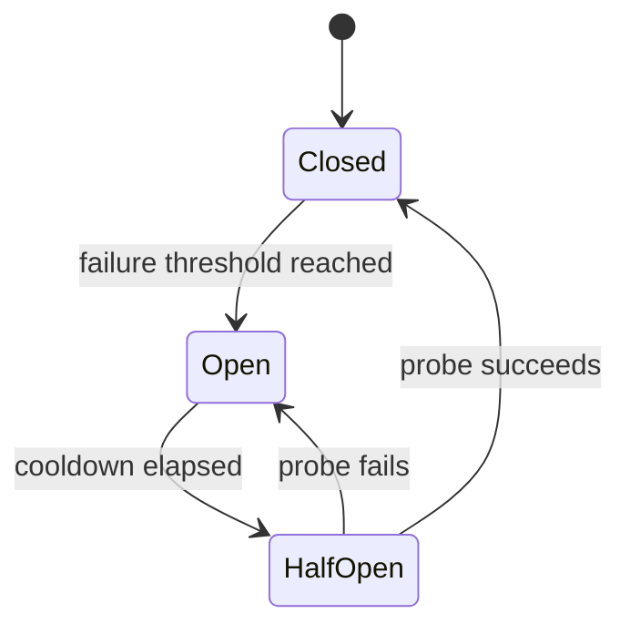

# ADR-0013: Provider Retry and Circuit Breaker Strategy

- **Status:** Proposed
- **Date:** 2026-11-04
- **Decision Owners:** llm-gateway architecture team
- **Related ADRs:** ADR-0006, ADR-0008, ADR-0009, ADR-0010, ADR-0012, ADR-0014

## 1. Context

The `llm-gateway` calls external model providers that can experience:

- Rate limiting and quota exhaustion
- Transient network failures and timeouts
- Provider-side overload and service degradation
- Authentication or configuration errors
- Model-specific failures
- Partial or ambiguous request outcomes
- Streaming interruptions

Retries can improve availability, but uncontrolled retries amplify provider load, increase latency and cost, and may duplicate billable inference requests.

Circuit breakers prevent repeated calls to providers that are likely to fail. They must operate alongside routing, execution lifecycle, concurrency control, budget accounting, and streaming semantics.

The gateway must distinguish retryable failures from permanent failures and must not retry an inference request when its outcome is unknown unless the request is known to be safe to replay.

## 2. Decision

The gateway will implement a centralized **Reliability Engine** that owns retry decisions, circuit-breaker state, provider health signals, and fallback eligibility.

Provider adapters will normalize provider errors but will not independently implement retry loops.

The Reliability Engine will:

1. Classify provider outcomes.
2. Determine whether the current attempt is retryable.
3. Enforce retry budgets and deadlines.
4. Apply exponential backoff with jitter.
5. Consult circuit-breaker state before dispatch.
6. Recompute eligible routes when fallback is permitted.
7. Record every attempt and reliability decision.
8. Preserve execution and financial-accounting invariants.

Retries and fallbacks are separate decisions:

- **Retry:** repeat an attempt against the same provider/model route.
- **Fallback:** select a different eligible provider/model route through the routing engine.

## 3. Failure Classification

Provider adapters map vendor-specific errors to canonical gateway failure categories.

| Category | Examples | Retry same route? | Fallback? |
|---|---|---:|---:|
| Rate limited | HTTP 429, provider throttle | Usually, after delay | Yes, if another route is eligible |
| Provider overload | HTTP 503, capacity unavailable | Usually | Yes |
| Transient network | Connection reset, temporary DNS failure | Usually, if outcome is known safe | Yes |
| Connect timeout | Failure before request transmission | Usually | Yes |
| Read timeout | Timeout after request may have reached provider | Only if replay safety is established | Conditional |
| Provider 5xx | Temporary internal error | Usually, subject to outcome certainty | Yes |
| Invalid request | Malformed payload, unsupported parameter | No | Only if route-specific incompatibility can be corrected |
| Authentication error | Invalid provider credentials | No | Possibly, to another independently configured provider |
| Permission error | Model access denied | No | Yes, if another route is eligible |
| Model unavailable | Model retired or unavailable | No repeated same-route retry | Yes |
| Content/policy rejection | Provider safety rejection | No | Only if policy permits and semantics remain equivalent |
| Client cancellation | Client disconnected or cancelled | No | No |
| Unknown outcome | Provider may have accepted request but response was lost | Not by default | Only under explicit replay policy |

The canonical error must include:

- `category`
- `provider_code`, when available
- `http_status`, when available
- `retryable_hint`
- `request_may_have_been_accepted`
- `retry_after`
- `safe_to_replay`
- `failure_scope` (request, model, provider, or configuration)

Provider-supplied retry hints are advisory and must be bounded by gateway policy.

## 4. Retry Policy

### 4.1 Bounded retries

Retries are bounded by all of the following:

- Maximum attempts per execution
- Maximum retry duration
- Overall request deadline
- Per-provider retry budget
- Tenant or platform reliability policy
- Remaining execution and budget constraints

The initial attempt counts toward the maximum attempt count.

Retries must not extend execution beyond the caller's deadline.

### 4.2 Exponential backoff with jitter

Use capped exponential backoff with full jitter:

```text
cap = min(max_backoff, base_backoff * 2^retry_index)
delay = random(0, cap)
```

If the provider returns `Retry-After`, use it as a lower-bound signal subject to configured maximum delay and the overall deadline.

The implementation must avoid synchronized retry bursts across gateway replicas.

### 4.3 Retry budgets

A retry budget limits the fraction or absolute number of retry attempts relative to original requests.

The initial implementation will support:

- Global retry budget
- Provider-specific retry budget
- Optional tenant-level retry policy

When a retry budget is exhausted, the gateway stops retrying and proceeds to an eligible fallback or returns a normalized error.

Retries must not be used to bypass rate limits or concurrency limits. Every new attempt must pass the applicable admission controls.

### 4.4 Idempotency and uncertain outcomes

The gateway must not assume that an inference request is idempotent merely because it uses HTTP POST.

A retry is permitted only when:

- The provider confirms the request was not accepted; or
- The provider supports an idempotency mechanism that the gateway can safely use; or
- An explicit policy permits replay despite duplicate-execution risk.

For uncertain outcomes:

1. Persist the attempt as `outcome_unknown`.
2. Preserve the budget reservation or move it into the defined reconciliation state.
3. Do not automatically retry by default.
4. Reconcile provider status where supported.
5. Apply a policy-specific decision if reconciliation is unavailable.

See ADR-0009 and ADR-0010.

## 5. Circuit Breaker

### 5.1 State machine

Each circuit breaker follows this state machine:



- **Closed:** requests may be dispatched.
- **Open:** requests are rejected for this route without contacting the provider.
- **Half-open:** a limited number of probe requests are permitted to test recovery.

### 5.2 Breaker scope

Circuit breakers are scoped by provider and model route where provider behavior differs by model.

The implementation may maintain a broader provider-level breaker for provider-wide outages, but it must not unnecessarily disable healthy models when only one model is degraded.

Breaker state is operational state and is stored in Redis so gateway replicas share provider health decisions.

### 5.3 Failure signals

Count failures that indicate provider availability or reliability problems, such as:

- Provider overload
- Relevant provider 5xx responses
- Connection failures
- Repeated timeouts
- Provider-specific availability errors

Do not count as breaker failures:

- Client validation errors
- Authentication or authorization errors caused by gateway configuration
- Client cancellations
- Policy rejections
- Expected business-level responses

Rate-limit responses may affect provider health, but should be tracked separately from availability failures so a quota issue does not automatically classify the provider as unavailable.

### 5.4 Thresholds and recovery

Breaker thresholds are configuration-driven and must support:

- Minimum sample count
- Failure ratio threshold
- Rolling observation window
- Open-state cooldown
- Half-open probe limit
- Recovery success threshold

Initial values will be selected through load testing and operational tuning rather than treated as universal constants.

Breaker transitions must be observable and auditable.

## 6. Routing and Fallback Integration

The Reliability Engine uses the routing engine to find fallback candidates. It must not invent provider/model mappings or bypass routing constraints.

Fallback candidates must satisfy:

- Tenant and model access policy
- Required capabilities and request parameters
- Data residency and compliance constraints
- Budget and pricing policy
- Provider/model health
- Rate and concurrency admission controls
- Quality and latency requirements

Fallback sequence:

1. Classify the failed attempt.
2. Determine whether retrying the same route is allowed.
3. If retry is not allowed or exhausted, request a new candidate from the routing engine.
4. Acquire candidate-specific concurrency permits.
5. Reserve or adjust budget according to ADR-0009.
6. Dispatch the fallback attempt.
7. Release permits and settle accounting for each completed attempt.

A fallback must not silently weaken tenant policy, data residency, capability requirements, or quality constraints.

## 7. Streaming Semantics

Retries and fallback are more restrictive for streaming requests.

- Before the first client-visible output, retry or fallback may be allowed if replay safety and execution policy permit it.
- After output has been sent to the client, the gateway must not transparently switch providers and splice a second generation into the same stream.
- If a stream fails after output begins, terminate the stream with a normalized error event or connection close according to the API contract.
- Record partial output and provider usage when available.
- Preserve the execution's accounting and outcome state.
- Do not release concurrency permits until provider cancellation is confirmed or the lease recovery policy takes over.

Streaming behavior is further specified in ADR-0014.

## 8. Configuration

Reliability policy is centrally configurable and versioned.

Example configuration:

```yaml
reliability:
  max_attempts: 3
  max_retry_duration_ms: 8000
  base_backoff_ms: 100
  max_backoff_ms: 2000
  retry_budget:
    global_ratio: 0.10
    provider_ratio: 0.15
  circuit_breaker:
    minimum_samples: 20
    failure_ratio: 0.50
    rolling_window_seconds: 30
    open_duration_seconds: 20
    half_open_probe_limit: 2
```

These values are illustrative defaults and must be validated through performance and failure-injection testing.

Configuration changes must be auditable and applied without requiring a gateway restart where practical.

## 9. Clean Architecture

### Domain and application responsibilities

`gateway-core` defines:

- Canonical provider failure categories
- Retry and fallback decisions
- Retry budget policy
- Circuit-breaker policy and state transitions
- Reliability Engine orchestration
- Ports for breaker state, retry budgets, and provider health

### Infrastructure responsibilities

`gateway-infra` implements:

- Redis-backed distributed breaker state
- Retry-budget coordination
- Provider error normalization support
- Provider-specific retry hint parsing
- Metrics and tracing integration

### Provider adapter responsibilities

Adapters:

- Execute one provider attempt
- Normalize provider responses and failures
- Expose provider capabilities and replay-safety information
- Do not run independent retry loops

## 10. Rust Interface Sketch

```rust
#[derive(Debug, Clone)]
pub struct RetryDecision {
    pub retry_same_route: bool,
    pub fallback_allowed: bool,
    pub delay_ms: Option<u64>,
    pub reason: String,
}

#[async_trait::async_trait]
pub trait ReliabilityEngine: Send + Sync {
    async fn evaluate_failure(
        &self,
        context: ReliabilityContext,
        failure: ProviderFailure,
    ) -> Result<RetryDecision, ReliabilityError>;
}

#[async_trait::async_trait]
pub trait CircuitBreakerStore: Send + Sync {
    async fn allow_request(
        &self,
        route: &ProviderRoute,
    ) -> Result<BreakerPermit, ReliabilityError>;

    async fn record_success(
        &self,
        permit: BreakerPermit,
    ) -> Result<(), ReliabilityError>;

    async fn record_failure(
        &self,
        permit: BreakerPermit,
        failure: ProviderFailure,
    ) -> Result<(), ReliabilityError>;
}
```

The final implementation must prevent stale or duplicate breaker updates from corrupting state, using atomic Redis operations or scripts.

## 11. Observability

Required metrics:

- `llm_gateway_provider_attempts_total`
- `llm_gateway_provider_failures_total`
- `llm_gateway_retries_total`
- `llm_gateway_fallbacks_total`
- `llm_gateway_retry_delay_seconds`
- `llm_gateway_retry_budget_exhausted_total`
- `llm_gateway_circuit_breaker_state`
- `llm_gateway_circuit_breaker_transitions_total`
- `llm_gateway_provider_outcome_unknown_total`

Required trace attributes include:

- Execution ID
- Attempt ID
- Provider and model route
- Retry index
- Retry decision and reason
- Breaker state
- Fallback decision
- Normalized failure category

Do not use raw prompts, API keys, or unbounded tenant identifiers as metric labels.

## 12. Security and Operational Considerations

- Provider error bodies must be size-limited and redacted before logging.
- Retry and fallback decisions must not expose provider credentials or sensitive request content.
- Redis access must use TLS and scoped ACLs.
- Breaker and retry state must be protected against accidental eviction or uncontrolled key growth.
- Provider-specific policy must be configurable without allowing tenants to bypass platform safety limits.
- Retry storms must be prevented through bounded retries, jitter, retry budgets, and circuit breakers.

## 13. Consequences

### Positive

- Reduces transient provider failures visible to clients.
- Prevents repeated calls to degraded routes.
- Makes retry and fallback behavior consistent across providers.
- Improves incident diagnosis through attempt-level telemetry.
- Limits retry amplification and uncontrolled cost.

### Negative

- Adds Redis coordination and reliability-policy complexity.
- Requires careful treatment of ambiguous provider outcomes.
- Distributed breaker state may lag or become unavailable during Redis incidents.
- Fallback can change latency, cost, or model behavior and must remain policy-constrained.

### Risks

- Incorrect error classification may cause retry storms or suppress valid retries.
- Replaying uncertain requests may duplicate provider work and charges.
- Circuit breakers may oscillate if thresholds are poorly tuned.
- Fallback may be unavailable when all eligible routes are unhealthy or over quota.

## 14. Validation Criteria

The decision is considered implemented when:

- [ ] Provider errors are normalized into canonical categories.
- [ ] Provider adapters execute one attempt and do not own retry loops.
- [ ] Retries respect attempt limits, deadlines, retry budgets, and backoff.
- [ ] Uncertain outcomes are not retried by default.
- [ ] Circuit breakers support closed, open, and half-open states.
- [ ] Breaker state is coordinated across gateway replicas.
- [ ] Fallback candidates are re-evaluated through routing policy.
- [ ] Every retry and fallback passes rate, concurrency, and budget controls.
- [ ] Streaming requests are not transparently switched after client-visible output.
- [ ] Metrics, traces, and audit events capture reliability decisions.
- [ ] Failure-injection tests cover provider outages, 429s, timeouts, Redis failure, and recovery.

## 15. Related Decisions

- ADR-0006: Canonical Provider Adapter Interface
- ADR-0008: Constraint-Based Model Routing
- ADR-0009: Budget Reservation and Financial Settlement
- ADR-0010: Inference Idempotency and Execution Lifecycle
- ADR-0012: Distributed Concurrency Control
- ADR-0014: Streaming and Provider Fallback Semantics

