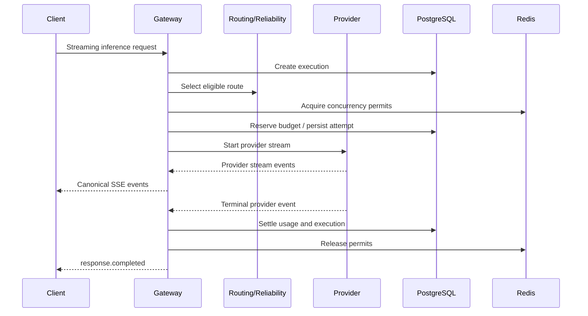

# ADR-0014: Streaming and Provider Fallback Semantics

- **Status:** Proposed
- **Date:** 2026-11-04
- **Decision Owners:** llm-gateway architecture team
- **Related ADRs:** ADR-0006, ADR-0008, ADR-0009, ADR-0010, ADR-0012, ADR-0013

## 1. Context

The `llm-gateway` must support both non-streaming and streaming inference requests across multiple providers.

Streaming improves perceived latency by delivering incremental output, but it introduces additional reliability and accounting challenges:

- A provider may fail before returning the first token.
- A provider may fail after partial output has reached the client.
- Client disconnects may occur while the provider is still generating.
- Provider streams may use different event formats and termination signals.
- Usage information may arrive only at the end of a stream—or not arrive at all.
- Retrying or switching providers after output has been delivered can produce duplicated, inconsistent, or semantically discontinuous responses.

The gateway needs provider-neutral streaming semantics while preserving execution lifecycle, admission control, budget accounting, and observability.

## 2. Decision

The gateway will expose a canonical streaming protocol independent of provider-specific event formats.

The gateway will support:

1. **Pre-output retry/fallback:** permitted only when replay safety and policy allow it.
2. **Post-output failure termination:** once client-visible output begins, the gateway will not transparently switch providers.
3. **Explicit terminal events:** every successfully completed stream ends with a canonical terminal event.
4. **Usage reconciliation:** usage is captured from provider stream events when available and reconciled when missing or uncertain.
5. **Cancellation propagation:** client cancellation triggers provider-stream cancellation and execution cleanup.
6. **Attempt-level tracking:** each provider stream is represented as an attempt within the logical execution.

The gateway will not promise seamless provider switching after client-visible output has begun.

## 3. Canonical Streaming Protocol

The public API will use Server-Sent Events (SSE) for the initial streaming interface.

Each event is a canonical gateway event, not a raw provider event.

### 3.1 Event types

| Event | Purpose |
|---|---|
| `response.started` | Logical response has started |
| `response.output_text.delta` | Incremental text output |
| `response.output_metadata` | Structured metadata, if supported |
| `response.usage` | Usage information available during or after generation |
| `response.completed` | Successful terminal event |
| `response.failed` | Terminal failure |
| `response.cancelled` | Request cancelled |
| `response.warning` | Non-terminal warning, such as unavailable usage metadata |

The exact public event schema is governed by `docs/api-contracts.md`.

### 3.2 Event envelope

```json
{
  "id": "evt_01J...",
  "type": "response.output_text.delta",
  "response_id": "resp_01J...",
  "created_at": "2026-11-04T12:00:00Z",
  "sequence_number": 4,
  "data": {
    "text": "Hello"
  }
}
```

Requirements:

- `sequence_number` is monotonically increasing within a response.
- Event IDs are unique within the gateway's event namespace.
- Provider-specific fields are normalized or placed in an explicitly defined metadata object.
- Raw provider payloads are not forwarded by default.
- Sensitive provider metadata is filtered before emission.

## 4. Stream Lifecycle



The lifecycle is:

1. Authenticate and authorize the request.
2. Validate request parameters and streaming support.
3. Apply rate limits and routing policy.
4. Acquire applicable concurrency permits.
5. Reserve budget and persist the execution/attempt.
6. Start the provider stream.
7. Normalize and emit canonical events.
8. Process provider terminal state and usage.
9. Settle accounting and update execution state.
10. Release permits and emit the canonical terminal event.

The implementation must define ordering so a successful terminal event is not emitted before required durable accounting state is recorded.

## 5. Fallback Semantics

### 5.1 Before client-visible output

Fallback may be considered when:

- The provider fails before any output has been emitted.
- The failure is classified as retryable or fallback-eligible.
- The request is safe to replay under the configured policy.
- The overall deadline and retry budget permit another attempt.
- A new route satisfies all routing constraints.
- Required concurrency permits and budget reservations can be acquired.

The gateway must not emit provider-specific output before determining whether the attempt will be exposed to the client.

### 5.2 After client-visible output

Once any output delta has been emitted:

- Do not transparently switch to another provider.
- Do not concatenate output from a new provider attempt into the existing stream.
- Terminate with `response.failed` or close the stream according to the API contract.
- Record partial output status and available usage.
- Preserve accounting for the attempt.
- Attempt provider cancellation and cleanup.

A future API version may support explicit continuation semantics, but continuation is not part of this decision.

### 5.3 Retry versus fallback

| Condition | Behavior |
|---|---|
| Connect failure before request transmission | Retry or fallback if policy permits |
| Provider rejects request before generation | Retry/fallback based on normalized error |
| Timeout with uncertain provider acceptance | Do not replay by default |
| Failure before first output, safe replay | Retry/fallback may be allowed |
| Failure after output emitted | Terminate; no transparent fallback |
| Client cancellation | Cancel provider stream; no retry |
| Gateway internal error before output | Retry only if execution state and replay safety allow |

## 6. Client Disconnect and Cancellation

When the client disconnects or explicitly cancels:

1. Mark the logical execution as cancellation-requested.
2. Signal cancellation to the provider adapter.
3. Stop forwarding events.
4. Drain or close the provider stream according to adapter capabilities.
5. Record usage and final outcome if available.
6. Settle or reconcile budget accounting.
7. Release concurrency permits only when provider cancellation is confirmed or the lease recovery policy applies.
8. Persist the terminal execution state.

A client disconnect does not prove that the provider stopped generating.

If cancellation cannot be confirmed, the execution must remain in an appropriate uncertain or cleanup-pending state. The gateway must not immediately assume that provider resources or charges have stopped.

## 7. Usage and Financial Accounting

Streaming usage may be delivered:

- In a terminal provider event
- In a separate usage event
- Through a provider usage API
- Not at all

The gateway will:

- Capture usage events without assuming they are final until the provider stream terminates.
- Persist usage associated with the specific provider attempt.
- Settle the budget using authoritative usage when available.
- Use documented estimation rules when exact usage is unavailable.
- Mark estimated usage distinctly from provider-reported usage.
- Reconcile uncertain or late usage through the accounting workflow.

Each attempt must have its own usage record. Logical execution usage is the aggregate of its attempts, subject to provider billing semantics and duplicate-execution risk.

The gateway must not assume that a failed or cancelled stream is free.

## 8. Backpressure and Buffering

The gateway will use bounded buffering between provider adapters and client transport.

Requirements:

- Do not buffer the entire generated response in memory.
- Apply backpressure when the client consumes output slowly.
- Bound event size and buffer capacity.
- Cancel or terminate streams that exceed configured resource limits.
- Avoid unbounded per-connection task or channel growth.
- Keep provider stream processing asynchronous and non-blocking.

If the client cannot keep up, the gateway must follow a defined policy: wait within bounded limits, then cancel or terminate the stream rather than allowing unbounded memory growth.

## 9. Timeouts and Limits

Streaming requests must support:

- Connection establishment timeout
- Time to first token/output timeout
- Inter-event idle timeout
- Overall execution deadline
- Maximum output tokens
- Maximum stream duration
- Maximum buffered bytes/events

Timeouts are distinct:

- **Time to first output:** limits provider startup latency.
- **Idle timeout:** detects a stalled stream after output begins.
- **Overall deadline:** caps total request duration.

A timeout before output may allow retry/fallback if safe. A timeout after output generally terminates the stream.

## 10. Provider Adapter Contract

Provider adapters expose a normalized stream interface.

```rust
#[async_trait::async_trait]
pub trait ProviderStream: Send {
    async fn next_event(
        &mut self,
    ) -> Result<Option<CanonicalProviderEvent>, ProviderError>;

    async fn cancel(&mut self) -> Result<(), ProviderError>;
}

#[async_trait::async_trait]
pub trait ProviderAdapter: Send + Sync {
    async fn start_stream(
        &self,
        request: ProviderRequest,
    ) -> Result<Box<dyn ProviderStream>, ProviderError>;
}
```

The adapter is responsible for:

- Mapping provider events to canonical provider events
- Detecting provider terminal events
- Extracting usage information
- Mapping provider errors
- Propagating cancellation
- Closing provider resources

The gateway application layer is responsible for:

- Retry and fallback policy
- Public event translation
- Execution lifecycle
- Budget settlement
- Concurrency permit lifecycle
- Client transport behavior

## 11. Clean Architecture Placement

```text
crates/
├── gateway-core/
│   ├── inference/
│   │   ├── execution.rs
│   │   └── streaming.rs
│   ├── reliability/
│   │   └── fallback.rs
│   └── ports/
│       └── provider_stream.rs
├── gateway-api/
│   └── http/
│       └── streaming_handler.rs
└── gateway-infra/
    └── providers/
        └── <provider>/
            └── stream_adapter.rs
```

Domain and application logic must not depend on Axum SSE types or provider-specific stream structures.

## 12. Observability

Required metrics:

- `llm_gateway_streams_started_total`
- `llm_gateway_streams_completed_total`
- `llm_gateway_streams_failed_total`
- `llm_gateway_streams_cancelled_total`
- `llm_gateway_stream_time_to_first_output_seconds`
- `llm_gateway_stream_duration_seconds`
- `llm_gateway_stream_idle_timeouts_total`
- `llm_gateway_stream_client_disconnects_total`
- `llm_gateway_stream_provider_cancel_failures_total`
- `llm_gateway_stream_usage_missing_total`
- `llm_gateway_stream_fallbacks_before_output_total`

Trace spans should include:

- Execution ID and attempt ID
- Provider/model route
- Time to first output
- Number of emitted events
- Output byte/token counts when available
- Terminal reason
- Cancellation result
- Usage source and estimation status

Do not log raw prompts or generated content by default.

## 13. Security

- Validate and authorize before opening provider streams.
- Enforce output and duration limits to mitigate resource exhaustion.
- Redact sensitive provider metadata before forwarding.
- Do not expose provider request IDs unless explicitly approved by the API contract.
- Apply tenant isolation to stream execution and cancellation.
- Ensure cancellation endpoints cannot target another tenant's execution.
- Treat stream event payloads as untrusted provider data.
- Avoid logging raw prompt or response content by default.

## 14. Consequences

### Positive

- Provides a consistent streaming API across providers.
- Makes retry/fallback behavior predictable.
- Prevents discontinuous output caused by transparent mid-stream provider switching.
- Supports cancellation, usage accounting, and execution observability.
- Limits memory use through bounded streaming and backpressure.

### Negative

- Post-output provider failures are visible to clients.
- Streaming accounting is more complex than non-streaming accounting.
- Cancellation may not immediately stop provider work or billing.
- Provider adapters must normalize different event and usage formats.

### Risks

- Incorrect terminal-event handling may leave executions active.
- Missing usage events may require estimation and reconciliation.
- Slow clients can consume concurrency permits for extended periods.
- Provider cancellation failures can leave uncertain resource usage.

## 15. Validation Criteria

- [ ] Public streaming events are provider-neutral and documented.
- [ ] Successful streams emit exactly one canonical terminal event.
- [ ] No transparent provider switch occurs after client-visible output.
- [ ] Pre-output fallback respects replay safety and routing constraints.
- [ ] Client cancellation propagates to provider adapters.
- [ ] Provider cancellation uncertainty is represented in execution state.
- [ ] Usage is recorded per attempt and reconciled when missing.
- [ ] Streaming uses bounded buffers and backpressure.
- [ ] Time-to-first-output, idle, and overall deadlines are enforced.
- [ ] Concurrency permits remain held until completion or valid cleanup/lease recovery.
- [ ] Tests cover partial output failure, cancellation, slow clients, missing usage, and fallback before output.

## 16. Related Decisions

- ADR-0006: Canonical Provider Adapter Interface
- ADR-0008: Constraint-Based Model Routing
- ADR-0009: Budget Reservation and Financial Settlement
- ADR-0010: Inference Idempotency and Execution Lifecycle
- ADR-0012: Distributed Concurrency Control
- ADR-0013: Provider Retry and Circuit Breaker Strategy

