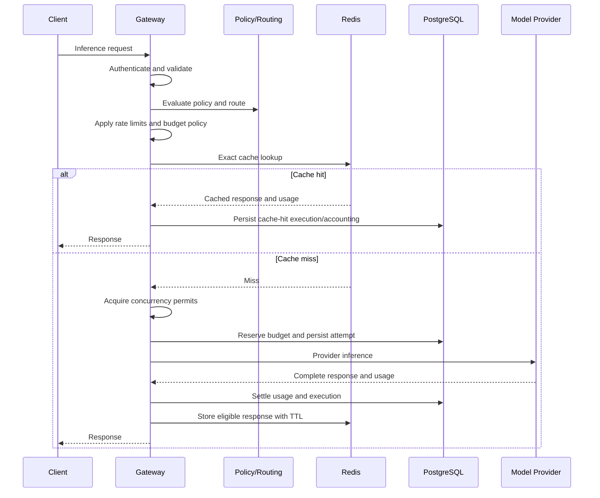

# ADR-0015: Exact Cache Architecture

- **Status:** Proposed
- **Date:** 2026-11-04
- **Decision Owners:** llm-gateway architecture team
- **Related ADRs:** ADR-0004, ADR-0007, ADR-0008, ADR-0009, ADR-0010, ADR-0014

## 1. Context

The `llm-gateway` can reduce latency and provider cost by reusing responses for identical inference requests.

Caching model outputs is more sensitive than caching ordinary HTTP responses because results can depend on:

- Model and provider configuration
- Prompt and message content
- Sampling parameters
- System instructions
- Tool definitions and tool choice
- Response format or structured-output schema
- Tenant-specific context and policy
- Model version, pricing, and capability changes
- Safety and authorization context

An incorrect cache hit can return a response generated under different instructions, leak data across tenants, violate policy, or misrepresent usage and cost.

The gateway needs a conservative exact-cache design before considering semantic caching.

## 2. Decision

The gateway will implement an **opt-in exact response cache** backed by Redis.

The cache will:

- Reuse responses only when the canonical request fingerprint matches.
- Be disabled by default for requests that are not explicitly cache-eligible.
- Enforce tenant isolation and policy constraints.
- Store only complete, successful, cacheable responses.
- Exclude streaming requests from the initial implementation.
- Exclude tool execution and other side-effecting workflows.
- Use TTL-based expiration and bounded storage.
- Treat cache entries as operational data, not authoritative execution or accounting records.

A cache hit is a new logical gateway execution with its own authorization, rate-limit, budget, audit, and usage semantics. It is not a replay of the original execution record.

## 3. Cache Eligibility

A request is eligible only when all required conditions hold:

- The tenant's cache policy enables exact caching.
- The request is non-streaming.
- The request uses a supported inference operation.
- The request is deterministic enough for the configured cache policy.
- The request contains no unsupported tool calls or side effects.
- The model and provider route are cache-compatible.
- The request has no `no-cache` directive.
- The request does not contain sensitive or prohibited content under tenant policy.
- The response can be stored within configured size limits.

Initial implementation will support non-streaming text/chat completion requests with no tool execution.

### 3.1 Excluded by default

- Streaming responses
- Tool calls or function execution
- Requests with external side effects
- Requests requiring live retrieval or current external data
- Requests with unsupported multimodal inputs
- Requests with provider-specific nondeterministic features not represented in the cache key
- Requests where policy requires fresh provider execution
- Requests that cannot be safely isolated by tenant and authorization context

Eligibility must be evaluated before cache lookup.

## 4. Cache Key

The cache key is a cryptographic fingerprint of a canonical request representation.

```text
cache_key = SHA-256(
    cache_namespace
    || tenant_scope
    || canonical_request
    || cache_policy_version
)
```

The canonical request must include all response-affecting fields, including:

- Stable gateway model ID
- Resolved provider/model route
- Model revision or deployment version when available
- System and user messages in order
- Sampling parameters
- Maximum output tokens
- Stop sequences
- Response format and schema
- Tool definitions and tool choice, if later supported
- Relevant safety or policy version
- Cache namespace and version

The canonicalization algorithm must be deterministic and versioned.

The key must not contain raw API keys or be directly reversible to prompt content. Sensitive request content must not be stored in Redis keys.

### 4.1 Route identity

The initial cache key includes the resolved provider/model route.

This avoids serving a response generated by a different route when provider behavior, model revision, or deployment configuration may differ.

If routing policy changes the selected route, the request produces a different cache key.

### 4.2 Hashing

Use a cryptographic hash such as SHA-256 over canonical serialized bytes.

Do not use a process-local hash function whose output can change across runtime versions.

## 5. Cache Value

Cache entries contain only the data needed to reproduce the supported response.

```json
{
  "schema_version": 1,
  "cache_key_version": 1,
  "created_at": "2026-11-04T12:00:00Z",
  "expires_at": "2026-11-04T12:05:00Z",
  "tenant_scope": "tenant_opaque_id",
  "model_id": "gateway-model-id",
  "route_id": "provider-route-id",
  "response": {
    "id": "resp_original",
    "output": [],
    "finish_reason": "stop"
  },
  "usage": {
    "input_tokens": 120,
    "output_tokens": 45,
    "source": "provider_reported"
  }
}
```

The stored representation must exclude:

- Provider credentials
- Raw authorization headers
- Internal secrets
- Unnecessary provider metadata
- Unredacted diagnostics
- Data not required to reconstruct the public response

Response IDs and timestamps must be regenerated or adapted for the new logical execution where required by the API contract. The cache must not make a new request appear to be the same execution as the original request.

## 6. Cache Lookup and Execution Flow



The implementation must define ordering between cache lookup, budget reservation, and execution persistence so that cache hits are correctly accounted for without creating provider-attempt records.

## 7. Cache Hit Accounting

A cache hit must not be represented as a provider call.

The gateway will:

- Create a new logical execution record.
- Mark the execution outcome as `cache_hit`.
- Record cache metadata and the source cache entry reference where appropriate.
- Apply tenant request quotas and policy.
- Apply the configured cache-hit billing policy.
- Avoid provider usage charges when no provider call occurred.
- Avoid acquiring provider-specific concurrency permits.
- Record zero provider tokens/cost for the new execution unless a separate gateway billing policy applies.

The initial policy is that provider cost is zero for a cache hit. Tenant billing, if enabled, is a separate explicit policy and must not be inferred from provider cost.

Rate limits and tenant-level request quotas still apply to cache hits.

## 8. Cache Miss and Write Policy

On a cache miss:

1. Continue through normal admission and execution controls.
2. Invoke the selected provider route.
3. Capture the complete response and usage.
4. Settle accounting.
5. Store the response only if the request and response remain cache-eligible.
6. Apply the configured TTL and size limits.

Only complete successful responses may be cached.

Do not cache:

- Provider errors
- Partial or interrupted responses
- Cancelled executions
- Unknown outcomes
- Responses with unresolved accounting state
- Responses that violate cache policy
- Responses exceeding configured size limits

Cache write failure must not fail an otherwise successful inference request.

## 9. TTL, Invalidation, and Versioning

Each cache entry has a bounded TTL.

TTL is configured by tenant policy and may vary by model or operation. The initial default should be conservative and configurable.

Invalidation is achieved through:

- TTL expiration
- Cache namespace version changes
- Cache-key version changes
- Model revision or route identity changes
- Policy version changes
- Explicit tenant or model cache purge operations

The gateway must not rely solely on manual invalidation for correctness.

Administrative cache purge operations must be authorized, audited, and scoped.

## 10. Redis Failure and Resource Management

Redis is an optimization layer, not the authoritative inference store.

- Cache lookup failure is treated as a cache miss.
- Cache write failure is logged and measured but does not fail the inference response.
- Redis cache data may be evicted.
- Cache storage must have explicit memory and entry-size limits.
- Cache keys must have bounded cardinality controls.
- Cache operations must use timeouts.
- Cache traffic should be isolated from critical rate-limit and concurrency coordination where practical.

If Redis is shared with admission-control state, cache eviction policy must not compromise active concurrency permits or strict rate-limit state. Prefer separate Redis deployments or resource isolation for cache and coordination workloads.

## 11. Clean Architecture

### Application responsibilities

`gateway-core` defines:

- Cache eligibility policy
- Canonical cache-key input model
- Cache lookup/write orchestration
- Cache-hit execution semantics
- Cache policy and invalidation interfaces

### Infrastructure responsibilities

`gateway-infra` implements:

- Redis cache storage
- Serialization and schema versioning
- TTL management
- Cache purge operations
- Cache metrics and error handling

### Suggested structure

```text
crates/
├── gateway-core/
│   └── cache/
│       ├── eligibility.rs
│       ├── key.rs
│       ├── policy.rs
│       └── ports.rs
└── gateway-infra/
    └── cache/
        ├── redis_store.rs
        └── serialization.rs
```

## 12. Rust Interface Sketch

```rust id="5y5v3g"
#[derive(Debug, Clone)]
pub struct CacheLookupRequest {
    pub key: CacheKey,
    pub tenant_id: TenantId,
}

#[async_trait::async_trait]
pub trait ExactResponseCache: Send + Sync {
    async fn get(
        &self,
        request: CacheLookupRequest,
    ) -> Result<Option<CachedResponse>, CacheError>;

    async fn put(
        &self,
        entry: CachedResponse,
        ttl_seconds: u64,
    ) -> Result<(), CacheError>;

    async fn purge(
        &self,
        scope: CachePurgeScope,
    ) -> Result<u64, CacheError>;
}
```

The cache key must be generated by application logic from the canonical request model, not by infrastructure-specific serialization.

## 13. Observability

Required metrics:

- `llm_gateway_cache_lookups_total`
- `llm_gateway_cache_hits_total`
- `llm_gateway_cache_misses_total`
- `llm_gateway_cache_bypasses_total`
- `llm_gateway_cache_write_failures_total`
- `llm_gateway_cache_lookup_duration_seconds`
- `llm_gateway_cache_entry_size_bytes`
- `llm_gateway_cache_evictions_total`
- `llm_gateway_cache_purge_operations_total`

Cache bypass reasons should be recorded with bounded labels such as:

- `streaming`
- `tool_execution`
- `policy_disabled`
- `unsupported_operation`
- `sensitive_request`
- `route_not_cacheable`
- `request_directive`
- `response_size_limit`

Do not include prompts, cache keys, or raw tenant identifiers in metric labels.

## 14. Security and Privacy

- Cache entries are tenant-scoped.
- Authorization and policy checks occur before cache lookup.
- Cache keys use opaque tenant scope identifiers.
- Redis connections use TLS and scoped ACLs.
- Sensitive request data is not stored in Redis keys.
- Cache values have explicit retention limits.
- Cache purge operations are audited.
- Cache responses must not bypass content policy or access control.
- Tenant isolation tests must verify that identical prompts across tenants cannot collide.

## 15. Consequences

### Positive

- Reduces provider cost for repeated identical requests.
- Improves latency for eligible requests.
- Provides a conservative foundation before semantic caching.
- Preserves provider-neutral cache semantics.
- Keeps cache failures from becoming inference failures.

### Negative

- Exact matching limits hit rate.
- Canonicalization and key versioning require careful governance.
- Cache-hit accounting adds execution-path complexity.
- Redis storage and invalidation require operational controls.

### Risks

- Missing a response-affecting field from the key can cause incorrect hits.
- Incorrect tenant scoping can create data leakage.
- Caching nondeterministic or context-sensitive responses can return stale output.
- Shared Redis resource policies can affect admission-control reliability.

## 16. Validation Criteria

- [ ] Exact cache is disabled by default unless policy enables it.
- [ ] Cache eligibility excludes streaming and side-effecting requests.
- [ ] Cache key includes all supported response-affecting fields.
- [ ] Cache key includes tenant scope, route identity, and policy/key version.
- [ ] Only complete successful responses are stored.
- [ ] Cache hits create new logical execution records.
- [ ] Cache hits do not create provider attempts or provider charges.
- [ ] Request quotas and authorization still apply on cache hits.
- [ ] Redis cache failures degrade to miss/bypass behavior.
- [ ] TTL, size limits, and purge operations are enforced.
- [ ] Tests verify canonicalization, tenant isolation, key versioning, expiry, and cache-write failure behavior.

## 17. Related Decisions

- ADR-0004: Redis for Distributed Coordination and Caching
- ADR-0007: Model Registry and Capability Representation
- ADR-0008: Constraint-Based Model Routing
- ADR-0009: Budget Reservation and Financial Settlement
- ADR-0010: Inference Idempotency and Execution Lifecycle
- ADR-0014: Streaming and Provider Fallback Semantics

