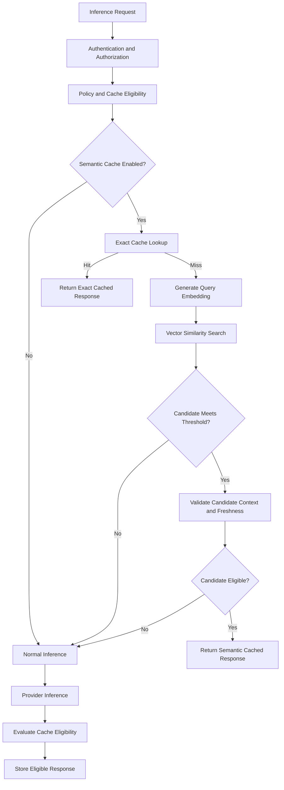

# ADR-0016: Semantic Cache Activation Criteria

- **Status:** Proposed
- **Date:** 2026-11-04
- **Decision Owners:** llm-gateway architecture team
- **Related ADRs:** ADR-0004, ADR-0007, ADR-0008, ADR-0009, ADR-0010, ADR-0015

## 1. Context

Exact caching, defined in ADR-0015, reuses a response only when the canonical request fingerprint matches.

However, many inference requests express the same intent using different wording.

Examples:

- "How can I reset my router?"
- "What are the steps to restart my Wi-Fi router?"
- "Explain how to reboot my home router."

These requests may be semantically similar even though their exact cache keys differ.

Semantic caching can improve cache hit rates and reduce inference latency and provider cost. However, it introduces additional risks:

- Similar wording does not guarantee equivalent intent.
- Small differences in context may change the correct answer.
- Embedding similarity does not establish factual correctness.
- Cached answers can become stale.
- Cross-tenant retrieval can expose confidential information.
- Similarity thresholds vary by model, domain, and query distribution.

The gateway must therefore treat semantic caching as a controlled optimization, not a default inference behavior.

## 2. Decision

The gateway will support semantic caching as an optional, policy-controlled capability.

Semantic caching will be:

- Disabled by default.
- Activated only for explicitly approved tenants and use cases.
- Applied after authentication, authorization, and cache eligibility checks.
- Isolated by tenant and configured semantic-cache namespace.
- Restricted to approved model families and request types.
- Evaluated against an exact-cache lookup strategy.
- Governed by similarity thresholds, freshness limits, and quality evaluation.
- Independently observable and disableable without affecting inference availability.

Semantic cache misses always continue through the normal routing and inference workflow.

A semantic cache hit must never bypass tenant policy, authorization, safety checks, or required validation.

## 3. Scope and Exclusions

### 3.1 Initial supported use cases

The initial implementation may support:

- FAQ-style queries
- Stable product documentation questions
- Repeated informational requests
- Controlled internal knowledge assistants
- Approved support use cases with bounded knowledge freshness requirements

### 3.2 Excluded use cases

Semantic caching must remain disabled for:

- Financial transactions and payment operations
- Refund or account-changing operations
- Requests involving external side effects
- Live pricing, inventory, or account status
- Time-sensitive information
- Personalized responses requiring current user context
- Requests with sensitive data unless explicitly approved and isolated
- Tool-using agent workflows
- Streaming requests in the initial implementation
- Requests where exact context equivalence cannot be established

A semantic match must not turn a request requiring a fresh external action into a cached answer.

## 4. Semantic Cache Architecture

The semantic cache uses embeddings to retrieve candidate responses based on query similarity.

Initial architecture:

- Redis remains the operational cache and coordination layer.
- A vector index stores embeddings and associated cache metadata.
- PostgreSQL remains authoritative for policy, tenant configuration, audit, and durable execution records.
- The embedding model and version are part of the cache namespace.

The vector index may initially use PostgreSQL with `pgvector` or a dedicated vector database. The implementation must choose one through a separate implementation decision based on scale, operational complexity, and benchmark results.

### 4.1 Logical flow



The exact-cache lookup occurs first because it is cheaper and requires no embedding computation.

## 5. Semantic Cache Entry

A semantic cache entry contains:

- Tenant scope
- Cache namespace
- Original query representation
- Query embedding
- Cached response
- Model and route identity
- Embedding model and version
- Response generation timestamp
- Expiration timestamp
- Source/context version, when applicable
- Quality/evaluation metadata
- Cache policy version

Illustrative logical record:

```json id="8r1w6u"
{
  "entry_id": "sem_01J...",
  "tenant_scope": "tenant_opaque_id",
  "namespace": "support-faq-v1",
  "embedding_model": "embedding-model-id",
  "embedding_version": "v1",
  "model_id": "gateway-model-id",
  "created_at": "2026-11-04T12:00:00Z",
  "expires_at": "2026-11-04T13:00:00Z",
  "similarity_threshold": 0.94,
  "context_version": "knowledge-base-v12",
  "response": {
    "output": []
  },
  "quality_status": "approved"
}
```

This is a logical representation. The physical schema must use appropriate vector types, indexes, and metadata columns.

## 6. Similarity and Candidate Selection

### 6.1 Similarity calculation

The initial implementation will use cosine similarity or another benchmarked distance metric supported by the selected vector index.

A candidate must exceed a configured threshold:

```text id="0s4gr8"
similarity(query_embedding, candidate_embedding)
    >= configured_threshold
```

Thresholds are configuration-driven and specific to the cache namespace or use case.

A universal similarity threshold is not assumed to be safe.

### 6.2 Candidate validation

Similarity alone is insufficient.

Before returning a candidate, the gateway must validate:

1. Tenant and namespace match.
2. Model and operation are compatible.
3. Request context is compatible.
4. Required policy version is compatible.
5. Entry has not expired.
6. Source knowledge version is still valid, when applicable.
7. Candidate passed the relevant quality requirements.
8. No freshness requirement mandates a new provider call.
9. The request is still eligible for semantic caching.

If multiple candidates qualify, select the candidate with the strongest validated compatibility and similarity score.

### 6.3 Ambiguous candidates

If multiple candidates have similar scores but materially different responses, the gateway must treat the lookup as ambiguous and perform normal inference.

The initial implementation will prefer a cache miss over a potentially incorrect answer.

## 7. Context Equivalence

The semantic cache must not assume that query text is the only relevant input.

The cache namespace and candidate validation must account for response-affecting context, such as:

- System prompt or instruction version
- Tenant knowledge base
- Product or policy version
- Locale and language
- User authorization scope
- Relevant conversation context
- Model behavior or response-format requirements

For the initial implementation, semantic caching should be restricted to stateless, single-turn informational requests.

Multi-turn conversation caching requires an explicit context-equivalence design and is out of scope.

## 8. Freshness and Invalidation

Semantic cache entries require explicit freshness policies.

Supported invalidation mechanisms:

- TTL expiration
- Namespace version changes
- Embedding model/version changes
- Knowledge-source version changes
- Tenant policy changes
- Model or response policy changes
- Explicit administrative purge

For knowledge-grounded responses, source-version changes must invalidate or make affected entries ineligible.

Semantic cache freshness must be stricter for information that changes frequently.

The gateway must not use a long TTL merely to increase cache hit rate.

## 9. Semantic Cache Quality Evaluation

Semantic caching must be evaluated before production activation.

Evaluation datasets should contain:

- Paraphrases with equivalent intent
- Similar wording with different intent
- Negated queries
- Queries with different entities or identifiers
- Queries with different temporal context
- Queries requiring personalized context
- Queries requiring live data
- Adversarial and ambiguous examples

Required measurements:

| Metric | Purpose |
|---|---|
| Semantic hit rate | Percentage of eligible requests served from semantic cache |
| False-positive hit rate | Incorrectly accepted semantic matches |
| Answer equivalence | Whether cached response satisfies the new request |
| Precision | Fraction of semantic hits that are acceptable |
| Recall | Fraction of suitable reusable responses retrieved |
| Latency saved | Reduction compared with provider inference |
| Cost saved | Provider cost avoided |
| Staleness rate | Responses returned after relevant source changes |
| Cache bypass rate | Requests rejected by eligibility or validation |

### 9.1 Activation gate

A semantic cache namespace may be enabled only after:

- A representative evaluation dataset exists.
- A threshold has been selected using validation data.
- False-positive behavior is measured.
- Freshness and invalidation tests pass.
- Tenant-isolation tests pass.
- Operational disablement is verified.
- The expected cost and latency benefit is demonstrated.

A high hit rate alone is not sufficient evidence of success.

## 10. Cache-Hit Accounting

A semantic cache hit creates a new logical execution with outcome `semantic_cache_hit`.

The gateway must:

- Apply normal authentication and authorization.
- Apply request quotas and applicable tenant limits.
- Record the cache entry reference and similarity score.
- Record the cache policy and embedding model version.
- Avoid creating a provider attempt for the new execution.
- Record zero provider inference cost for the new execution.
- Apply separate tenant billing policy, if configured.
- Preserve auditability without storing unnecessary prompt or response content.

The original provider execution remains a separate historical execution.

## 11. Failure Behavior

Semantic caching is an optimization and must not become a dependency for inference availability.

| Failure | Required behavior |
|---|---|
| Embedding service unavailable | Bypass semantic cache |
| Vector index unavailable | Treat as cache miss |
| Similarity search timeout | Continue normal inference |
| Invalid embedding | Bypass semantic cache and record error |
| Candidate validation failure | Treat as cache miss |
| Cache response deserialization failure | Reject entry and continue inference |
| Cache write failure | Preserve successful inference response |
| Redis or vector infrastructure failure | Do not bypass security or admission controls |

Semantic cache failure must never trigger a relaxed authorization or routing policy.

## 12. Security and Privacy

- Tenant isolation is mandatory at both index and query levels.
- Tenant identifiers must be derived from authenticated gateway context.
- Embeddings must be treated as sensitive derived data.
- Embeddings must not be assumed anonymous or non-reversible.
- Raw API keys and authorization headers must never enter embeddings or cache metadata.
- Sensitive prompts must be excluded unless an explicit data policy permits their processing and storage.
- Cache access and purge operations must be audited.
- Retention and deletion policies must cover both embeddings and response records.
- Redis and vector infrastructure must use authenticated, encrypted connections.
- Administrative cache operations require scoped RBAC permissions.

## 13. Clean Architecture

### Application responsibilities

`gateway-core` defines:

- Semantic cache eligibility
- Namespace and context compatibility
- Similarity acceptance policy
- Candidate validation
- Freshness and invalidation rules
- Cache-hit execution behavior

### Infrastructure responsibilities

`gateway-infra` implements:

- Embedding provider integration
- Vector storage and retrieval
- Similarity search
- Metadata filtering
- Cache serialization
- TTL and purge mechanisms

### Suggested structure

```text
crates/
├── gateway-core/
│   └── cache/
│       ├── semantic_policy.rs
│       ├── candidate_validation.rs
│       └── context_compatibility.rs
└── gateway-infra/
    └── cache/
        ├── embedding_client.rs
        ├── vector_store.rs
        └── semantic_cache.rs
```

## 14. Rust Interface Sketch

```rust
#[derive(Debug, Clone)]
pub struct SemanticSearchRequest {
    pub tenant_id: TenantId,
    pub namespace: CacheNamespace,
    pub embedding: Vec<f32>,
    pub threshold: f32,
    pub context_version: Option<String>,
}

#[derive(Debug, Clone)]
pub struct SemanticCandidate {
    pub entry_id: String,
    pub similarity: f32,
    pub response: CachedResponse,
    pub context_version: Option<String>,
}

#[async_trait::async_trait]
pub trait SemanticCache: Send + Sync {
    async fn search(
        &self,
        request: SemanticSearchRequest,
    ) -> Result<Vec<SemanticCandidate>, SemanticCacheError>;

    async fn store(
        &self,
        entry: SemanticCacheEntry,
    ) -> Result<(), SemanticCacheError>;

    async fn invalidate(
        &self,
        scope: SemanticCacheScope,
    ) -> Result<u64, SemanticCacheError>;
}
```

The application layer must validate every returned candidate. Infrastructure retrieval results are not automatically acceptable cache hits.

## 15. Observability

Required metrics:

- `llm_gateway_semantic_cache_lookups_total`
- `llm_gateway_semantic_cache_hits_total`
- `llm_gateway_semantic_cache_misses_total`
- `llm_gateway_semantic_cache_rejections_total`
- `llm_gateway_semantic_cache_similarity`
- `llm_gateway_semantic_cache_lookup_duration_seconds`
- `llm_gateway_semantic_cache_embedding_duration_seconds`
- `llm_gateway_semantic_cache_stale_entries_total`
- `llm_gateway_semantic_cache_validation_failures_total`
- `llm_gateway_semantic_cache_errors_total`

Use bounded labels such as namespace, outcome, and rejection reason.

Do not use raw prompts, embeddings, cache entry IDs, or unbounded tenant identifiers as metric labels.

## 16. Consequences

### Positive

- Can reuse answers for semantically equivalent requests.
- May improve latency and reduce provider cost.
- Provides a controlled foundation for domain-specific caching.
- Makes semantic cache quality measurable before activation.
- Keeps semantic cache failures from affecting normal inference availability.

### Negative

- Adds embedding generation and vector retrieval latency.
- Requires domain-specific thresholds and evaluation datasets.
- Increases storage, operational, and privacy complexity.
- Can produce incorrect responses if context validation is insufficient.

### Risks

- False-positive matches can return incorrect answers.
- Stale entries can misrepresent current product or policy information.
- Embeddings may expose sensitive information.
- Poor threshold selection may optimize hit rate at the expense of answer correctness.

## 17. Validation Criteria

- [ ] Semantic caching is disabled by default.
- [ ] Exact cache lookup precedes semantic lookup.
- [ ] Only explicitly approved use cases are eligible.
- [ ] Tenant and namespace isolation are enforced.
- [ ] Embedding model and version are recorded.
- [ ] Context compatibility is validated before accepting a candidate.
- [ ] Similarity thresholds are configurable and evaluation-backed.
- [ ] Ambiguous candidates produce cache misses.
- [ ] Freshness and invalidation rules are enforced.
- [ ] Cache hits create new logical execution records.
- [ ] Cache hits do not create provider attempts or provider charges.
- [ ] Embedding and vector-store failures degrade to normal inference.
- [ ] Evaluation measures false-positive hits and answer equivalence.
- [ ] Administrative purge and disablement are tested.

## 18. Related Decisions

- ADR-0004: Redis for Distributed Coordination and Caching
- ADR-0007: Model Registry and Capability Representation
- ADR-0008: Constraint-Based Model Routing
- ADR-0009: Budget Reservation and Financial Settlement
- ADR-0010: Inference Idempotency and Execution Lifecycle
- ADR-0015: Exact Cache Architecture

