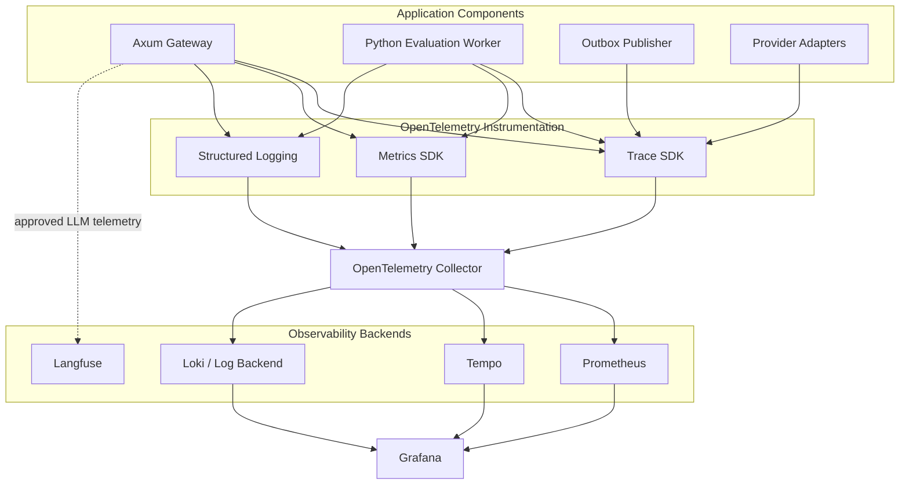

# ADR-0017: OpenTelemetry Observability Architecture

- **Status:** Proposed
- **Date:** 2026-11-04
- **Decision Owners:** llm-gateway architecture team
- **Related ADRs:** ADR-0001, ADR-0005, ADR-0006, ADR-0008, ADR-0009, ADR-0010, ADR-0013, ADR-0014

## 1. Context

The `llm-gateway` is a distributed inference platform responsible for routing requests across multiple model providers while enforcing security, reliability, cost, and operational policies.

A production gateway must make it possible to answer:

- Why did a request select a particular model?
- Which provider attempts occurred?
- Why did a retry or fallback happen?
- How long did authentication, routing, and provider inference take?
- How many tokens were consumed?
- What was the estimated or actual provider cost?
- Did a request hit a cache?
- Why was a request rejected?
- Which component caused an execution failure?
- Are provider latency, availability, or error rates degrading?
- Is a tenant approaching a usage or budget limit?

Traditional application logs alone are insufficient. The platform needs correlated traces, metrics, and structured logs across gateway replicas, providers, workers, and infrastructure.

## 2. Decision

The gateway will adopt **OpenTelemetry (OTel) as the vendor-neutral instrumentation standard**.

The observability architecture will use three complementary signals:

| Signal | Primary purpose | Initial technology |
|---|---|---|
| Traces | Follow one request across components and providers | OpenTelemetry |
| Metrics | Measure service health, usage, and performance | Prometheus |
| Logs | Investigate errors and operational events | Structured JSON logs |

Initial deployment will use:

- OpenTelemetry SDK for Rust services
- OpenTelemetry SDK for Python workers
- OpenTelemetry Collector for telemetry processing and export
- Prometheus for metrics
- Grafana for dashboards
- Tempo for distributed tracing
- Loki or an equivalent structured log backend
- Langfuse for LLM-specific observability and prompt/response evaluation workflows where approved

The architecture will avoid hard dependencies on a specific telemetry backend.

## 3. Observability Architecture



The OpenTelemetry Collector will handle batching, filtering, resource enrichment, sampling, and export.

Application services must not depend directly on Grafana, Prometheus, Tempo, or Loki APIs.

## 4. Distributed Trace Architecture

### 4.1 Trace boundaries

Every inference request should produce a distributed trace covering its logical execution.

Example span hierarchy:

```text
inference.request
├── authentication
├── authorization
├── request.validation
├── rate_limit.check
├── model_registry.lookup
├── routing.evaluate
├── cache.lookup
├── concurrency.acquire
├── budget.reserve
├── execution.persist
├── inference.execute
│   ├── provider.attempt
│   │   ├── provider.connect
│   │   └── provider.generate
│   ├── reliability.evaluate
│   ├── provider.retry
│   └── provider.fallback
├── usage.record
├── budget.settle
└── execution.complete
```

Not every request executes every span.

For example:

- A cache hit does not create a provider attempt.
- A rejected request does not execute inference.
- A failed budget reservation does not dispatch a provider request.

### 4.2 Trace correlation

The following identifiers must be correlated where applicable:

| Identifier | Purpose |
|---|---|
| Trace ID | Correlates distributed spans |
| Span ID | Identifies one operation |
| Request ID | Identifies the API request |
| Execution ID | Identifies logical inference execution |
| Attempt ID | Identifies a provider attempt |
| Tenant ID | Correlates tenant activity using controlled telemetry attributes |
| Provider route ID | Identifies selected provider/model route |

Execution and attempt IDs must be generated by the gateway, not copied blindly from untrusted client input.

### 4.3 Context propagation

Use W3C Trace Context as the initial propagation standard.

Requirements:

- Accept valid `traceparent` and `tracestate` headers.
- Validate incoming propagation metadata.
- Generate new context when incoming headers are absent or invalid.
- Propagate trace context to internal services and workers.
- Propagate context to provider calls only when appropriate and permitted.
- Do not forward arbitrary baggage to external providers.
- Prevent untrusted trace metadata from overriding gateway-generated execution identifiers.

## 5. Metrics Architecture

Metrics provide aggregated visibility into platform behavior.

### 5.1 Metric categories

**Gateway traffic**

- Request count
- Request rate
- Response status
- Request size
- Response size

**Latency**

- End-to-end request duration
- Routing duration
- Provider duration
- Time to first token
- Stream duration
- Cache lookup duration

**Reliability**

- Provider error rate
- Retry count
- Fallback count
- Circuit-breaker state
- Timeout count
- Unknown execution outcomes

**Admission control**

- Rate-limit rejections
- Active concurrency permits
- Concurrency acquisition failures
- Queue depth, if queueing is enabled

**Financial and usage**

- Input tokens
- Output tokens
- Estimated provider cost
- Settled provider cost
- Budget reservation failures
- Budget utilization

**Caching**

- Exact cache hit ratio
- Semantic cache hit ratio
- Cache errors
- Cache latency

**Workers and events**

- Outbox backlog
- Event publication failures
- Consumer lag
- Evaluation queue depth
- Evaluation execution duration

### 5.2 Metric naming

Use a consistent prefix:

```text
llm_gateway_requests_total
llm_gateway_request_duration_seconds
llm_gateway_provider_requests_total
llm_gateway_provider_duration_seconds
llm_gateway_tokens_total
llm_gateway_cost_total
llm_gateway_cache_hits_total
llm_gateway_rate_limit_rejections_total
llm_gateway_concurrency_in_use
```

Counters must be monotonically increasing. Gauges represent current state. Histograms are preferred for latency and size distributions.

### 5.3 Cardinality control

Metrics must not include unbounded dimensions.

Avoid labels containing:

- Raw prompts
- Response content
- API keys
- Execution IDs
- Request IDs
- Attempt IDs
- Arbitrary user metadata
- Unbounded tenant identifiers

Use bounded labels such as:

- Provider
- Model family
- Operation
- Status class
- Error category
- Cache outcome
- Deployment environment

Tenant-specific analytics should use controlled aggregation or a separate analytics data path rather than high-cardinality infrastructure metrics.

## 6. Structured Logging

All services will emit structured JSON logs.

Recommended fields:

```json id="0zv4q1"
{
  "timestamp": "2026-11-04T12:00:00Z",
  "level": "INFO",
  "service": "gateway-api",
  "environment": "production",
  "trace_id": "trace-id",
  "span_id": "span-id",
  "request_id": "req-id",
  "execution_id": "exec-id",
  "attempt_id": "attempt-id",
  "event": "provider_attempt_completed",
  "provider": "provider-name",
  "model": "model-name",
  "duration_ms": 820,
  "outcome": "success"
}
```

Log requirements:

- Use consistent event names.
- Include trace correlation identifiers.
- Avoid unstructured free-text where a structured field is appropriate.
- Redact secrets and sensitive information.
- Do not log prompts and completions by default.
- Apply retention and access controls.
- Ensure errors are logged with normalized categories and safe diagnostic details.

## 7. LLM-Specific Observability

Traditional service telemetry does not fully explain model behavior.

The gateway will capture LLM-specific metadata where policy permits:

- Gateway model ID
- Provider/model route
- Prompt token count
- Completion token count
- Total token count
- Provider-reported or estimated usage
- Provider cost
- Cache status
- Retry and fallback decisions
- Finish reason
- Time to first token
- Evaluation result reference
- Prompt or policy version

Langfuse may be used for prompt/version tracking, trace visualization, and evaluation workflows.

However:

- Sensitive content must not be exported without explicit policy approval.
- Raw prompts and completions remain disabled by default.
- Redaction must occur before export.
- Provider secrets and authorization metadata must never be captured.
- Langfuse is not the authoritative execution, usage, or financial ledger.

## 8. Sampling Strategy

Tracing every request may become expensive at scale.

The gateway will use configurable sampling.

Initial strategy:

- Always retain security-relevant and operationally critical failure traces, subject to privacy policy.
- Sample successful low-latency requests.
- Increase sampling for degraded providers and unusual failure patterns.
- Preserve complete traces for selected evaluations and debugging sessions.
- Use tail sampling in the Collector where practical.

Sampling must not remove authoritative execution records or financial accounting data. Telemetry sampling is not data retention policy.

## 9. Alerting and SLOs

The platform will define service-level indicators (SLIs) and objectives (SLOs).

Initial SLI categories:

| SLI | Measurement |
|---|---|
| Gateway availability | Successful eligible requests / eligible requests |
| Gateway latency | End-to-end latency percentiles |
| Provider reliability | Successful provider attempts / provider attempts |
| Time to first token | Streaming startup latency |
| Routing success | Requests with eligible route / route evaluations |
| Budget integrity | Successful settlements / completed billable executions |
| Event delivery | Successfully published events / pending events |
| Cache reliability | Cache operation success / cache operations |

SLO targets will be established after baseline performance testing and production workload analysis.

Example alert conditions:

- Elevated gateway 5xx rate
- Provider failure ratio above threshold
- Circuit breaker open for an extended period
- Increased time to first token
- Redis coordination failures
- PostgreSQL connection pool exhaustion
- Growing outbox backlog
- Budget settlement failures
- Evaluation worker backlog growth

Alerts must include runbook links and actionable diagnostic context.

## 10. Privacy and Data Governance

Observability data can contain sensitive information and must follow the gateway security model.

Requirements:

- Apply redaction before telemetry export.
- Never capture API keys, provider credentials, or authorization headers.
- Avoid raw prompts and completions by default.
- Minimize personal data in span attributes and logs.
- Apply role-based access to telemetry backends.
- Configure retention by telemetry type.
- Audit access to sensitive debugging data.
- Support tenant-aware access controls where tenant-level telemetry is exposed.

A trace is diagnostic evidence, not a substitute for the authoritative audit log.

## 11. Clean Architecture

Observability must be implemented through ports and adapters.

### Application responsibilities

`gateway-core` defines domain-relevant telemetry events and instrumentation boundaries without depending on backend-specific SDK exporters.

### Infrastructure responsibilities

`gateway-infra` provides:

- OpenTelemetry SDK configuration
- Trace and metric exporters
- Structured logging integration
- Resource attributes
- Collector integration
- Redaction and filtering
- Sampling configuration

### Suggested structure

```text
crates/
├── gateway-core/
│   └── observability/
│       ├── events.rs
│       └── ports.rs
├── gateway-infra/
│   └── observability/
│       ├── tracing.rs
│       ├── metrics.rs
│       ├── logging.rs
│       ├── propagation.rs
│       └── redaction.rs
└── gateway-api/
    └── middleware/
        └── telemetry.rs
```

Instrumentation must not change business behavior when an exporter is unavailable.

## 12. Rust Implementation Sketch

```rust
pub struct ObservabilityContext {
    pub request_id: RequestId,
    pub execution_id: Option<ExecutionId>,
    pub attempt_id: Option<AttemptId>,
}

pub trait InferenceTelemetry: Send + Sync {
    fn request_started(&self, context: &ObservabilityContext);

    fn routing_completed(
        &self,
        context: &ObservabilityContext,
        route: &ProviderRoute,
    );

    fn provider_attempt_completed(
        &self,
        context: &ObservabilityContext,
        outcome: ProviderAttemptOutcome,
    );

    fn execution_completed(
        &self,
        context: &ObservabilityContext,
        outcome: ExecutionOutcome,
    );
}
```

The production implementation should use appropriate OpenTelemetry instruments and tracing spans. The interface above is a domain-facing sketch, not a requirement to manually implement all SDK functionality.

## 13. Operational Requirements

- Collector deployment must support batching and bounded queues.
- Exporter failures must not block inference requests indefinitely.
- Telemetry buffers must have explicit memory limits.
- Collector health and dropped telemetry must be monitored.
- Telemetry backends must have retention and storage limits.
- Sampling and redaction policies must be version-controlled.
- Dashboard and alert definitions must be maintained as code.
- Telemetry schema changes must be backward-compatible where practical.

## 14. Consequences

### Positive

- Enables end-to-end request diagnosis.
- Provides consistent telemetry across Rust and Python components.
- Supports provider reliability and cost analysis.
- Improves incident response and operational tuning.
- Reduces dependence on a single observability vendor.

### Negative

- Adds instrumentation and Collector operational overhead.
- Telemetry storage can become expensive.
- Cardinality and privacy controls require ongoing governance.
- Cross-service trace propagation requires consistent implementation.

### Risks

- Incorrect instrumentation can create misleading metrics.
- Excessive cardinality can degrade Prometheus performance.
- Missing redaction can expose sensitive information.
- Aggressive sampling can remove useful diagnostic evidence.
- Exporter failures can silently reduce observability unless monitored.

## 15. Validation Criteria

- [ ] Rust gateway and Python workers emit OpenTelemetry traces.
- [ ] Trace context propagates across internal service boundaries.
- [ ] Request, execution, and attempt identifiers are correlated.
- [ ] Core latency, reliability, usage, and admission metrics exist.
- [ ] Metric labels have bounded cardinality.
- [ ] Structured logs contain trace correlation fields.
- [ ] Sensitive fields are redacted before telemetry export.
- [ ] Raw prompts and completions are disabled by default.
- [ ] Collector export failures do not block inference.
- [ ] Sampling behavior is configurable and tested.
- [ ] Dashboards and alerts cover critical platform SLIs.
- [ ] Telemetry retention and access controls are documented.
- [ ] Observability backend failures are monitored.

## 16. Related Decisions

- ADR-0001: Clean Architecture and Dependency Direction
- ADR-0005: Transactional Outbox and Event Delivery
- ADR-0006: Canonical Provider Adapter Interface
- ADR-0008: Constraint-Based Model Routing
- ADR-0009: Budget Reservation and Financial Settlement
- ADR-0010: Inference Idempotency and Execution Lifecycle
- ADR-0013: Provider Retry and Circuit Breaker Strategy
- ADR-0014: Streaming and Provider Fallback Semantics

