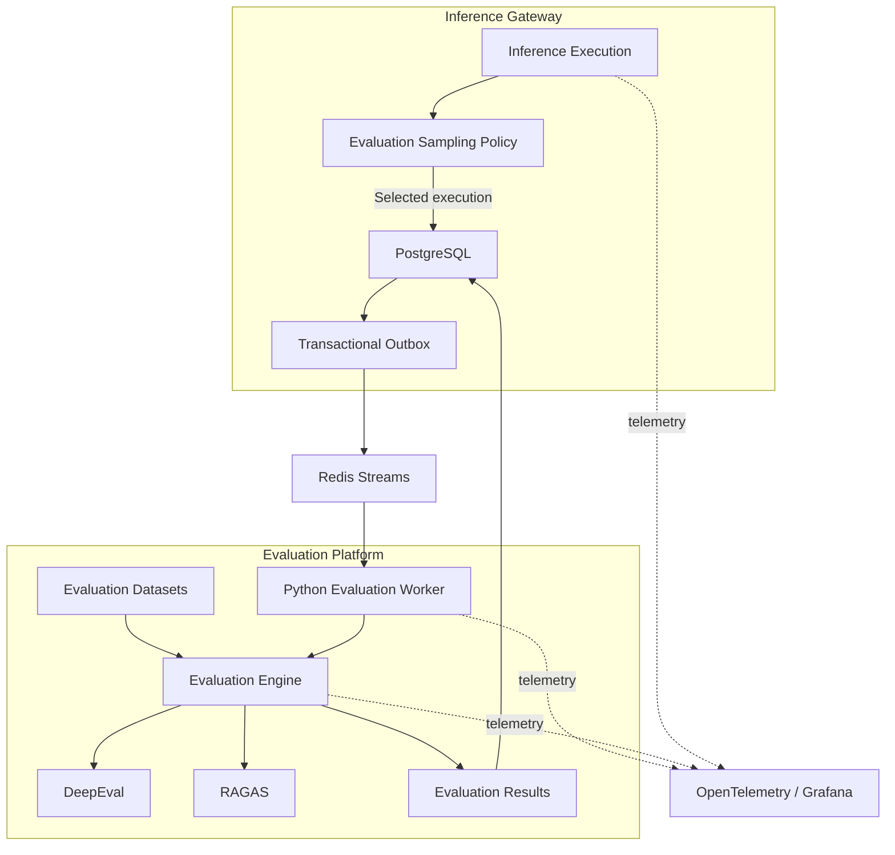
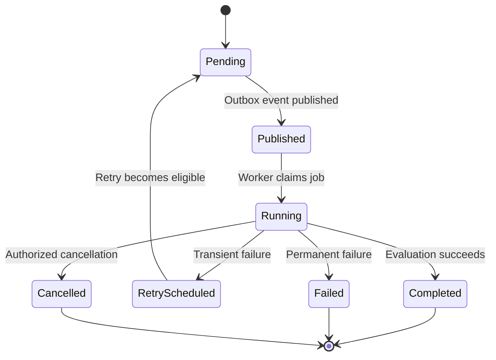

# ADR-0018: Asynchronous Evaluation Architecture

- **Status:** Proposed
- **Date:** 2026-11-04
- **Decision Owners:** llm-gateway architecture team
- **Related ADRs:** ADR-0005, ADR-0009, ADR-0010, ADR-0017

## 1. Context

The `llm-gateway` needs to evaluate model quality, provider behavior, and production inference outcomes.

Evaluation is necessary to:

- Compare providers and models.
- Measure response quality and consistency.
- Detect regressions after model or prompt changes.
- Evaluate routing decisions.
- Measure RAG relevance and groundedness.
- Detect hallucinations and policy violations.
- Assess agent and tool execution behavior.
- Support model promotion and deprecation decisions.
- Build evidence for architecture and operational decisions.

Evaluation must not add unacceptable latency to the synchronous inference path.

Some evaluation techniques require additional model calls, embedding generation, reference answers, or human review. These operations can be expensive and time-consuming.

The gateway therefore needs a durable asynchronous evaluation architecture.

## 2. Decision

The platform will implement a dedicated asynchronous evaluation pipeline.

The initial architecture will use:

- PostgreSQL as the authoritative source for evaluation jobs and results.
- Transactional outbox for durable evaluation event publication.
- Redis Streams as the initial event transport.
- A Python evaluation worker for evaluation execution.
- DeepEval and RAGAS as initial evaluation frameworks.
- OpenTelemetry for distributed tracing and evaluation pipeline observability.
- PostgreSQL for durable evaluation results and metadata.

Evaluation will be separated from synchronous inference execution.

The gateway will support three evaluation modes:

| Mode | Purpose | Execution |
|---|---|---|
| Offline evaluation | Benchmark models, prompts, and routing policies | Dataset-driven batch jobs |
| Online sampled evaluation | Evaluate selected production responses | Asynchronous background jobs |
| Human evaluation | Review subjective or high-impact responses | Review workflow |

The initial implementation prioritizes offline evaluation and sampled online evaluation.

## 3. Architectural Principles

1. Evaluation must not block successful inference responses.
2. Evaluation jobs must be durably recorded before publication.
3. Event delivery is at-least-once; workers must be idempotent.
4. Evaluation datasets and metric definitions must be versioned.
5. Evaluation results must be reproducible where practical.
6. Evaluation must distinguish model quality from infrastructure reliability.
7. Evaluation data must follow tenant privacy and retention policies.
8. Failed evaluation jobs must be retryable without duplicating results.
9. Evaluation cost must be separately measured and governed.
10. Evaluation results must not automatically change production routing without an explicit promotion policy.

## 4. Architecture



PostgreSQL remains authoritative for evaluation jobs, job state, datasets metadata, and results.

Redis Streams transports evaluation events but does not become the source of truth.

## 5. Evaluation Lifecycle

An evaluation job follows this lifecycle:



The job lifecycle must be persisted in PostgreSQL.

A worker must use an atomic claim operation or lease to prevent concurrent processing of the same logical job.

## 6. Evaluation Job Creation

After an inference execution completes, the gateway evaluates whether the execution should be selected for evaluation.

Selection policy may consider:

- Tenant evaluation configuration
- Model and provider
- Request operation
- Sampling percentage
- Model rollout or experiment
- Error or fallback occurrence
- Cost or latency anomalies
- Explicit debugging or evaluation request

For selected executions:

1. Persist the completed execution.
2. Create an evaluation job.
3. Insert the corresponding outbox event in the same PostgreSQL transaction.
4. Publish the event asynchronously.
5. Allow the inference response to complete independently of evaluation processing.

Evaluation sampling must be deterministic or reproducible where practical.

The evaluation job should reference the execution and attempt records rather than duplicate large amounts of execution data.

## 7. Evaluation Types

### 7.1 Offline evaluation

Offline evaluation runs a versioned dataset against one or more models or configurations.

Use cases:

- Model comparison
- Prompt regression testing
- Routing policy evaluation
- Provider migration validation
- RAG pipeline quality measurement
- Release qualification

An offline evaluation run records:

- Dataset ID and version
- Model and provider configuration
- Prompt/template version
- Evaluator version
- Metric definitions
- Execution parameters
- Start and completion timestamps
- Aggregate and individual results

### 7.2 Online sampled evaluation

Online evaluation selects a controlled sample of production executions.

Potential metrics:

- Answer relevance
- Faithfulness
- Groundedness
- Context precision
- Context recall
- Toxicity or harmful-content indicators
- Instruction following
- Structured-output validity

The evaluation pipeline must not assume that a single automated metric proves correctness.

### 7.3 Human evaluation

Human review may be required for:

- Subjective response quality
- Ambiguous or disputed outputs
- High-impact use cases
- Model promotion decisions
- Evaluation dataset annotation

Human evaluation will be represented as a separate review workflow, linked to the original evaluation job and execution.

## 8. Evaluation Framework Integration

The initial Python evaluation worker will use:

- DeepEval for LLM evaluation and test cases.
- RAGAS for RAG-specific metrics.
- Custom evaluators for gateway-specific routing, policy, and reliability behavior.

Frameworks are adapters, not the evaluation domain model.

The gateway must retain its own canonical evaluation result format so that framework replacement does not require changing the public API or durable schema.

### 8.1 Canonical evaluation result

Each result should include:

- Evaluation job ID
- Execution ID
- Attempt ID, where applicable
- Evaluator name and version
- Metric name
- Metric score
- Pass/fail outcome, if applicable
- Threshold
- Explanation or diagnostic reference
- Evaluation timestamp
- Input dataset version
- Evaluation cost and token usage, when available

A score must include its metric definition and interpretation. Scores from different evaluator versions must not be treated as directly comparable without compatibility checks.

## 9. Job Reliability and Idempotency

The event transport uses at-least-once delivery.

The worker must:

- Claim jobs using a database-backed lease or atomic state transition.
- Use an idempotency key for each evaluation job and metric result.
- Detect duplicate event delivery.
- Persist result records transactionally.
- Acknowledge the Redis Stream message only after durable completion or durable retry scheduling.
- Recover expired worker leases.
- Support bounded retries with exponential backoff and jitter.
- Send permanently failing jobs to a dead-letter state.

A worker crash must not cause a completed evaluation to be executed repeatedly without detection.

### 9.1 Idempotency key

An evaluation result identity can be derived from:

```text
evaluation_run_id
+ execution_id
+ evaluator_name
+ evaluator_version
+ metric_name
```

The database must enforce uniqueness for the selected result identity.

## 10. Evaluation Cost Governance

Evaluation can generate additional LLM and embedding costs.

The platform must track evaluation usage separately from customer inference usage.

Required controls:

- Maximum evaluation jobs per tenant or time window
- Evaluation worker concurrency limits
- Maximum evaluator tokens
- Maximum evaluator execution duration
- Evaluation budget
- Sampling policy
- Per-evaluator cost tracking
- Job cancellation and retry limits

Evaluation cost must not be silently charged to the original inference execution.

Where an evaluation is tenant-sponsored, accounting must use a separate evaluation cost category and policy.

## 11. Data and Privacy

Evaluation may require access to prompts, completions, retrieved context, and tool results.

Requirements:

- Store references to execution data rather than unnecessary duplicates.
- Enforce tenant access controls.
- Apply redaction before data enters external evaluation services.
- Do not send sensitive data to external evaluators without explicit policy approval.
- Support evaluation-specific retention rules.
- Record evaluator and data-access provenance.
- Prevent evaluation workers from accessing unrelated tenant executions.
- Apply least-privilege database and Redis permissions.

The evaluation system must distinguish between data that is available for operational diagnosis and data approved for model-quality evaluation.

## 12. Clean Architecture

### Gateway application

`gateway-core` owns:

- Evaluation selection policy
- Evaluation job creation
- Evaluation job state transitions
- Evaluation event contracts
- Evaluation result domain model

### Evaluation worker

The Python worker owns:

- Job consumption
- Dataset loading
- Evaluator execution
- Framework adapters
- Result normalization
- Retry and dead-letter handling

### Infrastructure

`gateway-infra` provides:

- PostgreSQL repositories
- Transactional outbox publisher
- Redis Streams transport
- Worker job lease coordination
- Telemetry export

### Suggested structure

```text
llm-gateway/
├── crates/
│   ├── gateway-core/
│   │   └── evaluation/
│   │       ├── policy.rs
│   │       ├── job.rs
│   │       ├── result.rs
│   │       └── ports.rs
│   └── gateway-infra/
│       └── evaluation/
│           ├── repository.rs
│           └── event_publisher.rs
├── workers/
│   └── evaluation-worker/
│       ├── src/
│       │   ├── consumer.py
│       │   ├── runner.py
│       │   ├── evaluators/
│       │   └── adapters/
│       └── tests/
└── evaluation/
    ├── datasets/
    ├── experiments/
    └── reports/
```

## 13. Data Model

Initial logical entities:

| Entity | Responsibility |
|---|---|
| `evaluation_jobs` | Evaluation execution state |
| `evaluation_runs` | Dataset/model evaluation run |
| `evaluation_datasets` | Dataset identity and version |
| `evaluation_cases` | Individual test cases |
| `evaluation_results` | Metric results |
| `evaluation_review_tasks` | Human review tasks |
| `evaluation_cost_records` | Evaluator usage and cost |

Evaluation job state and result persistence must be transactional where required.

Dataset files may live in version-controlled object storage or the repository, but dataset identity, version, and provenance must be recorded in PostgreSQL.

## 14. Rust and Python Contracts

### Rust application port

```rust
#[async_trait::async_trait]
pub trait EvaluationJobRepository: Send + Sync {
    async fn create_job(
        &self,
        job: NewEvaluationJob,
    ) -> Result<EvaluationJobId, EvaluationError>;

    async fn get_job(
        &self,
        id: EvaluationJobId,
    ) -> Result<Option<EvaluationJob>, EvaluationError>;
}
```

### Python worker contract

The worker receives a versioned event referencing a durable job:

```json
{
  "event_id": "evt_01J...",
  "event_type": "evaluation.requested",
  "schema_version": 1,
  "evaluation_job_id": "eval_01J...",
  "execution_id": "exec_01J...",
  "created_at": "2026-11-04T12:00:00Z"
}
```

The worker must load authorized data through its repository interfaces rather than trusting event payloads as the complete source of truth.

## 15. Observability

Required metrics:

- `llm_gateway_evaluation_jobs_created_total`
- `llm_gateway_evaluation_jobs_completed_total`
- `llm_gateway_evaluation_jobs_failed_total`
- `llm_gateway_evaluation_jobs_retried_total`
- `llm_gateway_evaluation_queue_depth`
- `llm_gateway_evaluation_job_duration_seconds`
- `llm_gateway_evaluation_worker_active_jobs`
- `llm_gateway_evaluation_cost_total`
- `llm_gateway_evaluation_tokens_total`
- `llm_gateway_evaluation_results_total`

Trace correlation must link evaluation work to the original inference execution without keeping the original synchronous request open.

## 16. Consequences

### Positive

- Keeps evaluation off the synchronous inference path.
- Supports repeatable model and prompt comparisons.
- Enables continuous quality monitoring.
- Supports multiple evaluation frameworks behind a canonical contract.
- Provides durable job and result history.

### Negative

- Introduces a separate worker deployment and operational workload.
- Evaluation can add substantial provider and infrastructure cost.
- Evaluation quality depends on dataset quality and evaluator reliability.
- Asynchronous results are not immediately available.

### Risks

- Biased or incomplete datasets can create misleading conclusions.
- LLM-as-judge evaluators can introduce bias and inconsistency.
- Duplicate job processing can waste cost without strong idempotency.
- Sensitive inference data can be exposed through evaluation integrations.
- Evaluation results may be incorrectly compared across evaluator versions.

## 17. Validation Criteria

- [ ] Evaluation selection is policy-driven and configurable.
- [ ] Evaluation job and outbox event are created transactionally.
- [ ] Inference completion does not wait for evaluation.
- [ ] Worker processing is idempotent.
- [ ] Job leases and crash recovery are implemented.
- [ ] Retry and dead-letter policies are bounded.
- [ ] Dataset and evaluator versions are recorded.
- [ ] Results use a canonical schema independent of evaluation frameworks.
- [ ] Evaluation usage and cost are tracked separately.
- [ ] Tenant isolation and privacy controls are tested.
- [ ] Offline and online evaluation modes are supported.
- [ ] Worker backlog, latency, failures, and costs are observable.

## 18. Related Decisions

- ADR-0005: Transactional Outbox and Event Delivery
- ADR-0009: Budget Reservation and Financial Settlement
- ADR-0010: Inference Idempotency and Execution Lifecycle
- ADR-0017: OpenTelemetry Observability Architecture

