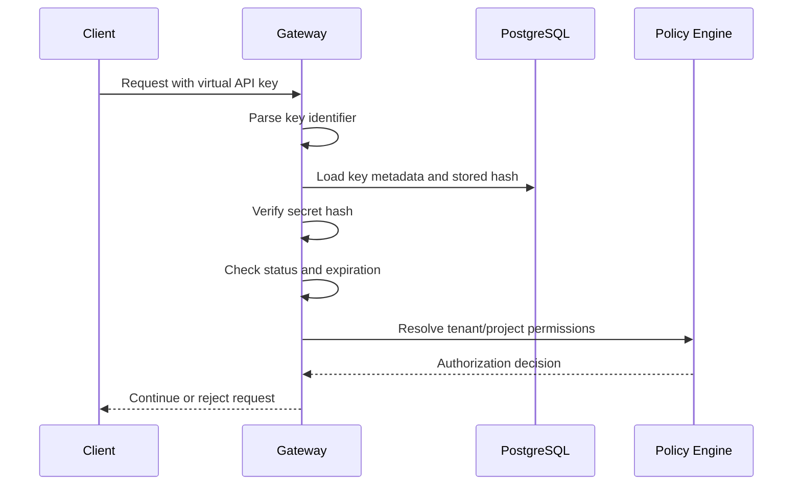
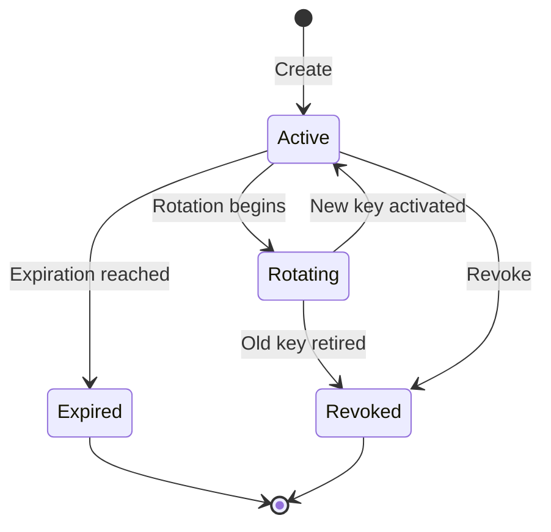

# ADR-0019: Virtual API Key Security Model

- **Status:** Proposed
- **Date:** 2026-11-04
- **Decision Owners:** llm-gateway architecture team
- **Related ADRs:** ADR-0001, ADR-0003, ADR-0009, ADR-0010, ADR-0011, ADR-0012, ADR-0017

## 1. Context

The `llm-gateway` exposes a unified API to multiple model providers.

Clients should authenticate with gateway-issued credentials rather than provider-specific API keys.

A virtual API key provides a controlled identity and authorization boundary between a client application and the gateway.

The gateway must support:

- Tenant isolation
- Project-level access control
- API key creation, rotation, expiration, and revocation
- Scope-based authorization
- Model and operation restrictions
- Usage and budget attribution
- Rate and concurrency policies
- Secure credential storage
- Auditability

Provider credentials must remain inside the gateway infrastructure and must never be exposed to clients.

## 2. Decision

The gateway will implement a **virtual API key authentication model**.

Every virtual API key:

1. Is generated by the gateway using a cryptographically secure random generator.
2. Has a public identifier and a secret component.
3. Is returned to the client only once at creation.
4. Is stored as a cryptographic hash, not plaintext.
5. Belongs to exactly one tenant and one project.
6. Has explicit scopes, permissions, and lifecycle state.
7. Can be independently revoked or expired.
8. Is attributed to inference executions, usage, and audit events.

The gateway will use API keys for machine-to-machine authentication. Administrative user authentication is a separate concern covered by ADR-0020.

## 3. API Key Format

Use a structured credential format:

```text
lgw_live_<key_id>_<secret>
lgw_test_<key_id>_<secret>
```

Where:

- `lgw` identifies the gateway.
- `live` or `test` identifies the environment.
- `key_id` is a non-secret lookup identifier.
- `secret` is a cryptographically random secret.

The format is illustrative and may be adjusted during implementation.

The key identifier must not be treated as an authentication secret.

### 3.1 Secret generation

Requirements:

- Use a cryptographically secure random number generator.
- Generate at least 256 bits of secret entropy.
- Encode the secret using a URL-safe representation.
- Never derive secrets from timestamps, UUIDs alone, tenant IDs, or predictable values.
- Never log or persist the full credential.

## 4. Storage and Verification

The database stores:

- Key ID
- Secret hash
- Hash algorithm/version
- Tenant ID
- Project ID
- Key name
- Environment
- Scopes
- Restrictions
- Expiration
- Lifecycle status
- Creation and last-used timestamps
- Revocation metadata

The plaintext secret is shown only once during creation.

### 4.1 Hashing

Use a keyed cryptographic hash such as HMAC-SHA-256 with a separately managed server-side pepper.

Conceptually:

```text
stored_hash = HMAC-SHA-256(server_pepper, api_key_secret)
```

Requirements:

- Store the pepper in a secret manager, not PostgreSQL.
- Support pepper versioning and rotation.
- Use constant-time comparison where applicable.
- Never store recoverable plaintext secrets.
- Do not use fast unkeyed hashes without a separate threat-model justification.

Because API keys contain high-entropy random secrets, a keyed cryptographic hash is appropriate for verification. The implementation must protect the pepper and enforce key entropy.

### 4.2 Authentication flow



Authentication must complete before model routing or provider execution.

## 5. Authorization Model

API key authentication establishes the client identity. Authorization determines what that identity can do.

Each key is associated with:

- Tenant
- Project
- Environment
- Scope set
- Optional model restrictions
- Optional operation restrictions
- Optional network restrictions
- Optional expiration

### 5.1 Initial scopes

| Scope | Permission |
|---|---|
| `inference:read` | Read inference execution status where permitted |
| `inference:write` | Submit inference requests |
| `models:read` | List accessible gateway models |
| `usage:read` | Read authorized usage summaries |

Administrative operations must not be available through ordinary inference API keys.

### 5.2 Authorization constraints

A request is allowed only when all applicable checks pass:

1. API key is active and not expired.
2. Tenant is active.
3. Project is active.
4. Required scope is present.
5. Requested model is permitted.
6. Requested operation is permitted.
7. Environment matches.
8. Optional network or contextual restrictions pass.
9. Tenant policy allows the operation.

Authorization must use trusted database-backed identity context, not client-supplied tenant or project identifiers.

## 6. Key Lifecycle



Supported lifecycle operations:

- Create
- List metadata
- Rotate
- Revoke
- Expire
- Update restrictions where policy permits

### 6.1 Rotation

Rotation must support a controlled overlap period.

Recommended sequence:

1. Create replacement key.
2. Return replacement secret once.
3. Mark old key as scheduled for retirement.
4. Allow both keys during the configured overlap period.
5. Revoke the old key.
6. Audit the complete rotation sequence.

Rotation must not expose the old secret or make it recoverable.

### 6.2 Revocation

Revocation must take effect promptly across gateway replicas.

The initial implementation will use:

- PostgreSQL as the authoritative key lifecycle store.
- Redis as an optional short-lived authentication metadata cache.
- Explicit cache invalidation when keys are revoked or changed.
- Bounded cache TTL to limit stale authorization state.

If the gateway cannot establish current key validity under a strict revocation policy, it must fail closed.

## 7. Database Model

Initial logical entity:

### `api_keys`

| Field | Type | Purpose |
|---|---|---|
| `id` | UUID | Internal primary key |
| `key_id` | VARCHAR | Public lookup identifier |
| `secret_hash` | BYTEA | Keyed secret hash |
| `pepper_version` | INTEGER | Hash key version |
| `tenant_id` | UUID | Owning tenant |
| `project_id` | UUID | Owning project |
| `name` | VARCHAR | Human-readable name |
| `environment` | VARCHAR | Test or live |
| `scopes` | JSONB | Granted scopes |
| `restrictions` | JSONB | Model and operation restrictions |
| `status` | VARCHAR | Active, revoked, expired |
| `expires_at` | TIMESTAMPTZ | Optional expiration |
| `last_used_at` | TIMESTAMPTZ | Last successful use |
| `created_at` | TIMESTAMPTZ | Creation timestamp |
| `revoked_at` | TIMESTAMPTZ | Revocation timestamp |
| `revoked_by` | UUID | Administrative actor |

Constraints:

- Unique `key_id`.
- Foreign keys to tenant and project.
- Index on active key lookup.
- Index on tenant/project ownership.
- No plaintext secret column.
- Revocation and lifecycle events must be auditable.

The database must enforce that a project belongs to the key's tenant.

## 8. Request Processing Order

The gateway applies controls in a defined order:

1. Parse credential and locate key metadata.
2. Verify secret.
3. Check key and tenant lifecycle state.
4. Resolve trusted tenant/project context.
5. Authorize operation, model, and scopes.
6. Validate request.
7. Apply request rate limits.
8. Evaluate routing and model policy.
9. Apply concurrency and budget controls.
10. Execute inference.

This order prevents unauthorized requests from consuming provider resources.

The gateway may use carefully scoped caches for authentication metadata, but it must not cache authorization decisions indefinitely.

## 9. Usage Attribution and Audit

Every authenticated inference execution must retain the identity context needed for attribution:

- Tenant ID
- Project ID
- API key ID
- Environment
- Execution ID

Usage records must not contain the API key secret.

Audit events must cover:

- Key creation
- Key rotation
- Key revocation
- Key expiration
- Scope changes
- Restriction changes
- Failed authentication
- Authorization denial
- Administrative access to key metadata

Avoid recording complete credentials in application logs, traces, error responses, or analytics.

## 10. Rate Limiting and Concurrency Integration

API key identity is one of the possible admission-control scopes.

The gateway will support:

- Tenant request and token quotas
- Project request and token quotas
- API key request and token quotas
- Tenant concurrency limits
- Project concurrency limits
- API key concurrency limits

The policy engine determines which limits apply.

API key revocation must prevent new executions, but must not erase the audit or accounting records of executions already accepted.

## 11. Security Requirements

### Credential handling

- Require HTTPS.
- Accept credentials through the documented authorization header.
- Reject credentials in query parameters.
- Redact authorization headers from logs and traces.
- Never return secret material after creation.
- Use constant-time hash verification where applicable.

### Abuse protection

- Apply authentication endpoint rate limits.
- Use generic authentication error responses.
- Avoid exposing whether a key ID exists.
- Monitor repeated failed authentication attempts.
- Support automated detection of unusual key usage.
- Allow optional IP or network restrictions.

### Infrastructure

- Store the hash pepper in a managed secret store.
- Encrypt database storage and backups.
- Restrict database access to required services.
- Use Redis TLS and ACLs.
- Audit administrative lifecycle operations.

## 12. Clean Architecture

### Domain responsibilities

`gateway-core` defines:

- API key identity
- API key lifecycle
- Scope and restriction models
- Authentication and authorization decisions
- Key lifecycle use cases
- Credential verification interfaces

### Infrastructure responsibilities

`gateway-infra` implements:

- PostgreSQL API key repository
- Cryptographic hashing and verification
- Secret manager integration
- Optional Redis metadata cache
- Cache invalidation

### Suggested structure

```text
crates/
├── gateway-core/
│   └── identity/
│       ├── api_key.rs
│       ├── scope.rs
│       ├── authorization.rs
│       └── ports.rs
├── gateway-infra/
│   └── identity/
│       ├── postgres_repository.rs
│       ├── key_hasher.rs
│       └── redis_cache.rs
└── gateway-api/
    └── middleware/
        └── api_key_auth.rs
```

## 13. Rust Interface Sketch

```rust
#[derive(Debug, Clone)]
pub struct ApiKeyIdentity {
    pub key_id: ApiKeyId,
    pub tenant_id: TenantId,
    pub project_id: ProjectId,
    pub scopes: Vec<ApiScope>,
    pub status: ApiKeyStatus,
}

#[async_trait::async_trait]
pub trait ApiKeyRepository: Send + Sync {
    async fn find_by_key_id(
        &self,
        key_id: &str,
    ) -> Result<Option<ApiKeyRecord>, ApiKeyError>;

    async fn create(
        &self,
        record: NewApiKeyRecord,
    ) -> Result<ApiKeyId, ApiKeyError>;

    async fn revoke(
        &self,
        key_id: ApiKeyId,
        actor_id: AdminUserId,
    ) -> Result<(), ApiKeyError>;
}

pub trait ApiKeyHasher: Send + Sync {
    fn hash(&self, secret: &str) -> Result<SecretHash, ApiKeyError>;

    fn verify(
        &self,
        secret: &str,
        stored_hash: &SecretHash,
    ) -> Result<bool, ApiKeyError>;
}
```

The implementation must ensure that plaintext credentials are not retained beyond the creation or verification operation.

## 14. Observability

Required metrics:

- `llm_gateway_api_key_auth_success_total`
- `llm_gateway_api_key_auth_failure_total`
- `llm_gateway_api_key_authorization_denied_total`
- `llm_gateway_api_key_revocations_total`
- `llm_gateway_api_key_rotations_total`
- `llm_gateway_api_key_cache_lookup_total`
- `llm_gateway_api_key_cache_invalidation_total`

Use bounded labels such as outcome and reason category.

Never use the API key secret, full credential, or raw authorization header as a metric label.

## 15. Consequences

### Positive

- Centralizes client authentication.
- Prevents provider credentials from reaching client applications.
- Supports tenant and project isolation.
- Enables key-level usage attribution.
- Supports scoped authorization and credential lifecycle management.

### Negative

- Requires secure key lifecycle management.
- Adds authentication lookups and cache invalidation complexity.
- Pepper rotation requires coordinated operational procedures.
- Revocation consistency must be managed across replicas.

### Risks

- Secret leakage can compromise client access.
- Stale authentication caches can delay revocation.
- Incorrect tenant/project binding can cause cross-tenant access.
- Overly broad scopes can grant unintended access.
- Poor rotation procedures can cause service interruption.

## 16. Validation Criteria

- [ ] API keys contain at least 256 bits of cryptographically secure secret entropy.
- [ ] Plaintext secrets are returned only once.
- [ ] Only keyed cryptographic hashes are stored.
- [ ] Pepper material is managed outside PostgreSQL.
- [ ] Key lookup uses a non-secret identifier.
- [ ] Authentication checks status, expiration, and tenant lifecycle.
- [ ] Authorization enforces scopes and restrictions.
- [ ] Tenant/project ownership is validated.
- [ ] Rotation supports a controlled overlap period.
- [ ] Revocation propagates across gateway replicas.
- [ ] API key secrets are redacted from logs, traces, and errors.
- [ ] Every execution is attributed to its authenticated identity.
- [ ] Authentication and authorization failure paths are tested.
- [ ] Administrative lifecycle operations are audited.

## 17. Related Decisions

- ADR-0001: Clean Architecture and Dependency Direction
- ADR-0003: PostgreSQL as Authoritative Data Store
- ADR-0009: Budget Reservation and Financial Settlement
- ADR-0010: Inference Idempotency and Execution Lifecycle
- ADR-0011: Distributed Rate Limiting
- ADR-0012: Distributed Concurrency Control
- ADR-0017: OpenTelemetry Observability Architecture

