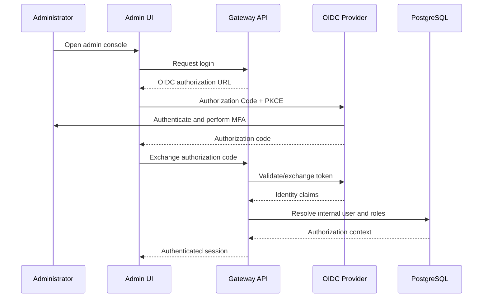
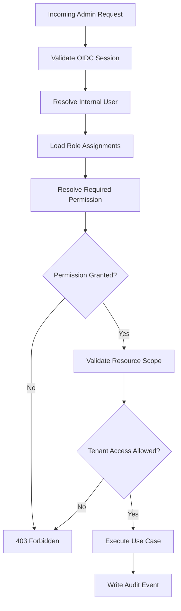

# ADR-0020: Administrative Authentication and Authorization

- **Status:** Proposed
- **Date:** 2026-11-04
- **Decision Owners:** llm-gateway architecture team
- **Related ADRs:** ADR-0001, ADR-0003, ADR-0019, ADR-0021, ADR-0022

## 1. Context

The `llm-gateway` requires an administrative interface for managing tenants, projects, API keys, model availability, routing policies, budgets, provider configurations, and operational controls.

These operations have higher privileges than ordinary inference requests.

Virtual API keys, as defined in ADR-0019, authenticate client applications. They must not be used to authenticate human administrators.

The administrative security model must provide:

- Human administrator authentication
- Role-based access control (RBAC)
- Tenant-aware authorization
- Separation of duties
- Secure session management
- Auditability
- Protection against privilege escalation
- Support for enterprise identity providers

## 2. Decision

The gateway will use:

1. **OpenID Connect (OIDC)** for human administrator authentication.
2. **OAuth 2.0 Authorization Code Flow with PKCE** for browser-based authentication.
3. **Role-Based Access Control (RBAC)** for authorization.
4. **PostgreSQL** for administrative identity mappings, role assignments, and audit records.
5. **Short-lived access tokens** and securely managed sessions.
6. **Multi-factor authentication (MFA)** through the identity provider.
7. **Tenant-scoped permissions** for tenant-specific administration.

The gateway will support integration with enterprise identity providers such as Keycloak, Microsoft Entra ID, and Okta.

The gateway will not implement its own password authentication system in the initial release.

## 3. Authentication Architecture

The identity provider is responsible for:

- User authentication
- Password policy
- MFA
- Account recovery
- Account lockout
- Enterprise identity federation
- Authentication lifecycle

The gateway is responsible for:

- Validating identity tokens
- Mapping external identities to internal users
- Resolving roles and permissions
- Enforcing tenant boundaries
- Managing application sessions
- Auditing privileged operations

### 3.1 Authentication flow



The exact token-exchange implementation depends on the selected OIDC deployment model.

For a server-side administrative application, prefer a Backend-for-Frontend (BFF) session model so browser JavaScript does not need to manage long-lived credentials.

## 4. Identity Model

The gateway maintains an internal user identity independently of the external identity provider.

### 4.1 Administrative user

| Field | Type | Purpose |
|---|---|---|
| `id` | UUID | Internal user ID |
| `identity_provider` | VARCHAR | OIDC issuer |
| `external_subject` | VARCHAR | OIDC subject |
| `email` | VARCHAR | Display/contact identity |
| `display_name` | VARCHAR | User display name |
| `status` | VARCHAR | Active, suspended |
| `created_at` | TIMESTAMPTZ | Creation time |
| `last_login_at` | TIMESTAMPTZ | Last successful login |

The identity mapping must use the combination of OIDC issuer and subject as its stable external identity.

Email addresses must not be treated as globally unique identity identifiers.

### 4.2 Identity lifecycle

- User provisioned or invited.
- User authenticates through OIDC.
- Gateway resolves internal identity.
- Roles and permissions are evaluated.
- User can be suspended independently of the identity provider.
- User access is revoked when the account is disabled or the external identity is no longer trusted.

Unknown users must not automatically receive privileged roles.

## 5. Role-Based Access Control

The gateway will implement RBAC with tenant-scoped role assignments.

Roles are collections of permissions. Permissions represent individual administrative capabilities.

### 5.1 Initial roles

| Role | Scope | Responsibilities |
|---|---|---|
| `platform_admin` | Global | Manage platform configuration and tenants |
| `security_admin` | Global | Manage security policies and access controls |
| `platform_operator` | Global | Monitor and operate gateway infrastructure |
| `tenant_admin` | Tenant | Manage tenant projects, keys, and policies |
| `tenant_operator` | Tenant | Monitor tenant usage and executions |
| `billing_admin` | Tenant | Manage budgets, quotas, and financial reports |
| `auditor` | Global or tenant | Read audit records and compliance evidence |

Roles must be assigned explicitly. The gateway must not infer administrative privileges from email domains or user-controlled claims.

### 5.2 Permission model

Example permissions:

| Permission | Description |
|---|---|
| `tenant:read` | Read tenant information |
| `tenant:write` | Create or update tenant configuration |
| `project:read` | Read project information |
| `project:write` | Manage projects |
| `apikey:read` | Read API key metadata |
| `apikey:create` | Create virtual API keys |
| `apikey:revoke` | Revoke virtual API keys |
| `model:read` | Read model registry |
| `model:write` | Manage model registry entries |
| `routing:read` | Read routing policies |
| `routing:write` | Modify routing policies |
| `budget:read` | Read budget configuration and usage |
| `budget:write` | Modify budget configuration |
| `audit:read` | Read audit records |
| `security:write` | Modify security configuration |
| `provider:read` | Read provider metadata |
| `provider:write` | Modify provider configuration |

### 5.3 Role-permission mapping

| Role | Representative permissions |
|---|---|
| `platform_admin` | All platform permissions |
| `security_admin` | Security and access-management permissions |
| `platform_operator` | Operational read access and approved operational actions |
| `tenant_admin` | Tenant and project management, API key lifecycle |
| `tenant_operator` | Tenant usage and execution read access |
| `billing_admin` | Budget and billing management |
| `auditor` | Read-only audit and compliance access |

The implementation must define the complete permission mapping in code and seed data.

Sensitive operations must require explicit permissions, not merely broad role-name checks.

## 6. Authorization Decision

Every administrative request must pass:

1. Authentication validation.
2. Internal user status validation.
3. Permission resolution.
4. Resource scope validation.
5. Tenant ownership validation.
6. Operation-specific policy checks.

A role assignment does not bypass tenant isolation.

### 6.1 Tenant-scoped authorization

A tenant administrator may access resources only within assigned tenant boundaries.

The gateway must derive the effective tenant scope from trusted authorization context.

Client-provided tenant identifiers are resource selectors, not proof of authorization.



## 7. Separation of Duties

The gateway must support separation of duties for high-impact operations.

Examples:

- A platform operator cannot modify security policies without the appropriate permission.
- A tenant operator cannot modify tenant budgets.
- An auditor cannot modify any configuration.
- A tenant administrator cannot grant global platform roles.
- Provider secret access is not automatically granted to provider configuration administrators.

For sensitive actions, the gateway may require:

- Step-up authentication
- MFA confirmation
- Explicit confirmation
- Approval by a second administrator

Dual approval is a future extension and must be introduced for operations where business or compliance requirements justify it.

## 8. Session and Token Security

### 8.1 Access tokens

Requirements:

- Short-lived access tokens.
- Validate issuer, audience, signature, expiration, and relevant claims.
- Accept only explicitly configured signing algorithms.
- Reject unsigned tokens and unexpected algorithms.
- Use key rotation through OIDC JWKS.
- Do not trust arbitrary token-provided role claims without a defined mapping policy.

A recommended initial access-token lifetime is 5–15 minutes, subject to identity-provider configuration.

### 8.2 Browser sessions

For the administrative web application:

- Prefer server-side BFF sessions.
- Use Secure, HttpOnly, SameSite cookies.
- Enforce CSRF protection for state-changing requests.
- Rotate session identifiers after authentication and privilege changes.
- Enforce idle and absolute session expiration.
- Support logout and administrative session invalidation.

Access tokens and refresh tokens must not be exposed to browser local storage.

### 8.3 Service-to-service authentication

Administrative human authentication is separate from internal service authentication.

Internal services should use workload identity, mTLS, or short-lived service credentials.

Virtual API keys must not be reused for internal service authentication.

## 9. PostgreSQL Data Model

Suggested tables:

### `admin_users`

```sql
CREATE TABLE admin_users (
    id UUID PRIMARY KEY,
    identity_provider TEXT NOT NULL,
    external_subject TEXT NOT NULL,
    email TEXT,
    display_name TEXT,
    status TEXT NOT NULL DEFAULT 'active',
    created_at TIMESTAMPTZ NOT NULL DEFAULT now(),
    last_login_at TIMESTAMPTZ,
    UNIQUE (identity_provider, external_subject)
);
```

### `admin_roles`

```sql
CREATE TABLE admin_roles (
    id UUID PRIMARY KEY,
    name TEXT NOT NULL UNIQUE,
    description TEXT,
    scope_type TEXT NOT NULL,
    created_at TIMESTAMPTZ NOT NULL DEFAULT now()
);
```

### `admin_permissions`

```sql
CREATE TABLE admin_permissions (
    id UUID PRIMARY KEY,
    name TEXT NOT NULL UNIQUE,
    description TEXT
);
```

### `admin_role_permissions`

```sql
CREATE TABLE admin_role_permissions (
    role_id UUID NOT NULL REFERENCES admin_roles(id),
    permission_id UUID NOT NULL REFERENCES admin_permissions(id),
    PRIMARY KEY (role_id, permission_id)
);
```

### `admin_user_role_assignments`

```sql
CREATE TABLE admin_user_role_assignments (
    id UUID PRIMARY KEY,
    admin_user_id UUID NOT NULL REFERENCES admin_users(id),
    role_id UUID NOT NULL REFERENCES admin_roles(id),
    tenant_id UUID,
    assigned_by UUID REFERENCES admin_users(id),
    assigned_at TIMESTAMPTZ NOT NULL DEFAULT now(),
    expires_at TIMESTAMPTZ
);
```

Constraints:

- Global roles must not contain a tenant ID.
- Tenant-scoped roles must reference a valid tenant.
- Role assignment changes must be audited.
- Expired assignments must not grant access.
- Only authorized actors may grant or revoke roles.

Additional constraints and indexes should be included in the production migration.

## 10. Administrative API Design

Suggested endpoints:

| Method | Endpoint | Purpose |
|---|---|---|
| GET | `/admin/v1/me` | Current administrator identity |
| GET | `/admin/v1/users` | List administrators |
| GET | `/admin/v1/users/{id}` | Read administrator |
| POST | `/admin/v1/users` | Provision administrator |
| PATCH | `/admin/v1/users/{id}` | Update administrator status |
| GET | `/admin/v1/roles` | List roles |
| POST | `/admin/v1/users/{id}/roles` | Assign role |
| DELETE | `/admin/v1/users/{id}/roles/{assignment_id}` | Revoke role assignment |
| GET | `/admin/v1/audit-events` | Search audit events |

Administrative APIs must be separate from inference APIs.

Every endpoint must declare its required permission and resource scope.

## 11. Clean Architecture

### Domain layer

`gateway-core` owns:

- Admin user
- Role
- Permission
- Role assignment
- Authorization policy
- Administrative use cases

### Application layer

Application use cases include:

- Provision administrator
- Suspend administrator
- Assign role
- Revoke role
- Resolve permissions
- Authorize administrative operation

### Infrastructure layer

`gateway-infra` owns:

- OIDC/JWKS integration
- PostgreSQL repositories
- Session persistence
- Identity provider configuration
- Audit event persistence

### API layer

`gateway-api` owns:

- OIDC callback endpoints
- Session middleware
- CSRF middleware
- Administrative authorization middleware
- Admin REST endpoints

Suggested structure:

```text
crates/
├── gateway-core/
│   └── admin_identity/
│       ├── admin_user.rs
│       ├── role.rs
│       ├── permission.rs
│       ├── authorization.rs
│       └── ports.rs
├── gateway-application/
│   └── admin/
│       ├── assign_role.rs
│       ├── revoke_role.rs
│       └── resolve_permissions.rs
├── gateway-infra/
│   └── admin_identity/
│       ├── oidc/
│       ├── postgres_repository.rs
│       └── session_store.rs
└── gateway-api/
    └── admin/
        ├── auth_routes.rs
        ├── middleware.rs
        └── routes.rs
```

## 12. Rust Interface Sketch

```rust
#[derive(Debug, Clone)]
pub struct AdminPrincipal {
    pub user_id: AdminUserId,
    pub issuer: String,
    pub subject: String,
    pub permissions: Vec<Permission>,
    pub tenant_scopes: Vec<TenantId>,
}

#[async_trait::async_trait]
pub trait AdminIdentityRepository: Send + Sync {
    async fn find_by_external_identity(
        &self,
        issuer: &str,
        subject: &str,
    ) -> Result<Option<AdminUser>, IdentityError>;
}

#[async_trait::async_trait]
pub trait AuthorizationService: Send + Sync {
    async fn authorize(
        &self,
        principal: &AdminPrincipal,
        permission: Permission,
        resource: ResourceContext,
    ) -> Result<AuthorizationDecision, AuthorizationError>;
}
```

The principal must be constructed from validated identity and trusted authorization data. Request headers must not be allowed to manufacture a principal or grant permissions.

## 13. Audit and Observability

Administrative actions require durable audit records.

Record:

- Actor ID
- Action
- Resource type and ID
- Tenant scope
- Outcome
- Timestamp
- Correlation ID
- Relevant change metadata
- Source IP where appropriate and permitted

Do not record:

- Access tokens
- Refresh tokens
- Session cookies
- Passwords
- OIDC authorization codes
- Provider secrets

Required metrics:

- `llm_gateway_admin_auth_success_total`
- `llm_gateway_admin_auth_failure_total`
- `llm_gateway_admin_authorization_denied_total`
- `llm_gateway_admin_role_changes_total`
- `llm_gateway_admin_session_invalidations_total`

Use bounded labels and avoid sensitive identity information in metric dimensions.

## 14. Testing Strategy

### Unit tests

- Permission resolution.
- Role-to-permission mapping.
- Tenant-scoped authorization.
- Expired role assignments.
- Suspended administrator behavior.
- Separation-of-duties rules.

### Integration tests

- OIDC token signature and claim validation.
- Invalid issuer and audience.
- Expired and malformed tokens.
- Unknown external identities.
- Role assignment persistence.
- Administrative audit persistence.
- Session invalidation.

### Security tests

- Cross-tenant access attempts.
- Privilege escalation attempts.
- CSRF protection.
- Session fixation.
- Token replay where applicable.
- Invalid JWT algorithm acceptance.
- Unauthorized role assignment.
- Administrator suspension while a session exists.

## 15. Consequences

### Positive

- Delegates authentication to established identity providers.
- Supports enterprise SSO and MFA.
- Separates human administrators from machine clients.
- Enables fine-grained authorization.
- Supports tenant-scoped administration.
- Creates a durable audit trail for privileged operations.

### Negative

- Requires OIDC provider configuration and operational ownership.
- Adds identity-provider availability as an administrative dependency.
- Requires careful role and permission lifecycle management.
- Session invalidation and authorization freshness require explicit policies.

### Risks

- Incorrect role mappings can create privilege escalation.
- Long-lived sessions can delay access revocation.
- Poor tenant-scope enforcement can expose cross-tenant data.
- Misconfigured OIDC audiences or issuers can permit token misuse.

## 16. Validation Criteria

- [ ] Administrative users authenticate through OIDC.
- [ ] Authorization Code Flow with PKCE is supported.
- [ ] MFA is enforced through the identity provider according to policy.
- [ ] External identity is mapped by issuer and subject.
- [ ] Unknown users receive no privileged access by default.
- [ ] RBAC permissions are explicitly defined.
- [ ] Tenant-scoped roles enforce tenant boundaries.
- [ ] Role assignments are auditable.
- [ ] Suspended users cannot perform administrative actions.
- [ ] Sessions have idle and absolute expiration.
- [ ] Browser sessions use secure cookie settings.
- [ ] CSRF protection covers state-changing requests.
- [ ] Administrative APIs are separate from inference APIs.
- [ ] Virtual API keys cannot authenticate administrative operations.
- [ ] Cross-tenant and privilege-escalation tests pass.

## 17. Related Decisions

- ADR-0001: Clean Architecture and Dependency Direction
- ADR-0003: PostgreSQL as Authoritative Data Store
- ADR-0019: Virtual API Key Security Model
- ADR-0021: Provider Secret Management
- ADR-0022: Tenant Isolation and PostgreSQL RLS

