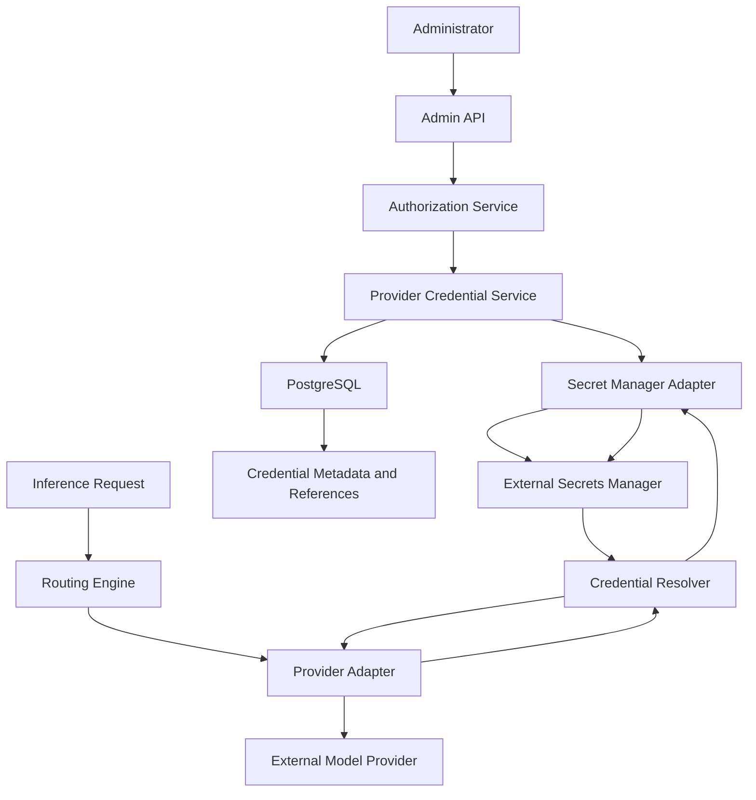
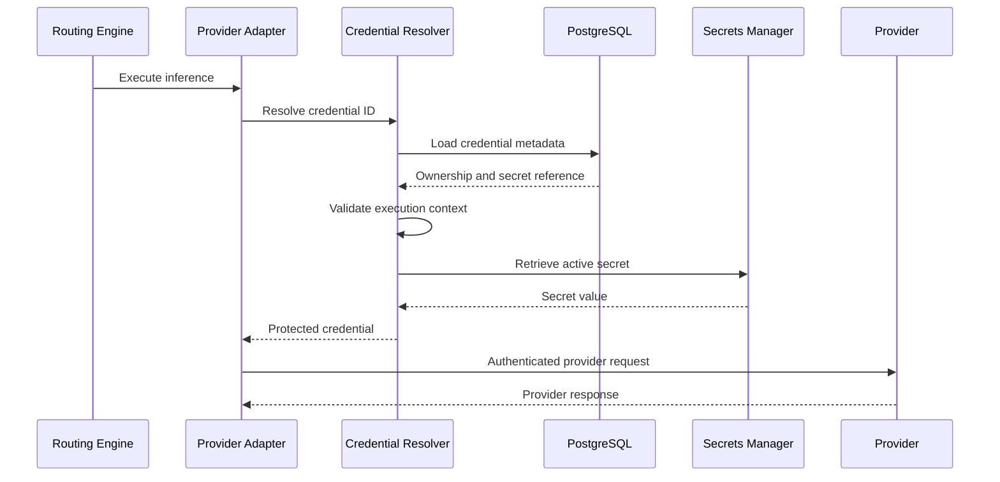

# ADR-0021: Provider Secret Management

- **Status:** Proposed
- **Date:** 2026-11-04
- **Decision Owners:** llm-gateway architecture team
- **Related ADRs:** ADR-0001, ADR-0003, ADR-0006, ADR-0007, ADR-0013, ADR-0017, ADR-0019, ADR-0020

## 1. Context

The `llm-gateway` integrates with multiple commercial and self-hosted model providers.

Each provider may require sensitive credentials:

- API keys
- OAuth client secrets
- Access tokens
- Refresh tokens
- Cloud service credentials
- Private certificates
- Signing keys

These credentials allow the gateway to invoke external inference APIs and potentially incur significant financial costs.

The gateway must protect provider credentials throughout their lifecycle, including creation, storage, retrieval, rotation, usage, revocation, and deletion.

The following security boundaries are important:

1. Client applications authenticate using virtual API keys.
2. Administrators authenticate through the identity model defined in ADR-0020.
3. The gateway authenticates to model providers using provider-specific credentials.
4. Provider credentials must never be returned to clients or exposed through administrative APIs.

## 2. Decision

The gateway will use an external secrets manager as the authoritative store for provider credentials.

PostgreSQL will store provider credential metadata and secret references, but never plaintext provider credentials.

The initial architecture will support a secrets-manager abstraction with implementations for:

- HashiCorp Vault
- AWS Secrets Manager
- Azure Key Vault
- Google Cloud Secret Manager

The deployment selects the concrete implementation through configuration.

Provider adapters receive credentials through a restricted credential-resolution interface. They do not access the secrets manager directly.

## 3. Security Principles

The implementation must enforce:

- No plaintext provider secrets in PostgreSQL.
- No provider secrets in source code or Git.
- No provider secrets in container images.
- No provider secrets in application logs or traces.
- No provider secrets in API responses.
- Least-privilege access to secret references.
- Explicit credential ownership and provider association.
- Rotation without unnecessary service interruption.
- Auditable administrative credential operations.
- Tenant isolation where credentials are tenant-owned.

Secrets must be treated as sensitive data throughout their entire lifecycle.

## 4. Credential Ownership Model

The gateway will support two initial credential ownership models.

### 4.1 Platform-managed credentials

The platform owns and manages provider accounts and credentials.

Examples:

- Shared OpenAI account.
- Shared Anthropic account.
- Organization-owned cloud model endpoint.

Characteristics:

- Managed by platform administrators.
- Available to authorized tenants through routing policies.
- Associated with platform-level provider configurations.
- Usage attributed to the requesting tenant and project.

### 4.2 Tenant-managed credentials

A tenant supplies its own provider credentials.

Examples:

- A tenant's own commercial provider API key.
- A tenant-specific cloud endpoint credential.

Characteristics:

- Owned by a specific tenant.
- Accessible only within that tenant's authorization boundary.
- Must not be available to other tenants.
- Must be excluded from platform-wide routing unless explicitly authorized by policy.

The ownership model must be represented explicitly in the provider configuration.

## 5. Architecture



### Responsibilities

| Component | Responsibility |
|---|---|
| Admin API | Accept authorized credential-management requests |
| Authorization service | Validate administrative permissions and tenant scope |
| Credential service | Manage credential lifecycle and metadata |
| Secret manager adapter | Integrate with the selected secrets manager |
| PostgreSQL | Store credential metadata and references |
| Credential resolver | Resolve authorized credentials for provider execution |
| Provider adapter | Use credentials to authenticate provider requests |

Provider adapters must not contain provider secrets or secret-management logic.

## 6. Secret Reference Strategy

PostgreSQL stores an opaque secret reference.

Example:

```text
secret_ref:
  provider/openai/platform/production/credential-001
```

The reference must not contain the actual credential.

Suggested metadata:

| Field | Purpose |
|---|---|
| `id` | Internal credential ID |
| `provider_id` | Associated provider |
| `tenant_id` | Tenant owner, nullable for platform credentials |
| `ownership_type` | Platform or tenant |
| `secret_ref` | External secrets-manager reference |
| `credential_type` | API key, OAuth, cloud credential |
| `version` | Active secret version |
| `status` | Active, disabled, revoked |
| `created_by` | Administrative actor |
| `created_at` | Creation timestamp |
| `updated_at` | Last metadata update |
| `last_rotated_at` | Last successful rotation |
| `expires_at` | Optional expiration |

The actual secret value must never be stored in this table.

## 7. Secret Manager Interface

The gateway will define a provider-neutral abstraction.

```rust
use async_trait::async_trait;
use secrecy::SecretString;

#[async_trait]
pub trait SecretManager: Send + Sync {
    async fn create_secret(
        &self,
        path: &str,
        value: SecretString,
    ) -> Result<SecretReference, SecretError>;

    async fn get_secret(
        &self,
        reference: &SecretReference,
    ) -> Result<SecretString, SecretError>;

    async fn rotate_secret(
        &self,
        reference: &SecretReference,
        new_value: SecretString,
    ) -> Result<SecretVersion, SecretError>;

    async fn delete_secret(
        &self,
        reference: &SecretReference,
    ) -> Result<(), SecretError>;
}
```

The implementation should use secret-handling types that minimize accidental exposure through debugging and serialization.

Avoid implementing `Debug` output that reveals secret values.

## 8. Credential Resolution

Credentials must be resolved only when needed for an authorized provider execution.

### Resolution flow



### Mandatory checks

Before resolving a credential:

1. Validate the provider configuration.
2. Verify the credential is active.
3. Verify the provider association.
4. Verify platform or tenant ownership.
5. Verify the requesting tenant is authorized to use it.
6. Verify the credential version is valid.
7. Resolve the secret through the configured secret manager.

The caller must not be allowed to supply an arbitrary secret reference.

## 9. Caching Policy

Provider credentials are sensitive and must not be cached without a defined security policy.

Initial decision:

- Do not introduce a distributed Redis cache for provider secret values.
- Resolve credentials through the secrets-manager abstraction.
- Permit a short-lived, process-local credential cache only after performance and threat-model review.
- Never persist secret values in Redis.
- Never serialize secret values into application state or events.

If local caching is introduced, it must provide:

- A strict maximum TTL.
- Explicit invalidation on rotation and revocation.
- Bounded memory usage.
- No secret values in debug output.
- Restricted process access.
- Defined behavior when the secrets manager becomes unavailable.

The initial implementation should favor correctness and security over speculative caching optimizations.

## 10. Rotation and Revocation

Credential rotation must not require rebuilding or redeploying the gateway.

### Rotation procedure

1. Administrator requests credential rotation.
2. Authorization service validates permission.
3. Credential service validates provider and ownership.
4. New secret is written as a new secret-manager version.
5. New version is validated where provider APIs support safe validation.
6. Metadata is updated to reference the active version.
7. Provider adapters use the new version for subsequent executions.
8. Old version is disabled or retired according to provider policy.
9. Audit event is persisted.

### Revocation

Revocation must:

- Prevent new credential resolutions.
- Mark the metadata record as revoked.
- Invalidate any local cached version.
- Record the actor and timestamp.
- Trigger provider-side credential revocation when supported and authorized.

The gateway must distinguish between disabling a credential in the gateway and revoking the credential at the external provider.

A gateway-side revocation cannot guarantee that a copied provider credential is invalidated externally.

## 11. Failure Handling

| Failure | Expected behavior |
|---|---|
| Secret manager unavailable | Fail provider execution safely |
| Credential not found | Reject provider attempt |
| Credential revoked | Reject provider attempt |
| Credential expired | Reject provider attempt |
| Invalid provider association | Reject provider attempt and alert |
| Rotation in progress | Use the valid active version according to rotation policy |
| Secret version unavailable | Reject provider attempt |
| Invalid provider credential | Normalize provider authentication failure |
| Unauthorized tenant access | Deny access and record security event |

The gateway must not silently substitute another tenant's credentials.

A provider credential failure may trigger the reliability engine to select another eligible provider only when routing policy allows it.

## 12. PostgreSQL Model

Suggested table:

```sql
CREATE TABLE provider_credentials (
    id UUID PRIMARY KEY,
    provider_id UUID NOT NULL,
    tenant_id UUID,
    ownership_type TEXT NOT NULL,
    secret_ref TEXT NOT NULL,
    credential_type TEXT NOT NULL,
    active_version TEXT,
    status TEXT NOT NULL DEFAULT 'active',
    created_by UUID NOT NULL,
    created_at TIMESTAMPTZ NOT NULL DEFAULT now(),
    updated_at TIMESTAMPTZ NOT NULL DEFAULT now(),
    last_rotated_at TIMESTAMPTZ,
    expires_at TIMESTAMPTZ,

    CONSTRAINT provider_credentials_ownership_check
        CHECK (
            (ownership_type = 'platform' AND tenant_id IS NULL)
            OR
            (ownership_type = 'tenant' AND tenant_id IS NOT NULL)
        )
);
```

Production migration requirements:

- Foreign keys to provider and tenant records.
- Indexes for provider and tenant lookup.
- Unique secret-reference policy where appropriate.
- Status constraints.
- Tenant isolation enforcement.
- Auditable lifecycle changes.

The secret manager remains authoritative for secret material and secret versions.

## 13. Clean Architecture

### Domain layer

`gateway-core` defines:

- Provider credential identity
- Credential ownership
- Credential lifecycle
- Credential status
- Secret reference
- Credential resolution policy

### Application layer

`gateway-application` defines:

- Create provider credential
- Update credential metadata
- Resolve credential
- Rotate credential
- Revoke credential

### Infrastructure layer

`gateway-infra` implements:

- Vault integration
- AWS Secrets Manager integration
- Azure Key Vault integration
- Google Cloud Secret Manager integration
- PostgreSQL credential repository

### API layer

`gateway-api` exposes authorized administrative endpoints and delegates credential lifecycle operations to application use cases.

Suggested structure:

```text
crates/
├── gateway-core/
│   └── provider_credentials/
│       ├── credential.rs
│       ├── ownership.rs
│       ├── lifecycle.rs
│       └── ports.rs
├── gateway-application/
│   └── provider_credentials/
│       ├── create.rs
│       ├── resolve.rs
│       ├── rotate.rs
│       └── revoke.rs
├── gateway-infra/
│   └── secrets/
│       ├── vault.rs
│       ├── aws.rs
│       ├── azure.rs
│       ├── gcp.rs
│       └── postgres_repository.rs
└── gateway-api/
    └── admin/
        └── provider_credentials.rs
```

## 14. Administrative API

Suggested endpoints:

| Method | Endpoint | Purpose |
|---|---|---|
| POST | `/admin/v1/provider-credentials` | Register credential |
| GET | `/admin/v1/provider-credentials` | List credential metadata |
| GET | `/admin/v1/provider-credentials/{id}` | Read credential metadata |
| POST | `/admin/v1/provider-credentials/{id}/rotate` | Rotate credential |
| POST | `/admin/v1/provider-credentials/{id}/validate` | Validate credential |
| POST | `/admin/v1/provider-credentials/{id}/revoke` | Revoke credential |
| DELETE | `/admin/v1/provider-credentials/{id}` | Remove metadata and schedule secret cleanup |

All endpoints require explicit administrative permissions.

No endpoint may return the stored secret value.

Credential creation should accept the secret over TLS and transfer it directly to the secret manager. The gateway must not persist it in request logs, tracing attributes, or error messages.

## 15. Audit and Observability

Audit events:

- `provider_credential.created`
- `provider_credential.updated`
- `provider_credential.rotated`
- `provider_credential.revoked`
- `provider_credential.validation_succeeded`
- `provider_credential.validation_failed`
- `provider_credential.access_denied`

Record:

- Credential ID
- Provider ID
- Tenant ID where applicable
- Administrative actor
- Operation
- Outcome
- Timestamp
- Correlation ID

Never record:

- Secret values
- Authorization headers
- Secret-manager access tokens
- Private keys
- Full provider request authentication headers

Suggested metrics:

- `llm_gateway_secret_resolution_total`
- `llm_gateway_secret_resolution_failures_total`
- `llm_gateway_secret_resolution_duration_seconds`
- `llm_gateway_provider_credential_rotation_total`
- `llm_gateway_provider_credential_expiration_total`

Use bounded labels. Do not expose secret references or tenant-specific credential identifiers as metric labels.

## 16. Testing Strategy

### Unit tests

- Credential ownership validation.
- Credential lifecycle transitions.
- Provider association validation.
- Secret reference validation.
- Rotation state transitions.
- Tenant authorization rules.

### Integration tests

- Secret creation and retrieval.
- Secret rotation.
- Secret revocation.
- PostgreSQL metadata persistence.
- Secrets-manager outage handling.
- Provider adapter credential injection.

### Security tests

- Verify plaintext secrets never enter PostgreSQL.
- Verify secret values are absent from logs.
- Verify unauthorized tenant access is rejected.
- Verify revoked credentials cannot be resolved.
- Verify arbitrary secret references cannot be supplied by clients.
- Verify credential rotation invalidates local cached values.
- Verify administrative authorization on every lifecycle endpoint.
- Verify secrets are not included in telemetry or exception messages.

## 17. Consequences

### Positive

- Centralized secret lifecycle management.
- Provider credentials are separated from client credentials.
- Reduced impact of PostgreSQL data exposure.
- Supports multiple cloud and self-hosted secrets managers.
- Enables controlled rotation and revocation.
- Supports platform-managed and tenant-managed credentials.

### Negative

- Introduces an external infrastructure dependency.
- Adds secret resolution latency.
- Requires operational procedures for secret-manager availability.
- Requires careful lifecycle coordination between metadata and secret versions.

### Risks

- Secret-manager permissions may be overly broad.
- Secret leakage may occur through debugging or error handling.
- Rotation may temporarily disrupt provider execution.
- Tenant ownership mistakes may expose credentials across boundaries.
- External provider revocation may not be immediately observable.

## 18. Validation Criteria

- [ ] Provider secrets are never stored in plaintext in PostgreSQL.
- [ ] Provider credentials are stored in an external secrets manager.
- [ ] PostgreSQL stores only metadata and secret references.
- [ ] Platform and tenant credential ownership are distinct.
- [ ] Tenant ownership is validated before credential resolution.
- [ ] Provider adapters use the credential resolver abstraction.
- [ ] Clients cannot provide arbitrary secret references.
- [ ] Secret rotation does not require a gateway deployment.
- [ ] Revocation prevents subsequent credential resolution.
- [ ] Secret-manager failures are handled safely.
- [ ] No secrets appear in logs, traces, metrics, or API responses.
- [ ] Credential lifecycle operations are audited.
- [ ] Security and tenant-isolation tests pass.

## 19. Related Decisions

- ADR-0001: Clean Architecture and Dependency Direction
- ADR-0003: PostgreSQL as Authoritative Data Store
- ADR-0006: Canonical Provider Adapter Interface
- ADR-0007: Model Registry and Capability Representation
- ADR-0013: Provider Retry and Circuit Breaker Strategy
- ADR-0017: OpenTelemetry Observability Architecture
- ADR-0019: Virtual API Key Security Model
- ADR-0020: Administrative Authentication and Authorization

