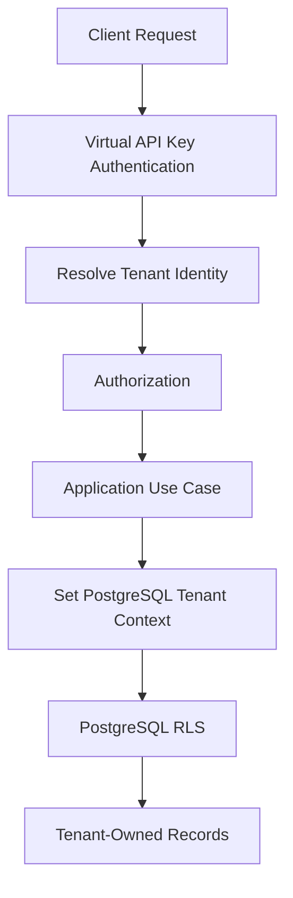
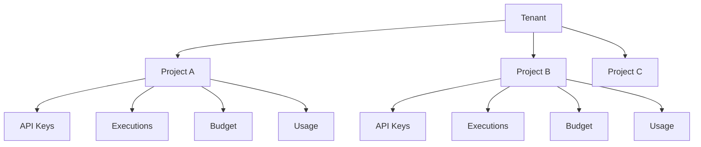

# ADR-0022: Tenant Isolation and PostgreSQL Row-Level Security

- **Status:** Proposed
- **Date:** 2026-11-04
- **Decision Owners:** llm-gateway architecture team
- **Related ADRs:** ADR-0001, ADR-0003, ADR-0009, ADR-0010, ADR-0019, ADR-0020, ADR-0021

## 1. Context

The `llm-gateway` is a multi-tenant platform.

Multiple organizations use the same gateway infrastructure while maintaining independent:

- Projects
- Virtual API keys
- Inference executions
- Usage records
- Budgets
- Routing policies
- Evaluation datasets
- Audit records
- Provider credentials
- Operational configuration

A security failure in tenant isolation could expose confidential prompts, model responses, financial records, provider credentials, or administrative information.

Application-level filtering alone is insufficient because a missing tenant condition in a query can expose another tenant's data.

The platform therefore needs defense in depth.

## 2. Decision

The gateway will implement multi-tenant isolation using:

1. **Shared PostgreSQL database** with shared tables for tenant-owned resources.
2. Explicit `tenant_id` ownership columns.
3. PostgreSQL Row-Level Security (RLS) for tenant-owned tables.
4. Application-level authorization before data access.
5. Tenant context derived from authenticated identity.
6. Database constraints and foreign keys to prevent cross-tenant relationships.
7. Dedicated administrative access paths for authorized global operations.

RLS is an additional security boundary, not a replacement for application authorization.

PostgreSQL remains the authoritative source for tenant ownership and access control.

## 3. Tenant Isolation Model

The initial architecture uses a shared database and shared schema model.



Each tenant has one or more projects.

A tenant owns its projects, API keys, usage, budgets, and other tenant-scoped resources.

### 3.1 Ownership hierarchy



### 3.2 Tenant-owned resources

The following resources must carry tenant ownership:

| Resource | Tenant isolation |
|---|---|
| Projects | Required |
| API keys | Required |
| Inference executions | Required |
| Inference attempts | Required |
| Usage records | Required |
| Budget accounts | Required |
| Financial ledger | Required |
| Routing policies | Required |
| Evaluation datasets | Required |
| Evaluation results | Required |
| Audit events | Required |
| Provider credentials | Required for tenant-owned credentials |
| Cache metadata | Tenant-scoped where applicable |

Global platform configuration may be shared, but tenant-specific overrides must remain isolated.

## 4. Trusted Tenant Context

The gateway must derive tenant identity from a validated authentication principal.

For inference requests:

```text
Authorization header
        |
        v
Virtual API key verification
        |
        v
PostgreSQL API key record
        |
        v
Trusted tenant_id + project_id
```

For administrative requests:

```text
OIDC authentication
        |
        v
Internal administrator identity
        |
        v
RBAC permission resolution
        |
        v
Authorized tenant scope
```

### Mandatory invariants

- Never trust a tenant ID supplied in a request header.
- Never trust a tenant ID supplied in a request body.
- Never derive tenant identity from an unvalidated JWT claim.
- Never allow a client to change the tenant context after authentication.
- Every database operation involving tenant-owned data must execute under the appropriate tenant context.

A client may provide a project or resource identifier, but the application must verify that it belongs to the authenticated tenant.

## 5. PostgreSQL Row-Level Security

RLS will enforce tenant ownership at the database layer.

### 5.1 Tenant context

The application sets the tenant context using a transaction-local PostgreSQL setting.

Example:

```sql
BEGIN;

SELECT set_config(
    'app.current_tenant_id',
    '00000000-0000-0000-0000-000000000001',
    true
);

SELECT *
FROM inference_executions;

COMMIT;
```

The third argument to `set_config` makes the setting transaction-local.

This is important when using connection pooling because a tenant context must not leak into another request.

The application must set the context inside every transaction that accesses tenant-owned data.

### 5.2 RLS policy

Example table:

```sql
CREATE TABLE projects (
    id UUID PRIMARY KEY,
    tenant_id UUID NOT NULL REFERENCES tenants(id),
    name TEXT NOT NULL,
    created_at TIMESTAMPTZ NOT NULL DEFAULT now(),

    UNIQUE (tenant_id, id)
);
```

Enable RLS:

```sql
ALTER TABLE projects ENABLE ROW LEVEL SECURITY;
ALTER TABLE projects FORCE ROW LEVEL SECURITY;
```

Create tenant isolation policy:

```sql
CREATE POLICY projects_tenant_isolation
ON projects
USING (
    tenant_id = NULLIF(
        current_setting('app.current_tenant_id', true),
        ''
    )::UUID
)
WITH CHECK (
    tenant_id = NULLIF(
        current_setting('app.current_tenant_id', true),
        ''
    )::UUID
);
```

The policy provides:

- `USING`: restricts which existing rows can be read, updated, or deleted.
- `WITH CHECK`: restricts which rows can be inserted or updated.

When the tenant context is absent, the policy must deny access rather than expose all rows.

Apply equivalent policies to every tenant-owned table.

## 6. Database Role Separation

Application runtime and migration operations must use different PostgreSQL roles.

| Database role | Responsibility |
|---|---|
| `gateway_runtime` | Normal application queries |
| `gateway_migrator` | Schema migrations |
| `gateway_readonly` | Approved read-only reporting |
| `gateway_admin` | Restricted platform administration |

### Security requirements

- Runtime role must not be a superuser.
- Runtime role must not have `BYPASSRLS`.
- Runtime role must not own tenant tables.
- Runtime role must not have unrestricted administrative privileges.
- Migration role must not be exposed to normal application traffic.
- Administrative database access must be restricted and audited.

`FORCE ROW LEVEL SECURITY` must be used for tenant-owned tables to ensure table owners are subject to RLS where applicable.

PostgreSQL superusers and roles with `BYPASSRLS` can bypass RLS. These privileges must remain outside the normal application execution path.

## 7. Clean Architecture Responsibilities

### Domain layer

`gateway-core` defines:

- Tenant identity
- Project ownership
- Tenant authorization rules
- Resource ownership invariants

The domain must not depend on PostgreSQL RLS implementation details.

### Application layer

`gateway-application`:

- Resolves authenticated tenant context.
- Validates resource ownership.
- Starts tenant-scoped transactions.
- Executes authorized use cases.

### Infrastructure layer

`gateway-infra`:

- Implements PostgreSQL repositories.
- Sets transaction-local tenant context.
- Applies RLS-aware database access.
- Enforces tenant-scoped query behavior.

### API layer

`gateway-api`:

- Authenticates requests.
- Builds trusted tenant context.
- Prevents request-controlled tenant spoofing.
- Propagates the principal to application use cases.

## 8. Rust Implementation Sketch

Define a trusted tenant context:

```rust
#[derive(Debug, Clone)]
pub struct TenantContext {
    pub tenant_id: TenantId,
    pub project_id: Option<ProjectId>,
    pub principal_id: PrincipalId,
}
```

A tenant-scoped transaction helper:

```rust
use sqlx::{PgPool, Postgres, Transaction};

pub async fn begin_tenant_transaction(
    pool: &PgPool,
    tenant_id: TenantId,
) -> Result<Transaction<'_, Postgres>, sqlx::Error> {
    let mut tx = pool.begin().await?;

    sqlx::query(
        "SELECT set_config('app.current_tenant_id', $1, true)"
    )
    .bind(tenant_id.to_string())
    .execute(&mut *tx)
    .await?;

    Ok(tx)
}
```

Repositories must use the tenant-scoped transaction rather than executing tenant-owned queries through an unscoped connection.

The transaction helper must be the standard entry point for tenant-owned database operations.

## 9. Cross-Tenant Relationship Protection

RLS protects row visibility, but database constraints must also prevent invalid relationships.

For example, an inference execution must not reference a project belonging to another tenant.

Use composite foreign keys where appropriate.

```sql
CREATE TABLE projects (
    id UUID PRIMARY KEY,
    tenant_id UUID NOT NULL REFERENCES tenants(id),
    name TEXT NOT NULL,
    UNIQUE (tenant_id, id)
);

CREATE TABLE inference_executions (
    id UUID PRIMARY KEY,
    tenant_id UUID NOT NULL,
    project_id UUID NOT NULL,
    status TEXT NOT NULL,

    FOREIGN KEY (tenant_id, project_id)
        REFERENCES projects (tenant_id, id)
);
```

This ensures that the execution's tenant and project ownership agree.

Apply the same pattern to:

- API keys and projects.
- Budget accounts and projects.
- Usage records and executions.
- Provider credentials and tenants.
- Evaluation datasets and projects.

## 10. Global Administrative Access

Some operations require cross-tenant visibility.

Examples:

- Platform-wide monitoring.
- Tenant provisioning.
- Security incident investigation.
- Global billing reconciliation.
- Compliance auditing.

These operations must not bypass RLS through the ordinary runtime database role.

The initial implementation will use explicit administrative application use cases with narrowly scoped database access.

Where a privileged database role is required, it must:

1. Be unavailable to inference request handlers.
2. Be granted only to dedicated administrative operations.
3. Require explicit authorization.
4. Be audited.
5. Use read-only access whenever possible.
6. Avoid unrestricted cross-tenant data export.

A future design may introduce separate administrative read models for platform-wide reporting.

## 11. Redis and Tenant Isolation

Redis is not protected by PostgreSQL RLS.

Tenant isolation must therefore be implemented explicitly in Redis key design and access logic.

Examples:

```text
tenant:{tenant_id}:rate-limit
tenant:{tenant_id}:project:{project_id}:concurrency
tenant:{tenant_id}:cache:{cache_key}
tenant:{tenant_id}:breaker:{provider_id}
```

Requirements:

- Every tenant-specific key includes tenant identity.
- Cache fingerprints include tenant and project isolation boundaries.
- Redis commands must derive identifiers from trusted context.
- Clients must never control internal Redis key names.
- Tenant data must not be shared through semantic cache unless explicitly authorized by policy.

Redis ACLs and network restrictions provide additional infrastructure protection.

## 12. Cache and Search Isolation

Tenant isolation must also apply outside PostgreSQL.

### Exact cache

The cache fingerprint must include:

- Tenant ID
- Project ID
- Model identity
- Canonical request parameters
- Relevant policy and execution settings

### Semantic cache

Semantic cache namespaces must be tenant-scoped by default.

Cross-tenant semantic reuse is prohibited unless an explicit platform policy and data-governance decision authorize it.

### Evaluation datasets

Evaluation workers must receive explicit tenant/project context and access only authorized datasets.

Background jobs must not infer tenant ownership from untrusted payload fields.

## 13. Failure Handling

| Scenario | Expected behavior |
|---|---|
| Missing tenant context | Deny tenant-owned database access |
| Invalid tenant ID | Reject request |
| Tenant suspended | Reject new operations |
| Cross-tenant project ID | Return authorization-safe error |
| Missing RLS policy | Deployment validation fails |
| Runtime role bypasses RLS | Security validation fails |
| Connection reused after tenant transaction | No context leakage |
| Background job missing tenant context | Reject or quarantine job |
| Redis key missing tenant scope | Reject implementation or fail security tests |

The system must fail closed when tenant ownership cannot be established.

## 14. Migration Strategy

Every new tenant-owned table must include:

- `tenant_id UUID NOT NULL`
- Appropriate foreign keys
- RLS enabled
- RLS forced where appropriate
- `USING` policy
- `WITH CHECK` policy
- Tenant-aware indexes
- Cross-tenant relationship constraints
- Isolation tests

A migration must not be considered complete until RLS policies and tests are included.

The migration pipeline must detect tenant-owned tables that lack RLS.

Existing data migrations must assign ownership explicitly before RLS is enabled.

## 15. Testing Strategy

### Unit tests

- Tenant context construction.
- Project ownership validation.
- Resource authorization.
- Tenant-scoped repository behavior.

### Integration tests

- Tenant A can read its own records.
- Tenant A cannot read Tenant B records.
- Tenant A cannot update Tenant B records.
- Tenant A cannot delete Tenant B records.
- Tenant A cannot insert records for Tenant B.
- Missing tenant context denies access.
- Transaction rollback clears transaction-local context.
- Connection pooling does not leak tenant context.

### Database security tests

- Runtime role does not own protected tables.
- Runtime role has no `BYPASSRLS`.
- RLS is enabled on every tenant-owned table.
- RLS is forced where required.
- Cross-tenant foreign keys fail.
- Administrative access is isolated and audited.

### Integration matrix

| Scenario | Expected result |
|---|---|
| Tenant A reads Tenant A execution | Allowed |
| Tenant A reads Tenant B execution | No row returned |
| Tenant A updates Tenant B execution | No row modified |
| Tenant A inserts execution for Tenant B | Rejected |
| Missing tenant context | Denied |
| Tenant A uses Tenant B project ID | Denied |
| Runtime role bypasses RLS | Deployment test fails |

## 16. Consequences

### Positive

- Defense in depth against cross-tenant data access.
- Consistent database-level tenant enforcement.
- Reduced impact of missing application filters.
- Clear ownership relationships.
- Better compliance and auditability.

### Negative

- More complex transaction management.
- Every tenant-owned query requires trusted tenant context.
- RLS policies add migration and testing responsibilities.
- Cross-tenant administrative reporting requires explicit access paths.

### Risks

- Incorrect database role privileges can bypass RLS.
- Missing tenant context can cause unexpected failures.
- Connection pooling can introduce context leakage if transaction-local settings are not used correctly.
- Incomplete policies can create inconsistent isolation.
- Background workers may accidentally execute without tenant context.

## 17. Validation Criteria

- [ ] All tenant-owned tables include `tenant_id`.
- [ ] RLS is enabled and forced where applicable.
- [ ] Missing tenant context denies access.
- [ ] Runtime role is not a superuser or `BYPASSRLS` role.
- [ ] Runtime role does not own protected tables.
- [ ] Tenant context comes only from trusted authentication.
- [ ] Composite foreign keys protect cross-tenant relationships.
- [ ] Redis keys include tenant isolation boundaries.
- [ ] Exact and semantic caches enforce tenant isolation.
- [ ] Background workers propagate trusted tenant context.
- [ ] Administrative cross-tenant operations are explicit and audited.
- [ ] Automated cross-tenant tests pass.
- [ ] Migration checks detect tenant-owned tables without RLS.

## 18. Related Decisions

- ADR-0001: Clean Architecture and Dependency Direction
- ADR-0003: PostgreSQL as Authoritative Data Store
- ADR-0009: Budget Reservation and Financial Settlement
- ADR-0010: Inference Idempotency and Execution Lifecycle
- ADR-0019: Virtual API Key Security Model
- ADR-0020: Administrative Authentication and Authorization
- ADR-0021: Provider Secret Management

