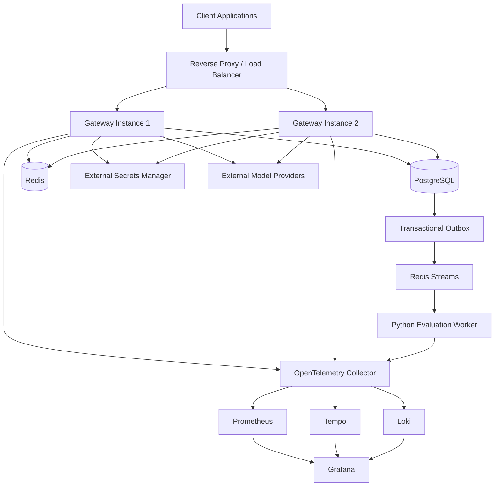
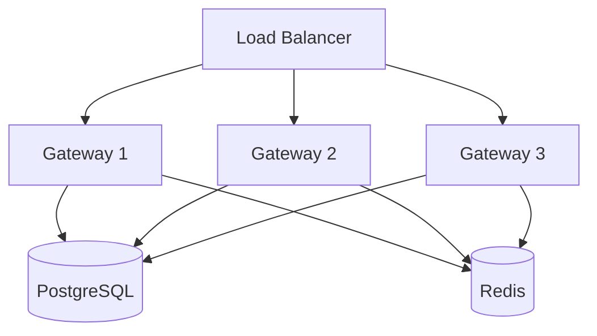
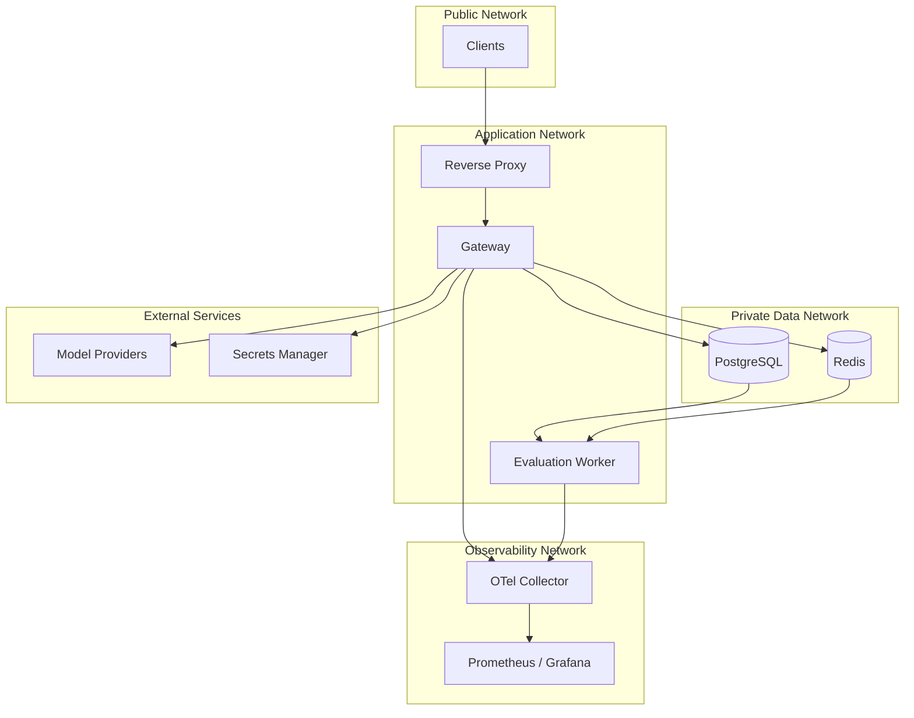

# ADR-0024: Initial Deployment and Container Architecture

- **Status:** Proposed
- **Date:** 2026-11-04
- **Decision Owners:** llm-gateway architecture team
- **Related ADRs:** ADR-0001, ADR-0003, ADR-0004, ADR-0005, ADR-0017, ADR-0018, ADR-0021, ADR-0022, ADR-0023

## 1. Context

The `llm-gateway` requires a deployment architecture that supports:

- Low-latency inference requests.
- Multiple provider integrations.
- Distributed rate limiting and concurrency control.
- Durable execution and financial records.
- Asynchronous evaluation and reconciliation.
- Centralized observability.
- Secure credential management.
- Horizontal scaling.
- Reliable deployment and rollback.

The initial deployment must remain operationally manageable while providing a clear path toward production infrastructure.

The architecture should avoid introducing Kubernetes and unnecessary distributed infrastructure before the workload requires them.

## 2. Decision

The initial deployment will use:

- Docker for containerization.
- Docker Compose for local development and initial single-host deployments.
- A Rust gateway container.
- A Python evaluation worker container.
- PostgreSQL as the authoritative database.
- Redis for operational coordination and caching.
- OpenTelemetry Collector for telemetry processing.
- Prometheus and Grafana for metrics and dashboards.
- Tempo for distributed tracing.
- Loki for centralized logs.
- An external secrets manager for production provider credentials.

The gateway will be packaged as a Rust modular monolith and scaled horizontally by running multiple identical gateway instances.

The initial architecture will not require Kubernetes.

## 3. Deployment Architecture



## 4. Container Boundaries

Each independently operated responsibility will have a dedicated container.

| Container | Technology | Responsibility |
|---|---|---|
| `llm-gateway` | Rust | HTTP API, authentication, routing, inference orchestration |
| `evaluation-worker` | Python | Asynchronous evaluation |
| `postgres` | PostgreSQL | Authoritative application data |
| `redis` | Redis | Rate limits, concurrency, cache, event transport |
| `otel-collector` | OpenTelemetry | Telemetry collection and export |
| `prometheus` | Prometheus | Metrics storage |
| `grafana` | Grafana | Monitoring dashboards |
| `tempo` | Tempo | Distributed trace storage |
| `loki` | Loki | Log aggregation |

A reverse proxy or load balancer terminates public TLS and routes traffic to gateway instances.

Production deployments may use managed PostgreSQL, Redis, and observability services instead of self-hosted containers.

## 5. Rust Gateway Deployment

The gateway is a stateless application process from the perspective of durable business state.

It must not rely on local disk for authoritative execution, budget, identity, or usage data.

### Requirements

- Multiple instances must be able to process requests concurrently.
- All instances use the same PostgreSQL and Redis infrastructure.
- Authentication and authorization behavior must be consistent across instances.
- Provider routing decisions must use shared registry and policy data.
- Rate limits and concurrency controls must be distributed.
- Shutdown must drain active requests and release resources safely.

### Horizontal scaling



Gateway instances must not maintain independent authoritative quota or budget state.

## 6. Python Evaluation Worker

Evaluation is asynchronous and must not block the inference request path.

The Python worker consumes evaluation jobs through the event infrastructure defined in ADR-0018.

Responsibilities:

- Consume evaluation jobs.
- Load authorized execution context.
- Run configured evaluation metrics.
- Persist evaluation results.
- Record evaluation cost where applicable.
- Acknowledge jobs only after durable processing.
- Retry transient failures with bounded policies.
- Send permanently failing jobs to a dead-letter workflow.

Worker instances may scale independently of gateway instances.

## 7. PostgreSQL Deployment

PostgreSQL is the authoritative store.

It contains:

- Tenants and projects.
- API keys and administrative identities.
- Model registry.
- Provider metadata.
- Inference executions and attempts.
- Budget reservations.
- Financial ledger.
- Usage records.
- Transactional outbox.
- Evaluation jobs and results.
- Audit events.

### Production requirements

- Persistent storage.
- Automated backups.
- Point-in-time recovery where supported.
- TLS connections.
- Restricted network access.
- Connection pooling.
- Migration execution as a controlled deployment step.
- Monitoring of connections, locks, replication, storage, and query latency.

PostgreSQL must not be exposed directly to public networks.

## 8. Redis Deployment

Redis provides operational coordination.

Use cases:

- Distributed rate limiting.
- Distributed concurrency control.
- Exact response cache.
- Semantic cache infrastructure when activated.
- Provider health and circuit-breaker state.
- Initial event transport using Redis Streams.

Redis is not the authoritative source for financial accounting, identity, or execution history.

### Requirements

- Persistence and recovery policy appropriate to its workload.
- Authentication and ACLs.
- TLS in production.
- Restricted network access.
- Memory limits and eviction policy.
- Monitoring of memory, latency, command failures, and replication.
- Defined outage behavior for each Redis feature.

Redis persistence must not be treated as a substitute for PostgreSQL durability.

## 9. Networking and Security

### Network zones

The deployment separates:

1. Public ingress.
2. Application services.
3. Data services.
4. Observability services.
5. External provider and secrets-manager egress.



### Security requirements

- TLS for public ingress.
- TLS for production service-to-service and data connections where supported.
- No public database or Redis ports.
- Least-privilege service accounts.
- Read-only container filesystems where practical.
- Non-root container processes.
- No secrets embedded in images.
- Restricted outbound network access.
- Container image vulnerability scanning.
- Signed or otherwise verifiable release artifacts.

## 10. Docker Image Strategy

### Rust gateway

Use a multi-stage build:

1. Dependency and build stage.
2. Optimized release compilation.
3. Minimal runtime image.

Requirements:

- Pin base image versions.
- Use a reproducible dependency lockfile.
- Exclude development tooling from the runtime image.
- Run as a non-root user.
- Include a health-check mechanism.
- Handle SIGTERM gracefully.

### Python worker

Use a separate image.

Requirements:

- Pin Python dependencies.
- Use a lockfile.
- Install only required runtime packages.
- Run as a non-root user.
- Provide worker health and readiness reporting.
- Support graceful shutdown and in-flight job handling.

### Image naming

```text
llm-gateway:<version>
llm-gateway-evaluation-worker:<version>
```

Use immutable version tags or image digests in production deployments.

## 11. Docker Compose Structure

Suggested repository structure:

```text
llm-gateway/
├── Dockerfile
├── Dockerfile.worker
├── compose.yaml
├── compose.dev.yaml
├── .dockerignore
├── .env.example
├── crates/
├── workers/
│   └── evaluation/
├── migrations/
├── scripts/
└── docs/
```

Suggested local services:

```yaml
services:
  gateway:
    build:
      context: .
      dockerfile: Dockerfile
    depends_on:
      postgres:
        condition: service_healthy
      redis:
        condition: service_healthy
    ports:
      - "8080:8080"
    environment:
      DATABASE_URL: ${DATABASE_URL}
      REDIS_URL: ${REDIS_URL}
    restart: unless-stopped

  evaluation-worker:
    build:
      context: .
      dockerfile: Dockerfile.worker
    depends_on:
      postgres:
        condition: service_healthy
      redis:
        condition: service_healthy
    restart: unless-stopped

  postgres:
    image: postgres:17
    environment:
      POSTGRES_DB: llm_gateway
      POSTGRES_USER: gateway
      POSTGRES_PASSWORD: ${POSTGRES_PASSWORD}
    volumes:
      - postgres_data:/var/lib/postgresql/data
    healthcheck:
      test: ["CMD-SHELL", "pg_isready -U gateway -d llm_gateway"]
      interval: 10s
      timeout: 5s
      retries: 5

  redis:
    image: redis:7
    command: ["redis-server", "--appendonly", "yes"]
    volumes:
      - redis_data:/data
    healthcheck:
      test: ["CMD", "redis-cli", "ping"]
      interval: 10s
      timeout: 5s
      retries: 5

volumes:
  postgres_data:
  redis_data:
```

This is a development-oriented starting point, not a complete production Compose configuration.

Production deployment must add network segmentation, TLS, secret-manager integration, resource limits, hardened images, backup procedures, and appropriate Redis authentication and ACL configuration.

## 12. Configuration Management

Configuration must be separated into:

### Non-secret configuration

Examples:

- HTTP port.
- Database host.
- Redis host.
- Provider timeout.
- Routing policy defaults.
- Telemetry endpoint.
- Worker concurrency.

These may be injected through environment variables or configuration files.

### Secret configuration

Examples:

- Database passwords.
- Redis credentials.
- OIDC client secrets.
- Provider API keys.
- Secret-manager credentials.

Production secrets must be delivered through the approved secrets manager or workload identity mechanism.

`.env` files are for local development only.

Never commit populated `.env` files.

Provide `.env.example` with placeholder values.

## 13. Health Checks and Lifecycle

The gateway exposes separate health endpoints.

| Endpoint | Purpose |
|---|---|
| `/health/live` | Process is alive |
| `/health/ready` | Instance can accept traffic |
| `/health/dependencies` | Dependency diagnostics for authorized monitoring |

Readiness must reflect the ability to accept the relevant workload, not merely whether the process is running.

Dependency checks must use bounded timeouts.

A transient optional dependency failure must not automatically restart every gateway instance.

### Graceful shutdown

On SIGTERM:

1. Stop accepting new requests.
2. Mark instance unready.
3. Drain active HTTP requests within a configured deadline.
4. Cancel or safely terminate remaining work.
5. Release concurrency permits.
6. Preserve execution and accounting state.
7. Close database and Redis connections.
8. Exit.

Streaming requests require explicit shutdown handling consistent with ADR-0014.

## 14. Deployment and Migration Order

Initial deployment sequence:

1. Provision secrets manager and workload identity.
2. Provision PostgreSQL and Redis.
3. Apply database migrations.
4. Verify RLS policies and database permissions.
5. Deploy OpenTelemetry Collector and monitoring services.
6. Deploy evaluation worker.
7. Deploy gateway instances.
8. Configure load balancer and TLS.
9. Run smoke tests.
10. Enable production traffic.

Database migrations must be backward-compatible with the application rollout strategy.

For breaking database changes, use an expand-and-contract migration process.

## 15. Scaling Strategy

Scale components independently.

| Component | Scaling trigger |
|---|---|
| Gateway | Request rate, CPU, memory, latency |
| Evaluation worker | Queue depth and processing latency |
| PostgreSQL | Connection pressure, query latency, storage |
| Redis | Memory, command latency, throughput |
| Telemetry collector | Ingestion volume and export backlog |

Gateway scaling must account for downstream connection pools and provider rate limits.

Increasing gateway replicas without adjusting PostgreSQL connection limits can overload the database.

Use bounded connection pools and explicit total-connection capacity planning.

## 16. Disaster Recovery

### PostgreSQL

- Automated backups.
- Point-in-time recovery.
- Periodic restore tests.
- Documented RPO and RTO.
- Recovery verification for financial ledger and execution records.

### Redis

- Persistence according to operational needs.
- Defined reconstruction procedures for recoverable state.
- Reconciliation for distributed permits and transient coordination state.
- Cache rebuild after data loss.

### Gateway

- Stateless redeployment from immutable images.
- Externalized configuration.
- Secret-manager recovery procedures.

### Evaluation worker

- Recover pending jobs from durable PostgreSQL state.
- Use idempotent job processing.
- Reprocess safely after worker failure.

The project must define numeric RPO and RTO targets before production readiness approval.

## 17. Observability

The deployment must expose:

- Request rate and latency.
- Gateway error rate.
- Provider latency and failure rate.
- Routing decisions.
- Rate-limit and concurrency rejections.
- Budget reservation failures.
- Database connection pool utilization.
- Redis latency and availability.
- Evaluation queue depth.
- Evaluation processing latency.
- Container CPU and memory.
- Telemetry ingestion and export failures.

All services must propagate trace context and correlation IDs.

Sensitive request content and credentials must not be included in telemetry.

## 18. Testing Strategy

### Container tests

- Gateway image builds successfully.
- Worker image builds successfully.
- Images run as non-root users.
- Images contain no committed secrets.
- Health checks behave correctly.
- Graceful shutdown works.

### Compose integration tests

- Gateway starts with PostgreSQL and Redis.
- Database migrations execute.
- Gateway authenticates a test client.
- Inference request reaches a mock provider.
- Outbox event reaches the evaluation worker.
- Evaluation results persist.
- Dependency failures are handled safely.

### Deployment tests

- Rolling gateway deployment.
- Application rollback.
- Database migration compatibility.
- PostgreSQL backup restoration.
- Redis restart and recovery.
- Worker restart with pending jobs.
- Gateway shutdown during streaming requests.

## 19. Consequences

### Positive

- Simple initial deployment model.
- Clear service and container boundaries.
- Independent gateway and worker scaling.
- Reproducible builds.
- Straightforward local development.
- Migration path toward managed cloud infrastructure and orchestration platforms.

### Negative

- Docker Compose does not provide full production orchestration.
- Single-host deployment can be a single point of failure.
- Self-hosted observability increases operational overhead.
- Database and Redis sizing require explicit planning.

### Risks

- Persistent volume loss can cause data loss without backups.
- Unbounded gateway scaling can exhaust database connections.
- Poor shutdown behavior can interrupt streams or leave permits unreleased.
- Misconfigured container networking can expose internal services.
- Secret injection mistakes can expose credentials.

## 20. Future Evolution

The architecture may evolve toward:

- Managed PostgreSQL with high availability.
- Managed Redis.
- Kubernetes or another container orchestration platform.
- Dedicated worker pools.
- Multi-region gateway deployment.
- Regional data residency.
- Separate control-plane and data-plane deployments.
- Dedicated telemetry infrastructure.

These changes require workload evidence and operational justification rather than being prerequisites for the initial implementation.

## 21. Validation Criteria

- [ ] Gateway is packaged as a Rust container.
- [ ] Evaluation worker is packaged independently.
- [ ] PostgreSQL and Redis have persistent development volumes.
- [ ] Production data services are private.
- [ ] Secrets are not embedded in container images.
- [ ] Runtime containers use non-root users.
- [ ] Gateway instances support horizontal scaling.
- [ ] Database connections are bounded.
- [ ] Health and readiness checks are implemented.
- [ ] Graceful shutdown handles active requests and streams.
- [ ] Database migrations run as a controlled deployment step.
- [ ] Backups and restore procedures are tested.
- [ ] Observability is available across all services.
- [ ] Container images are scanned and versioned.
- [ ] Deployment and rollback procedures are documented.

## 22. Related Decisions

- ADR-0001: Clean Architecture and Dependency Direction
- ADR-0003: PostgreSQL as Authoritative Data Store
- ADR-0004: Redis for Distributed Coordination and Caching
- ADR-0005: Transactional Outbox and Event Delivery
- ADR-0017: OpenTelemetry Observability Architecture
- ADR-0018: Asynchronous Evaluation Architecture
- ADR-0021: Provider Secret Management
- ADR-0022: Tenant Isolation and PostgreSQL RLS
- ADR-0023: API Versioning and OpenAPI Governance

