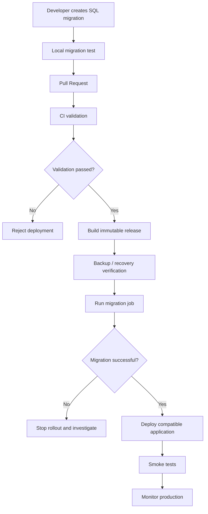

# ADR-0025: Database Migration Strategy

- **Status:** Proposed
- **Date:** 2026-11-04
- **Decision Owners:** llm-gateway architecture team
- **Related ADRs:** ADR-0001, ADR-0003, ADR-0005, ADR-0009, ADR-0010, ADR-0018, ADR-0022, ADR-0024

## 1. Context

The `llm-gateway` uses PostgreSQL as its authoritative data store.

Its database contains business-critical information:

- Tenant and project identities.
- Virtual API keys and authorization metadata.
- Model and provider registries.
- Inference executions and attempts.
- Budget reservations.
- Financial usage ledger.
- Transactional outbox events.
- Evaluation jobs and results.
- Audit records.
- Administrative configuration.

Database schema changes must preserve data integrity, tenant isolation, financial correctness, and application availability.

The migration strategy must support:

- Repeatable development environments.
- Automated CI/CD deployment.
- Safe schema evolution.
- Multiple gateway instances during rolling deployments.
- Recovery from failed migrations.
- Large-table changes without unnecessary downtime.
- Auditable schema history.

## 2. Decision

Use **SQLx database migrations** as the authoritative database schema migration mechanism.

Migrations will be:

- Written as SQL files.
- Version-controlled in the repository.
- Ordered and immutable after application to shared environments.
- Applied through a dedicated migration job.
- Validated in CI.
- Executed before application instances requiring the new schema are deployed.

Rust application code will use SQLx for database access and compile-time query checking where practical.

The migration process will follow an **expand-and-contract** strategy for changes that could break compatibility with running application instances.

## 3. Technology Selection

| Concern | Decision |
|---|---|
| Migration framework | SQLx migrations |
| Migration format | SQL |
| Database | PostgreSQL |
| Migration execution | Dedicated deployment job |
| Schema history | SQLx migration metadata |
| CI validation | Fresh database migration and integration tests |
| Production rollout | Controlled, serialized migration |
| Destructive changes | Separate contract migration |
| Recovery | Forward repair or explicitly approved restore procedure |

SQL migrations are preferred because they provide direct control over PostgreSQL-specific capabilities, including:

- Row-level security.
- Partial and composite indexes.
- Constraints.
- Triggers.
- JSONB.
- Transaction isolation.
- Advanced locking behavior.
- Partitioning when introduced.

## 4. Repository Structure

```text
llm-gateway/
├── migrations/
│   ├── 0001_create_extensions.sql
│   ├── 0002_create_tenant_tables.sql
│   ├── 0003_create_project_tables.sql
│   ├── 0004_create_api_key_tables.sql
│   ├── 0005_create_provider_tables.sql
│   ├── 0006_create_model_registry_tables.sql
│   ├── 0007_create_execution_tables.sql
│   ├── 0008_create_budget_tables.sql
│   ├── 0009_create_usage_ledger.sql
│   ├── 0010_create_outbox_tables.sql
│   ├── 0011_create_evaluation_tables.sql
│   ├── 0012_create_audit_tables.sql
│   └── ...
├── crates/
│   ├── gateway-api/
│   ├── gateway-core/
│   ├── gateway-application/
│   ├── gateway-infrastructure/
│   └── ...
├── scripts/
│   ├── migrate.sh
│   └── verify-schema.sh
└── docs/
    └── database/
        ├── migration-policy.md
        └── schema-ownership.md
```

Migration filenames must have unique, monotonically increasing versions.

Once a migration has been applied to a shared environment, its contents must not be edited. Corrections require a new migration.

## 5. Migration Naming Convention

Use:

```text
<version>_<short_description>.sql
```

Examples:

```text
0027_add_execution_provider_metadata.sql
0028_add_budget_reservation_expiry.sql
0029_add_model_capability_index.sql
0030_add_evaluation_job_status_index.sql
```

Rules:

1. Use zero-padded numeric versions.
2. Use lowercase snake_case descriptions.
3. Keep one logical schema change per migration where practical.
4. Never reuse a migration version.
5. Never rename an applied migration.
6. Never modify an applied migration to correct production state.

## 6. Migration Categories

Classify migrations by operational risk.

| Category | Examples | Deployment risk |
|---|---|---|
| Additive | Add nullable column, create table | Low to moderate |
| Constraint | Add foreign key, check constraint | Moderate |
| Index | Add index | Moderate to high on large tables |
| Data transformation | Backfill or normalize records | Moderate to high |
| Contract | Drop column or table | High |
| Security | Add RLS policies or tighten privileges | High |
| Financial | Modify ledger or reservation structures | Very high |

Every migration must document its expected locking behavior, data impact, and rollback or recovery approach.

## 7. Expand-and-Contract Strategy

Schema changes must preserve compatibility between the old and new application versions during rolling deployments.

### Example: Rename a column

Suppose `provider_name` must become `provider_id`.

Do not rename the column immediately.

Use multiple releases.

### Step 1 — Expand

Add the new column.

```sql
ALTER TABLE provider_configs
ADD COLUMN provider_id UUID;
```

Keep the existing column.

### Step 2 — Backfill

Populate the new column using an approved mapping.

```sql
UPDATE provider_configs
SET provider_id = provider_registry.id
FROM provider_registry
WHERE provider_configs.provider_name = provider_registry.name
  AND provider_configs.provider_id IS NULL;
```

For large tables, use bounded batches rather than one long-running transaction.

### Step 3 — Dual compatibility

Deploy application code that can read the new column while preserving compatibility with the previous application version.

If writes must update both columns, define a clear synchronization mechanism and remove it only after all old application instances are gone.

### Step 4 — Switch reads and writes

Deploy application code using `provider_id` as the authoritative field.

Verify data consistency.

### Step 5 — Contract

After confirming that no deployed application version depends on `provider_name`, remove it in a later migration.

```sql
ALTER TABLE provider_configs
DROP COLUMN provider_name;
```

The contract migration must be a separate release decision.

## 8. Transaction and Locking Policy

Migrations should use transactions by default.

However, PostgreSQL operations such as `CREATE INDEX CONCURRENTLY` cannot run inside a transaction block.

These operations must be handled explicitly by the migration process.

### Requirements

- Keep transactions short.
- Avoid unnecessary table rewrites.
- Avoid long-running locks.
- Set appropriate lock and statement timeouts.
- Use concurrent index creation for large production tables when appropriate.
- Monitor migration progress.
- Avoid running expensive data backfills during peak traffic.

Example:

```sql
SET lock_timeout = '5s';
SET statement_timeout = '15min';

CREATE INDEX CONCURRENTLY IF NOT EXISTS
idx_executions_tenant_created_at
ON inference_executions (tenant_id, created_at DESC);
```

This migration must be configured to execute outside a transaction.

The migration runner must support explicitly identified non-transactional migrations and verify their completion before marking the schema release successful.

## 9. Tenant Isolation and RLS Migrations

Migrations involving tenant isolation require additional review.

See ADR-0022.

Requirements:

- Every tenant-owned table must have an explicit tenant ownership strategy.
- RLS policies must be tested with runtime roles.
- Migration roles must be separate from runtime roles.
- Runtime roles must not have `BYPASSRLS`.
- Tenant context must be transaction-local.
- Composite foreign keys must prevent cross-tenant references where applicable.

Example:

```sql
ALTER TABLE inference_executions
ENABLE ROW LEVEL SECURITY;

ALTER TABLE inference_executions
FORCE ROW LEVEL SECURITY;

CREATE POLICY tenant_isolation_policy
ON inference_executions
USING (
    tenant_id = current_setting('app.tenant_id', true)::uuid
)
WITH CHECK (
    tenant_id = current_setting('app.tenant_id', true)::uuid
);
```

The policy must be validated using the actual application database role, not only the migration owner.

## 10. Financial Data Migration Policy

Financial tables require stricter controls.

Affected tables include:

- `budget_reservations`
- `usage_ledger`
- `inference_executions`
- `inference_attempts`
- `usage_records`

Requirements:

1. Never silently overwrite historical financial values.
2. Never delete ledger entries to correct accounting mistakes.
3. Use explicit adjustment or correction records.
4. Preserve historical pricing and currency information.
5. Backfill calculations must be deterministic and auditable.
6. Validate totals before and after transformation.
7. Require additional review for migrations that modify financial semantics.
8. Preserve idempotency guarantees.

Financial migrations must include reconciliation queries and documented expected results.

## 11. Migration Execution Workflow

Migrations must run through a dedicated deployment job.



### Deployment rules

- Only one migration job may execute at a time.
- Migration execution must acquire a deployment-level lock.
- Gateway instances must not automatically run production migrations at startup.
- Migration failure must stop the application rollout.
- The deployment pipeline must record the migration version and release identifier.

## 12. SQLx Migration Commands

Add SQLx CLI as a development dependency.

Install:

```bash
cargo install sqlx-cli --no-default-features --features postgres,rustls
```

Create a migration:

```bash
sqlx migrate add create_tenant_tables
```

Run migrations locally:

```bash
sqlx migrate run
```

Revert the latest migration only in a controlled development environment:

```bash
sqlx migrate revert
```

Check migration status:

```bash
sqlx migrate info
```

Production migration execution must use a controlled deployment identity and must not rely on a developer's local credentials.

## 13. Migration Testing Strategy

### CI tests

Every pull request must validate:

- Migration filename and version uniqueness.
- Fresh database migration.
- Upgrade from the previous schema.
- SQL syntax and PostgreSQL compatibility.
- Constraint correctness.
- RLS policies.
- Index definitions.
- Application compatibility with the migrated schema.

### Integration tests

Use a real PostgreSQL instance.

Test:

- Tenant A cannot access Tenant B records.
- Foreign keys reject invalid references.
- Unique constraints prevent duplicate records.
- Budget reservation invariants remain valid.
- Ledger records remain append-only.
- Outbox records remain transactionally consistent.
- Evaluation jobs remain recoverable.

### Upgrade tests

Test migration paths from supported previous releases, not only an empty database.

For risky migrations, use production-like synthetic data volumes to measure lock duration and backfill performance.

## 14. Rollback and Recovery

Database rollback is not equivalent to application rollback.

An application can often be rolled back to a previous immutable image, but schema changes may already have altered or removed data.

### Recovery hierarchy

1. Stop the rollout.
2. Assess whether the migration partially completed.
3. Determine whether the previous application version remains schema-compatible.
4. Apply a forward repair migration if appropriate.
5. Restore from backup only when necessary and approved.
6. Reconcile financial and execution records after recovery.

### Rules

- Do not automatically reverse destructive migrations.
- Do not assume a SQL rollback restores application-level consistency.
- Do not delete migration history to force a migration to rerun.
- Do not edit an applied migration.
- Preserve evidence and audit records during recovery.

## 15. Migration Permissions

Use separate PostgreSQL roles.

| Role | Responsibility |
|---|---|
| `gateway_runtime` | Normal application queries |
| `gateway_migrator` | Schema migrations |
| `gateway_readonly` | Approved read-only diagnostics |
| `gateway_backup` | Backup operations |

The runtime role must not own application schemas or have unrestricted DDL privileges.

The migration role must be restricted to deployment infrastructure.

RLS and privilege changes require explicit security review.

## 16. Observability

Track:

- Current schema version.
- Migration duration.
- Migration failures.
- Lock acquisition time.
- Lock wait duration.
- Long-running transactions.
- Backfill progress.
- Database availability during migration.
- Application errors after migration.
- Schema compatibility across deployed versions.

Each migration execution should produce an audit record containing:

- Migration version.
- Migration name.
- Release identifier.
- Start and completion timestamps.
- Execution result.
- Deployment identity.

Avoid logging secrets or sensitive row contents.

## 17. Consequences

### Positive

- Reproducible schema evolution.
- Strong PostgreSQL-specific control.
- Auditable database history.
- Safer rolling deployments.
- Reduced risk of application downtime.
- Explicit ownership of schema changes.
- Better financial and tenant-isolation safeguards.

### Negative

- More deployment coordination.
- Expand-and-contract changes can require multiple releases.
- Large data migrations need dedicated operational planning.
- SQL migrations require careful review and testing.
- Rollback may require forward repair or backup restoration.

## 18. Validation Criteria

- [ ] SQLx is the standard migration tool.
- [ ] All migrations are version-controlled.
- [ ] Applied migrations are immutable.
- [ ] Migration versions are unique.
- [ ] Production migrations run through a dedicated job.
- [ ] Only one migration job runs at a time.
- [ ] Expand-and-contract is used for incompatible schema changes.
- [ ] Non-transactional migrations are explicitly supported.
- [ ] Large indexes use an appropriate online strategy.
- [ ] RLS policies are tested using runtime roles.
- [ ] Financial migrations include reconciliation checks.
- [ ] Runtime roles do not have unrestricted DDL privileges.
- [ ] CI validates fresh and upgrade migration paths.
- [ ] Backup and recovery procedures are documented.
- [ ] Migration execution is observable and auditable.

## 19. Related Decisions

- ADR-0003: PostgreSQL as Authoritative Data Store
- ADR-0005: Transactional Outbox and Event Delivery
- ADR-0009: Budget Reservation and Financial Settlement
- ADR-0010: Inference Idempotency and Execution Lifecycle
- ADR-0018: Asynchronous Evaluation Architecture
- ADR-0022: Tenant Isolation and PostgreSQL RLS
- ADR-0024: Initial Deployment and Container Architecture

