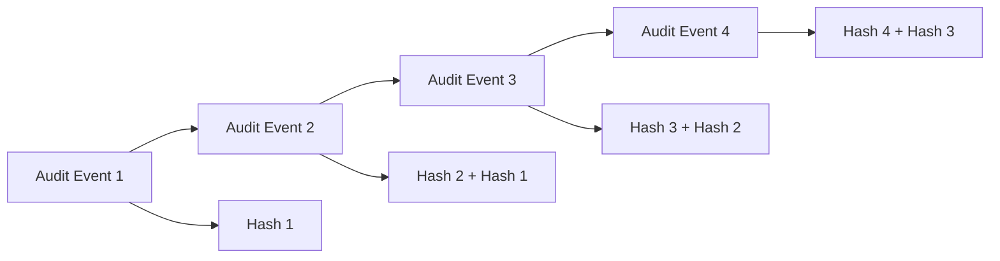
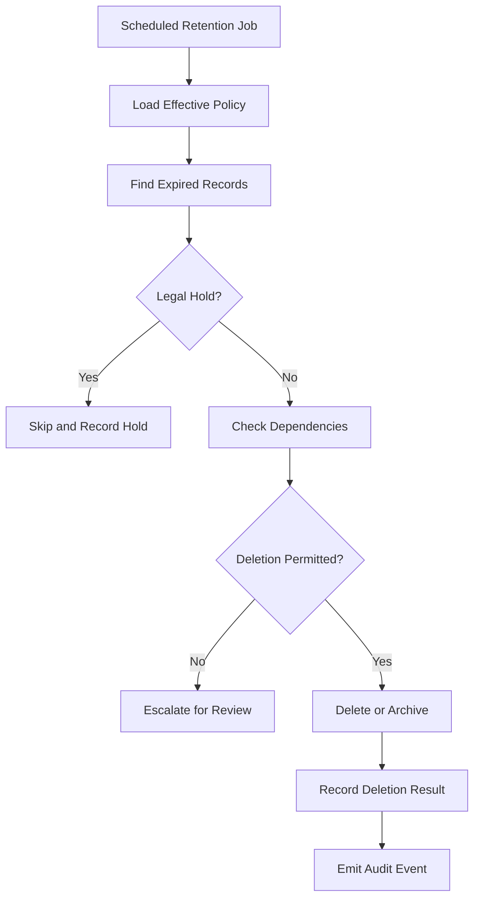

# ADR-0026: Financial Data Retention and Auditability

- **Status:** Proposed
- **Date:** 2026-11-04
- **Decision Owners:** llm-gateway architecture team
- **Related ADRs:** ADR-0003, ADR-0005, ADR-0009, ADR-0010, ADR-0017, ADR-0018, ADR-0019, ADR-0021, ADR-0022, ADR-0025

## 1. Context

The `llm-gateway` processes inference requests that create financial and operational records.

A single inference request may involve:

- A tenant and project.
- A virtual API key.
- A selected model and provider.
- One or more provider attempts.
- Input and output token consumption.
- Pricing and currency calculations.
- Budget reservations and settlements.
- Cache usage.
- Provider failures and retries.
- Evaluation costs.
- Administrative policy changes.

These records are required for:

- Customer billing and usage reporting.
- Budget enforcement.
- Financial reconciliation.
- Incident investigation.
- Dispute resolution.
- Compliance and audit.
- Operational analytics.

The system must preserve financial correctness while minimizing retention of sensitive prompts, completions, credentials, and personal information.

## 2. Decision

Adopt a **separation-of-concerns retention architecture**.

Financial records, operational metadata, audit records, and inference content will have separate retention policies.

The following principles are mandatory:

1. Financial ledger records are append-only.
2. Financial corrections use explicit adjustment entries.
3. Historical pricing information is immutable and reproducible.
4. Financial records are retained according to approved legal and business requirements.
5. Sensitive inference content has a shorter, configurable retention period.
6. Audit events are tamper-evident and access-controlled.
7. Tenant data deletion must not silently corrupt financial history.
8. Retention and deletion operations must be auditable.
9. Retention periods must be configurable by data category and jurisdiction.
10. Legal holds override routine deletion workflows.

Exact retention durations must be approved before production launch based on applicable jurisdictional, contractual, tax, privacy, and accounting requirements.

## 3. Data Classification

The system classifies persisted data into five categories.

| Category | Examples | Default policy |
|---|---|---|
| Financial records | Usage ledger, reservations, settlements | Long-term retention |
| Execution metadata | Execution IDs, model IDs, status, latency | Operational retention |
| Inference content | Prompts, completions, attachments | Short-term or disabled |
| Security and audit | Authentication events, policy changes | Controlled long-term retention |
| Evaluation data | Scores, labels, evaluation evidence | Configurable retention |

### 3.1 Financial records

Financial records include:

- Usage ledger entries.
- Budget reservations.
- Budget settlements.
- Pricing snapshots.
- Currency and cost calculations.
- Financial adjustments.
- Reconciliation results.

These records must remain reproducible and traceable.

### 3.2 Execution metadata

Execution metadata includes:

- Request and execution identifiers.
- Attempt identifiers.
- Tenant and project identifiers.
- Selected model and provider.
- Execution timestamps.
- Token counts.
- Latency.
- Status and normalized error codes.
- Cache hit information.

Execution metadata must not unnecessarily duplicate sensitive request content.

### 3.3 Inference content

Inference content includes:

- User prompts.
- Model completions.
- Tool arguments and outputs.
- Retrieved document excerpts.
- Uploaded content.
- Provider-specific payloads.

Content retention must be independently configurable.

The default production policy is to avoid persistent raw prompt and completion storage unless a tenant explicitly enables an approved feature requiring it.

### 3.4 Security and audit data

Security and audit events include:

- API key creation, rotation, and revocation.
- Authentication failures.
- Authorization denials.
- Administrative actions.
- Provider credential changes.
- Routing policy changes.
- Budget configuration changes.
- Retention policy changes.
- Data export and deletion operations.

### 3.5 Evaluation data

Evaluation data includes:

- Evaluation job metadata.
- Metric names and versions.
- Scores.
- Human review decisions.
- Evaluation timestamps.
- References to source executions.
- Optional evaluation evidence.

Evaluation records must not automatically extend the retention period of raw inference content.

## 4. Financial Ledger Immutability

The usage ledger is append-only.

Once a financial entry is committed, its financial values must not be overwritten or silently deleted.

### Prohibited operations

- Updating historical token consumption.
- Replacing a historical price with a current price.
- Deleting an incorrect ledger entry.
- Recalculating old charges using current model pricing without an explicit adjustment.
- Changing a settled reservation without a corresponding audit trail.

### Correction mechanism

Financial corrections must create new adjustment records.

Example:

```text
Original usage entry:
  usage_id: U-1001
  amount: 0.050000 USD

Correction:
  adjustment_id: A-1001
  references_usage_id: U-1001
  adjustment_amount: -0.010000 USD
  reason: provider usage reconciliation

Net financial amount:
  0.040000 USD
```

The original record remains available.

### Ledger invariants

- Every adjustment references its original or related financial record.
- Adjustment reasons are mandatory.
- Currency is explicit.
- Amount precision is deterministic.
- Entries are immutable after posting.
- Every financial operation is traceable to an execution or approved administrative action.

## 5. Historical Pricing Snapshots

Model pricing changes over time.

The gateway must preserve the pricing information used when an execution was settled.

Each usage record must capture:

- Stable model identifier.
- Provider identifier.
- Pricing version.
- Input token rate.
- Output token rate.
- Cached input token rate, when applicable.
- Currency.
- Token counts.
- Calculated amount.
- Pricing timestamp or effective interval.

Example:

```json
{
  "model_id": "model-premium",
  "provider_id": "provider-a",
  "pricing_version": 3,
  "input_tokens": 1200,
  "output_tokens": 500,
  "input_rate_per_million": "2.50",
  "output_rate_per_million": "10.00",
  "currency": "USD",
  "total_cost": "0.008000"
}
```

Historical usage must remain reproducible even after model pricing changes.

Financial calculations must use decimal arithmetic, not binary floating-point arithmetic.

## 6. Retention Policy Model

Retention policy is defined by data category and scope.

A policy may include:

- Data category.
- Retention duration.
- Tenant-specific override, where permitted.
- Jurisdiction.
- Legal hold status.
- Deletion method.
- Policy version.
- Effective date.
- Approval metadata.

Example:

| Data category | Example policy | Deletion approach |
|---|---|---|
| Financial ledger | Approved statutory retention period | Restricted archival or approved deletion |
| Execution metadata | 12 months | Scheduled deletion or archival |
| Raw inference content | 0 days by default unless enabled | Immediate non-persistence or scheduled deletion |
| Security audit | Approved security retention period | Controlled archival or deletion |
| Evaluation results | 12 months | Scheduled deletion |
| Temporary cache | Short TTL | Automatic expiration |

The example durations are design defaults for discussion, not legal retention recommendations. Final values must be approved before production.

## 7. Data Model

Introduce retention and audit metadata.

### 7.1 Retention policy

```sql
CREATE TABLE retention_policies (
    id UUID PRIMARY KEY,
    tenant_id UUID NULL,
    data_category TEXT NOT NULL,
    retention_days INTEGER NOT NULL,
    policy_version INTEGER NOT NULL,
    effective_at TIMESTAMPTZ NOT NULL,
    legal_hold_enabled BOOLEAN NOT NULL DEFAULT FALSE,
    created_at TIMESTAMPTZ NOT NULL DEFAULT NOW(),

    CHECK (retention_days >= 0)
);
```

A production implementation must enforce uniqueness and scope rules for global and tenant-specific policies.

### 7.2 Audit events

```sql
CREATE TABLE audit_events (
    id UUID PRIMARY KEY,
    tenant_id UUID NULL,
    actor_type TEXT NOT NULL,
    actor_id TEXT,
    action TEXT NOT NULL,
    resource_type TEXT NOT NULL,
    resource_id TEXT,
    occurred_at TIMESTAMPTZ NOT NULL DEFAULT NOW(),
    correlation_id UUID,
    metadata JSONB NOT NULL DEFAULT '{}'::jsonb,
    previous_hash TEXT,
    event_hash TEXT NOT NULL
);
```

Audit metadata must be allowlisted and must not contain raw credentials, secrets, or unrestricted prompt content.

### 7.3 Financial adjustments

```sql
CREATE TABLE financial_adjustments (
    id UUID PRIMARY KEY,
    tenant_id UUID NOT NULL,
    original_ledger_entry_id UUID NOT NULL,
    adjustment_amount NUMERIC(20, 10) NOT NULL,
    currency CHAR(3) NOT NULL,
    reason TEXT NOT NULL,
    approved_by UUID,
    created_at TIMESTAMPTZ NOT NULL DEFAULT NOW()
);
```

The exact foreign key, approval model, and uniqueness constraints must match the final financial data model.

## 8. Auditability and Tamper Evidence

Audit records must be protected against unauthorized modification.

The initial design uses:

- Append-only application permissions.
- Restricted database roles.
- Hash chaining for ordered audit batches or streams.
- Periodic signed checkpoints.
- Export to a separately controlled archive.
- Monitoring for missing or invalid sequence entries.

A simple hash-chain concept:



Hash chaining alone does not guarantee tamper-proof storage if an attacker can rewrite the entire chain.

Therefore:

- Checkpoints must be periodically exported.
- Checkpoints must be signed using a controlled key.
- The archive must have independent access controls.
- Verification must detect missing, reordered, or modified events.

Audit integrity checks must be automated.

## 9. Retention and Deletion Workflow

Retention execution must be asynchronous and auditable.



### Requirements

1. Retention jobs operate in bounded batches.
2. Jobs are idempotent.
3. Legal holds are checked immediately before destructive operations.
4. Tenant boundaries are enforced.
5. Every deletion or archival operation is recorded.
6. Failed records can be retried safely.
7. Financial dependencies are validated before deletion.
8. Retention jobs must not delete records required for unresolved financial reconciliation.

## 10. Tenant Data Deletion

Tenant deletion requires special treatment.

A tenant may request deletion of personal or customer data, but financial and audit records may have independent retention obligations.

The deletion workflow must distinguish:

- Personal data.
- Raw inference content.
- Operational metadata.
- Financial records.
- Security audit records.
- Legal-hold records.

### Deletion principles

- Delete eligible personal data.
- Remove or anonymize eligible inference content.
- Preserve records that must legally or contractually remain.
- Restrict access to retained records.
- Record the deletion request and outcome.
- Preserve the ability to reconcile historical financial activity.

Anonymization must be assessed for re-identification risk. Removing a name alone is not necessarily sufficient.

Tenant deletion must be a controlled workflow, not a cascading database delete across all financial tables.

## 11. Financial Reconciliation

Financial reconciliation must compare:

1. Gateway-calculated usage.
2. Provider-reported usage.
3. Budget reservations.
4. Budget settlements.
5. Financial ledger entries.

Discrepancies must generate explicit reconciliation records.

Example:

```text
Execution: E-1001

Gateway estimate:       0.010000 USD
Provider reported cost:  0.012000 USD
Settled amount:          0.010000 USD

Difference:              0.002000 USD
Status:                  RECONCILIATION_REQUIRED
```

Reconciliation must not silently overwrite the original settlement.

Corrections require approved adjustment entries.

## 12. Access Control

Financial and audit records require restricted access.

| Role | Access |
|---|---|
| Gateway runtime | Required financial writes and scoped reads |
| Tenant administrator | Authorized tenant usage and billing views |
| Finance administrator | Approved financial reporting and adjustments |
| Security administrator | Security and audit investigations |
| Auditor | Read-only access to approved audit and financial records |
| Retention worker | Scoped retention operations |
| Database administrator | Controlled infrastructure administration |

All privileged operations must be audited.

Runtime services must not receive unrestricted deletion permissions for financial or audit tables.

## 13. Privacy and Observability

Telemetry retention is separate from financial retention.

Observability systems must avoid becoming an uncontrolled secondary store for inference content.

Requirements:

- Do not record raw API keys.
- Do not record provider credentials.
- Redact or omit sensitive headers.
- Avoid raw prompt and completion logging by default.
- Apply tenant-aware access restrictions.
- Use trace IDs and execution IDs for correlation.
- Define separate retention periods for traces, metrics, and logs.
- Restrict access to evaluation evidence.

Data minimization must apply across logs, traces, metrics, and evaluation systems.

## 14. Testing Strategy

### Financial integrity

- Ledger entries cannot be updated by runtime roles.
- Ledger entries cannot be deleted by runtime roles.
- Adjustments preserve original entries.
- Historical pricing reproduces historical costs.
- Decimal calculations are deterministic.
- Reconciliation identifies discrepancies.

### Retention

- Expired records are identified correctly.
- Records under legal hold are retained.
- Tenant-specific policies do not affect other tenants.
- Jobs process bounded batches.
- Repeated jobs do not duplicate deletion records.
- Failed jobs can resume safely.
- Unresolved financial records are protected.

### Audit integrity

- Unauthorized modification is rejected.
- Hash-chain verification detects modified records.
- Missing events are detectable through checkpoints.
- Checkpoint signature verification works.
- Privileged operations create audit events.

### Privacy

- Raw prompts are not persisted when retention is disabled.
- Sensitive values are redacted from telemetry.
- Tenant deletion does not erase mandatory financial history.
- Retained data remains access-controlled.

## 15. Operational Requirements

Monitor:

- Financial reconciliation backlog.
- Unresolved financial discrepancies.
- Retention job backlog.
- Records eligible for deletion.
- Records held by legal hold.
- Failed deletion operations.
- Audit verification failures.
- Financial adjustment volume.
- Archive export failures.
- Data retention policy changes.

Alert on:

- Audit chain verification failures.
- Unexpected financial ledger mutation attempts.
- Failed backup or archive operations.
- Retention jobs deleting records outside policy.
- Unresolved reconciliation beyond its operational threshold.

## 16. Consequences

### Positive

- Preserves financial history.
- Supports billing disputes and reconciliation.
- Separates business records from sensitive inference content.
- Provides controlled tenant deletion.
- Improves auditability.
- Supports configurable retention policies.
- Reduces unnecessary personal-data storage.

### Negative

- More complex deletion workflows.
- Additional storage for historical financial records.
- Audit integrity requires independent checkpoint management.
- Retention policy changes require careful review.
- Tenant deletion cannot always be implemented as a simple cascade.

### Risks

- Incorrect retention configuration may cause premature deletion.
- Excessive retention may violate privacy or contractual requirements.
- Hash chaining without independent checkpoints provides incomplete tamper evidence.
- Poorly designed anonymization may leave re-identifiable data.
- Financial adjustments without approval controls may enable abuse.

## 17. Validation Criteria

- [ ] Financial ledger is append-only.
- [ ] Financial corrections use adjustment records.
- [ ] Historical pricing snapshots are preserved.
- [ ] Financial calculations use decimal arithmetic.
- [ ] Data categories have separate retention policies.
- [ ] Raw inference content is not retained by default.
- [ ] Legal holds override routine deletion.
- [ ] Retention jobs are bounded and idempotent.
- [ ] Tenant deletion distinguishes financial and personal data.
- [ ] Audit records are protected against unauthorized modification.
- [ ] Audit checkpoints are independently stored and verifiable.
- [ ] Financial reconciliation is implemented.
- [ ] Privileged financial operations are audited.
- [ ] Retention policies are tested.
- [ ] Numeric retention periods receive legal and business approval before production.

## 18. Related Decisions

- ADR-0003: PostgreSQL as Authoritative Data Store
- ADR-0005: Transactional Outbox and Event Delivery
- ADR-0009: Budget Reservation and Financial Settlement
- ADR-0010: Inference Idempotency and Execution Lifecycle
- ADR-0017: OpenTelemetry Observability Architecture
- ADR-0018: Asynchronous Evaluation Architecture
- ADR-0019: Virtual API Key Security Model
- ADR-0021: Provider Secret Management
- ADR-0022: Tenant Isolation and PostgreSQL RLS
- ADR-0025: Database Migration Strategy

