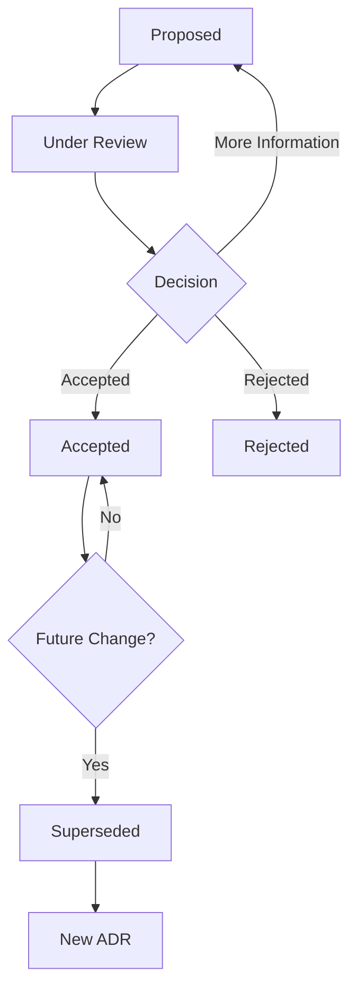
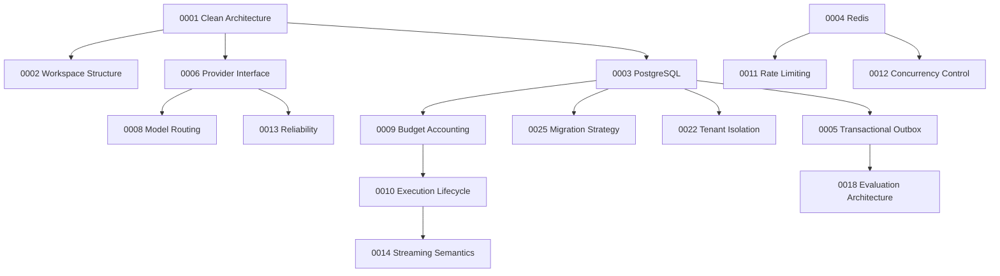

# LLM Gateway — Architecture Decision Records

**File:** `docs/adr/README.md`  
**Version:** 1.0  
**Status:** Draft  
**Project:** `llm-gateway`

# 1. Purpose

Architecture Decision Records (ADRs) document significant technical and architectural decisions made during the development of `llm-gateway`.

Each ADR records:

- The context and problem.
- The decision.
- Alternatives considered.
- Consequences and trade-offs.
- Implementation implications.
- Validation criteria.

ADRs provide an auditable history of why the system is designed the way it is.

# 2. ADR Principles

1. One ADR documents one significant decision.
2. Decisions must include context and alternatives.
3. Decisions must identify their consequences.
4. Accepted decisions are not silently rewritten.
5. Superseded decisions remain in the repository.
6. Implementation must follow accepted ADRs.
7. Significant deviations require a new ADR or an explicit amendment.
8. ADRs must link to affected specifications.
9. Rejected alternatives should include reasons.
10. Decisions should be evidence-based whenever possible.

# 3. ADR Lifecycle



| Status | Meaning |
|---|---|
| Proposed | Decision drafted |
| Under Review | Alternatives and consequences being evaluated |
| Accepted | Decision approved |
| Rejected | Decision explicitly declined |
| Superseded | Replaced by a newer decision |

An accepted ADR remains part of the historical record even after implementation changes.

# 4. ADR File Naming

Use the following format:

```text
docs/adr/
├── README.md
├── 0001-clean-architecture.md
├── 0002-rust-workspace-structure.md
├── 0003-postgresql-as-source-of-truth.md
└── ...
```

Rules:

- Four-digit sequential identifiers.
- Lowercase kebab-case filenames.
- One decision per file.
- Never reuse an identifier.
- Do not renumber existing ADRs.
- Keep rejected and superseded ADRs.

# 5. ADR Template

Every ADR must follow this structure.

```markdown
# ADR-NNNN: Decision Title

- Status: Proposed
- Date: YYYY-MM-DD
- Decision Owners: Engineering
- Related Documents:

## 1. Context

Describe the problem and why a decision is required.

## 2. Decision Drivers

List the requirements and constraints influencing the decision.

## 3. Considered Options

### Option A

Description, advantages, disadvantages.

### Option B

Description, advantages, disadvantages.

### Option C

Description, advantages, disadvantages.

## 4. Decision

Describe the selected option and its implementation boundaries.

## 5. Consequences

### Positive

- ...

### Negative

- ...

### Risks

- ...

## 6. Implementation Notes

Describe implementation implications.

## 7. Validation Criteria

Define measurable evidence that confirms the decision is working.

## 8. Related ADRs

- ADR-NNNN

## 9. References

- Related specifications.
- Technical documentation.
```

# 6. Initial ADR Register

The following register consolidates the decision topics previously proposed across the specifications.

These are proposed ADR topics, not automatically accepted decisions.

| ADR | Title | Priority | Initial Status |
|---|---|---|---|
| 0001 | Clean Architecture and Dependency Direction | Critical | Proposed |
| 0002 | Rust Workspace Structure and Crate Boundaries | Critical | Proposed |
| 0003 | PostgreSQL as the Authoritative Data Store | Critical | Proposed |
| 0004 | Redis for Distributed Coordination and Caching | Critical | Proposed |
| 0005 | Transactional Outbox and Event Delivery | High | Proposed |
| 0006 | Canonical Provider Adapter Interface | Critical | Proposed |
| 0007 | Model Registry and Capability Representation | High | Proposed |
| 0008 | Constraint-Based Model Routing | Critical | Proposed |
| 0009 | Budget Reservation and Financial Settlement | Critical | Proposed |
| 0010 | Inference Idempotency and Execution Lifecycle | Critical | Proposed |
| 0011 | Distributed Rate Limiting | High | Proposed |
| 0012 | Distributed Concurrency Control | High | Proposed |
| 0013 | Provider Retry and Circuit Breaker Strategy | High | Proposed |
| 0014 | Streaming and Provider Fallback Semantics | High | Proposed |
| 0015 | Exact Cache Architecture | Medium | Proposed |
| 0016 | Semantic Cache Activation Criteria | Medium | Proposed |
| 0017 | OpenTelemetry Observability Architecture | High | Proposed |
| 0018 | Asynchronous Evaluation Architecture | High | Proposed |
| 0019 | Virtual API Key Security Model | Critical | Proposed |
| 0020 | Administrative Authentication and Authorization | Critical | Proposed |
| 0021 | Provider Secret Management | Critical | Proposed |
| 0022 | Tenant Isolation and PostgreSQL RLS | Critical | Proposed |
| 0023 | API Versioning and OpenAPI Governance | High | Proposed |
| 0024 | Initial Deployment and Container Architecture | High | Proposed |
| 0025 | Database Migration Strategy | High | Proposed |
| 0026 | Financial Data Retention and Auditability | High | Proposed |

# 7. Decision Dependencies

Some decisions depend on earlier architectural decisions.



The dependency diagram is guidance. Decisions may be reviewed concurrently, but dependent ADRs must not be finalized without their prerequisite context.

# 8. ADR Review Criteria

Before accepting an ADR, verify:

- Does it solve a clearly defined problem?
- Is it consistent with product requirements?
- Does it preserve Clean Architecture boundaries?
- Does it identify alternatives?
- Are trade-offs explicit?
- Are security implications addressed?
- Are operational implications addressed?
- Are testing requirements defined?
- Are consequences for existing specifications documented?
- Can the decision be validated?

# 9. Implementation Governance

When an accepted ADR changes implementation:

1. Identify the affected specifications.
2. Update the implementation plan.
3. Update architecture and API contracts if necessary.
4. Add or update tests.
5. Implement the decision.
6. Record deviations.
7. Update the ADR register.

An ADR does not replace the implementation specification.

# 10. Initial Decision Approval Strategy

Recommended approval sequence:

**Foundation**
- ADR-0001: Clean Architecture.
- ADR-0002: Rust workspace structure.
- ADR-0003: PostgreSQL.
- ADR-0004: Redis.
- ADR-0006: Provider interface.

**Core execution**
- ADR-0008: Model routing.
- ADR-0009: Budget accounting.
- ADR-0010: Execution lifecycle.
- ADR-0011: Rate limiting.
- ADR-0012: Concurrency.

**Reliability and operations**
- ADR-0005: Event delivery.
- ADR-0013: Reliability.
- ADR-0014: Streaming.
- ADR-0017: Observability.
- ADR-0024: Deployment.

**Security and governance**
- ADR-0019: API key security.
- ADR-0020: Administrative authentication.
- ADR-0021: Secret management.
- ADR-0022: Tenant isolation.

# 11. Repository Structure

```text
docs/
└── adr/
    ├── README.md
    ├── 0001-clean-architecture.md
    ├── 0002-rust-workspace-structure.md
    ├── 0003-postgresql-as-source-of-truth.md
    ├── 0004-redis-for-coordination-and-caching.md
    ├── 0005-transactional-outbox.md
    ├── ...
    └── 0026-financial-retention-and-auditability.md
```

# 12. Definition of Done

ADR governance is established when:

- The template is available.
- Naming and numbering rules are documented.
- The initial register exists.
- Status lifecycle is defined.
- Decision dependencies are documented.
- Accepted decisions link to affected specifications.
- Superseded decisions remain traceable.

---

**Important:** The register is a proposal. Do not mark an ADR accepted until its decision has been reviewed and approved.
