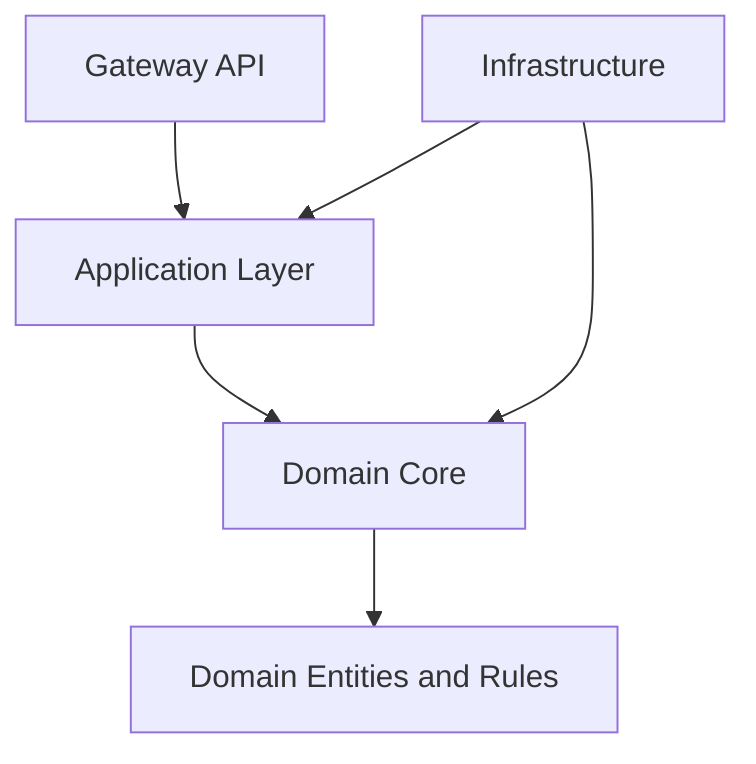
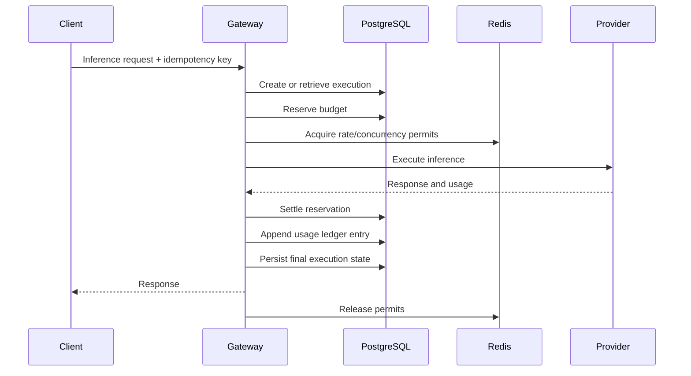

# Architecture Consistency Review

- **Project:** `llm-gateway`
- **Status:** Proposed
- **Date:** 2026-11-04
- **Scope:** Architecture, API contracts, security, data model, reliability, deployment, and all 26 ADRs.

## 1. Review Objectives

This review validates consistency across the architecture documentation.

It focuses on:

1. Dependency direction and module boundaries.
2. Inference execution lifecycle.
3. Provider routing and fallback.
4. Budget reservation and financial settlement.
5. Distributed rate limiting and concurrency.
6. Streaming and cancellation.
7. Database and Redis responsibilities.
8. Tenant isolation and security.
9. Event delivery and asynchronous evaluation.
10. Observability and privacy.
11. Deployment and database migration.
12. Financial retention and auditability.

## 2. Architecture Baseline

The approved architectural direction is:

| Area | Decision |
|---|---|
| Architecture | Clean Architecture |
| Application structure | Rust modular monolith |
| API framework | Axum |
| Async runtime | Tokio |
| HTTP client | Reqwest |
| Database | PostgreSQL |
| Database access | SQLx |
| Operational coordination | Redis |
| Event transport | Redis Streams |
| Event durability | PostgreSQL transactional outbox |
| Evaluation | Python worker |
| API documentation | OpenAPI 3.1 |
| Observability | OpenTelemetry |
| Deployment | Docker Compose initially |
| Future orchestration | Kubernetes or managed container platform |

## 3. Consistency Review

### 3.1 Architecture and dependency direction

**Related:** ADR-0001, ADR-0002

<badge color="success">Consistent</badge>

The system uses Clean Architecture with explicit dependency direction.

Expected dependency flow:

Validation requirements:

- Domain code must not depend on Axum, SQLx, Redis, or provider SDKs.
- Application services must depend on interfaces rather than infrastructure implementations.
- Provider adapters must implement canonical provider interfaces.
- API handlers must not contain financial or routing business rules.

### 3.2 PostgreSQL and Redis responsibilities

**Related:** ADR-0003, ADR-0004

<badge color="success">Consistent</badge>

PostgreSQL remains authoritative.

Redis is operational infrastructure.

| Data | Authoritative location |
|---|---|
| Tenant identity | PostgreSQL |
| API key metadata | PostgreSQL |
| Model registry | PostgreSQL |
| Execution history | PostgreSQL |
| Financial ledger | PostgreSQL |
| Budget reservations | PostgreSQL |
| Transactional outbox | PostgreSQL |
| Rate-limit counters | Redis |
| Concurrency permits | Redis |
| Exact cache | Redis |
| Circuit-breaker operational state | Redis |
| Initial event transport | Redis Streams |

**Implementation gate:** Redis loss must never silently erase financial or execution history.

### 3.3 Transactional outbox and event delivery

**Related:** ADR-0005, ADR-0018

<badge color="success">Consistent with implementation conditions</badge>

The architecture uses:

- PostgreSQL transactional outbox.
- Redis Streams as initial event transport.
- At-least-once delivery.
- Idempotent consumers.

The publisher must only mark an outbox event as published after successful stream publication.

A crash between publishing and marking the event can result in duplicate delivery. Consumers must therefore use stable event IDs and idempotent processing.

**Implementation gate:** Define event schemas, retry policy, dead-letter handling, and outbox cleanup rules before implementing workers.

### 3.4 Provider routing and reliability

**Related:** ADR-0006, ADR-0007, ADR-0008, ADR-0013

<badge color="success">Consistent</badge>

Routing follows two stages:

1. Hard eligibility filtering.
2. Ranking of eligible candidates.

The selected model must satisfy capability, tenant policy, residency, budget, and reliability constraints.

The reliability engine owns retries and fallback behavior.

Provider adapters normalize provider-specific errors into canonical failures.

**Implementation gate:** Routing must return an explainable decision containing eligible candidates, rejection reasons, and the selected model without exposing sensitive provider configuration.

### 3.5 Inference lifecycle, idempotency, and accounting

**Related:** ADR-0009, ADR-0010

<badge color="success">Consistent with critical implementation conditions</badge>

The execution lifecycle must preserve financial correctness.

Critical invariants:

- An idempotency key cannot create multiple independent financial settlements.
- A reservation must be associated with its execution.
- Every settlement must be idempotent.
- An uncertain provider outcome must not be treated as a confirmed failure.
- A failed request must not leave an unreconciled reservation indefinitely.
- Every financial adjustment must preserve the original ledger entry.

**Implementation gate:** Define transaction boundaries and recovery behavior for every execution state.

### 3.6 Rate limiting and concurrency control

**Related:** ADR-0011, ADR-0012

<badge color="success">Consistent</badge>

These are separate mechanisms:

- Rate limiting controls request or token consumption over time.
- Concurrency control limits simultaneous active work.

They must not share one ambiguous quota model.

Required controls:

- Tenant-level limits.
- Project-level limits.
- API-key limits.
- Model-specific limits where configured.
- Atomic permit acquisition.
- Permit ownership and expiry.
- Safe release and reconciliation.
- Bounded waiting or immediate rejection.

**Implementation gate:** Define behavior for Redis failure, expired permits, process crashes, and long-running streams.

### 3.7 Streaming and fallback

**Related:** ADR-0014

<badge color="success">Consistent</badge>

Provider fallback is allowed before client-visible streaming output.

Once output has been sent to the client, transparent fallback is prohibited.

Required behavior:

- Canonical SSE events.
- Explicit stream completion and error events.
- Backpressure.
- Cancellation propagation.
- Provider usage reconciliation.
- Resource release on disconnect.
- No duplicate response content after retry.

**Implementation gate:** Test client disconnects, provider disconnects, timeouts, and gateway shutdown during streaming.

### 3.8 Cache architecture

**Related:** ADR-0015, ADR-0016

<badge color="success">Consistent</badge>

Exact caching is opt-in and initially limited to non-streaming responses.

Semantic caching remains disabled by default.

Both cache strategies must respect:

- Tenant isolation.
- Model identity.
- Relevant generation parameters.
- Security and policy context.
- Cache freshness.
- Data retention requirements.

Cache hits must create a new execution record while recording zero provider execution cost for that hit.

**Implementation gate:** Define cache invalidation and pricing treatment before production activation.

### 3.9 Security and tenant isolation

**Related:** ADR-0019, ADR-0020, ADR-0021, ADR-0022

<badge color="success">Consistent with critical implementation conditions</badge>

Security responsibilities are separated:

| Concern | Mechanism |
|---|---|
| Client authentication | Virtual API keys |
| Administrative authentication | OIDC |
| Authorization | Scoped RBAC and policies |
| Provider credentials | External secrets manager |
| Database isolation | PostgreSQL RLS |
| Application isolation | Tenant-scoped repositories and services |
| Auditability | Restricted audit events |

Critical requirements:

- Runtime database roles cannot bypass RLS.
- Tenant context is transaction-local.
- Provider secrets never appear in logs or traces.
- API key material is never stored in plaintext.
- Administrative permissions are tenant-scoped where appropriate.
- Redis keys are tenant-scoped.
- External provider endpoints are protected against SSRF.

**Implementation gate:** Add cross-tenant access tests to the first database integration test suite.

### 3.10 API governance

**Related:** ADR-0023

<badge color="success">Consistent</badge>

The API uses explicit major-version URL paths.

Public, administrative, and internal APIs have separate authorization boundaries.

OpenAPI is the contract source for supported HTTP endpoints.

**Implementation gate:** Define error response schemas, pagination, rate-limit headers, idempotency behavior, and SSE event schemas before declaring API contracts stable.

### 3.11 Deployment and migrations

**Related:** ADR-0024, ADR-0025

<badge color="success">Consistent</badge>

The initial deployment uses Docker Compose.

Database migrations run through a dedicated deployment job rather than automatically during gateway startup.

The migration process uses SQLx and expand-and-contract for incompatible schema changes.

**Implementation gate:**

- Non-root images.
- Private database and Redis networks.
- Controlled migration identity.
- Backup and restoration validation.
- Graceful shutdown.
- Bounded connection pools.
- Immutable release images.

### 3.12 Retention and auditability

**Related:** ADR-0026

<badge color="success">Consistent with policy approval required</badge>

Financial history is append-only.

Raw inference content is not retained by default.

Retention periods are configurable and must be approved for applicable jurisdictions and contractual requirements.

Hash chaining requires independently stored signed checkpoints to provide meaningful tamper evidence.

**Implementation gate:** Approve retention periods, legal-hold behavior, tenant deletion semantics, and financial correction procedures before production.

## 4. Cross-Document Issues Requiring Explicit Resolution

The following items should be resolved before the relevant implementation work begins.

| ID | Topic | Required decision | Priority |
|---|---|---|---|
| CR-01 | Unknown provider outcomes | Define reconciliation deadline and terminal handling | Critical |
| CR-02 | Redis outage | Specify behavior separately for rate limits, concurrency, cache, and events | Critical |
| CR-03 | Budget reservation | Define expiry, recovery, and settlement transaction boundaries | Critical |
| CR-04 | Streaming cancellation | Define execution and accounting state after partial output | Critical |
| CR-05 | Tenant RLS | Define transaction-local context and connection-pool reset behavior | Critical |
| CR-06 | Outbox delivery | Define retry, poison-message, and cleanup policies | High |
| CR-07 | Provider pricing | Define effective-dated pricing and rounding rules | High |
| CR-08 | Cache accounting | Define exact usage and billing semantics for cache hits | High |
| CR-09 | Data retention | Approve numeric retention periods and legal holds | High |
| CR-10 | Deployment availability | Define production RPO, RTO, and availability objectives | High |
| CR-11 | API contract | Finalize error codes, headers, and SSE schemas | High |
| CR-12 | Migration process | Define migration locking and production approval workflow | High |

These are implementation gates, not evidence that the existing architecture is contradictory.

## 5. Recommended Implementation Order

The implementation should follow dependency order rather than ADR numbering.

| Order | Workstream | Main deliverables |
|---|---|---|
| 1 | Repository foundation | Rust workspace, CI, formatting, linting |
| 2 | Database foundation | PostgreSQL, SQLx migrations, RLS |
| 3 | Domain core | Entities, value objects, domain errors |
| 4 | Application contracts | Ports, use cases, dependency injection |
| 5 | API foundation | Axum, authentication, OpenAPI |
| 6 | Provider integration | Canonical types, mock adapter, real adapter |
| 7 | Inference lifecycle | Idempotency, execution state machine |
| 8 | Financial controls | Budget reservations, ledger, settlement |
| 9 | Routing and reliability | Eligibility, ranking, retry, breaker |
| 10 | Distributed controls | Rate limiting, concurrency permits |
| 11 | Streaming | SSE, cancellation, backpressure |
| 12 | Caching | Exact cache, evaluation-gated semantic cache |
| 13 | Events and evaluation | Outbox publisher, Redis Streams, Python worker |
| 14 | Observability | OTel, metrics, tracing, dashboards |
| 15 | Security hardening | Secret management, audit, isolation tests |
| 16 | Deployment | Container hardening, release, recovery testing |

## 6. Architecture Exit Criteria

The architecture is ready for implementation when:

- [ ] All 26 ADRs have been reviewed.
- [ ] No unresolved contradiction exists between domain, API, and data models.
- [ ] Critical execution and accounting invariants are documented.
- [ ] Provider failure and unknown-outcome handling are defined.
- [ ] Redis outage behavior is defined per capability.
- [ ] RLS behavior is testable.
- [ ] Event delivery is idempotent.
- [ ] Streaming fallback rules are explicit.
- [ ] API error and streaming contracts are stable.
- [ ] Migration and recovery workflows are documented.
- [ ] Financial and retention policies have named owners.
- [ ] Implementation acceptance criteria are traceable to requirements.

## 7. Final Assessment

The `llm-gateway` architecture has a coherent foundation:

- Clean Architecture modular monolith.
- PostgreSQL as the authoritative data store.
- Redis for operational coordination.
- Provider-neutral inference abstractions.
- Constraint-based routing.
- Explicit financial accounting.
- Distributed reliability controls.
- Tenant-aware security.
- Asynchronous evaluation.
- Centralized observability.
- Containerized deployment.

The main remaining work is to convert the architectural decisions into executable contracts, database migrations, integration tests, and operational procedures.

**Recommendation:** Begin implementation with the repository foundation and database foundation. Do not begin with provider integrations or agent orchestration; the execution, identity, and financial foundations must exist first.

