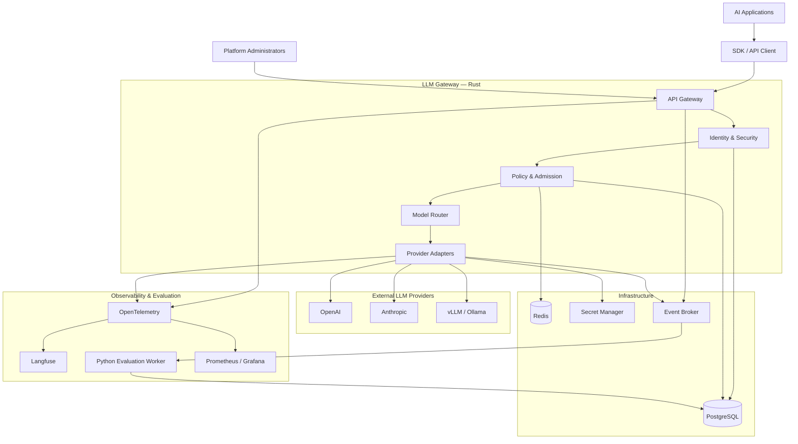
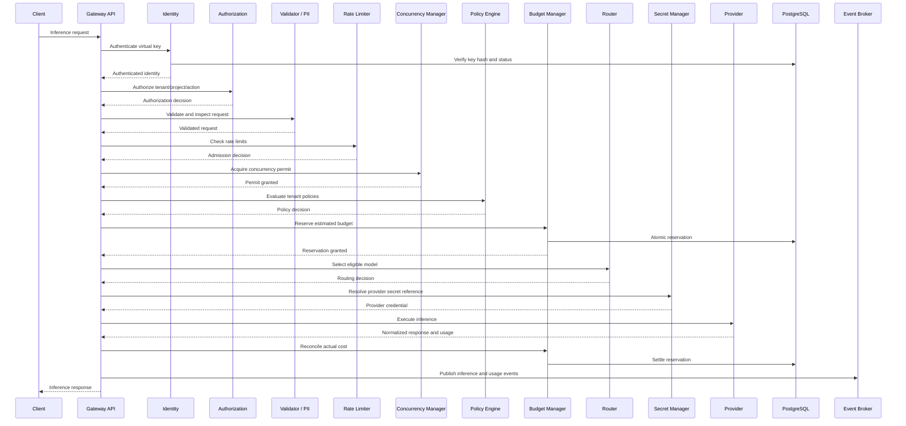
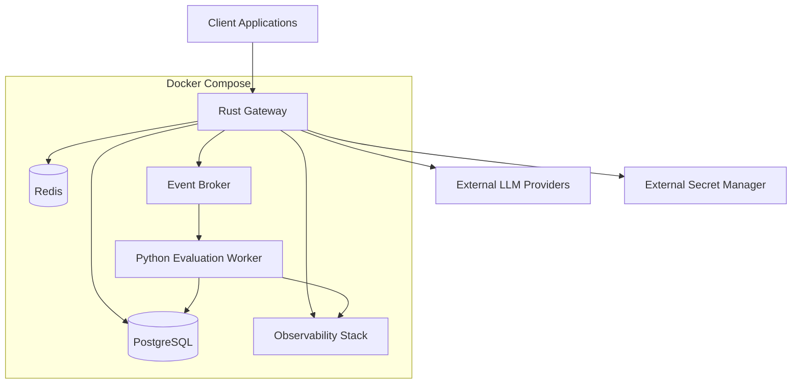

# LLM Gateway — System Architecture

**Version:** 1.1  
**Status:** Draft  
**Architecture style:** Clean Architecture + Event-Driven Architecture  
**Primary language:** Rust  
**Evaluation services:** Python

---

## 1. Architecture Goals

The LLM Gateway is a provider-independent infrastructure platform that centralizes access to LLM providers.

It must provide:

- Unified API for multiple LLM providers.
- Secure authentication and authorization.
- Tenant isolation and access control.
- Distributed rate limiting and concurrency control.
- Financial budget enforcement and usage accounting.
- Secure provider credential management.
- Intelligent model routing.
- Provider resilience and fallback.
- Exact and semantic caching.
- Centralized observability and audit trails.
- Asynchronous evaluation and quality monitoring.

### Architecture principles

1. Security before inference.
2. Policy enforcement before provider execution.
3. Financial controls must be atomic and auditable.
4. Provider integrations must be replaceable.
5. Inference must not depend on asynchronous evaluation.
6. PostgreSQL is the source of truth for durable business data.
7. Redis supports distributed, low-latency operational controls.
8. Every routing decision must be explainable.
9. Secrets must never be exposed through application logs or API responses.
10. Infrastructure concerns must remain outside domain logic.

---

## 2. System Context



---

## 3. Architectural Style

The system uses two complementary architectural patterns.

### 3.1 Clean Architecture

The application is organized into four logical layers:

| Layer | Responsibility |
|---|---|
| Domain | Business rules, entities, value objects, domain services |
| Application | Use cases, orchestration, ports and interfaces |
| Infrastructure | PostgreSQL, Redis, providers, secret manager, event broker |
| Presentation | HTTP API, middleware, request and response DTOs |

Dependencies point inward.

The domain layer must not depend on Axum, SQLx, Redis, HTTP clients, or provider SDKs.

### 3.2 Event-Driven Architecture

The synchronous inference path publishes events for asynchronous processing.

Examples:

- InferenceRequested
- InferenceCompleted
- InferenceFailed
- UsageRecorded
- BudgetThresholdReached
- ProviderHealthChanged
- EvaluationRequested
- EvaluationCompleted
- APIKeyCreated
- APIKeyRevoked
- PolicyUpdated

The transactional outbox pattern should be used when a database transaction must reliably produce an event.

---

## 4. Logical Components

### 4.1 API Gateway

Responsibilities:

- Expose the public API.
- Validate HTTP structure and content types.
- Enforce request-size limits.
- Apply request timeouts.
- Extract correlation and idempotency identifiers.
- Invoke application use cases.
- Normalize error responses.
- Handle streaming responses.

Technology: Rust, Axum, Tokio, Tower.

### 4.2 Identity Management

Responsibilities:

- Manage virtual API keys.
- Authenticate API requests.
- Manage key expiration and revocation.
- Associate keys with tenants and projects.
- Support key scopes and permissions.
- Record key lifecycle events.

Virtual API keys are credentials issued by this gateway to client applications.

**Storage rule:** store only a cryptographic hash of the virtual API key, never the raw key.

### 4.3 Authorization and Tenant Isolation

Responsibilities:

- Enforce RBAC.
- Verify tenant and project ownership.
- Enforce resource-level permissions.
- Prevent cross-tenant access.
- Enforce API key scopes.

Initial roles:

| Role | Permissions |
|---|---|
| Platform Admin | Platform-wide administration |
| Tenant Admin | Manage tenant resources and policies |
| Project Admin | Manage project configuration and keys |
| Developer | Execute permitted inference requests |
| Auditor | Read permitted usage and audit records |

Authorization must be checked independently of authentication.

A valid API key does not automatically authorize access to every resource.

### 4.4 Request Validator

Responsibilities:

- Validate model identifiers.
- Validate message structures.
- Enforce input and output token limits.
- Validate sampling parameters.
- Reject unsupported capabilities.
- Enforce content-type and payload-size limits.
- Detect malformed or prohibited requests.

Validation should occur before expensive downstream operations.

### 4.5 PII Protection

Responsibilities:

- Detect configured sensitive information.
- Apply tenant-specific redaction policies.
- Prevent accidental sensitive-data exposure in logs.
- Control which request fields may be retained.
- Apply configurable retention policies.

PII protection must distinguish between the content sent to the provider and the content retained for observability.

### 4.6 Abuse Protection

Responsibilities:

- Detect suspicious request patterns.
- Identify repeated authentication failures.
- Protect against oversized payloads.
- Detect excessive request bursts.
- Apply configurable abuse rules.
- Temporarily block abusive API keys or tenants.

Abuse detection must not replace authentication, rate limiting, or authorization.

### 4.7 Policy Engine

Responsibilities:

- Evaluate tenant policies.
- Enforce allowed providers and models.
- Enforce model capabilities.
- Apply data residency requirements.
- Enforce cost constraints.
- Enforce model restrictions.
- Return explicit allow or deny decisions.

The policy engine evaluates business rules; it should not own persistence or network-specific implementation details.

### 4.8 Rate Limiter

Rate limiting controls request consumption over time.

It is different from a financial budget.

Supported dimensions:

| Dimension | Example |
|---|---|
| Requests per second | 10 requests/sec |
| Requests per minute | 300 requests/min |
| Tokens per minute | 100,000 tokens/min |
| Tenant limit | 1,000 requests/min |
| Project limit | 300 requests/min |
| API key limit | 60 requests/min |
| Provider limit | Provider-specific quota |

Initial algorithm: Token Bucket.

Additional algorithms:

- Sliding Window for accurate rolling-window limits.
- Semaphore-based admission for concurrent request limits.

Redis should provide distributed atomic enforcement, using Lua scripts or equivalent atomic operations.

The system must define behavior when Redis is unavailable. Security-sensitive limits should fail closed unless an explicitly approved fallback policy exists.

### 4.9 Concurrency Manager

Responsibilities:

- Enforce maximum simultaneous requests.
- Apply tenant-level concurrency limits.
- Apply project-level concurrency limits.
- Apply provider-level concurrency limits.
- Release permits after completion or cancellation.
- Prevent resource exhaustion.

Concurrency limits are independent of requests-per-minute limits.

### 4.10 Budget Manager

Responsibilities:

- Manage tenant and project budgets.
- Reserve estimated inference costs.
- Reconcile actual provider costs.
- Prevent overspending.
- Track daily and monthly usage.
- Support configurable warning thresholds.

Budget enforcement requires atomic reservation and settlement.

PostgreSQL is the durable financial source of truth. Redis may support fast admission decisions but must not be the only record of financial usage.

### 4.11 Secret Manager

The system has two distinct credential categories.

**A. Virtual API keys**

- Issued to gateway clients.
- Stored as hashes in PostgreSQL.
- Support expiration, rotation, and revocation.
- Associated with tenant, project, and scopes.

**B. Provider credentials**

- OpenAI API keys.
- Anthropic API keys.
- Other provider credentials.
- Internal inference endpoint credentials.

Provider credentials must never be committed to Git, embedded in container images, or stored as plaintext in application configuration.

Initial implementation:

- Local development: environment variables or Docker secrets.
- Production: HashiCorp Vault or a cloud secret manager.
- Database: store secret references and metadata, not provider secret values.

Define a provider abstraction:

```rust
#[async_trait::async_trait]
pub trait SecretProvider: Send + Sync {
    async fn get_secret(
        &self,
        secret_name: &str,
    ) -> Result<SecretValue, SecretError>;
}
```

The implementation must support credential rotation and must avoid logging secret values.

### 4.12 Model Registry

Responsibilities:

- Register providers and models.
- Store model capabilities.
- Store context-window limits.
- Store supported input and output modalities.
- Store pricing metadata.
- Store operational status.
- Version model configuration.

Model metadata must be configurable rather than hardcoded throughout the routing engine.

### 4.13 Model Router

Responsibilities:

- Select an eligible model.
- Evaluate task requirements.
- Evaluate model capabilities.
- Consider quality requirements.
- Consider latency objectives.
- Consider provider health.
- Consider budget constraints.
- Explain routing decisions.

Routing objective:

> Select the lowest-cost eligible model that satisfies the request's quality, capability, policy, reliability, and latency constraints.

### 4.14 Provider Adapters

Each provider has a dedicated adapter implementing a common interface.

Responsibilities:

- Translate normalized requests.
- Resolve provider credentials.
- Call the provider.
- Handle streaming.
- Normalize provider responses.
- Normalize provider errors.
- Extract usage and cost information.

Initial providers:

- OpenAI
- Anthropic
- vLLM
- Ollama

Provider-specific behavior must remain isolated from domain and application layers.

### 4.15 Reliability Engine

Responsibilities:

- Request timeout management.
- Retry classification.
- Exponential backoff with jitter.
- Circuit breakers.
- Provider health monitoring.
- Fallback execution.
- Cancellation propagation.

Retries must be bounded and must respect provider `Retry-After` information.

Streaming fallback requires special treatment: after tokens have been delivered to a client, switching providers may create an invalid or duplicated response.

### 4.16 Cache Engine

Two cache strategies:

**Exact cache**
- Hash normalized request and compatible configuration.
- Return a matching response.
- Enforce tenant isolation.
- Apply TTL and invalidation rules.

**Semantic cache**
- Compare request embeddings.
- Apply similarity thresholds.
- Enforce tenant and authorization boundaries.
- Exclude sensitive data by default.
- Evaluate false-positive rates.

Semantic cache must not return an answer simply because two prompts are semantically similar. Compatibility and authorization must also be established.

### 4.17 Usage Accounting

Responsibilities:

- Record token usage.
- Record provider cost.
- Record model and provider.
- Associate usage with tenant and project.
- Reconcile estimated and actual costs.
- Support reporting and audit.

Usage accounting is separate from budget enforcement, although both consume usage information.

### 4.18 Audit Logger

Responsibilities:

- Record security-sensitive actions.
- Record API key lifecycle events.
- Record authorization failures.
- Record policy changes.
- Record secret reference changes.
- Record budget modifications.
- Record administrative operations.

Audit events must be durable, access-controlled, and tamper-resistant to the extent supported by the deployment.

Do not put raw API keys, provider secrets, or unnecessary prompt content in audit records.

### 4.19 Observability

Responsibilities:

- Distributed traces.
- Metrics.
- Structured logs.
- Provider latency.
- Token usage.
- Cost per request.
- Routing decisions.
- Error rates.
- Cache hit rates.
- Rate-limit rejections.

Technology:

- OpenTelemetry
- OpenInference conventions where applicable
- Prometheus
- Grafana
- Langfuse

### 4.20 Evaluation Worker

A separate Python service performs asynchronous quality evaluation.

Responsibilities:

- Consume inference events.
- Select eligible samples.
- Evaluate output quality.
- Evaluate faithfulness and relevance where applicable.
- Run safety checks.
- Store evaluation results.
- Produce quality reports.

Technology:

- Python
- DeepEval
- RAGAS
- Langfuse integrations where useful

Evaluation must not block the synchronous inference response.

---

## 5. Request Admission and Inference Flow

The most important architectural rule is that provider execution must not begin until all required admission controls have passed.



### Admission sequence

1. Authenticate the virtual API key.
2. Authorize the tenant, project, and requested operation.
3. Validate the request.
4. Apply configured PII and abuse controls.
5. Check distributed rate limits.
6. Acquire concurrency capacity.
7. Evaluate tenant and model policies.
8. Reserve the estimated budget.
9. Check cache eligibility.
10. Select an eligible model.
11. Resolve provider credentials.
12. Execute provider inference.
13. Reconcile actual usage and cost.
14. Release concurrency capacity.
15. Publish events and telemetry.
16. Return the normalized response.

Some operations may be reordered when safe, but the admission invariants must remain intact.

For example, a cache lookup may occur before provider routing, but it must not bypass authentication, authorization, tenant isolation, rate limits, or required budget policy.

---

## 6. Request Lifecycle and Failure Handling

| Failure | Expected behavior |
|---|---|
| Invalid API key | Reject with 401 |
| Insufficient permission | Reject with 403 |
| Invalid payload | Reject with 400 |
| Rate limit exceeded | Reject with 429 |
| Concurrency limit exceeded | Reject with 429 or configured overload response |
| Budget exhausted | Reject with 402 or documented gateway policy |
| Model prohibited | Reject with policy error |
| Provider timeout | Apply bounded retry/fallback policy |
| Provider unavailable | Open circuit and evaluate fallback |
| Secret manager unavailable | Fail closed for provider credential resolution |
| Redis unavailable | Apply configured fail-open/fail-closed policy per control |
| PostgreSQL unavailable | Reject operations requiring durable authorization or financial guarantees |

The API must return consistent error objects with stable error codes and correlation IDs.

---

## 7. Streaming Architecture

Streaming requests require a separate execution path.

Requirements:

- Support server-sent events.
- Propagate cancellation.
- Enforce request and idle timeouts.
- Track partial token usage when available.
- Release concurrency permits on disconnect.
- Record incomplete provider executions.
- Prevent unsafe provider switching after output has been delivered.

A streaming response should not be buffered entirely in memory.

---

## 8. Data Architecture

### PostgreSQL — authoritative storage

Stores:

- Tenants and projects.
- Users and roles.
- Virtual API key hashes.
- Policies and configurations.
- Budget definitions.
- Budget reservations and settlements.
- Usage records.
- Provider and model registry.
- Routing rules.
- Audit events.
- Idempotency records.
- Outbox events.
- Evaluation results.

### Redis — operational storage

Stores:

- Distributed rate-limit state.
- Concurrency counters and permits.
- Short-lived operational state.
- Exact cache entries.
- Semantic cache coordination.
- Provider health state where appropriate.

Redis must not be the only durable source for budgets, audit records, or usage accounting.

### Event broker

Initial option: Redis Streams.

Future option: Kafka or another durable event platform when throughput, replay, and retention requirements justify it.

Use the transactional outbox pattern to avoid losing events between database commits and event publication.

---

## 9. Security Architecture

Security is a cross-cutting architectural concern.

### Security controls

| Control | Primary responsibility |
|---|---|
| Authentication | Verify API key or administrative identity |
| Authorization | Enforce roles, scopes, and resource permissions |
| Tenant isolation | Prevent cross-tenant access |
| Secret management | Protect provider credentials |
| Request validation | Reject malformed and prohibited input |
| PII protection | Control sensitive data exposure |
| Abuse protection | Detect suspicious activity |
| Rate limiting | Control request and token consumption |
| Concurrency control | Limit simultaneous execution |
| Budget enforcement | Prevent unauthorized financial exposure |
| Audit logging | Record security-sensitive operations |
| TLS | Protect network communication |
| Idempotency | Prevent duplicate execution where supported |

### Security invariants

- No plaintext provider credentials in source control.
- No raw virtual API keys in persistent storage.
- No provider request before successful admission.
- No cross-tenant cache access.
- No secret values in logs or traces.
- No administrative action without authorization.
- All sensitive configuration changes must be auditable.

---

## 10. Observability Architecture

Every inference execution should have a trace.

Suggested span hierarchy:

```text
llm.gateway.request
 ├── authentication
 ├── authorization
 ├── request.validation
 ├── pii.protection
 ├── rate_limit.check
 ├── concurrency.acquire
 ├── policy.evaluate
 ├── budget.reserve
 ├── cache.lookup
 ├── routing.select
 ├── provider.resolve_secret
 ├── provider.execute
 ├── usage.reconcile
 ├── budget.settle
 └── event.publish
```

Core metrics:

| Metric | Description |
|---|---|
| `gateway_requests_total` | Total requests |
| `gateway_request_duration_seconds` | End-to-end duration |
| `gateway_admission_rejections_total` | Rejected requests by control |
| `gateway_rate_limit_rejections_total` | Rate-limit rejections |
| `gateway_concurrent_requests` | Active requests |
| `gateway_provider_requests_total` | Provider calls |
| `gateway_provider_errors_total` | Provider errors |
| `gateway_provider_latency_seconds` | Provider latency |
| `gateway_tokens_total` | Token consumption |
| `gateway_cost_total` | Estimated or reconciled cost |
| `gateway_cache_hits_total` | Cache hits |
| `gateway_budget_reservations_total` | Budget reservations |
| `gateway_routing_decisions_total` | Routing decisions |

Sensitive prompt and response content must not be recorded by default.

---

## 11. Deployment Architecture

Initial deployment uses Docker Compose.



### Deployment principles

- Stateless Rust gateway instances.
- Externalized configuration.
- Health and readiness endpoints.
- Graceful shutdown.
- Database migrations.
- Structured logs.
- Secrets injected securely.
- Resource limits.
- Container health checks.
- Separate development and production configurations.

Kubernetes and multi-region deployment are future extensions, not initial requirements.

---

## 12. Rust Workspace Boundaries

Proposed workspace:

```text
llm-gateway/
├── Cargo.toml
├── Cargo.lock
├── rust-toolchain.toml
├── .env.example
├── docker-compose.yml
│
├── apps/
│   └── gateway-server/
│
├── crates/
│   ├── gateway-core/
│   ├── shared-kernel/
│   ├── identity/
│   ├── authorization/
│   ├── tenant-management/
│   ├── secret-manager/
│   ├── request-validator/
│   ├── pii-protection/
│   ├── abuse-protection/
│   ├── policy-engine/
│   ├── rate-limiter/
│   ├── concurrency-manager/
│   ├── budget-manager/
│   ├── model-registry/
│   ├── model-router/
│   ├── provider-adapters/
│   ├── reliability-engine/
│   ├── cache-engine/
│   ├── usage-accounting/
│   ├── idempotency/
│   ├── audit-logger/
│   ├── telemetry/
│   └── event-publisher/
│
├── services/
│   └── evaluation-worker/
│
├── config/
│   ├── models.yaml
│   ├── routing.yaml
│   ├── policies.yaml
│   └── limits.yaml
│
├── migrations/
├── tests/
│   ├── integration/
│   ├── contract/
│   ├── security/
│   └── load/
│
├── evals/
│   ├── datasets/
│   ├── metrics/
│   └── reports/
│
└── docs/
    ├── product.md
    ├── architecture.md
    ├── domain-model.md
    ├── api-contracts.md
    ├── security.md
    ├── routing-policy.md
    ├── data-model.md
    ├── test-strategy.md
    ├── definition-of-done.md
    ├── build-plan.md
    └── adr/
```

The workspace is a logical starting point. Avoid creating empty crates without a concrete implementation boundary. Some closely related capabilities may initially live together and be extracted as the project grows.

---

## 13. Architecture Decision Records

Initial ADR candidates:

| ADR | Decision |
|---|---|
| ADR-001 | Rust as primary gateway language |
| ADR-002 | Axum and Tokio for HTTP and asynchronous execution |
| ADR-003 | Clean Architecture boundaries |
| ADR-004 | PostgreSQL as authoritative database |
| ADR-005 | Redis for distributed operational controls |
| ADR-006 | Provider adapter abstraction |
| ADR-007 | Token Bucket as primary rate-limit algorithm |
| ADR-008 | Secret manager abstraction |
| ADR-009 | Transactional outbox for event publication |
| ADR-010 | OpenTelemetry for distributed tracing |
| ADR-011 | Python evaluation worker |
| ADR-012 | Budget reservation and settlement model |
| ADR-013 | Idempotency strategy |
| ADR-014 | Streaming and provider fallback behavior |
| ADR-015 | Tenant isolation and cache boundaries |

Each ADR should include context, decision, alternatives, consequences, and status.

---

## 14. Architecture Quality Attributes

| Attribute | Initial target or requirement |
|---|---|
| Performance | Gateway overhead p95 below 50 ms, excluding provider latency, under a defined benchmark |
| Exact cache | p95 below 15 ms under defined benchmark conditions |
| Availability | Initial target of 99.9%, subject to deployment assumptions |
| Concurrency | Baseline test with 1,000 concurrent requests |
| Security | Tenant isolation and secret-handling tests required |
| Reliability | Bounded retries and circuit breakers |
| Scalability | Horizontally scalable stateless gateway |
| Maintainability | Explicit Clean Architecture boundaries |
| Observability | Traceable inference lifecycle |
| Financial integrity | Atomic reservation and idempotent settlement |

These are engineering targets, not measured performance claims. Benchmark results must document hardware, workload, concurrency, provider conditions, and test duration.

---

## 15. Architecture Definition of Done

The architecture is ready for implementation when:

- [ ] All major components and responsibilities are documented.
- [ ] Clean Architecture boundaries are defined.
- [ ] Request admission sequence is documented.
- [ ] Authentication and authorization are separated.
- [ ] Tenant isolation strategy is defined.
- [ ] Virtual API key lifecycle is defined.
- [ ] Provider secret management is defined.
- [ ] Rate limiting and concurrency controls are defined.
- [ ] Budget reservation and settlement are defined.
- [ ] Provider abstraction is defined.
- [ ] Routing and fallback responsibilities are defined.
- [ ] Streaming behavior is documented.
- [ ] Cache isolation and compatibility rules are documented.
- [ ] Audit and observability boundaries are defined.
- [ ] Asynchronous evaluation is separated from inference.
- [ ] Data ownership and event publication are defined.
- [ ] Initial ADRs are identified.
- [ ] Security and failure paths are documented.

---

## 16. Next Document

The next specification is `docs/domain-model.md`.

It will define the business entities, value objects, aggregates, relationships, invariants, and lifecycle rules behind:

- Tenants, projects, users, roles, and API keys.
- Provider secret references.
- Policies and model registry.
- Rate limits and concurrency quotas.
- Budget reservations and usage accounting.
- Inference executions and provider attempts.
- Routing decisions.
- Cache entries.
- Audit events and idempotency records.
- Evaluation datasets and results.

The domain model will distinguish financial budgets, request rate limits, and concurrency limits as separate concepts.
