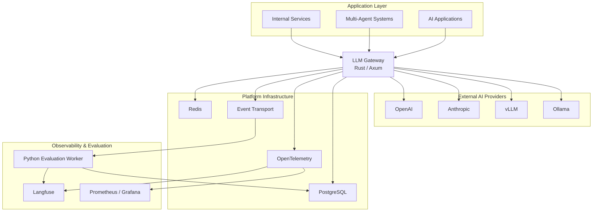
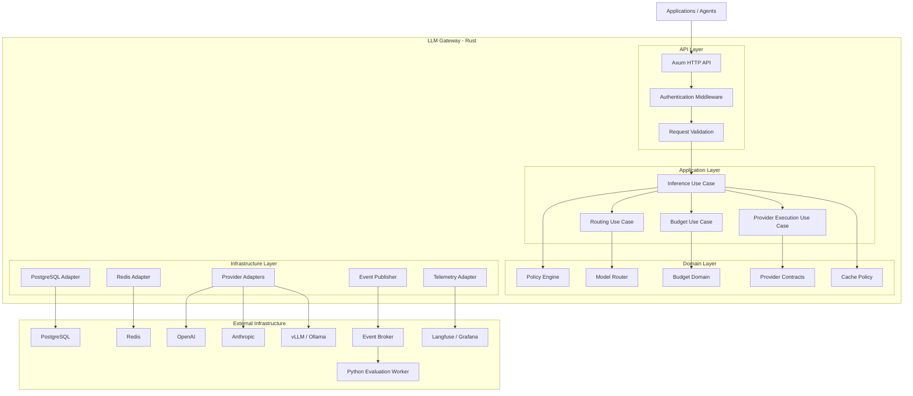
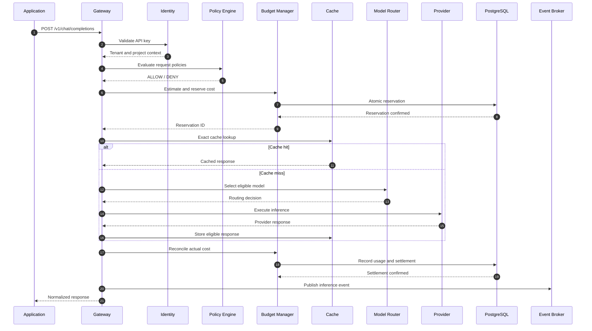
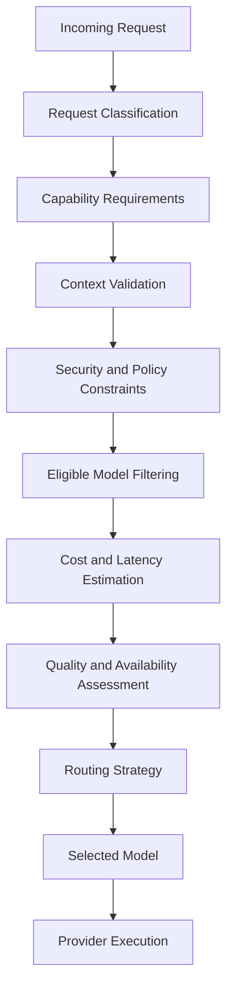
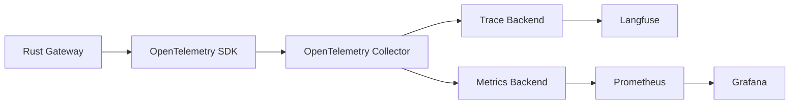
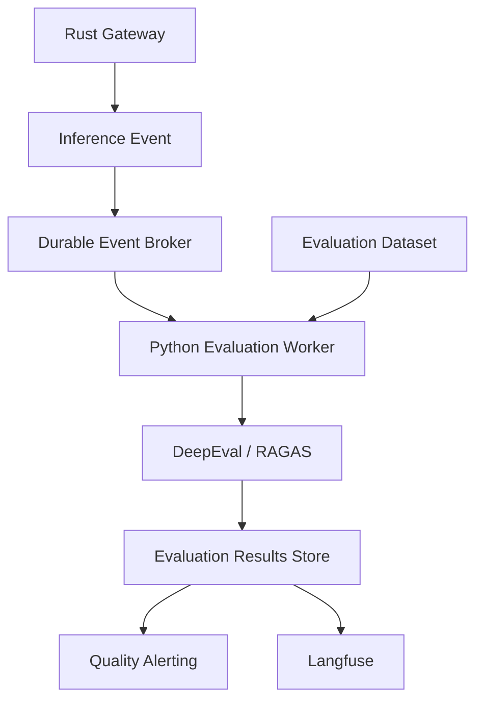
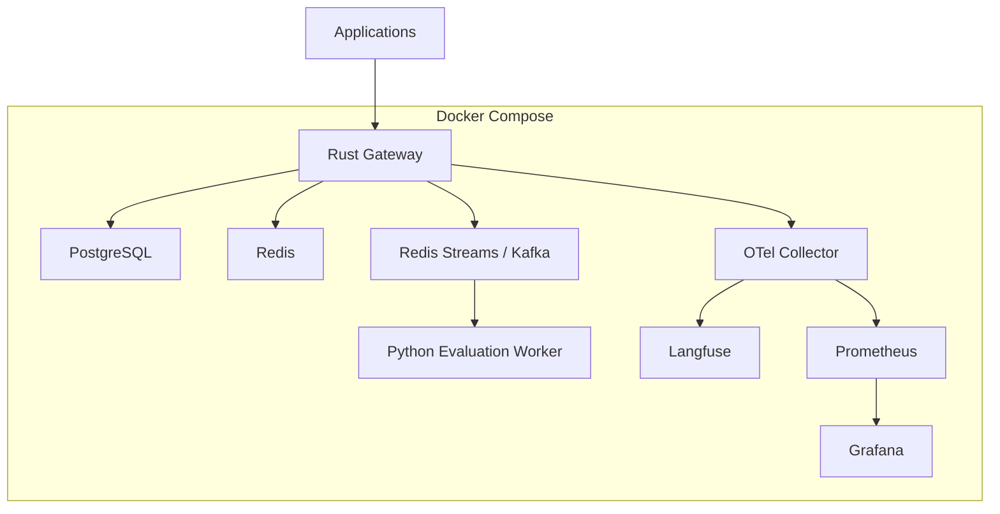

# Architecture — llm-gateway

**Project:** llm-gateway  
**Document:** System Architecture  
**Version:** 1.0  
**Status:** Draft  
**Architecture Style:** Clean Architecture + Event-Driven Architecture  
**Primary Language:** Rust  
**Evaluation Service:** Python

---

# 1. Architecture Overview

## 1.1 Purpose

This document defines the technical architecture of `llm-gateway`.

It establishes:

- System boundaries.
- Architectural style.
- Core components.
- Component responsibilities.
- Data flows.
- Integration patterns.
- Technology decisions.
- Deployment architecture.
- Reliability and security principles.

The architecture provides a foundation for implementing the product requirements defined in `product.md`.

## 1.2 Architectural Goals

The architecture must:

1. Decouple applications from LLM providers.
2. Centralize inference governance.
3. Support intelligent model routing.
4. Enforce tenant-level financial controls.
5. Provide reliable provider integrations.
6. Capture distributed inference telemetry.
7. Support asynchronous evaluation.
8. Scale horizontally.
9. Maintain clear separation of concerns.
10. Support additional providers and capabilities without modifying core business logic.

## 1.3 Architectural Principles

| Principle | Description |
|---|---|
| Clean Architecture | Business rules independent of infrastructure |
| Domain-Driven Design | Explicit domain models and business invariants |
| Dependency Inversion | Core depends on abstractions |
| Provider Independence | Provider-specific logic isolated in adapters |
| Policy-Driven Design | Routing and governance controlled by policies |
| Event-Driven Architecture | Asynchronous telemetry and evaluation |
| Fail-Safe Defaults | Security and budget controls default to restrictive behavior |
| Observability by Design | Every inference execution is traceable |
| Idempotency | Financial and event processing operations are safe to repeat |
| Extensibility | New providers and evaluation methods require minimal changes |

---

# 2. System Context

## 2.1 System Context Diagram



## 2.2 External Actors

| Actor | Interaction |
|---|---|
| AI Application | Sends inference requests |
| Multi-Agent System | Sends inference and tool-related requests |
| Tenant Administrator | Manages tenant configuration |
| Platform Administrator | Manages providers, models and policies |
| LLM Provider | Executes inference |
| Evaluation Worker | Evaluates inference outputs |
| Observability Platform | Receives traces and metrics |

## 2.3 System Boundary

The gateway owns:

- API authentication.
- Tenant identification.
- Request admission.
- Policy enforcement.
- Budget reservations.
- Model selection.
- Provider execution orchestration.
- Response normalization.
- Cache management.
- Usage accounting.
- Telemetry generation.

External infrastructure owns:

- Model inference.
- Durable database storage.
- Distributed caching.
- Event transportation.
- Trace storage and visualization.
- Automated evaluation execution.

---

# 3. High-Level Architecture

## 3.1 Logical Architecture

The system consists of five major architectural layers.

1. API and ingress layer.
2. Application orchestration layer.
3. Domain and policy layer.
4. Infrastructure and provider integration layer.
5. Asynchronous observability and evaluation layer.



## 3.2 Architectural Separation

The Rust gateway follows Clean Architecture.

### API Layer

Responsibilities:

- HTTP endpoints.
- Authentication middleware.
- Request parsing.
- Input validation.
- Response serialization.
- Streaming response handling.

Framework:

- Axum.
- Tower.
- Serde.

The API layer must not contain business rules.

### Application Layer

Responsibilities:

- Coordinate use cases.
- Manage request execution.
- Invoke domain services.
- Coordinate repository interfaces.
- Manage transactions.
- Coordinate provider execution.
- Publish domain and integration events.

Application use cases:

- CreateInferenceRequest.
- ExecuteInference.
- ResolveModel.
- ReserveBudget.
- ReconcileUsage.
- ExecuteFallback.
- EvaluateCacheEligibility.
- RecordInferenceExecution.

### Domain Layer

Responsibilities:

- Define business entities.
- Enforce domain invariants.
- Define policies.
- Calculate routing decisions.
- Calculate cost estimates.
- Control budget state transitions.
- Define provider contracts.

The domain layer must not depend on Axum, SQLx, Redis, Reqwest, or provider SDKs.

### Infrastructure Layer

Responsibilities:

- PostgreSQL repositories.
- Redis cache implementation.
- Provider HTTP clients.
- Event publishing.
- OpenTelemetry integration.
- External service communication.

Infrastructure implements interfaces defined by the application and domain layers.

---

# 4. Core Component Architecture

## 4.1 API Gateway

**Responsibility:** Expose a standardized interface to applications.

Initial endpoints:

| Method | Endpoint | Description |
|---|---|---|
| POST | /v1/chat/completions | Chat completion |
| GET | /v1/models | Available models |
| GET | /health | Liveness |
| GET | /ready | Readiness |
| GET | /admin/providers | Provider management |
| GET | /admin/usage | Usage information |
| GET | /admin/budgets | Budget management |

The initial compatibility target is the OpenAI Chat Completions API.

Provider-specific features must be normalized or explicitly exposed as supported extensions.

## 4.2 Identity and Tenant Management

Responsibilities:

- API key validation.
- Tenant resolution.
- Project resolution.
- Role verification.
- Key expiration.
- Key revocation.
- Request authorization.

An API key must never be stored in plaintext.

## 4.3 Policy Engine

The policy engine determines whether a request is permitted.

Policy dimensions:

- Tenant permissions.
- Project permissions.
- Allowed providers.
- Allowed models.
- Maximum input tokens.
- Maximum output tokens.
- Maximum context length.
- Data sensitivity.
- Budget restrictions.
- Rate limits.

The engine returns an explicit policy decision:

- ALLOW.
- DENY.
- ALLOW_WITH_CONSTRAINTS.

## 4.4 Budget Manager

Responsibilities:

- Estimate inference cost.
- Reserve budget.
- Reconcile actual expenditure.
- Release unused reservations.
- Enforce daily and monthly limits.
- Record financial transactions.

PostgreSQL is the authoritative financial ledger.

Redis may provide fast admission-control data but must not be the sole source of financial truth.

## 4.5 Model Router

Responsibilities:

- Resolve model aliases.
- Evaluate model capabilities.
- Apply routing policies.
- Estimate cost.
- Evaluate provider health.
- Select eligible providers.
- Explain routing decisions.

Routing dimensions:

| Dimension | Example |
|---|---|
| Complexity | Low / Medium / High |
| Capability | Coding / Reasoning / JSON |
| Context | Short / Long |
| Cost | Estimated request cost |
| Latency | Expected response time |
| Availability | Provider health |
| Quality | Historical evaluation results |
| Security | Deployment and data restrictions |

Routing must be deterministic for a given configuration and input classification, except where explicitly configured weighted selection is used.

## 4.6 Provider Adapter

Each provider implements a common contract.

Initial adapters:

- OpenAI.
- Anthropic.
- vLLM.
- Ollama.

Responsibilities:

- Authentication.
- Request translation.
- HTTP communication.
- Response translation.
- Streaming.
- Error normalization.
- Usage extraction.

Provider-specific behavior must not leak into the domain layer.

## 4.7 Cache Engine

Two cache strategies:

**Exact Cache**

Uses a canonical request fingerprint.

**Semantic Cache**

Uses embedding similarity and eligibility rules.

Cache keys must account for:

- Tenant.
- Project.
- Model compatibility.
- Prompt version.
- Generation parameters.
- Authorization context.
- Data sensitivity.

Caching is disabled by default for requests that are unsafe to reuse.

## 4.8 Telemetry Engine

Responsibilities:

- Create inference spans.
- Propagate trace context.
- Record token usage.
- Record cost.
- Capture provider latency.
- Record routing decisions.
- Track retries and fallback.
- Track cache decisions.
- Publish structured inference events.

Sensitive content must be redacted or excluded according to telemetry policy.

---

# 5. Inference Request Lifecycle

## 5.1 Standard Inference Sequence



## 5.2 Request Processing Invariants

- No provider execution before required admission controls pass.
- No provider execution without a valid budget reservation when budget enforcement applies.
- Every inference execution has a unique execution identifier.
- Every provider attempt is independently identifiable.
- Budget settlement must be idempotent.
- Cache hits must be recorded as inference executions.
- Every completed request must have a usage outcome, including zero-cost outcomes where applicable.
- Evaluation must not block ordinary inference responses.

## 5.3 Streaming Requests

Streaming requests use asynchronous response streaming.

Requirements:

- Incremental token forwarding.
- Cancellation propagation.
- Request deadline enforcement.
- Token usage collection where provider support permits.
- Partial execution tracking.
- Explicit settlement for interrupted streams.
- No automatic fallback after client-visible output unless a safe protocol is explicitly defined.

---

# 6. Intelligent Routing Architecture

## 6.1 Routing Pipeline



## 6.2 Routing Strategies

Initial strategies:

- Rule-based routing.
- Capability-based routing.
- Cost-optimized routing.
- Latency-optimized routing.
- Complexity-based routing.
- Provider-health-aware routing.

## 6.3 Model Eligibility

A model must be excluded if it violates:

- Tenant permissions.
- Provider restrictions.
- Context requirements.
- Modality requirements.
- Data residency restrictions.
- Security policies.
- Required structured-output capabilities.

The router must never choose a model solely because it is cheaper.

## 6.4 Routing Decision Record

Every routing decision should capture:

- Request ID.
- Candidate models.
- Excluded models and reasons.
- Selected provider.
- Selected model.
- Estimated cost.
- Estimated latency.
- Routing policy version.
- Complexity score, if available.
- Selection reason.

---

# 7. Provider Reliability Architecture

## 7.1 Reliability Components

The reliability engine contains:

- Timeout manager.
- Retry policy.
- Backoff strategy.
- Circuit breaker.
- Provider health tracker.
- Fallback selector.

## 7.2 Failure Classification

| Failure | Strategy |
|---|---|
| 400 Bad Request | Reject |
| 401 Unauthorized | Configuration failure |
| 403 Forbidden | Reject |
| 429 Rate Limited | Respect Retry-After and apply bounded retry |
| 5xx | Bounded retry and eligible fallback |
| Connection failure | Retry or fallback |
| Timeout | Retry only when safe |
| Context overflow | Re-evaluate eligible models |
| Budget exceeded | Reject according to budget policy |

## 7.3 Circuit Breaker States

- CLOSED: Requests permitted.
- OPEN: Requests rejected or routed elsewhere.
- HALF_OPEN: Limited health probes.

Circuit breakers must be maintained independently for provider/model combinations where appropriate.

## 7.4 Retry Safety

The system must distinguish between:

- Failures before provider execution.
- Failures during execution.
- Failures after provider execution.
- Failures after partial streaming output.

The gateway must not assume that a timeout means the provider did not execute the request.

Financial reconciliation must account for uncertain provider outcomes.

---

# 8. Observability Architecture

## 8.1 Telemetry Flow



## 8.2 Trace Structure

Example distributed trace:

```text
Inference Request
│
├── Authentication
├── Policy Evaluation
├── Budget Reservation
├── Cache Lookup
├── Routing Decision
│
├── Provider Execution
│   ├── Provider Attempt 1
│   └── Provider Attempt 2 (Fallback)
│
├── Usage Reconciliation
└── Event Publication
```

## 8.3 Metrics

### Gateway

- Request count.
- Request errors.
- Request latency.
- Active requests.
- Streaming duration.

### Providers

- Request count.
- Error rate.
- Timeout rate.
- Provider latency.
- Retry rate.
- Fallback rate.

### Cost

- Input tokens.
- Output tokens.
- Estimated cost.
- Actual cost.
- Spend per tenant.
- Spend per project.
- Spend per model.

### Cache

- Exact cache hit rate.
- Semantic cache hit rate.
- Cache lookup latency.
- Cache savings.
- Invalid cache reuse rate.

### Routing

- Model selection distribution.
- Routing latency.
- Cost per selected model.
- Quality per model.
- Routing policy effectiveness.

---

# 9. Asynchronous Evaluation Architecture

## 9.1 Architecture

The evaluation service is implemented in Python because of its mature evaluation ecosystem.



## 9.2 Evaluation Types

**Offline evaluation**

- Fixed datasets.
- Model comparisons.
- Prompt regression.
- Routing policy validation.

**Production evaluation**

- Stratified traffic sampling.
- High-risk request evaluation.
- Failed execution evaluation.
- Fallback evaluation.
- Cache quality evaluation.

## 9.3 Evaluation Metrics

- Faithfulness.
- Answer relevancy.
- Task correctness.
- Structured output validity.
- Tool-call correctness.
- Safety compliance.
- Domain-specific quality.

Evaluation results must include:

- Dataset version.
- Metric version.
- Evaluator model.
- Prompt version.
- Model under evaluation.
- Execution timestamp.
- Evaluation score.
- Evaluation status.

---

# 10. Data Architecture

## 10.1 PostgreSQL

PostgreSQL is the authoritative store for:

- Tenants.
- Projects.
- Users.
- API keys.
- Roles.
- Providers.
- Models.
- Routing policies.
- Budgets.
- Budget reservations.
- Usage records.
- Audit events.
- Evaluation metadata.

## 10.2 Redis

Redis supports:

- Exact response cache.
- Semantic cache coordination.
- Distributed rate limiting.
- Provider health state.
- Short-lived request metadata.
- Budget admission snapshots.

Redis data must be treated as recoverable operational state, not the authoritative financial ledger.

## 10.3 Event Broker

The event broker carries:

- Inference completed.
- Inference failed.
- Provider attempt completed.
- Budget reconciled.
- Cache hit.
- Cache miss.
- Evaluation requested.
- Evaluation completed.

Events must have stable identifiers, schema versions, and correlation identifiers.

Use an outbox pattern for important events that must be published reliably alongside database transactions.

---

# 11. Security Architecture

## 11.1 Authentication

- Virtual API keys.
- Secure key hashing.
- Key rotation.
- Key expiration.
- Key revocation.

## 11.2 Authorization

- Tenant-level access control.
- Project-level access control.
- Role-based access control.
- Model-level permissions.
- Provider-level permissions.

## 11.3 Data Protection

- TLS for external communication.
- Secret management.
- PII redaction.
- Configurable prompt and response retention.
- Tenant-aware cache isolation.
- Restricted telemetry content.
- Audit logging.

## 11.4 Trust Boundaries

Treat all incoming application payloads, model outputs, provider responses, and retrieved context as untrusted.

Provider credentials must never be exposed to application clients.

---

# 12. Deployment Architecture

## 12.1 Initial Deployment

Docker Compose is the initial deployment target.



## 12.2 Container Responsibilities

| Container | Responsibility |
|---|---|
| llm-gateway | Rust API and inference orchestration |
| postgres | Durable application and financial data |
| redis | Cache and distributed rate limiting |
| event-broker | Asynchronous event transport |
| evaluation-worker | Python evaluation processing |
| otel-collector | Telemetry collection |
| langfuse | LLM trace visualization |
| prometheus | Metrics storage |
| grafana | Operational dashboards |

For the initial release, Redis Streams may serve as the event transport to reduce operational complexity. Kafka can be introduced when throughput and retention requirements justify it.

---

# 13. Scalability and Reliability

## 13.1 Horizontal Scaling

Gateway instances must be stateless.

Shared state resides in:

- PostgreSQL.
- Redis.
- Event broker.

Multiple gateway instances must be able to process requests for the same tenant safely.

## 13.2 Failure Isolation

Failure of an external subsystem must not automatically cause total platform failure.

| Component failure | Expected behavior |
|---|---|
| LLM provider | Eligible fallback |
| Redis cache | Bypass cache if policy permits |
| Redis rate limiter | Apply configured fail-closed policy |
| PostgreSQL | Reject operations requiring authoritative state |
| Event broker | Durable outbox buffering |
| Evaluation worker | Queue events for later processing |
| Langfuse | Continue inference and retain telemetry where configured |
| Metrics backend | Continue inference |

## 13.3 Graceful Degradation

The gateway must distinguish critical dependencies from optional observability and optimization dependencies.

Security and financial governance must not be bypassed merely to preserve availability.

---

# 14. Architecture Decisions and Constraints

The following decisions are proposed for formalization in ADRs.

| ID | Decision | Rationale |
|---|---|---|
| ADR-001 | Rust as primary gateway language | Performance, memory safety, concurrency |
| ADR-002 | Axum as HTTP framework | Async Rust ecosystem and Tower integration |
| ADR-003 | Clean Architecture | Separation of business rules and infrastructure |
| ADR-004 | PostgreSQL as authoritative database | Durable financial and operational records |
| ADR-005 | Redis for operational state | Low-latency cache and rate limiting |
| ADR-006 | OpenTelemetry for telemetry | Vendor-neutral observability |
| ADR-007 | Python evaluation service | Mature evaluation ecosystem |
| ADR-008 | OpenAI-compatible API | Application integration simplicity |
| ADR-009 | Event-driven evaluation | Inference and evaluation isolation |
| ADR-010 | Docker Compose initially | Reproducible development and deployment |

---

# 15. Architecture Quality Attributes

The architecture will be evaluated against the following quality attributes.

| Attribute | Verification |
|---|---|
| Performance | Load tests and latency benchmarks |
| Scalability | Multi-instance concurrency tests |
| Reliability | Provider failure injection |
| Security | Authentication and isolation tests |
| Financial integrity | Concurrent budget reservation tests |
| Maintainability | Module boundaries and dependency checks |
| Extensibility | Provider contract tests |
| Observability | Trace correlation tests |
| Quality assurance | Evaluation regression tests |
| Resilience | Dependency failure tests |

---

# 16. Architectural Constraints

1. Domain logic must not depend on infrastructure frameworks.
2. Provider-specific request models must not leak into domain entities.
3. Every inference request must have a correlation ID.
4. Every provider attempt must have an execution identifier.
5. Budget reservation and reconciliation must be idempotent.
6. Routing decisions must be explainable.
7. Sensitive data must not be cached or traced without explicit policy authorization.
8. Evaluation must be asynchronous by default.
9. Financial accounting must not depend exclusively on Redis.
10. All important external integrations must have explicit timeouts.
11. All event schemas must be versioned.
12. Streaming execution must support cancellation and partial-failure accounting.

---

# 17. Architecture Definition of Success

The architecture is considered validated when:

- A client can call multiple LLM providers through one API.
- The gateway can select models using configurable routing policies.
- Tenant budgets are enforced under concurrent workloads.
- Provider failures are handled through bounded retries and fallback.
- Inference traces can be correlated across the complete execution lifecycle.
- Evaluation runs independently of the inference request lifecycle.
- The system can scale gateway instances horizontally.
- Security boundaries are enforced across tenants.
- The architecture supports new providers without modifying domain logic.

**Core architectural principle:**

The Rust gateway controls inference execution, policies, cost, and reliability. External providers execute models. The asynchronous evaluation platform measures quality. Observability connects the complete lifecycle.

This separation is the foundation of `llm-gateway`.
