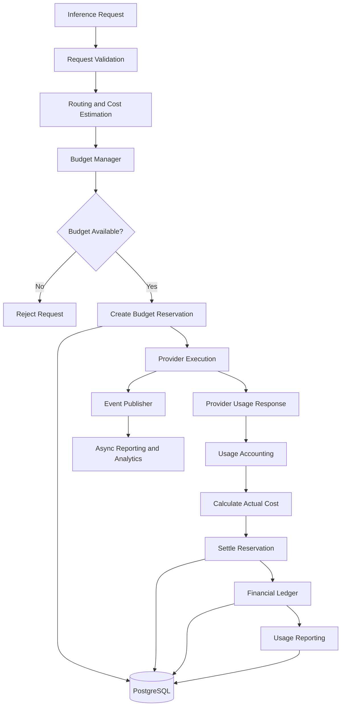
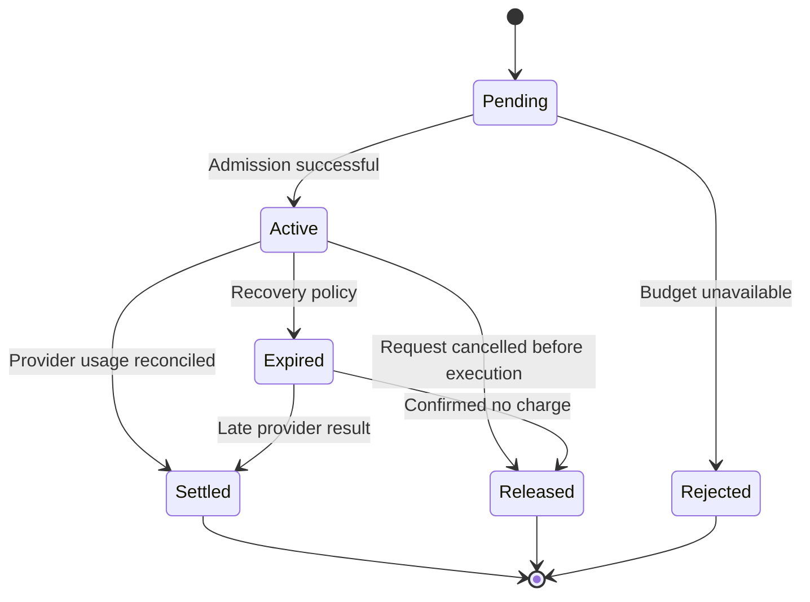
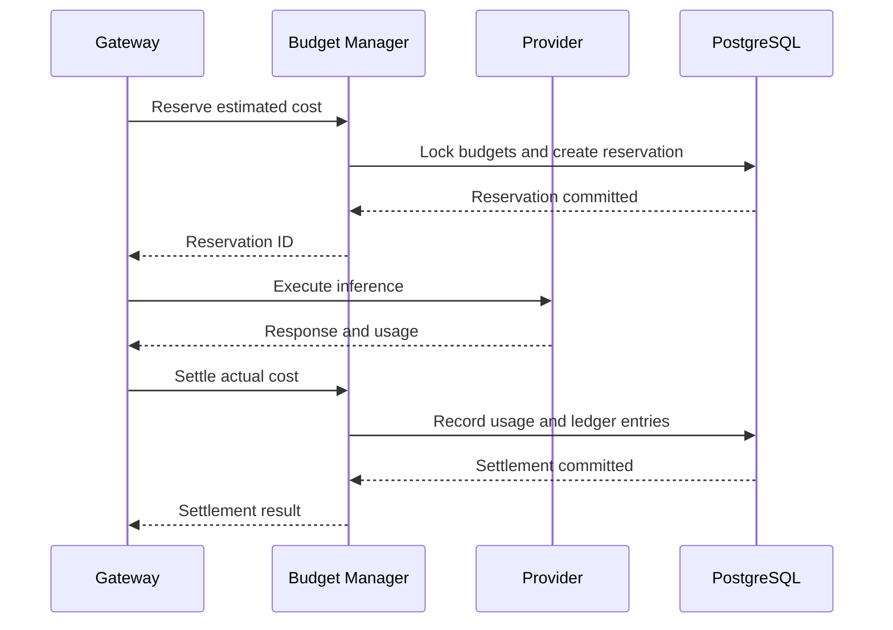

# LLM Gateway — Budget and Usage Accounting

**File:** `docs/budget-and-usage-accounting.md`  
**Version:** 1.0  
**Status:** Draft  
**Project:** `llm-gateway`  
**Implementation:** Rust  
**Architecture:** Clean Architecture

---

# 1. Purpose

This document defines the financial accounting architecture for `llm-gateway`.

The gateway must provide:

- Tenant and project spending limits.
- Pre-inference budget admission.
- Atomic budget reservations.
- Accurate token usage tracking.
- Provider cost reconciliation.
- Immutable financial ledger entries.
- Idempotent settlement.
- Cost attribution.
- Usage reporting.
- Financial observability.
- Protection against concurrent overspending.

The budget manager must prevent requests from executing when their estimated cost cannot be admitted under the applicable spending policies.

## 1.1 Design Objectives

| ID | Objective | Description |
|---|---|---|
| BA-001 | Budget enforcement | Prevent spending above configured limits |
| BA-002 | Pre-execution reservation | Reserve estimated cost before provider execution |
| BA-003 | Accurate accounting | Record actual provider usage |
| BA-004 | Idempotency | Prevent duplicate financial settlement |
| BA-005 | Tenant isolation | Attribute costs to the correct tenant |
| BA-006 | Project attribution | Track costs by project and API key |
| BA-007 | Auditability | Preserve financial transaction history |
| BA-008 | Reconciliation | Compare estimated and actual costs |
| BA-009 | Reporting | Provide usage and spending summaries |
| BA-010 | Reliability | Recover from partial failures and uncertain provider outcomes |

---

# 2. Financial Architecture

The budget manager is a separate domain capability from rate limiting.



## 2.1 Source of Truth

PostgreSQL is the authoritative financial data store.

Redis may be used for:

- Cached budget summaries.
- Fast admission hints.
- Temporary operational state.

Redis must never be the only source of truth for financial balances.

Every reservation and settlement must be recoverable from durable PostgreSQL records.

---

# 3. Financial Concepts

The system must distinguish the following concepts.

| Concept | Description |
|---|---|
| Budget limit | Maximum permitted expenditure |
| Committed amount | Amount reserved for in-flight requests |
| Actual spend | Settled expenditure |
| Available budget | Remaining amount available for admission |
| Estimated cost | Predicted cost before execution |
| Actual cost | Calculated cost from provider usage |
| Reservation | Temporary allocation before execution |
| Settlement | Final reconciliation of a reservation |
| Release | Return of unused reserved funds |
| Adjustment | Correction to a previously recorded financial amount |

## 3.1 Available Budget

\[
Available = Limit - ActualSpend - ActiveReservations
\]

A request may be admitted only when:

\[
EstimatedReservation \leq Available
\]

All amounts must use exact decimal arithmetic.

Never use floating-point types for financial accounting.

---

# 4. Budget Hierarchy

Budgets can exist at several scopes.

```text
Platform Budget
    |
    +-- Tenant Budget
           |
           +-- Project Budget
                  |
                  +-- Optional API Key Budget
```

A request must satisfy every applicable budget.

Example:

| Scope | Monthly Limit |
|---|---:|
| Platform | $100,000 |
| Tenant A | $5,000 |
| Project A1 | $1,000 |
| API key A1-01 | $300 |

The effective available amount is constrained by all applicable budgets.

A project must not spend beyond its limit even when its parent tenant has sufficient remaining funds.

## 4.1 Budget Policies

Each budget must define:

- Scope.
- Currency.
- Limit amount.
- Period.
- Start date.
- End date, if applicable.
- Warning thresholds.
- Hard or soft enforcement.
- Status.
- Policy version.

Example:

```yaml
budgets:
  tenant:
    monthly_limit: "5000.00"
    currency: USD
    enforcement: hard

  project:
    monthly_limit: "1000.00"
    currency: USD
    enforcement: hard

  warnings:
    - percentage: 70
    - percentage: 85
    - percentage: 95
```

Amounts in this example are illustrative.

---

# 5. Budget Periods

Supported periods:

- Hourly.
- Daily.
- Weekly.
- Monthly.
- Custom billing period.

Example:

```yaml
period:
  type: monthly
  timezone: UTC
  reset_policy: calendar_period
```

Requirements:

- Use UTC as the default accounting timezone.
- Define period boundaries explicitly.
- Do not delete historical financial records at reset.
- Preserve historical budget versions.
- Handle requests that cross period boundaries.
- Ensure reservations are associated with a specific budget period.

A reservation created in one period must not be silently transferred into another period.

---

# 6. Cost Estimation

Before execution, the gateway estimates the maximum expected request cost.

## 6.1 Cost Formula

For a basic text inference request:

\[
C_{estimated} =
\frac{T_{input} \times P_{input}}{1,000,000}
+
\frac{T_{output} \times P_{output}}{1,000,000}
\]

Where:

- \(T_{input}\): estimated input tokens.
- \(T_{output}\): reserved output tokens.
- \(P_{input}\): input price per million tokens.
- \(P_{output}\): output price per million tokens.

Additional pricing may include:

- Cached input tokens.
- Image processing.
- Audio input.
- Audio output.
- Tool execution.
- Batch processing.
- Provider-specific surcharges.

The pricing engine must support these dimensions without assuming every provider uses the same pricing model.

## 6.2 Pricing Registry

Pricing must be stored independently from provider configuration.

Each pricing record should include:

- Provider ID.
- Model ID.
- Input price.
- Output price.
- Cached input price, if applicable.
- Currency.
- Effective start time.
- Effective end time.
- Pricing source.
- Version.
- Last verification timestamp.

Example:

```yaml
pricing:
  provider_id: provider-a
  model_id: model-example

  currency: USD

  input:
    per_million_tokens: "1.00"

  output:
    per_million_tokens: "4.00"

  effective_from: "2026-01-01T00:00:00Z"
  version: "pricing-v1"
```

The prices are placeholders, not actual provider quotations.

## 6.3 Unknown Pricing

If pricing is unknown or outdated:

- Do not silently estimate using zero cost.
- Apply a configured conservative fallback price only if approved.
- Otherwise reject cost-controlled requests.
- Record the pricing error.
- Alert administrators.

Unknown pricing must not bypass hard budget enforcement.

---

# 7. Budget Reservation

Budget reservation happens before provider execution.

## 7.1 Reservation Workflow

1. Authenticate and authorize the request.
2. Resolve applicable budgets.
3. Resolve the selected model and provider.
4. Estimate input and output cost.
5. Apply the reservation safety margin.
6. Atomically check all applicable budgets.
7. Create reservation records.
8. Continue to provider execution.

If any required budget cannot admit the request, no provider call should be made.

## 7.2 Reservation Formula

\[
R = C_{estimated} \times (1 + M)
\]

Where:

- \(R\): reserved amount.
- \(C_{estimated}\): estimated cost.
- \(M\): reservation margin.

Example:

```text
Estimated cost:       $0.0200
Safety margin:           15%
Reserved amount:      $0.0230
```

The margin is a policy setting, not a universal constant.

## 7.3 Reservation States



A reservation must not be released solely because a gateway timeout occurred.

The provider may have processed and charged for the request even if the gateway did not receive the response.

---

# 8. Atomic Reservation

Concurrent requests must not overspend a shared budget.

Example:

```text
Budget limit: $100
Actual spend: $80
Active reservations: $10

Available budget: $10

Request A: $8
Request B: $8
```

Both requests cannot be admitted.

A correct implementation must allow at most one of these reservations.

## 8.1 PostgreSQL Transaction

The initial implementation should use PostgreSQL transactions.

Conceptual algorithm:

```text
BEGIN;

1. Lock applicable budget account rows.
2. Read settled spend and active reservations.
3. Calculate available budget.
4. Validate every applicable budget.
5. Insert reservation records.
6. Insert reservation ledger entries.
7. Commit.

If any budget fails:
    ROLLBACK.
```

Use consistent lock ordering across budget scopes to reduce deadlock risk.

For example:

1. Platform.
2. Tenant.
3. Project.
4. API key.

The transaction must protect against concurrent reservation races.

## 8.2 Database Concurrency

Recommended techniques:

- `SELECT ... FOR UPDATE`.
- Serializable transactions where justified.
- Unique idempotency constraints.
- Explicit transaction retries for serialization failures.
- Consistent lock ordering.

PostgreSQL should remain the financial source of truth.

---

# 9. Usage Accounting

After provider execution, the gateway records actual usage.

## 9.1 Usage Data

Capture:

- Execution ID.
- Tenant ID.
- Project ID.
- API key ID.
- Provider ID.
- Model ID.
- Input tokens.
- Output tokens.
- Cached input tokens.
- Total tokens.
- Actual cost.
- Currency.
- Pricing version.
- Provider request ID.
- Execution timestamp.
- Cache hit status.
- Provider attempt count.

Provider usage fields must be normalized into a common internal representation.

Do not assume every provider reports the same token categories.

## 9.2 Usage Record

```rust
pub struct UsageRecord {
    pub execution_id: ExecutionId,
    pub tenant_id: TenantId,
    pub project_id: ProjectId,
    pub provider_id: ProviderId,
    pub model_id: ModelId,
    pub input_tokens: u64,
    pub output_tokens: u64,
    pub cached_input_tokens: u64,
    pub total_tokens: u64,
    pub actual_cost: Decimal,
    pub currency: String,
    pub pricing_version: String,
    pub recorded_at: DateTime<Utc>,
}
```

The usage record must preserve the pricing version used to calculate actual cost.

---

# 10. Settlement

Settlement reconciles the original reservation against actual cost.

\[
Adjustment = ActualCost - ReservedAmount
\]

Examples:

| Reservation | Actual Cost | Adjustment |
|---:|---:|---:|
| $0.023 | $0.018 | -$0.005 |
| $0.023 | $0.023 | $0.000 |
| $0.023 | $0.028 | +$0.005 |

If actual cost is lower than the reservation, release the unused amount.

If actual cost is higher, record the additional expenditure.

If the additional amount exceeds the budget limit, the gateway must record the actual charge even though the budget has been exceeded.

Financial accounting must never hide real provider expenditure to preserve a configured limit.

The gateway can prevent future requests after detecting an overrun.

## 10.1 Settlement Workflow



Settlement must be idempotent.

---

# 11. Idempotency

Financial operations must not create duplicate charges.

Use a stable execution ID and unique settlement key.

Recommended uniqueness constraints:

- One active reservation per reservation idempotency key.
- One final settlement per execution.
- One usage record per provider execution or normalized usage event, according to the accounting model.

Example:

```text
reservation_idempotency_key:
    tenant_id + execution_id

settlement_idempotency_key:
    execution_id
```

If settlement is retried:

1. Check whether the settlement already exists.
2. If it exists, return the existing result.
3. Otherwise perform the transaction.
4. Enforce uniqueness at database level.

Application-level checks alone are insufficient.

---

# 12. Uncertain Provider Outcomes

One of the most important accounting failure scenarios is an uncertain provider outcome.

Example:

1. Gateway sends request.
2. Provider processes the request.
3. Provider generates a response.
4. Network connection fails.
5. Gateway never receives usage information.

The gateway cannot safely assume the provider did not charge.

## 12.1 Unknown Usage State

Introduce an explicit state:

```rust
pub enum UsageStatus {
    Pending,
    Confirmed,
    Estimated,
    Unknown,
    Reconciled,
}
```

When the outcome is uncertain:

- Preserve the reservation.
- Mark usage as unknown.
- Do not immediately release reserved funds.
- Attempt provider reconciliation where supported.
- Use provider request identifiers when available.
- Apply a configurable expiration and recovery process.
- Escalate unresolved financial discrepancies.

A reservation must not remain active forever.

Define an operational reconciliation deadline and an explicit accounting treatment after that deadline.

---

# 13. Financial Ledger

The ledger is the immutable record of financial changes.

It must not be treated as a mutable balance column.

## 13.1 Ledger Event Types

```rust
pub enum LedgerEntryType {
    ReservationCreated,
    ReservationReleased,
    UsageSettled,
    UsageAdjustment,
    ManualAdjustment,
    Refund,
    ReconciliationAdjustment,
}
```

Each entry should include:

- Ledger entry ID.
- Account ID.
- Tenant ID.
- Project ID, if applicable.
- Execution ID, if applicable.
- Reservation ID, if applicable.
- Entry type.
- Signed amount.
- Currency.
- Timestamp.
- Reference ID.
- Reason.
- Actor or service identity.

Financial ledger entries must be append-only.

Corrections should create compensating entries rather than modifying historical entries.

## 13.2 Ledger Invariants

1. Every settlement has a corresponding usage record.
2. Every reservation has a durable identifier.
3. A reservation cannot be settled twice.
4. A settlement cannot silently disappear.
5. Historical entries cannot be overwritten.
6. Every adjustment has a reason and reference.
7. Currency is explicit.
8. All accounting operations are idempotent.

---

# 14. PostgreSQL Data Model

The following tables are proposed for persistence.

| Table | Responsibility |
|---|---|
| `budget_accounts` | Budget scope and configuration |
| `budget_periods` | Period boundaries |
| `budget_reservations` | In-flight financial reservations |
| `usage_records` | Normalized provider usage |
| `financial_ledger_entries` | Immutable financial transactions |
| `model_pricing` | Versioned provider/model pricing |
| `budget_alerts` | Warning and threshold notifications |
| `reconciliation_jobs` | Recovery and discrepancy tracking |

## 14.1 budget_accounts

Important columns:

```text
id
scope_type
scope_id
currency
budget_limit
enforcement_mode
period_type
timezone
status
policy_version
created_at
updated_at
```

## 14.2 budget_reservations

Important columns:

```text
id
execution_id
budget_account_id
reserved_amount
currency
status
idempotency_key
expires_at
created_at
settled_at
```

Recommended constraints:

- Unique idempotency key.
- Valid reservation status.
- Non-negative reserved amount.
- Foreign key to budget account.
- Index on status and expiration.

## 14.3 usage_records

Important columns:

```text
id
execution_id
tenant_id
project_id
provider_id
model_id
input_tokens
output_tokens
cached_input_tokens
total_tokens
actual_cost
currency
pricing_version
usage_status
recorded_at
```

## 14.4 financial_ledger_entries

Important columns:

```text
id
account_id
execution_id
reservation_id
entry_type
amount
currency
reference_id
reason
created_at
```

Use database constraints and appropriate indexes for account, execution, reservation, and time-based queries.

---

# 15. Budget Alerts

The system should support configurable warning thresholds.

Example:

```yaml
alerts:
  thresholds:
    - percentage: 70
    - percentage: 85
    - percentage: 95
    - percentage: 100

  notifications:
    channels:
      - dashboard
      - webhook
```

Alerts must be idempotent for each budget period and threshold.

Example:

```text
Tenant A
Monthly budget: $1,000
Actual spend: $850

Alert:
85% budget consumed
```

Do not trigger duplicate notifications for the same threshold crossing unless a repeat-notification policy explicitly permits it.

---

# 16. Usage Reporting

The gateway must provide usage summaries by:

- Tenant.
- Project.
- API key.
- Provider.
- Model.
- Task type.
- Time period.
- Routing strategy.
- Cache status.

Example report:

| Provider | Model | Requests | Input Tokens | Output Tokens | Actual Cost |
|---|---|---:|---:|---:|---:|
| Provider A | Model Small | 1,000 | 500,000 | 200,000 | Calculated |
| Provider B | Model Large | 300 | 300,000 | 150,000 | Calculated |

Actual prices must come from the versioned pricing registry, not hardcoded report assumptions.

## 16.1 Reporting API

The API contract should support:

```http
GET /v1/usage
GET /v1/usage/summary
GET /v1/budgets
GET /v1/budgets/{budget_id}
GET /v1/budgets/{budget_id}/ledger
```

Administrative endpoints should be permission-controlled.

Pagination and time-range limits must be enforced.

---

# 17. Reconciliation

Reconciliation identifies discrepancies between:

- Estimated cost.
- Reserved cost.
- Actual normalized usage.
- Provider-reported billing, where available.

## 17.1 Reconciliation Workflow

1. Identify unsettled reservations.
2. Identify executions with unknown usage.
3. Retrieve available provider usage data.
4. Compare provider usage with gateway records.
5. Calculate discrepancies.
6. Create adjustment entries when necessary.
7. Mark reconciliation outcome.
8. Alert on unresolved discrepancies.

## 17.2 Reconciliation States

```rust
pub enum ReconciliationStatus {
    Pending,
    InProgress,
    Matched,
    DiscrepancyDetected,
    Adjusted,
    Failed,
}
```

## 17.3 Reconciliation Worker

Reconciliation should run asynchronously.

Initial implementation may use a scheduled Rust worker.

A separate accounting service is not required for the first release.

---

# 18. Reliability and Recovery

The accounting system must tolerate:

- Gateway process crashes.
- PostgreSQL transaction failures.
- Duplicate events.
- Provider timeouts.
- Late provider responses.
- Redis outages.
- Worker restarts.
- Duplicate settlement attempts.

Use a transactional outbox for publishing financial events.

The reservation, usage, and ledger transaction must commit before a corresponding durable event is published.

Consumers must be idempotent.

Never use an in-memory event queue as the only mechanism for financial event delivery.

---

# 19. Security Requirements

- Financial operations require authenticated service identities.
- Tenant isolation must be enforced in every query.
- Budget changes require RBAC authorization.
- Administrative changes must be audited.
- Ledger entries must be append-only.
- Financial calculations must use decimal arithmetic.
- Currency must be explicit.
- Raw provider credentials must never appear in usage records.
- Sensitive prompt content must not be required for financial reporting.
- Budget reservations must be idempotent.
- Settlement must be protected against duplicate execution.
- Manual adjustments must include an actor and reason.
- Historical pricing records must remain available.

---

# 20. Testing Strategy

## 20.1 Unit Tests

- Cost calculation.
- Input/output token pricing.
- Cached-token pricing.
- Reservation safety margin.
- Available budget calculation.
- Budget period calculation.
- Settlement calculations.
- Currency validation.
- Pricing version selection.
- Ledger entry validation.

## 20.2 Integration Tests

- Successful reservation.
- Budget exhaustion.
- Multiple budget scopes.
- Concurrent reservations.
- Reservation release.
- Successful settlement.
- Duplicate settlement.
- Provider timeout.
- Unknown usage recovery.
- Late provider response.
- Reconciliation adjustment.
- Database rollback.

## 20.3 Critical Concurrency Test

```text
Budget limit: $100
Current spend: $80
Active reservations: $10

Available: $10

Request A: reserve $8
Request B: reserve $8

Expected:
    Exactly one request is admitted.
    Exactly one request is rejected.
    Total committed exposure never exceeds $100.
```

This assumes the test holds both reservations until admission has completed.

## 20.4 Financial Invariant Tests

Verify:

- No duplicate settlement.
- No negative reservation amounts.
- No currency mismatch.
- No settlement without a valid execution reference.
- No missing ledger entry for a financial operation.
- No historical ledger mutation.
- No overspending caused by concurrent reservations.
- No premature release of uncertain provider outcomes.

---

# 21. Observability

Recommended metrics:

| Metric | Type | Description |
|---|---|---|
| `gateway_budget_reservations_total` | Counter | Created reservations |
| `gateway_budget_rejections_total` | Counter | Rejected budget admissions |
| `gateway_budget_reserved_amount` | Gauge | Active reservation exposure |
| `gateway_usage_actual_cost` | Counter or histogram | Recorded usage cost |
| `gateway_usage_tokens_total` | Counter | Input and output tokens |
| `gateway_settlement_failures_total` | Counter | Settlement failures |
| `gateway_unknown_usage_total` | Gauge | Unresolved provider usage |
| `gateway_reconciliation_discrepancies_total` | Counter | Detected discrepancies |
| `gateway_budget_utilization_ratio` | Gauge | Budget utilization |

Use controlled labels to prevent metric cardinality explosion.

Financial dashboards should support tenant-authorized views.

---

# 22. Definition of Done

## Budget Management

- [ ] Budget hierarchy defined.
- [ ] Budget periods defined.
- [ ] Tenant budgets supported.
- [ ] Project budgets supported.
- [ ] API-key budgets evaluated.
- [ ] Hard and soft enforcement defined.
- [ ] Atomic reservation implemented.
- [ ] Reservation expiration and recovery implemented.

## Usage Accounting

- [ ] Provider usage normalized.
- [ ] Pricing registry implemented.
- [ ] Pricing versions preserved.
- [ ] Cost calculation implemented.
- [ ] Decimal arithmetic used.
- [ ] Usage records persisted.
- [ ] Actual costs reconciled.

## Financial Ledger

- [ ] Append-only ledger implemented.
- [ ] Reservation ledger events implemented.
- [ ] Settlement ledger events implemented.
- [ ] Adjustment entries implemented.
- [ ] Idempotency constraints implemented.
- [ ] Audit trail available.

## Operations

- [ ] Budget alerts implemented.
- [ ] Usage reporting implemented.
- [ ] Reconciliation worker implemented.
- [ ] Unknown usage recovery implemented.
- [ ] Outbox event delivery implemented.
- [ ] Financial metrics available.
- [ ] Concurrent overspending tests pass.
- [ ] Failure recovery tests pass.

---

# 23. Architectural Decisions

Proposed ADRs:

| ADR | Decision |
|---|---|
| ADR-017 | PostgreSQL as financial source of truth |
| ADR-018 | Atomic budget reservations before provider execution |
| ADR-019 | Append-only financial ledger |
| ADR-020 | Decimal arithmetic for all monetary calculations |
| ADR-021 | Idempotent settlement by execution ID |
| ADR-022 | Explicit unknown-usage state |
| ADR-023 | Transactional outbox for financial events |

Reconcile these identifiers with the existing ADR index before adoption.

---

# 24. Architectural Invariants

1. No inference execution without required budget admission.
2. All applicable budget scopes must be satisfied.
3. Budget reservations must be atomic.
4. Actual provider expenditure must always be recorded.
5. Financial operations must be idempotent.
6. PostgreSQL is authoritative for financial state.
7. Financial ledger history is append-only.
8. Monetary values use decimal arithmetic.
9. Pricing versions must be preserved.
10. Uncertain provider outcomes must not trigger premature reservation release.
11. Settlement must be recoverable after process failure.
12. Rate-limit consumption and financial budget accounting remain separate.

---

# 25. Related Documents

- `docs/architecture.md`
- `docs/domain-model.md`
- `docs/data-model.md`
- `docs/api-contracts.md`
- `docs/security.md`
- `docs/routing-policy.md`
- `docs/rate-limiting-and-concurrency.md`
- `docs/provider-integration.md`
- `docs/reliability.md`
- `docs/observability.md`


