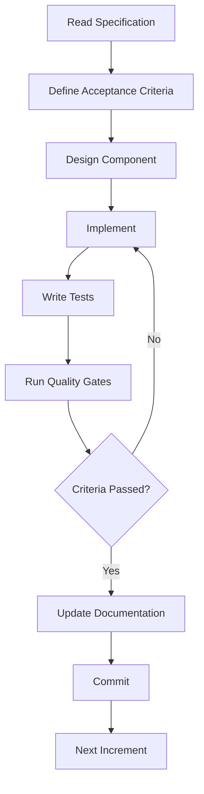
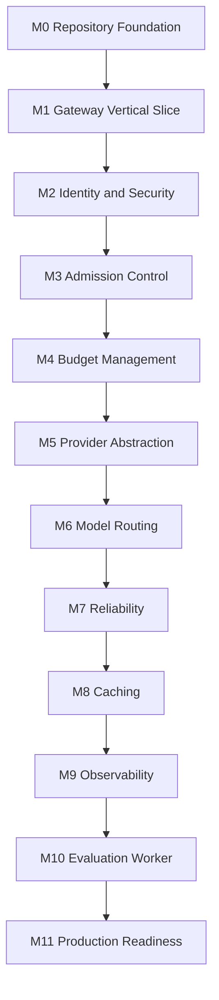

# LLM Gateway — Implementation Build Plan

**File:** `docs/build-plan.md`  
**Version:** 1.0  
**Status:** Draft  
**Project:** `llm-gateway`  
**Implementation:** Rust + Python  
**Architecture:** Clean Architecture  
**Development Method:** Specification-Driven Development

---

# 1. Purpose

This document defines the implementation roadmap for `llm-gateway`.

It translates the architecture, domain, security, API, and operational specifications into incremental engineering milestones.

The implementation must demonstrate:

- Clean Architecture in Rust.
- Provider-independent inference.
- Secure multi-tenant access.
- Intelligent model routing.
- Distributed rate limiting and concurrency control.
- Financially correct budget management.
- Provider reliability and fallback.
- Exact and semantic caching.
- Distributed observability.
- Automated model evaluation.
- Reproducible deployment.

The project will be developed incrementally. Each milestone must leave the system in a working, testable state.

# 2. Implementation Principles

## 2.1 Specification-Driven Development

Follow this development loop:



Do not implement a feature before its responsibilities, interfaces, invariants, and acceptance criteria are understood.

## 2.2 Incremental Architecture

- Start with a small but properly layered Rust workspace.
- Add crates when they represent meaningful dependency or ownership boundaries.
- Avoid creating a crate for every individual class or logical function.
- Keep provider-specific behavior outside the domain.
- Keep financial invariants in the domain and application layers.
- Keep external infrastructure behind interfaces.
- Introduce distributed infrastructure only when its responsibilities are clear.

## 2.3 Quality Gates

Every implementation step must satisfy:

1. Compilation.
2. Formatting and linting.
3. Relevant unit tests.
4. Relevant integration tests.
5. Architecture boundary checks where applicable.
6. Documentation updates.
7. Git commit.

# 3. Technology Stack

| Area | Technology |
|---|---|
| Language | Rust |
| Async runtime | Tokio |
| HTTP framework | Axum |
| HTTP client | Reqwest |
| Serialization | Serde |
| Database | PostgreSQL |
| Database access | SQLx |
| Cache and coordination | Redis |
| Event transport | Redis Streams initially |
| API documentation | OpenAPI 3.1 |
| Authentication | Virtual API keys, JWT/OIDC for administration |
| Telemetry | OpenTelemetry |
| Instrumentation | `tracing` |
| Metrics | Prometheus |
| Dashboards | Grafana |
| Trace backend | Tempo or Jaeger |
| LLM observability | Langfuse |
| Evaluation worker | Python |
| Evaluation | DeepEval, RAGAS, custom evaluators |
| Python environment | uv |
| Containerization | Docker |
| Local orchestration | Docker Compose |
| CI/CD | GitHub Actions |
| Load testing | k6 |
| Rust testing | cargo test, proptest, mockall |
| Python testing | pytest |

Use pinned dependency versions and maintain `Cargo.lock` and `uv.lock`.

# 4. Implementation Roadmap

<text weight="medium" color="secondary" size="xs">12 MILESTONES · DEPENDENCY-AWARE DELIVERY</text>

| Milestone | Focus | Outcome |
|---|---|---|
| M0 | Repository foundation | Buildable Rust workspace |
| M1 | Gateway vertical slice | First working inference API |
| M2 | Identity and security | Secure multi-tenant access |
| M3 | Admission control | Rate limiting and concurrency |
| M4 | Budget management | Financial reservations and accounting |
| M5 | Provider abstraction | Multiple provider integrations |
| M6 | Model routing | Policy-driven model selection |
| M7 | Reliability | Retry, circuit breaker, fallback |
| M8 | Cache | Exact cache and semantic cache foundation |
| M9 | Observability | Distributed traces, metrics, events |
| M10 | Evaluation | Python evaluation worker |
| M11 | Production readiness | Deployment, performance, recovery |

The milestones describe implementation order, not necessarily calendar duration. Actual estimates should be established after the initial repository and infrastructure work.

# 5. Milestone 0 — Repository Foundation

**Objective:** Establish a reproducible Rust workspace and development environment.

## Step 0.1 — Initialize Repository

Create:

```text
llm-gateway/
├── Cargo.toml
├── Cargo.lock
├── rust-toolchain.toml
├── .gitignore
├── .dockerignore
├── .env.example
├── README.md
├── LICENSE
├── CONTRIBUTING.md
├── LOG.md
├── crates/
├── services/
├── config/
├── migrations/
├── tests/
├── evals/
├── deploy/
└── docs/
```

Acceptance criteria:

- Rust workspace initializes.
- Toolchain is pinned.
- Git ignores secrets and build artifacts.
- Repository documentation exists.
- Existing specification documents are committed.

Suggested commit:

```bash
git add .
git commit -m "llm-gateway: initialize project repository"
```

## Step 0.2 — Configure Rust Workspace

Create the initial crates:

```text
crates/
├── gateway-api/
├── gateway-core/
└── shared-kernel/
```

Responsibilities:

| Crate | Responsibility |
|---|---|
| `gateway-api` | Axum application and HTTP boundary |
| `gateway-core` | Application use cases and orchestration |
| `shared-kernel` | Shared identifiers and common domain primitives |

Do not create every future crate immediately. Extract modules into independent crates when their boundaries and dependencies are established.

Acceptance criteria:

- Workspace compiles.
- Dependencies are centralized where practical.
- Application starts.
- Basic health endpoint works.

Suggested commit:

```bash
git add Cargo.toml Cargo.lock rust-toolchain.toml crates/
git commit -m "llm-gateway: establish Rust workspace architecture"
```

## Step 0.3 — Configure Development Tooling

Add:

- Rust formatting.
- Clippy.
- Unit-test commands.
- Pre-commit or equivalent local validation.
- GitHub Actions baseline.
- Environment configuration loading.

Acceptance criteria:

- CI runs formatting, linting, and tests.
- No secrets are committed.
- A developer can build the project using documented commands.

Suggested commit:

```bash
git add .github/ .gitignore .env.example
git commit -m "llm-gateway: configure development tooling and CI"
```

# 6. Milestone 1 — Gateway Vertical Slice

**Objective:** Deliver the first end-to-end inference request through the gateway.

Start with a single mock provider. Do not begin with complex routing or distributed infrastructure.

## Step 1.1 — Define Core Domain Types

Implement:

- `TenantId`
- `ProjectId`
- `RequestId`
- `ExecutionId`
- `ProviderId`
- `ModelId`
- `InferenceRequest`
- `InferenceResponse`
- `TokenUsage`
- `GatewayError`

Acceptance criteria:

- Domain types are independent of Axum and SQLx.
- Identifiers use explicit types.
- Serialization behavior is defined at appropriate boundaries.
- Domain unit tests pass.

Suggested commit:

```bash
git add crates/
git commit -m "llm-gateway: define core inference domain types"
```

## Step 1.2 — Implement Application Use Case

Implement the first `ExecuteInference` use case.

Initial responsibilities:

1. Accept normalized inference input.
2. Resolve a configured mock provider.
3. Execute the request.
4. Normalize the result.
5. Return a domain response.

Acceptance criteria:

- Application orchestration is independent of HTTP handlers.
- Provider execution is behind an interface.
- Mock provider tests pass.

Suggested commit:

```bash
git add crates/
git commit -m "llm-gateway: implement inference application use case"
```

## Step 1.3 — Implement HTTP API

Implement:

```http
GET /health/live
GET /health/ready
GET /v1/models
POST /v1/chat/completions
```

Initial API behavior:

- JSON request validation.
- Basic error response.
- Request ID generation.
- Mock provider execution.

Acceptance criteria:

- API contract tests pass.
- OpenAPI document reflects implementation.
- Invalid requests return predictable errors.

Suggested commit:

```bash
git add crates/ docs/
git commit -m "llm-gateway: implement initial inference API"
```

## Step 1.4 — Add Mock Provider

Implement deterministic mock responses and error scenarios.

Support:

- Success.
- Invalid request.
- Rate limiting.
- Provider unavailable.
- Timeout.
- Malformed response.

Acceptance criteria:

- No external provider credentials are needed for tests.
- Provider behavior is deterministic.
- Failure scenarios are reproducible.

Suggested commit:

```bash
git add crates/ tests/
git commit -m "llm-gateway: add deterministic mock provider"
```

<badge color="success">Milestone 1 exit criteria</badge>

A client can submit an inference request to the gateway and receive a normalized response from the mock provider.

# 7. Milestone 2 — Identity and Security

**Objective:** Introduce secure access control and tenant isolation before enabling real provider execution.

## Step 2.1 — Implement Identity Domain

Create or extract:

```text
crates/
├── identity/
└── authorization/
```

Implement:

- Virtual API key entity.
- API key generation.
- API key verification.
- Key expiration.
- Key revocation.
- Key rotation.
- Tenant and project association.

Acceptance criteria:

- Raw keys are returned only when created or rotated.
- Stored values are cryptographic hashes or keyed hashes.
- Revoked keys cannot authenticate.

Suggested commit:

```bash
git add crates/
git commit -m "llm-gateway: implement virtual API key identity"
```

## Step 2.2 — Implement Authorization

Implement:

- Tenant ownership checks.
- Project permissions.
- Role-based access control.
- Deny-by-default behavior.
- Authorization middleware or application boundary enforcement.

Acceptance criteria:

- Unauthorized requests are rejected.
- Cross-tenant access tests pass.
- Administrative permissions are separate from inference permissions.

Suggested commit:

```bash
git add crates/ tests/
git commit -m "llm-gateway: implement tenant authorization and RBAC"
```

## Step 2.3 — Add PostgreSQL Persistence

Implement:

- Database connection management.
- SQLx repositories.
- Initial migrations.
- Tenant and project persistence.
- API key hash persistence.
- Audit event persistence.

Acceptance criteria:

- Migrations execute successfully.
- Repository integration tests pass.
- Tenant ownership constraints are enforced.
- Secrets are never stored as plaintext API keys.

Suggested commit:

```bash
git add crates/ migrations/
git commit -m "llm-gateway: add PostgreSQL identity persistence"
```

## Step 2.4 — Implement Secret Management

Implement:

- `SecretProvider` abstraction.
- Local development secret source.
- Provider credential references.
- Secret-safe error and logging behavior.

Acceptance criteria:

- Provider credentials are never stored in ordinary model configuration.
- Secrets are not exposed in debug output.
- Missing secrets prevent provider execution.

Suggested commit:

```bash
git add crates/ docs/
git commit -m "llm-gateway: implement secret management abstraction"
```

# 8. Milestone 3 — Admission Control

**Objective:** Protect gateway capacity and provider quotas.

## Step 3.1 — Implement Request Validation

Implement:

- Request size limits.
- Message validation.
- Parameter validation.
- Model input validation.
- Context-size prechecks where model metadata is available.

Acceptance criteria:

- Malformed and oversized requests are rejected before provider execution.
- Validation errors are stable and documented.

Suggested commit:

```bash
git add crates/ tests/
git commit -m "llm-gateway: implement inference request validation"
```

## Step 3.2 — Implement Rate Limiting

Create or extract the rate-limiter component.

Implement:

- Token Bucket.
- Request quotas.
- Token quotas.
- API key limits.
- Project and tenant limits.
- Provider-specific quotas.

Acceptance criteria:

- Redis operations are atomic.
- Limits work across multiple gateway instances.
- Redis failure behavior follows the documented policy.

Suggested commit:

```bash
git add crates/ tests/
git commit -m "llm-gateway: implement distributed rate limiting"
```

## Step 3.3 — Implement Concurrency Management

Implement:

- Global concurrency limit.
- Tenant concurrency limit.
- Project concurrency limit.
- Provider concurrency limit.
- Permit leases.
- Permit release.
- Recovery after worker or gateway failure.

Acceptance criteria:

- Active execution limits are enforced.
- Permits are not permanently leaked.
- Multiple gateway instances respect shared limits.

Suggested commit:

```bash
git add crates/ tests/
git commit -m "llm-gateway: implement distributed concurrency control"
```

# 9. Milestone 4 — Budget and Usage Accounting

**Objective:** Ensure financial admission and accounting are correct.

## Step 4.1 — Implement Budget Domain

Implement:

- Budget account.
- Budget period.
- Budget limit.
- Budget reservation.
- Reservation state transitions.
- Budget hierarchy.

Acceptance criteria:

- Available budget is calculated correctly.
- Invalid state transitions are rejected.
- Monetary values use decimal arithmetic.

Suggested commit:

```bash
git add crates/
git commit -m "llm-gateway: implement budget domain model"
```

## Step 4.2 — Implement Pricing Registry

Implement:

- Model pricing.
- Input token price.
- Output token price.
- Cached token pricing where applicable.
- Pricing version.
- Effective dates.
- Unknown pricing behavior.

Acceptance criteria:

- Cost estimates use the correct pricing version.
- Unknown pricing is never treated as zero.
- Historical usage remains attributable to the pricing version used.

Suggested commit:

```bash
git add crates/ migrations/
git commit -m "llm-gateway: implement model pricing registry"
```

## Step 4.3 — Implement Atomic Reservations

Implement:

- Pre-execution cost estimation.
- Reservation creation.
- Hierarchical budget locking.
- Idempotency.
- Reservation expiration and recovery.

Acceptance criteria:

- Concurrent reservations cannot exceed configured available budget.
- Reservation failures prevent provider execution.
- Recovery handles incomplete reservations.

Suggested commit:

```bash
git add crates/ tests/
git commit -m "llm-gateway: implement atomic budget reservations"
```

## Step 4.4 — Implement Usage Settlement and Ledger

Implement:

- Provider usage normalization.
- Actual cost calculation.
- Idempotent settlement.
- Append-only financial ledger.
- Reconciliation workflow.
- Outbox events.

Acceptance criteria:

- Duplicate settlement cannot duplicate financial entries.
- Actual cost is recorded even when it exceeds the reservation.
- Unknown outcomes are represented explicitly.
- Financial records remain auditable.

Suggested commit:

```bash
git add crates/ migrations/ tests/
git commit -m "llm-gateway: implement usage settlement and financial ledger"
```

# 10. Milestone 5 — Provider Abstraction

**Objective:** Support real LLM providers through a consistent interface.

## Step 5.1 — Define Provider Contract

Implement:

- Provider interface.
- Canonical request.
- Canonical response.
- Normalized usage.
- Normalized error.
- Capability metadata.
- Streaming event types.

Acceptance criteria:

- Provider-specific types do not leak into application domain contracts.
- Mock provider implements the same interface.
- Provider contract tests pass.

Suggested commit:

```bash
git add crates/
git commit -m "llm-gateway: define provider adapter contracts"
```

## Step 5.2 — Implement OpenAI Adapter

Implement:

- Authentication.
- Chat completion requests.
- Response normalization.
- Usage extraction.
- Streaming.
- Error mapping.
- Timeouts and cancellation.

Acceptance criteria:

- Contract tests pass.
- Credential retrieval uses the secret abstraction.
- Live tests use dedicated test credentials and controlled budgets.

Suggested commit:

```bash
git add crates/ tests/
git commit -m "llm-gateway: add OpenAI provider adapter"
```

## Step 5.3 — Implement Anthropic Adapter

Implement the equivalent provider functionality, including provider-specific message and streaming normalization.

Suggested commit:

```bash
git add crates/ tests/
git commit -m "llm-gateway: add Anthropic provider adapter"
```

## Step 5.4 — Implement OpenAI-Compatible Adapter

Support configurable compatible endpoints for services such as:

- vLLM.
- Ollama.
- LocalAI.

Acceptance criteria:

- Endpoint configuration is validated.
- SSRF protections are enforced.
- Provider capabilities are not assumed without verification.

Suggested commit:

```bash
git add crates/ tests/
git commit -m "llm-gateway: add OpenAI-compatible provider adapter"
```

## Step 5.5 — Implement Provider Registry

Implement:

- Provider registration.
- Model registration.
- Provider activation and deactivation.
- Model capability metadata.
- Configuration versioning.

Suggested commit:

```bash
git add crates/ migrations/
git commit -m "llm-gateway: implement provider and model registry"
```

Gemini integration can be added as a subsequent adapter using the same contract, once its supported capabilities and API requirements are defined.

# 11. Milestone 6 — Model Routing

**Objective:** Select the lowest-cost eligible model that satisfies mandatory quality, capability, security, reliability, and budget constraints.

## Step 6.1 — Implement Model Capability Matching

Implement:

- Text.
- Streaming.
- Tool calling.
- Structured output.
- Vision.
- Audio.
- Embeddings.
- Context-window limits.

Acceptance criteria:

- Unsupported capabilities exclude a candidate.
- Context constraints are enforced.
- Model metadata is versioned.

Suggested commit:

```bash
git add crates/ tests/
git commit -m "llm-gateway: implement model capability matching"
```

## Step 6.2 — Implement Routing Policy Evaluation

Implement:

- Tenant policy.
- Model restrictions.
- Data residency.
- Security requirements.
- Quality requirements.
- Budget constraints.

Acceptance criteria:

- Mandatory constraints are applied before ranking.
- No ineligible model can be selected.
- Policy evaluation is independently testable.

Suggested commit:

```bash
git add crates/ tests/
git commit -m "llm-gateway: implement routing policy evaluation"
```

## Step 6.3 — Implement Candidate Ranking

Implement strategies:

- Explicit model.
- Cheapest eligible.
- Lowest latency.
- Quality first.
- Balanced routing.

Acceptance criteria:

- Ranking uses eligible candidates only.
- Pricing and quality evidence are versioned.
- Routing decisions contain an explanation.

Suggested commit:

```bash
git add crates/ tests/
git commit -m "llm-gateway: implement intelligent model routing"
```

## Step 6.4 — Integrate Router with Inference Workflow

Replace the initial mock-only provider resolution with the model registry and routing engine.

Acceptance criteria:

- Inference uses routing decisions.
- Explicit model selection is enforced.
- No eligible candidate produces a controlled error.
- Routing decisions are observable.

Suggested commit:

```bash
git add crates/ tests/
git commit -m "llm-gateway: integrate model router into inference pipeline"
```

# 12. Milestone 7 — Reliability Engineering

**Objective:** Protect inference execution from provider failures.

## Step 7.1 — Implement Failure Classification

Classify:

- Authentication errors.
- Invalid requests.
- Provider rate limiting.
- Context overflow.
- Timeouts.
- Connection failures.
- Provider outages.
- Server errors.
- Cancellation.
- Unknown outcomes.

Acceptance criteria:

- Retryability is explicit.
- Permanent failures are not retried.
- Classification is tested.

Suggested commit:

```bash
git add crates/ tests/
git commit -m "llm-gateway: implement provider failure classification"
```

## Step 7.2 — Implement Retry Engine

Implement:

- Bounded attempts.
- Exponential backoff.
- Jitter.
- Retry-After.
- Overall deadlines.
- Retry budget.

Suggested commit:

```bash
git add crates/ tests/
git commit -m "llm-gateway: implement bounded provider retries"
```

## Step 7.3 — Implement Circuit Breaker

Implement:

- Closed.
- Open.
- Half-Open.
- Rolling failure windows.
- Probe control.
- Recovery.

Suggested commit:

```bash
git add crates/ tests/
git commit -m "llm-gateway: implement provider circuit breaker"
```

## Step 7.4 — Implement Fallback

Implement:

- Alternative candidate selection.
- Policy re-evaluation.
- Budget re-evaluation.
- Provider health checks.
- Streaming fallback restrictions.

Acceptance criteria:

- Fallback never bypasses authorization or mandatory constraints.
- Incremental budget reservation is safe.
- No transparent fallback after delivered stream output.

Suggested commit:

```bash
git add crates/ tests/
git commit -m "llm-gateway: implement policy-aware provider fallback"
```

# 13. Milestone 8 — Caching

**Objective:** Reduce repeated provider calls while preserving response correctness and tenant isolation.

## Step 8.1 — Implement Exact Cache

Implement:

- Canonical request normalization.
- Cache fingerprint.
- Tenant-aware keys.
- TTL.
- Cache eligibility.
- Cache invalidation.

Acceptance criteria:

- Identical eligible requests can hit the cache.
- Response-affecting differences produce different keys.
- Cache entries cannot cross tenant boundaries.

Suggested commit:

```bash
git add crates/ tests/
git commit -m "llm-gateway: implement tenant-isolated exact cache"
```

## Step 8.2 — Integrate Cache with Inference

Define cache lookup and write positions in the inference workflow.

Acceptance criteria:

- Authorization and required policies execute before cache access.
- Failed or incomplete responses are not cached.
- Cache hits are observable.
- Cache hits do not create duplicate provider charges.

Suggested commit:

```bash
git add crates/ tests/
git commit -m "llm-gateway: integrate exact cache into inference pipeline"
```

## Step 8.3 — Implement Semantic Cache Foundation

Only after exact cache correctness is established:

- Embedding generation abstraction.
- Vector retrieval interface.
- Similarity thresholds.
- Authorization and freshness validation.
- False-positive evaluation.
- Semantic cache observability.

Acceptance criteria:

- Semantic caching is disabled by default.
- Evaluation demonstrates acceptable precision for the intended task.
- False-positive handling is tested.

Suggested commit:

```bash
git add crates/ tests/ evals/
git commit -m "llm-gateway: add evaluated semantic cache foundation"
```

# 14. Milestone 9 — Observability

**Objective:** Make every inference execution traceable and measurable.

## Step 9.1 — Add Structured Logging

Implement:

- Structured JSON logs.
- Correlation IDs.
- Execution IDs.
- Provider attempt IDs.
- Error classification.
- Sensitive-data redaction.

Suggested commit:

```bash
git add crates/
git commit -m "llm-gateway: implement structured logging"
```

## Step 9.2 — Add Distributed Tracing

Implement:

- OpenTelemetry SDK.
- W3C Trace Context.
- Inference spans.
- Provider attempt spans.
- Routing spans.
- Budget spans.
- Cache spans.
- Retry and fallback spans.

Suggested commit:

```bash
git add crates/
git commit -m "llm-gateway: implement distributed tracing"
```

## Step 9.3 — Add Metrics

Implement:

- Request volume.
- Gateway-added latency.
- Provider latency.
- Token usage.
- Cost.
- Budget rejection.
- Rate-limit rejection.
- Cache hit rate.
- Retry and fallback metrics.

Suggested commit:

```bash
git add crates/
git commit -m "llm-gateway: implement inference and cost metrics"
```

## Step 9.4 — Add Asynchronous Event Pipeline

Implement:

- Transactional outbox.
- Event publisher.
- Event schema.
- Consumer groups.
- Idempotent event processing.
- Retry and recovery.

Acceptance criteria:

- Financial events are not dependent on telemetry sampling.
- Duplicate event delivery does not duplicate accounting.
- Event publication failures are recoverable.

Suggested commit:

```bash
git add crates/ migrations/ tests/
git commit -m "llm-gateway: implement durable asynchronous event pipeline"
```

# 15. Milestone 10 — Evaluation Worker

**Objective:** Evaluate model quality independently of synchronous inference.

## Step 10.1 — Initialize Python Worker

Create:

```text
services/evaluation-worker/
├── pyproject.toml
├── uv.lock
├── src/
│   └── evaluation_worker/
│       ├── __init__.py
│       ├── consumer.py
│       ├── datasets/
│       ├── evaluators/
│       ├── metrics/
│       ├── models/
│       └── reporting/
└── tests/
```

Acceptance criteria:

- Python environment is reproducible.
- Worker starts independently.
- Unit tests pass.
- Configuration and secrets are handled safely.

Suggested commit:

```bash
git add services/evaluation-worker/
git commit -m "llm-gateway: initialize Python evaluation worker"
```

## Step 10.2 — Implement Dataset Management

Implement:

- Versioned datasets.
- JSONL support.
- Dataset validation.
- Test case metadata.
- Dataset selection.

Suggested commit:

```bash
git add services/evaluation-worker/ evals/
git commit -m "llm-gateway: implement versioned evaluation datasets"
```

## Step 10.3 — Implement Deterministic Evaluators

Implement:

- Schema compliance.
- Exact matching where appropriate.
- Token and cost metrics.
- Latency metrics.
- Custom deterministic checks.

Suggested commit:

```bash
git add services/evaluation-worker/
git commit -m "llm-gateway: implement deterministic evaluation metrics"
```

## Step 10.4 — Implement LLM-Based Evaluators

Integrate:

- DeepEval.
- RAGAS where applicable.
- Custom LLM-as-judge evaluators.

Include:

- Judge configuration.
- Version tracking.
- Calibration datasets.
- Failure handling.
- Evaluation budgets.

Suggested commit:

```bash
git add services/evaluation-worker/ evals/
git commit -m "llm-gateway: implement LLM-based quality evaluation"
```

## Step 10.5 — Implement Evaluation Reporting

Implement:

- Evaluation runs.
- Evaluation results.
- Quality thresholds.
- Regression detection.
- Model comparison reports.

Acceptance criteria:

- Evaluation results are traceable to model, prompt, dataset, and evaluator versions.
- Failed or incomplete evaluations cannot silently pass.
- Results are available to authorized users.

Suggested commit:

```bash
git add services/evaluation-worker/ evals/
git commit -m "llm-gateway: implement model evaluation reporting"
```

# 16. Milestone 11 — Production Readiness

**Objective:** Validate deployment, security, reliability, performance, and operational recovery.

## Step 11.1 — Dockerize Services

Implement:

- Gateway Dockerfile.
- Evaluation worker Dockerfile.
- Multi-stage builds.
- Non-root runtime.
- Image scanning.

Suggested commit:

```bash
git add Dockerfile Dockerfile.worker .dockerignore
git commit -m "llm-gateway: containerize gateway and evaluation worker"
```

## Step 11.2 — Implement Docker Compose

Deploy:

- Gateway.
- Evaluation worker.
- PostgreSQL.
- Redis.
- Event transport.
- OpenTelemetry Collector.
- Prometheus.
- Grafana.

Add optional observability services separately where practical.

Acceptance criteria:

- Local environment starts reproducibly.
- Health checks work.
- Services communicate through private networks.
- Persistent data uses named volumes.

Suggested commit:

```bash
git add docker-compose.yml deploy/
git commit -m "llm-gateway: add local infrastructure deployment"
```

## Step 11.3 — Complete Security Hardening

Implement:

- Security scanning.
- Container hardening.
- Secret rotation.
- Network restrictions.
- SSRF protections.
- Audit logging.
- Security test automation.

Suggested commit:

```bash
git add crates/ deploy/ .github/
git commit -m "llm-gateway: harden deployment security"
```

## Step 11.4 — Performance and Load Testing

Use k6 and Rust benchmarks.

Test:

- Single-request latency.
- Gateway overhead.
- Cache lookup.
- Routing.
- Database contention.
- Redis admission.
- Concurrent inference.
- Streaming.
- Sustained workloads.

Acceptance criteria:

- Results are repeatable.
- Workload and environment are documented.
- Bottlenecks are identified.
- Performance targets are measured rather than assumed.

Suggested commit:

```bash
git add tests/ evals/ docs/
git commit -m "llm-gateway: add performance and load benchmarks"
```

## Step 11.5 — Reliability and Recovery Testing

Validate:

- Provider outage.
- Redis outage.
- PostgreSQL outage.
- Event transport outage.
- Gateway process crash.
- Worker crash.
- Backup restoration.
- Financial reconciliation.
- Deployment rollback.

Suggested commit:

```bash
git add tests/ deploy/ docs/
git commit -m "llm-gateway: validate recovery and resilience procedures"
```

## Step 11.6 — Release Preparation

Complete:

- README.
- Architecture diagrams.
- API documentation.
- Deployment guide.
- Operational runbooks.
- Security documentation.
- Benchmark reports.
- Evaluation reports.
- Release notes.
- Demonstration workflows.

Suggested commit:

```bash
git add .
git commit -m "llm-gateway: prepare initial portfolio release"
```

# 17. End-to-End Delivery Sequence

The critical dependency path is:



Some work can proceed in parallel after its dependencies are established. For example, telemetry foundations and test automation can be developed incrementally throughout the project rather than waiting until M9.

# 18. Cross-Milestone Engineering Requirements

These requirements apply throughout development.

## 18.1 Testing

- Unit tests for domain logic.
- Integration tests for external dependencies.
- Contract tests for providers.
- Security tests for protected boundaries.
- Regression tests for resolved defects.
- Load tests for performance-sensitive changes.

## 18.2 Documentation

Update the relevant specification whenever implementation decisions change.

Do not allow the implementation and specification to drift silently.

## 18.3 Observability

Add appropriate instrumentation as components are introduced.

Do not postpone all observability until the final milestone.

## 18.4 Security

Security controls must be implemented before exposing the corresponding functionality.

Do not build an unrestricted provider proxy and plan to add tenant isolation later.

## 18.5 Financial Correctness

Budget reservation and usage settlement must be validated before real production inference is enabled.

## 18.6 Git Discipline

Use small, meaningful commits.

Every suggested commit message must include `llm-gateway`.

# 19. Milestone Exit Criteria

| Milestone | Exit Criteria |
|---|---|
| M0 | Workspace builds and CI runs |
| M1 | Mock-backed inference API works |
| M2 | API key authentication and tenant authorization work |
| M3 | Distributed rate limiting and concurrency work |
| M4 | Atomic budget reservation and idempotent settlement work |
| M5 | Multiple provider adapters satisfy common contracts |
| M6 | Policy-driven routing selects eligible models |
| M7 | Retry, circuit breaker, and fallback work |
| M8 | Exact cache works with tenant isolation |
| M9 | Inference executions are traceable and measurable |
| M10 | Evaluation worker produces versioned evaluation results |
| M11 | Deployment, security, recovery, and performance gates pass |

# 20. Portfolio Demonstration Requirements

The finished project should demonstrate more than a successful API request.

Prepare the following demonstrations:

| Demo | What It Proves |
|---|---|
| Provider-independent inference | Adapter architecture |
| Multi-provider routing | Routing and capability matching |
| Provider failure and fallback | Reliability engineering |
| Budget exhaustion | Financial governance |
| Concurrent budget requests | Transactional correctness |
| Tenant isolation | Security architecture |
| Rate-limit enforcement | Distributed admission control |
| Exact cache hit | Cost and latency optimization |
| Trace visualization | Observability |
| Model quality comparison | Evaluation engineering |
| Load test report | Performance engineering |
| Docker Compose deployment | Infrastructure engineering |

The portfolio should include measured results and reproducible instructions. Do not claim savings, availability, throughput, or latency improvements without benchmark evidence.

# 21. Final Project Completion Criteria

The initial portfolio release is complete when:

- [ ] All milestones have reached their agreed exit criteria.
- [ ] All public APIs have documented contracts.
- [ ] Multiple providers are integrated.
- [ ] Routing decisions are explainable.
- [ ] Authentication and tenant isolation are enforced.
- [ ] Distributed rate limiting and concurrency control work.
- [ ] Budget reservations and settlement are correct.
- [ ] Retry and fallback behavior is tested.
- [ ] Exact cache works.
- [ ] Distributed tracing and metrics are available.
- [ ] Evaluation worker produces versioned results.
- [ ] Security and dependency checks pass.
- [ ] Docker Compose deployment works.
- [ ] Performance benchmarks are published.
- [ ] Recovery procedures are tested.
- [ ] README and architecture documentation are complete.
- [ ] Portfolio demonstrations are reproducible.

---

# 22. Related Documents

- `docs/product.md`
- `docs/architecture.md`
- `docs/domain-model.md`
- `docs/data-model.md`
- `docs/api-contracts.md`
- `docs/security.md`
- `docs/routing-policy.md`
- `docs/provider-integration.md`
- `docs/reliability.md`
- `docs/rate-limiting-and-concurrency.md`
- `docs/budget-and-usage-accounting.md`
- `docs/observability.md`
- `docs/evaluation-strategy.md`
- `docs/cache-strategy.md`
- `docs/test-strategy.md`
- `docs/deployment.md`
- `docs/definition-of-done.md`


