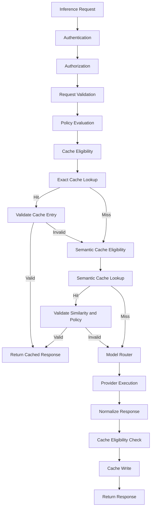
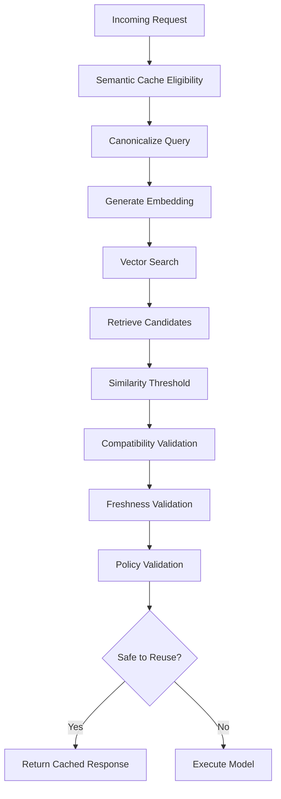

# LLM Gateway — Cache Strategy

**File:** `docs/cache-strategy.md`  
**Version:** 1.0  
**Status:** Draft  
**Project:** `llm-gateway`  
**Implementation:** Rust  
**Architecture:** Clean Architecture

---

# 1. Purpose

This document defines the caching architecture for `llm-gateway`.

Caching reduces:

- Inference costs.
- Provider API calls.
- Response latency.
- Provider rate-limit pressure.
- Repeated computation.

However, caching LLM responses introduces risks that traditional application caching does not fully address:

- Semantically similar but meaningfully different requests.
- Cross-tenant data leakage.
- Model-version incompatibility.
- Prompt and configuration changes.
- Stale responses.
- Privacy and data retention violations.
- Incorrect reuse of responses generated under different authorization contexts.

The caching strategy must optimize performance without compromising correctness, isolation, or security.

## 1.1 Objectives

| ID | Objective | Description |
|---|---|---|
| CACHE-001 | Exact caching | Reuse identical eligible requests |
| CACHE-002 | Semantic caching | Reuse sufficiently similar requests when permitted |
| CACHE-003 | Tenant isolation | Prevent cross-tenant cache leakage |
| CACHE-004 | Cost reduction | Reduce unnecessary provider executions |
| CACHE-005 | Latency reduction | Reduce response time |
| CACHE-006 | Cache correctness | Prevent incompatible response reuse |
| CACHE-007 | Invalidation | Support expiration and explicit invalidation |
| CACHE-008 | Security | Protect sensitive content and metadata |
| CACHE-009 | Observability | Measure cache performance |
| CACHE-010 | Configurability | Allow policy-driven cache behavior |

---

# 2. Cache Architecture

The gateway supports two cache mechanisms:

1. Exact-response cache.
2. Semantic-response cache.

They have different correctness requirements and should be implemented independently.



## 2.1 Cache Placement

The cache lookup must happen after authentication, authorization, and required policy checks.

It must not bypass:

- Tenant authorization.
- Project restrictions.
- Model access policies.
- Data residency requirements.
- Safety restrictions.
- Request validation.
- Applicable rate limits and budgets.

A cache hit avoids provider execution, but it is still a gateway request and must remain subject to the appropriate admission and accounting policies.

---

# 3. Cache Types

## 3.1 Exact-Response Cache

An exact cache hit requires a compatible request fingerprint.

Example:

```text
Request A:
"What is the difference between TCP and UDP?"

Request B:
"What is the difference between TCP and UDP?"

Result:
Potential exact cache hit.
```

The cache must consider all response-affecting request parameters.

These may include:

- Messages and their ordering.
- Model identity and version.
- Temperature.
- Top-p.
- Maximum output tokens.
- Response format.
- Tool definitions.
- Tool-choice configuration.
- System prompt version.
- Provider-specific options.
- Cache-relevant metadata.

A request that differs in a response-affecting field must not accidentally reuse an incompatible response.

## 3.2 Semantic Cache

Semantic caching attempts to identify requests with similar meaning.

Example:

```text
Request A:
"What is the capital of Canada?"

Request B:
"Which city is Canada's capital?"

Potential semantic cache hit.
```

Semantic similarity does not guarantee equivalent intent.

For example:

```text
Request A:
"What is the current price of this product?"

Request B:
"What was the price of this product last year?"
```

These requests may have high semantic similarity but require different answers.

Semantic caching must therefore be conservative and policy-controlled.

## 3.3 Initial Release Recommendation

Implement exact-response caching first.

Introduce semantic caching only after:

- Exact-cache correctness is established.
- Tenant isolation is tested.
- Cache metrics are available.
- Evaluation datasets cover semantic false positives.
- Data governance requirements are implemented.

---

# 4. Exact Cache Design

## 4.1 Cache Key

Use a cryptographic hash of a canonical request representation.

Conceptual formula:

\[
K = SHA256(Normalize(Request))
\]

The canonical representation must include:

- Tenant identifier.
- Project identifier.
- Cache namespace.
- Model identifier and version.
- Prompt/configuration version.
- Generation parameters.
- Messages.
- Tools and response format.
- Relevant policy version.

Example:

```rust
pub struct CacheKeyInput {
    pub tenant_id: String,
    pub project_id: String,
    pub model_id: String,
    pub model_version: Option<String>,
    pub prompt_version: Option<String>,
    pub generation_config: GenerationConfig,
    pub messages: Vec<CanonicalMessage>,
    pub response_format: Option<ResponseFormat>,
}
```

This is a conceptual domain structure, not a final persistence schema.

Canonicalization must be deterministic.

Do not assume JSON object ordering or omitted defaults are equivalent unless normalization explicitly establishes that equivalence.

## 4.2 Cache Key Security

Never use a raw API key as a cache key component.

The cache key should use stable internal identifiers.

Use a keyed hash or HMAC where cache-key confidentiality is required.

Avoid storing sensitive raw request content in cache-key metadata.

## 4.3 Exact Cache Entry

Example:

```json
{
  "cache_entry_id": "cache_123",
  "tenant_id": "tenant_123",
  "project_id": "project_456",
  "cache_type": "exact",
  "cache_key": "hashed-key",
  "model_id": "model_x",
  "model_version": "version_1",
  "prompt_version": "prompt_3",
  "response_reference": "response_123",
  "created_at": "2026-11-03T12:00:00Z",
  "expires_at": "2026-11-03T13:00:00Z",
  "status": "active"
}
```

This is an illustrative structure.

The actual response storage mechanism must enforce encryption, access control, and retention policies.

---

# 5. Semantic Cache Design

Semantic caching uses embeddings or another semantic similarity representation to retrieve candidate responses.

## 5.1 Architecture



## 5.2 Embedding Strategy

Possible implementations:

- Dedicated embedding provider.
- Existing provider embedding model.
- Self-hosted embedding model.

The embedding model and version must be recorded.

Changing the embedding model may require:

- Re-embedding stored entries.
- Creating a new vector namespace.
- Invalidating old semantic entries.
- Running compatibility tests.

## 5.3 Similarity Threshold

Example:

```yaml
cache:
  semantic:
    enabled: false

    similarity_threshold: 0.95

    embedding:
      provider: internal
      model: embedding-model-v1

    max_candidates: 5
```

A threshold of 0.95 is illustrative, not a universal safe threshold.

Thresholds must be calibrated using representative datasets.

Measure:

- True positive rate.
- False positive rate.
- False negative rate.
- Quality impact.
- Cost savings.
- Latency impact.

A false positive means an inappropriate cached answer was returned.

False positives are generally more harmful than false negatives.

## 5.4 Semantic Compatibility Checks

Before returning a semantic cache hit, validate:

- Tenant and project isolation.
- User or authorization scope where relevant.
- Model and task compatibility.
- Prompt version.
- Response format.
- Generation constraints.
- Data freshness.
- Context dependencies.
- Safety policy version.
- Request intent.
- Cache eligibility.

Do not reuse answers for requests involving changing external facts unless freshness is explicitly controlled.

---

# 6. Cache Eligibility

Not every request should be cached.

## 6.1 Default Eligibility

| Request Type | Exact Cache | Semantic Cache |
|---|---|---|
| Stable general knowledge | Allowed by policy | Possible |
| Deterministic transformations | Allowed | Possible |
| Current weather | Only with short freshness policy | Usually disabled |
| Financial market prices | Usually disabled | Disabled |
| Account-specific data | Restricted | Disabled by default |
| Personal information | Restricted | Disabled by default |
| Tool execution | Disabled by default | Disabled |
| Web search results | Freshness-dependent | Usually disabled |
| Structured deterministic output | Allowed if compatible | Restricted |
| Creative generation | Optional | Usually disabled |

## 6.2 Explicit Opt-In

Requests may include a cache preference, subject to platform policy.

Example:

```json
{
  "model": "auto",
  "messages": [
    {
      "role": "user",
      "content": "Explain TCP congestion control."
    }
  ],
  "cache": {
    "mode": "exact",
    "ttl_seconds": 3600
  }
}
```

The client must not be allowed to override platform restrictions.

Supported modes could include:

- `disabled`
- `exact`
- `semantic`
- `auto`

The gateway determines the final permitted mode.

---

# 7. TTL and Invalidation

## 7.1 Time-to-Live

TTL defines how long a cache entry may be reused.

Example:

```yaml
cache:
  exact:
    enabled: true
    default_ttl_seconds: 3600
    maximum_ttl_seconds: 86400

  semantic:
    enabled: false
    default_ttl_seconds: 1800
    maximum_ttl_seconds: 3600
```

TTL should depend on data freshness and task type.

## 7.2 Invalidation Triggers

Invalidate entries when:

- TTL expires.
- Model version changes.
- Prompt version changes.
- Relevant policy changes.
- Tenant requests invalidation.
- Project is disabled.
- Underlying data becomes stale.
- Security incident requires invalidation.
- Cache namespace is rotated.

## 7.3 Invalidation Strategy

Use:

- TTL expiration.
- Namespace versioning.
- Explicit entry deletion.
- Tenant/project-wide invalidation.
- Model or prompt version invalidation.

Namespace versioning can avoid expensive deletion of large groups of entries.

## 7.4 Cache Consistency

The cache is not an authoritative source of business data.

PostgreSQL remains authoritative for:

- Tenant policy.
- Model registry.
- Pricing.
- Cache administration.
- Audit history.

Redis or a vector database may store cache data and retrieval indexes.

---

# 8. Tenant Isolation and Authorization

Tenant isolation is a mandatory invariant.

Every cache entry must be scoped to the correct tenant and project.

The cache lookup must not rely on a hash alone as proof of authorization.

Before returning a response:

1. Authenticate the caller.
2. Resolve tenant and project.
3. Authorize access.
4. Apply current policy.
5. Verify cache namespace.
6. Validate compatibility.
7. Return the cached result only if all checks pass.

Additional isolation may be required for user-specific or role-specific information.

A cache entry created under one user's permissions must not be reused by another user unless the response is demonstrably independent of those permissions.

---

# 9. Cache Security and Privacy

Requirements:

- Encrypt sensitive cache data at rest.
- Protect Redis and vector-store access.
- Do not expose cache contents through administration APIs without authorization.
- Avoid raw prompt content in cache metadata.
- Do not store provider credentials.
- Apply retention and deletion policies.
- Prevent cache poisoning.
- Validate serialized response integrity.
- Restrict semantic-cache data sharing.
- Audit administrative cache operations.

## 9.1 Cache Poisoning Protection

Only cache successful and validated responses.

Do not cache:

- Provider errors.
- Partial responses.
- Untrusted tool outputs without policy validation.
- Malformed responses.
- Responses rejected by safety checks.
- Responses with uncertain execution state.

For high-risk workflows, require additional validation before a response becomes cacheable.

---

# 10. Streaming and Tool Calls

## 10.1 Streaming

Exact caching of streaming responses requires a deliberate design.

Options:

1. Store the complete normalized response after successful completion.
2. Replay the completed response through a compatible streaming interface.
3. Disable caching for streaming requests initially.

Recommended initial implementation:

- Do not serve incomplete cached streams.
- Cache only successfully completed responses.
- Replay cached content only when API semantics remain compatible.
- Preserve usage metadata.
- Clearly indicate cache-hit status.

## 10.2 Tool Calls

Tool execution can create side effects.

Examples:

- Issuing a refund.
- Creating a ticket.
- Updating a customer record.
- Sending a notification.

Never replay cached tool-call results as though the tool executed again.

Default policy:

```yaml
cache:
  tools:
    cache_tool_calls: false
```

Cache pure, deterministic tool results only when the application explicitly defines safe semantics and freshness rules.

---

# 11. Cache Accounting and Cost Attribution

A cache hit avoids a provider call, but it still consumes gateway resources.

Record:

- Cache hit/miss.
- Cache type.
- Cache lookup latency.
- Original model.
- Original provider.
- Original token usage.
- Original inference cost.
- Current request attribution.
- Cache entry age.

## 11.1 Financial Accounting

A cache hit must not create a new provider charge.

It should:

- Record a new gateway request.
- Record cache-hit usage.
- Avoid provider usage charges.
- Apply any configured platform or tenant accounting rules.

Do not confuse estimated avoided cost with actual realized savings.

## 11.2 Cost Avoidance Estimate

\[
Estimated\ Avoided\ Cost =
Expected\ Provider\ Cost\ Without\ Cache
\]

This is a counterfactual estimate.

Its calculation must use:

- Compatible model pricing.
- Expected token usage.
- Applicable provider pricing version.
- Defined cache-hit methodology.

Report estimates separately from actual expenditure.

---

# 12. Cache Storage Architecture

## 12.1 Initial Technology

| Component | Technology | Responsibility |
|---|---|---|
| Exact cache | Redis | Low-latency exact lookups |
| Semantic index | pgvector or Qdrant | Similarity retrieval |
| Cache metadata | PostgreSQL | Administrative and audit metadata |
| Response storage | Redis initially or protected object storage | Cached response payloads |
| Cache events | Redis Streams / outbox | Invalidation and analytics |

Do not introduce a separate vector database before semantic caching requires it.

For an initial implementation, pgvector can reduce operational complexity.

## 12.2 Logical Data Structure

```text
crates/
└── cache-engine/
    └── src/
        ├── lib.rs
        ├── eligibility.rs
        ├── key.rs
        ├── exact/
        │   ├── mod.rs
        │   ├── lookup.rs
        │   └── storage.rs
        ├── semantic/
        │   ├── mod.rs
        │   ├── embedding.rs
        │   ├── search.rs
        │   └── matching.rs
        ├── invalidation.rs
        ├── policy.rs
        └── errors.rs
```

## 12.3 Storage Abstraction

```rust
#[async_trait::async_trait]
pub trait ExactCache: Send + Sync {
    async fn get(
        &self,
        key: &CacheKey,
    ) -> Result<Option<CachedResponse>, CacheError>;

    async fn put(
        &self,
        key: CacheKey,
        response: CachedResponse,
        ttl_seconds: u64,
    ) -> Result<(), CacheError>;

    async fn invalidate(
        &self,
        key: &CacheKey,
    ) -> Result<(), CacheError>;
}
```

Semantic caching should have a separate interface because similarity retrieval and compatibility validation differ from exact lookup.

---

# 13. Failure Handling

Cache failures must not compromise correctness.

| Failure | Behavior |
|---|---|
| Redis unavailable | Cache miss; continue if admission controls permit |
| Redis timeout | Bound lookup time; continue according to policy |
| Vector database unavailable | Disable semantic lookup |
| Embedding provider unavailable | Skip semantic lookup |
| Corrupted cache entry | Reject entry and record error |
| Cache metadata unavailable | Fail closed where authorization or validity cannot be established |
| Invalidation failure | Record pending invalidation and prevent unsafe reuse where required |

A cache failure should generally degrade performance rather than return incorrect data.

Never bypass mandatory security or authorization checks because the cache is unavailable.

---

# 14. Cache Configuration

Example:

```yaml
cache:
  enabled: true

  exact:
    enabled: true
    default_ttl_seconds: 3600
    maximum_ttl_seconds: 86400
    lookup_timeout_ms: 20

  semantic:
    enabled: false
    similarity_threshold: 0.95
    maximum_candidates: 5
    default_ttl_seconds: 1800
    embedding_model: embedding-model-v1

  isolation:
    tenant_scoped: true
    project_scoped: true

  streaming:
    cache_completed_responses_only: true

  tools:
    cache_tool_calls: false

  security:
    cache_sensitive_data: false
    encrypt_payloads: true
```

All settings must be validated at startup and governed by platform policy.

---

# 15. Observability

Expose cache-specific metrics.

| Metric | Type | Description |
|---|---|---|
| `gateway_cache_requests_total` | Counter | Total cache lookups |
| `gateway_cache_hits_total` | Counter | Successful cache hits |
| `gateway_cache_misses_total` | Counter | Cache misses |
| `gateway_cache_lookup_duration_seconds` | Histogram | Lookup latency |
| `gateway_cache_write_errors_total` | Counter | Cache write errors |
| `gateway_cache_invalidations_total` | Counter | Invalidations |
| `gateway_cache_entries_active` | Gauge | Active entries |
| `gateway_semantic_similarity_score` | Histogram | Similarity scores |
| `gateway_semantic_false_positive_total` | Counter | Confirmed incorrect semantic reuse |
| `gateway_cache_estimated_avoided_cost` | Counter | Estimated avoided provider expenditure |

Do not expose tenant IDs or request IDs as unbounded Prometheus labels.

## 15.1 Dashboard

The cache dashboard should show:

- Exact-cache hit ratio.
- Semantic-cache hit ratio.
- Lookup latency.
- Write failures.
- Cache eviction rate.
- Cache entry age.
- Estimated avoided cost.
- Cache quality failures.
- Tenant-level cache utilization through authorized analytics.

---

# 16. Testing Strategy

## Unit Tests

- Canonical request serialization.
- Cache-key generation.
- TTL calculation.
- Cache eligibility.
- Tenant namespace isolation.
- Compatibility validation.
- Invalidation logic.
- Semantic threshold evaluation.

## Integration Tests

- Exact cache hit.
- Exact cache miss.
- Model-version mismatch.
- Prompt-version mismatch.
- Tenant isolation.
- Project isolation.
- Redis outage.
- Vector database outage.
- Cache expiration.
- Cache invalidation.
- Corrupted response payload.
- Streaming response replay.

## Security Tests

- Cross-tenant cache access.
- Cross-project cache access.
- Unauthorized cache administration.
- Cache poisoning.
- Sensitive-data leakage.
- Stale authorization context.
- Semantic false-positive reuse.

## Evaluation Tests

- Semantic-cache precision.
- Semantic-cache recall.
- False-positive rate.
- Quality impact.
- Cost reduction.
- Latency reduction.

Semantic caching must not be enabled for production traffic until its false-positive behavior is measured on representative datasets.

---

# 17. Definition of Done

## Exact Cache

- [ ] Canonical request representation implemented.
- [ ] Deterministic cache keys implemented.
- [ ] Tenant/project isolation enforced.
- [ ] TTL configurable.
- [ ] Model compatibility validated.
- [ ] Prompt version compatibility validated.
- [ ] Cache invalidation implemented.
- [ ] Cache failures handled safely.

## Semantic Cache

- [ ] Embedding interface implemented.
- [ ] Similarity retrieval implemented.
- [ ] Similarity thresholds configurable.
- [ ] Compatibility validation implemented.
- [ ] False-positive evaluation implemented.
- [ ] Data governance enforced.
- [ ] Production enablement requires quality evidence.

## Security and Operations

- [ ] Cache payload protection implemented.
- [ ] Sensitive data excluded by default.
- [ ] Tool-call caching disabled by default.
- [ ] Streaming behavior documented.
- [ ] Cache metrics exposed.
- [ ] Cache dashboard created.
- [ ] Security tests pass.
- [ ] Performance tests pass.

---

# 18. Architectural Decisions

Proposed ADRs:

| ADR | Decision |
|---|---|
| ADR-054 | Implement exact-response caching before semantic caching |
| ADR-055 | Use canonical request fingerprints for exact caching |
| ADR-056 | Enforce tenant and project cache isolation |
| ADR-057 | Disable semantic caching by default initially |
| ADR-058 | Cache only complete, validated responses |
| ADR-059 | Disable tool-call caching by default |
| ADR-060 | Treat cache failure as a performance degradation, not a correctness exception |
| ADR-061 | Use pgvector initially unless scale justifies a dedicated vector store |

Reconcile identifiers with the existing ADR index.

---

# 19. Architectural Invariants

1. Authentication and authorization always precede cache retrieval.
2. Cache keys include all response-affecting parameters.
3. Tenant and project isolation are mandatory.
4. Cache hits must satisfy current policy constraints.
5. Partial or failed responses are not cached.
6. Semantic similarity alone is insufficient for cache reuse.
7. Tool-call caching is disabled by default.
8. Sensitive content is not cached by default.
9. Cache hits do not create provider usage charges.
10. Financial and cache analytics remain distinguishable.
11. Cache invalidation must be auditable.
12. Cache failure must not bypass security controls.

---

# 20. Related Documents

- `docs/architecture.md`
- `docs/domain-model.md`
- `docs/data-model.md`
- `docs/security.md`
- `docs/routing-policy.md`
- `docs/provider-integration.md`
- `docs/reliability.md`
- `docs/observability.md`
- `docs/evaluation-strategy.md`
- `docs/budget-and-usage-accounting.md`
- `docs/deployment.md`


