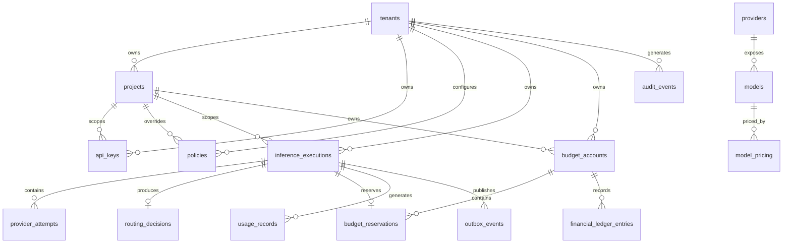

# LLM Gateway — Database and Data Model

**File:** `docs/data-model.md`  
**Version:** 1.0  
**Status:** Draft  
**Database:** PostgreSQL  
**Project:** `llm-gateway`

# 1. Purpose

Define the relational persistence model for the enterprise LLM Gateway.

The database is responsible for authoritative persistence of:

- Tenant and project information.
- API keys and authorization metadata.
- Policies and model registry.
- Provider configuration metadata.
- Inference executions and provider attempts.
- Routing decisions.
- Budget accounts and reservations.
- Usage records and financial ledger entries.
- Audit events.
- Transactional outbox events.
- Evaluation metadata and results.

Redis is used for operational coordination and caching. It is not the authoritative financial database.

# 2. Database Design Principles

1. PostgreSQL is the source of truth for durable business data.
2. Tenant-owned data must have explicit tenant ownership.
3. Financial operations must be transactional.
4. Financial records must use decimal arithmetic.
5. Historical inference decisions must remain auditable.
6. API keys must be stored as hashes, never plaintext.
7. Provider credentials must be stored outside ordinary application tables.
8. Database relationships must enforce referential integrity.
9. Idempotency must be enforced with database constraints.
10. Schema changes must use versioned migrations.
11. Audit and financial history must not be silently overwritten.
12. Database access must be tenant-aware.

# 3. Database Technology

| Component | Technology |
|---|---|
| Database | PostgreSQL |
| Rust database access | SQLx |
| Migration management | SQLx migrations |
| Primary identifiers | UUID |
| Financial amounts | NUMERIC |
| Structured metadata | JSONB |
| Timestamps | TIMESTAMPTZ |
| Operational cache | Redis |
| Vector search | Deferred; pgvector or Qdrant |

Recommended PostgreSQL configuration:

- UTF-8 encoding.
- UTC timestamps.
- Connection pooling.
- Automated backups.
- TLS for remote connections.
- Restricted application database roles.
- Separate migration and runtime database permissions.

# 4. Database Schemas

Use PostgreSQL schemas to organize logical ownership.

```sql
CREATE SCHEMA identity;
CREATE SCHEMA tenancy;
CREATE SCHEMA policy;
CREATE SCHEMA registry;
CREATE SCHEMA inference;
CREATE SCHEMA accounting;
CREATE SCHEMA audit;
CREATE SCHEMA events;
CREATE SCHEMA evaluation;
```

Responsibilities:

| Schema | Ownership |
|---|---|
| `identity` | Users, API keys, roles |
| `tenancy` | Tenants and projects |
| `policy` | Policies and policy versions |
| `registry` | Providers, models, capabilities, pricing |
| `inference` | Requests, executions, attempts, routing |
| `accounting` | Budgets, reservations, usage, ledger |
| `audit` | Audit events |
| `events` | Transactional outbox |
| `evaluation` | Datasets, runs, results |

# 5. Entity Relationship Diagram



# 6. Identity Schema

## 6.1 `identity.users`

Stores administrative and platform users.

| Column | Type | Constraints |
|---|---|---|
| id | UUID | PK |
| email | VARCHAR(320) | UNIQUE, NOT NULL |
| display_name | VARCHAR(200) | NOT NULL |
| status | VARCHAR(30) | NOT NULL |
| external_subject | VARCHAR(255) | UNIQUE, nullable |
| created_at | TIMESTAMPTZ | NOT NULL |
| updated_at | TIMESTAMPTZ | NOT NULL |

Authentication through an external OIDC identity provider is preferred for production administrative access.

## 6.2 `identity.api_keys`

Stores virtual inference API key metadata.

| Column | Type | Constraints |
|---|---|---|
| id | UUID | PK |
| tenant_id | UUID | FK, NOT NULL |
| project_id | UUID | FK, nullable |
| name | VARCHAR(120) | NOT NULL |
| key_prefix | VARCHAR(32) | NOT NULL |
| key_hash | BYTEA | UNIQUE, NOT NULL |
| scopes | JSONB | NOT NULL |
| status | VARCHAR(30) | NOT NULL |
| expires_at | TIMESTAMPTZ | nullable |
| revoked_at | TIMESTAMPTZ | nullable |
| created_at | TIMESTAMPTZ | NOT NULL |
| last_used_at | TIMESTAMPTZ | nullable |

Indexes:

```sql
CREATE INDEX idx_api_keys_tenant
ON identity.api_keys(tenant_id);

CREATE INDEX idx_api_keys_project
ON identity.api_keys(project_id);

CREATE INDEX idx_api_keys_status
ON identity.api_keys(status);
```

The key hash should be a cryptographic hash or keyed hash suitable for high-entropy API keys. The raw key is returned only once.

# 7. Tenancy Schema

## 7.1 `tenancy.tenants`

| Column | Type | Constraints |
|---|---|---|
| id | UUID | PK |
| name | VARCHAR(200) | NOT NULL |
| slug | VARCHAR(100) | UNIQUE, NOT NULL |
| status | VARCHAR(30) | NOT NULL |
| created_at | TIMESTAMPTZ | NOT NULL |
| updated_at | TIMESTAMPTZ | NOT NULL |

## 7.2 `tenancy.projects`

| Column | Type | Constraints |
|---|---|---|
| id | UUID | PK |
| tenant_id | UUID | FK, NOT NULL |
| name | VARCHAR(200) | NOT NULL |
| slug | VARCHAR(100) | NOT NULL |
| status | VARCHAR(30) | NOT NULL |
| created_at | TIMESTAMPTZ | NOT NULL |
| updated_at | TIMESTAMPTZ | NOT NULL |

Constraints:

```sql
CREATE UNIQUE INDEX uq_projects_tenant_slug
ON tenancy.projects(tenant_id, slug);

CREATE INDEX idx_projects_tenant
ON tenancy.projects(tenant_id);
```

# 8. Policy Schema

## 8.1 `policy.policies`

| Column | Type | Constraints |
|---|---|---|
| id | UUID | PK |
| tenant_id | UUID | FK, NOT NULL |
| project_id | UUID | FK, nullable |
| policy_type | VARCHAR(60) | NOT NULL |
| name | VARCHAR(150) | NOT NULL |
| current_version | INTEGER | NOT NULL |
| status | VARCHAR(30) | NOT NULL |
| created_at | TIMESTAMPTZ | NOT NULL |
| updated_at | TIMESTAMPTZ | NOT NULL |

## 8.2 `policy.policy_versions`

| Column | Type | Constraints |
|---|---|---|
| id | UUID | PK |
| policy_id | UUID | FK, NOT NULL |
| version | INTEGER | NOT NULL |
| configuration | JSONB | NOT NULL |
| created_by | UUID | FK, nullable |
| created_at | TIMESTAMPTZ | NOT NULL |

Constraints:

```sql
CREATE UNIQUE INDEX uq_policy_version
ON policy.policy_versions(policy_id, version);
```

Policy versions are immutable. Updating a policy creates a new version.

# 9. Registry Schema

## 9.1 `registry.providers`

| Column | Type | Constraints |
|---|---|---|
| id | UUID | PK |
| name | VARCHAR(100) | UNIQUE, NOT NULL |
| provider_type | VARCHAR(50) | NOT NULL |
| endpoint_reference | TEXT | nullable |
| credential_reference | TEXT | nullable |
| status | VARCHAR(30) | NOT NULL |
| configuration | JSONB | NOT NULL |
| configuration_version | INTEGER | NOT NULL |
| created_at | TIMESTAMPTZ | NOT NULL |
| updated_at | TIMESTAMPTZ | NOT NULL |

Do not store actual provider credentials in this table.

## 9.2 `registry.models`

| Column | Type | Constraints |
|---|---|---|
| id | UUID | PK |
| provider_id | UUID | FK, NOT NULL |
| model_key | VARCHAR(150) | UNIQUE, NOT NULL |
| provider_model_name | VARCHAR(200) | NOT NULL |
| display_name | VARCHAR(200) | NOT NULL |
| context_window | BIGINT | NOT NULL |
| max_output_tokens | BIGINT | nullable |
| capabilities | JSONB | NOT NULL |
| status | VARCHAR(30) | NOT NULL |
| created_at | TIMESTAMPTZ | NOT NULL |
| updated_at | TIMESTAMPTZ | NOT NULL |

## 9.3 `registry.model_pricing`

| Column | Type | Constraints |
|---|---|---|
| id | UUID | PK |
| model_id | UUID | FK, NOT NULL |
| version | INTEGER | NOT NULL |
| currency | CHAR(3) | NOT NULL |
| input_price_per_million | NUMERIC(24,12) | NOT NULL |
| output_price_per_million | NUMERIC(24,12) | NOT NULL |
| cached_input_price_per_million | NUMERIC(24,12) | nullable |
| effective_from | TIMESTAMPTZ | NOT NULL |
| effective_until | TIMESTAMPTZ | nullable |
| created_at | TIMESTAMPTZ | NOT NULL |

Constraints:

- Prices cannot be negative.
- Pricing versions must be unique per model.
- Effective periods must not overlap for the same pricing dimension.
- Historical pricing records must remain available.

```sql
CREATE UNIQUE INDEX uq_model_pricing_version
ON registry.model_pricing(model_id, version);
```

# 10. Inference Schema

## 10.1 `inference.requests`

| Column | Type | Constraints |
|---|---|---|
| id | UUID | PK |
| tenant_id | UUID | FK, NOT NULL |
| project_id | UUID | FK, NOT NULL |
| api_key_id | UUID | FK, NOT NULL |
| idempotency_key | VARCHAR(255) | nullable |
| request_fingerprint | BYTEA | NOT NULL |
| requested_model | VARCHAR(150) | NOT NULL |
| request_metadata | JSONB | NOT NULL |
| streaming | BOOLEAN | NOT NULL |
| created_at | TIMESTAMPTZ | NOT NULL |

Do not persist raw prompts by default. If prompt persistence is enabled for a specific feature, it requires an explicit retention and data-protection policy.

Idempotency uniqueness should be scoped to the authenticated client and operation.

## 10.2 `inference.executions`

| Column | Type | Constraints |
|---|---|---|
| id | UUID | PK |
| request_id | UUID | FK, NOT NULL |
| tenant_id | UUID | FK, NOT NULL |
| project_id | UUID | FK, NOT NULL |
| selected_model_id | UUID | FK, nullable |
| routing_decision_id | UUID | nullable |
| reservation_id | UUID | nullable |
| status | VARCHAR(40) | NOT NULL |
| failure_code | VARCHAR(100) | nullable |
| started_at | TIMESTAMPTZ | nullable |
| completed_at | TIMESTAMPTZ | nullable |
| created_at | TIMESTAMPTZ | NOT NULL |

Indexes:

```sql
CREATE INDEX idx_executions_tenant_created
ON inference.executions(tenant_id, created_at DESC);

CREATE INDEX idx_executions_project_created
ON inference.executions(project_id, created_at DESC);

CREATE INDEX idx_executions_status
ON inference.executions(status);
```

## 10.3 `inference.provider_attempts`

| Column | Type | Constraints |
|---|---|---|
| id | UUID | PK |
| execution_id | UUID | FK, NOT NULL |
| attempt_number | INTEGER | NOT NULL |
| provider_id | UUID | FK, NOT NULL |
| model_id | UUID | FK, NOT NULL |
| status | VARCHAR(40) | NOT NULL |
| provider_request_id | VARCHAR(255) | nullable |
| error_code | VARCHAR(100) | nullable |
| input_tokens | BIGINT | nullable |
| output_tokens | BIGINT | nullable |
| latency_ms | BIGINT | nullable |
| started_at | TIMESTAMPTZ | nullable |
| completed_at | TIMESTAMPTZ | nullable |

```sql
CREATE UNIQUE INDEX uq_execution_attempt_number
ON inference.provider_attempts(execution_id, attempt_number);
```

## 10.4 `inference.routing_decisions`

| Column | Type | Constraints |
|---|---|---|
| id | UUID | PK |
| execution_id | UUID | FK, UNIQUE, NOT NULL |
| selected_model_id | UUID | FK, NOT NULL |
| strategy | VARCHAR(50) | NOT NULL |
| decision_reason | TEXT | NOT NULL |
| candidate_snapshot | JSONB | NOT NULL |
| policy_version_snapshot | JSONB | NOT NULL |
| pricing_version | INTEGER | nullable |
| created_at | TIMESTAMPTZ | NOT NULL |

The candidate snapshot preserves enough information to explain why a model was selected.

# 11. Accounting Schema

## 11.1 `accounting.budget_accounts`

| Column | Type | Constraints |
|---|---|---|
| id | UUID | PK |
| tenant_id | UUID | FK, NOT NULL |
| project_id | UUID | FK, nullable |
| api_key_id | UUID | FK, nullable |
| scope_type | VARCHAR(30) | NOT NULL |
| scope_id | UUID | NOT NULL |
| currency | CHAR(3) | NOT NULL |
| limit_amount | NUMERIC(24,8) | NOT NULL |
| period_type | VARCHAR(30) | NOT NULL |
| period_start | TIMESTAMPTZ | NOT NULL |
| period_end | TIMESTAMPTZ | NOT NULL |
| status | VARCHAR(30) | NOT NULL |
| created_at | TIMESTAMPTZ | NOT NULL |

The application must validate scope ownership and prevent invalid scope combinations.

## 11.2 `accounting.budget_reservations`

| Column | Type | Constraints |
|---|---|---|
| id | UUID | PK |
| execution_id | UUID | FK, UNIQUE, NOT NULL |
| budget_account_id | UUID | FK, NOT NULL |
| reserved_amount | NUMERIC(24,8) | NOT NULL |
| settled_amount | NUMERIC(24,8) | nullable |
| currency | CHAR(3) | NOT NULL |
| status | VARCHAR(40) | NOT NULL |
| idempotency_key | VARCHAR(255) | NOT NULL |
| created_at | TIMESTAMPTZ | NOT NULL |
| settled_at | TIMESTAMPTZ | nullable |

```sql
CREATE UNIQUE INDEX uq_budget_reservation_idempotency
ON accounting.budget_reservations(budget_account_id, idempotency_key);
```

Reservation creation and settlement must be protected by database transactions and appropriate row locking.

## 11.3 `accounting.usage_records`

| Column | Type | Constraints |
|---|---|---|
| id | UUID | PK |
| execution_id | UUID | FK, NOT NULL |
| attempt_id | UUID | FK, nullable |
| model_id | UUID | FK, NOT NULL |
| input_tokens | BIGINT | NOT NULL |
| output_tokens | BIGINT | NOT NULL |
| cached_input_tokens | BIGINT | NOT NULL |
| estimated_cost | NUMERIC(24,8) | nullable |
| actual_cost | NUMERIC(24,8) | nullable |
| currency | CHAR(3) | NOT NULL |
| usage_source | VARCHAR(40) | NOT NULL |
| created_at | TIMESTAMPTZ | NOT NULL |

Usage records must distinguish estimates from actual provider-reported usage.

## 11.4 `accounting.financial_ledger_entries`

| Column | Type | Constraints |
|---|---|---|
| id | UUID | PK |
| budget_account_id | UUID | FK, NOT NULL |
| execution_id | UUID | FK, nullable |
| reservation_id | UUID | FK, nullable |
| entry_type | VARCHAR(40) | NOT NULL |
| amount | NUMERIC(24,8) | NOT NULL |
| currency | CHAR(3) | NOT NULL |
| reference_id | UUID | NOT NULL |
| created_at | TIMESTAMPTZ | NOT NULL |

```sql
CREATE UNIQUE INDEX uq_ledger_reference
ON accounting.financial_ledger_entries(reference_id, entry_type);
```

Ledger entries are append-only. Application roles must not receive permission to update or delete historical ledger rows.

# 12. Audit Schema

## 12.1 `audit.audit_events`

| Column | Type | Constraints |
|---|---|---|
| id | UUID | PK |
| tenant_id | UUID | FK, nullable |
| actor_id | UUID | nullable |
| action | VARCHAR(150) | NOT NULL |
| resource_type | VARCHAR(100) | NOT NULL |
| resource_id | UUID | nullable |
| outcome | VARCHAR(30) | NOT NULL |
| correlation_id | UUID | nullable |
| metadata | JSONB | NOT NULL |
| created_at | TIMESTAMPTZ | NOT NULL |

Audit records must exclude raw API keys, provider credentials, and unnecessary sensitive content.

# 13. Events Schema

## 13.1 `events.outbox_events`

| Column | Type | Constraints |
|---|---|---|
| id | UUID | PK |
| aggregate_type | VARCHAR(100) | NOT NULL |
| aggregate_id | UUID | NOT NULL |
| event_type | VARCHAR(150) | NOT NULL |
| schema_version | INTEGER | NOT NULL |
| payload | JSONB | NOT NULL |
| occurred_at | TIMESTAMPTZ | NOT NULL |
| published_at | TIMESTAMPTZ | nullable |
| attempts | INTEGER | NOT NULL DEFAULT 0 |
| next_attempt_at | TIMESTAMPTZ | nullable |

```sql
CREATE INDEX idx_outbox_unpublished
ON events.outbox_events(next_attempt_at, occurred_at)
WHERE published_at IS NULL;
```

Outbox records are created in the same transaction as the business state change.

The publisher retries failed deliveries. Consumers must be idempotent because delivery can occur more than once.

# 14. Evaluation Schema

## 14.1 `evaluation.datasets`

Stores dataset metadata and versions.

## 14.2 `evaluation.runs`

Stores evaluation execution metadata, including model, dataset version, evaluator version, and status.

## 14.3 `evaluation.results`

Stores individual evaluation results, metric values, and relevant execution references.

Large prompt and response datasets should be stored separately with appropriate access and retention controls.

# 15. Tenant Isolation

Use multiple layers of tenant isolation:

1. Application-level ownership validation.
2. Tenant-scoped repository methods.
3. Composite foreign keys where useful.
4. PostgreSQL Row-Level Security for tenant-owned tables.
5. Tenant-aware cache keys.
6. Tenant-aware event authorization.

Example:

```sql
ALTER TABLE inference.executions
ENABLE ROW LEVEL SECURITY;

CREATE POLICY tenant_execution_isolation
ON inference.executions
USING (
    tenant_id = current_setting('app.tenant_id', true)::uuid
);
```

Set tenant context using transaction-scoped settings and a trusted authenticated identity.

Never accept the database tenant context directly from an untrusted client field.

Connection pooling must ensure tenant context cannot leak between transactions.

RLS is defense in depth, not a replacement for application authorization.

# 16. Transaction Boundaries

## 16.1 Budget Reservation

The transaction must:

1. Lock applicable budget accounts in a deterministic order.
2. Calculate available balances.
3. Verify all required limits.
4. Create the reservation.
5. Record the financial reservation movement.
6. Insert the outbox event.
7. Commit.

Concurrent requests must not over-reserve the same budget.

## 16.2 Usage Settlement

The transaction must:

1. Identify the execution and reservation.
2. Verify settlement idempotency.
3. Record normalized usage.
4. Calculate actual cost using the applicable pricing version.
5. Update reservation status.
6. Insert ledger entries.
7. Insert outbox events.
8. Commit.

An uncertain provider outcome must remain unresolved until sufficient evidence is available.

## 16.3 Idempotency

Enforce idempotency with unique constraints and transactional checks.

An idempotency key must be scoped to the authenticated client and operation.

The gateway must not claim exactly-once provider execution. A provider timeout can leave the external execution outcome uncertain.

# 17. Indexing Strategy

Initial indexing priorities:

- Tenant and project lookup.
- API key hash lookup.
- Model and provider registry lookup.
- Execution history by tenant and timestamp.
- Provider attempts by execution.
- Budget accounts by scope.
- Active reservations by account.
- Ledger history by account and timestamp.
- Outbox unpublished events.
- Audit events by tenant and timestamp.
- Evaluation runs by dataset and model.

Avoid excessive indexes on high-write tables.

Review query plans using realistic data before adding composite indexes.

# 18. Data Retention

Define retention policies by data category.

| Data | Retention Consideration |
|---|---|
| API key metadata | Retain according to audit requirements |
| Raw prompts | Disabled by default |
| Execution metadata | Configurable retention |
| Provider attempts | Operational and audit retention |
| Financial ledger | Long-term accounting retention |
| Audit events | Security and compliance requirements |
| Outbox events | Delete or archive after confirmed processing and retention |
| Evaluation results | Dataset and model governance requirements |
| Cache entries | TTL and invalidation policy |

Financial and audit records must not be deleted merely because inference traces have expired.

# 19. Migration Strategy

Use versioned SQLx migrations.

```text
migrations/
├── 0001_create_schemas.sql
├── 0002_create_tenants_and_projects.sql
├── 0003_create_identity_tables.sql
├── 0004_create_policy_tables.sql
├── 0005_create_registry_tables.sql
├── 0006_create_inference_tables.sql
├── 0007_create_accounting_tables.sql
├── 0008_create_audit_tables.sql
├── 0009_create_outbox_tables.sql
└── 0010_create_evaluation_tables.sql
```

Migration principles:

- Every migration must be versioned.
- Migrations must be reviewed.
- Production migrations must be backward compatible where possible.
- Use expand-and-contract for breaking schema changes.
- Avoid destructive migrations during normal deployments.
- Test migrations against realistic database instances.
- Maintain rollback or forward-recovery procedures.

# 20. Performance and Scaling

Initial design considerations:

- Connection pooling with bounded connections.
- Pagination for execution and usage history.
- Composite indexes for common tenant queries.
- Partitioning for high-volume usage and audit tables when measurements justify it.
- Archiving for historical records.
- Batch outbox publishing.
- Read replicas for reporting when required.
- Avoid synchronous analytical queries on the inference path.

Do not introduce partitioning or read replicas before validating workload and operational complexity.

# 21. Testing Requirements

Database tests must cover:

- Migration application from an empty database.
- Foreign-key integrity.
- Unique constraints.
- Tenant isolation and RLS.
- Concurrent budget reservation.
- Idempotent settlement.
- Immutable ledger enforcement.
- Outbox atomicity.
- Duplicate event delivery.
- Query performance for tenant history.
- Migration compatibility.

Use disposable PostgreSQL instances in integration testing.

# 22. Definition of Done

The data model is ready when:

- All domain entities have persistence mappings.
- Primary and foreign keys are defined.
- Tenant ownership is enforceable.
- Financial transaction boundaries are documented.
- Idempotency constraints are defined.
- Ledger immutability is enforced.
- Outbox delivery semantics are documented.
- Indexes support initial access patterns.
- Migrations are executable and tested.
- Data retention responsibilities are documented.

# 23. Related Documents

- `docs/domain-model.md`
- `docs/architecture.md`
- `docs/security.md`
- `docs/budget-and-usage-accounting.md`
- `docs/rate-limiting-and-concurrency.md`
- `docs/observability.md`
- `docs/deployment.md`
- `docs/test-strategy.md`
- `docs/definition-of-done.md`
- `docs/build-plan.md`

