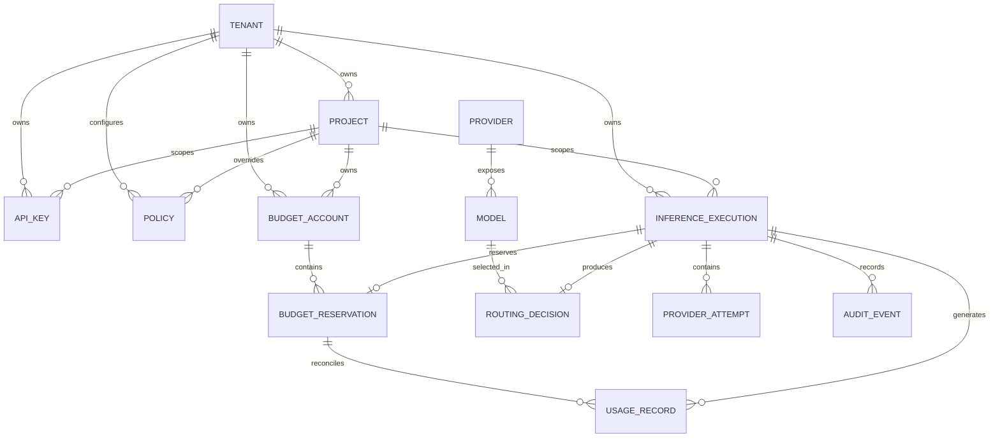

# LLM Gateway — Domain Model

**File:** `docs/domain-model.md`  
**Version:** 1.0  
**Status:** Draft  
**Project:** `llm-gateway`

# 1. Purpose

This document defines the domain model for the enterprise LLM Gateway.

The domain model describes:

- Core business entities.
- Aggregate boundaries.
- Value objects.
- Relationships.
- Domain invariants.
- State transitions.
- Domain events.
- Responsibilities of domain services.

It is independent of HTTP, Axum, SQLx, Redis, provider SDKs, and infrastructure implementation details.

# 2. Domain Overview

The gateway manages inference execution across multiple LLM providers while enforcing identity, authorization, financial, routing, and reliability policies.

The domain is divided into the following areas:

| Domain | Responsibility |
|---|---|
| Identity and Access | Users, API keys, roles, permissions |
| Tenant Management | Tenants and projects |
| Policy Management | Inference and security policies |
| Model Registry | Providers, models, capabilities, pricing |
| Inference Execution | Requests, executions, provider attempts |
| Routing | Candidate selection and routing decisions |
| Admission Control | Rate-limit and concurrency decisions |
| Budget Management | Budget accounts and reservations |
| Usage Accounting | Usage records and financial ledger |
| Cache Management | Cache eligibility and cache metadata |
| Audit | Security and administrative audit events |

# 3. Domain Relationships



This diagram describes conceptual relationships. The persistence model may introduce additional tables and foreign keys.

# 4. Aggregate Boundaries

Aggregates define consistency boundaries. Each aggregate protects its own invariants.

| Aggregate | Aggregate Root | Main Responsibilities |
|---|---|---|
| Tenant | Tenant | Tenant lifecycle and ownership |
| Project | Project | Project lifecycle and tenant association |
| API Key | APIKey | Key lifecycle, scopes, revocation |
| Policy | Policy | Policy configuration and version |
| Model | Model | Model capabilities and availability |
| Inference Execution | InferenceExecution | Logical inference lifecycle |
| Budget Account | BudgetAccount | Spending limits and available balance |
| Budget Reservation | BudgetReservation | Reserved, settled, released amounts |
| Usage Record | UsageRecord | Normalized usage and cost attribution |
| Financial Ledger | LedgerEntry | Immutable financial movements |
| Provider | Provider | Provider configuration and lifecycle |

Important consistency rule:

A logical inference execution can have multiple provider attempts. Provider attempts must not become independent financial executions.

Budget reservations and ledger entries require transactional consistency with their persistence operations.

# 5. Core Entities

## 5.1 Tenant

Represents an organization using the gateway.

Attributes:

| Attribute | Type | Description |
|---|---|---|
| id | TenantId | Unique identifier |
| name | String | Organization name |
| status | TenantStatus | Active, suspended, deleted |
| created_at | DateTime | Creation time |
| updated_at | DateTime | Last update |

Invariants:

- Tenant IDs are globally unique.
- Suspended tenants cannot execute inference.
- Tenant ownership must be checked for every tenant-scoped operation.
- Tenant identity must not be trusted from an unverified request field.

## 5.2 Project

Represents an application or workload within a tenant.

Attributes:

- ProjectId
- TenantId
- Name
- Status
- CreatedAt
- UpdatedAt

Invariants:

- Every project belongs to exactly one tenant.
- A project cannot reference a different tenant's API key.
- Project-level policies may narrow tenant-level permissions but cannot override mandatory platform restrictions.

## 5.3 API Key

Represents a credential used by client applications.

Attributes:

- APIKeyId
- TenantId
- ProjectId (optional)
- KeyHash
- KeyPrefix
- Scopes
- ExpiresAt
- RevokedAt
- CreatedAt
- LastUsedAt

Invariants:

- Raw API keys are returned only at creation or rotation.
- Raw keys are never persisted.
- Revoked and expired keys cannot authenticate.
- API keys cannot grant permissions beyond their assigned scope.
- Rotation creates a new credential and supports controlled revocation of the old credential.

## 5.4 Policy

Represents an enforceable set of gateway rules.

Policy categories:

- Access policy.
- Model allowlist.
- Provider allowlist.
- Data residency policy.
- Budget policy.
- Rate-limit policy.
- Cache policy.
- Content and safety policy.

Attributes:

- PolicyId
- Scope
- ScopeId
- Version
- Configuration
- Status
- EffectiveAt

Invariants:

- Policy versions are identifiable and auditable.
- Mandatory platform restrictions cannot be bypassed by tenant configuration.
- Policy evaluation produces an explainable decision.
- Policy changes must not silently rewrite historical execution decisions.

# 6. Model and Provider Domain

## 6.1 Provider

Represents an external or self-hosted model provider.

Attributes:

- ProviderId
- Name
- ProviderType
- EndpointReference
- CredentialReference
- Status
- ConfigurationVersion

Provider types:

- Commercial API.
- OpenAI-compatible API.
- Self-hosted inference service.

The domain stores secret references, not provider credentials.

## 6.2 Model

Represents a model exposed through a provider.

Attributes:

- ModelId
- ProviderId
- ProviderModelName
- DisplayName
- Capabilities
- ContextWindow
- MaximumOutputTokens
- PricingReference
- AvailabilityStatus
- ModelVersion

Capabilities include:

- Text generation.
- Streaming.
- Tool calling.
- Structured output.
- JSON mode.
- Image input.
- Audio input.
- Embeddings.

Invariants:

- A model belongs to one provider configuration.
- A model must advertise the capabilities required by a request.
- Disabled models cannot be selected for new executions.
- Pricing must have a version and effective period.
- Missing pricing must never be interpreted as zero cost.

## 6.3 Model Pricing

Pricing is versioned independently from model metadata.

Attributes:

- PricingId
- ModelId
- Version
- Currency
- InputTokenPrice
- OutputTokenPrice
- CachedInputTokenPrice (optional)
- EffectiveFrom
- EffectiveUntil

Additional pricing dimensions may include image, audio, tool, and batch usage.

Pricing calculations must use decimal arithmetic, not binary floating-point arithmetic.

# 7. Inference Domain

## 7.1 Inference Request

Represents the normalized intent submitted by a client.

Attributes:

- RequestId
- TenantId
- ProjectId
- APIKeyId
- RequestedModel
- Messages
- GenerationParameters
- RequestedCapabilities
- Streaming
- IdempotencyKey
- ReceivedAt

The domain request is independent of provider-specific HTTP schemas.

## 7.2 Inference Execution

Represents one logical attempt to fulfill an inference request.

Attributes:

- ExecutionId
- RequestId
- TenantId
- ProjectId
- SelectedModelId
- Status
- RoutingDecisionId
- ReservationId
- StartedAt
- CompletedAt
- FailureCode

An execution may contain multiple provider attempts.

Execution states:

| State | Meaning |
|---|---|
| Received | Request accepted by the application boundary |
| Admitted | Required admission checks passed |
| Reserved | Required financial reservation created |
| Executing | Provider execution started |
| Completed | Complete successful response received |
| Failed | Execution failed with a known outcome |
| Cancelled | Execution cancelled |
| UnknownOutcome | Provider outcome cannot yet be determined |
| ReconciliationPending | Requires reconciliation |
| Reconciled | Unknown outcome has been resolved |

State transitions must be validated. Terminal states must not be overwritten by duplicate events.

## 7.3 Provider Attempt

Represents one provider execution within a logical execution.

Attributes:

- AttemptId
- ExecutionId
- ProviderId
- ModelId
- AttemptNumber
- Status
- StartedAt
- CompletedAt
- ProviderRequestId
- ErrorCode
- InputTokens
- OutputTokens
- LatencyMs

Attempt states:

- Pending
- Started
- Succeeded
- Failed
- TimedOut
- Cancelled
- UnknownOutcome

Invariants:

- Each attempt belongs to one execution.
- Attempt numbers are unique within an execution.
- Every retry creates a new attempt.
- Provider failures are normalized before reaching application-level logic.
- An uncertain outcome remains distinguishable from a confirmed failure.

## 7.4 Routing Decision

Represents the decision to select a model.

Attributes:

- RoutingDecisionId
- ExecutionId
- RequestedModel
- SelectedModelId
- Strategy
- CandidateModels
- RejectedCandidates
- DecisionReason
- PolicyVersion
- PricingVersion
- CreatedAt

Invariants:

- Hard eligibility constraints are evaluated before ranking.
- A rejected model must have a recorded rejection reason.
- The selected model must satisfy mandatory policy constraints.
- Historical decisions must remain explainable using their recorded versions.

# 8. Budget and Financial Domain

## 8.1 Budget Account

Represents a spending limit for a particular scope and period.

Scopes:

- Platform.
- Tenant.
- Project.
- API key.

Attributes:

- BudgetAccountId
- Scope
- ScopeId
- LimitAmount
- Currency
- Period
- PeriodStart
- PeriodEnd
- Status

Invariants:

- A budget account has one currency.
- Spending cannot be admitted when the required budget is unavailable.
- Applicable parent and child budget constraints must both be respected.
- Budget limits cannot be bypassed by selecting a different provider.

Available budget:

\[
Available = Limit - ActualSpend - ActiveReservations
\]

## 8.2 Budget Reservation

Represents an amount reserved before provider execution.

Attributes:

- ReservationId
- ExecutionId
- BudgetAccountId
- ReservedAmount
- Currency
- Status
- CreatedAt
- SettledAt
- ReleasedAt

States:

- Pending
- Active
- Rejected
- Settled
- Released
- Expired
- ReconciliationPending

Invariants:

- Reservations are associated with a logical execution.
- A reservation cannot be settled more than once.
- Repeated settlement commands must be idempotent.
- Uncertain provider outcomes must not automatically release reservations.
- Actual provider cost must be recorded even if it exceeds the original reservation.

## 8.3 Usage Record

Represents normalized usage for an execution or provider attempt.

Attributes:

- UsageRecordId
- ExecutionId
- AttemptId
- ModelId
- InputTokens
- OutputTokens
- CachedInputTokens
- Currency
- EstimatedCost
- ActualCost
- UsageSource
- RecordedAt

Usage sources:

- ProviderReported.
- GatewayEstimated.
- Reconciled.

A usage record must distinguish estimated usage from provider-reported usage.

## 8.4 Financial Ledger Entry

Represents an immutable financial movement.

Attributes:

- LedgerEntryId
- BudgetAccountId
- ExecutionId
- ReservationId
- EntryType
- Amount
- Currency
- CreatedAt
- ReferenceId

Entry types:

- Reservation.
- Settlement.
- Release.
- Adjustment.
- Reconciliation.

Invariants:

- Ledger entries are append-only.
- Corrections use compensating entries.
- Financial amounts use decimal arithmetic.
- Every entry has a traceable business reference.
- Ledger updates and corresponding accounting state changes must be transactionally consistent.

# 9. Admission Control Domain

Admission control determines whether a request can proceed.

It includes separate controls:

| Control | Protects Against |
|---|---|
| Rate limit | Excessive request or token rate |
| Concurrency limit | Excessive active executions |
| Budget limit | Financial exposure |
| Abuse protection | Malicious or anomalous usage |
| Provider quota | Provider-specific capacity exhaustion |

These controls are related but are not interchangeable.

Domain decisions should be represented explicitly:

- AdmissionDecision
- RateLimitDecision
- ConcurrencyDecision
- BudgetDecision

Redis and PostgreSQL implementations belong to infrastructure.

# 10. Cache Domain

The cache domain defines whether an execution can use or populate a cache.

Cache types:

- Exact cache.
- Semantic cache.

Cache eligibility must consider:

- Tenant and project isolation.
- Authorization.
- Model and model version.
- Prompt and policy version.
- Generation parameters.
- Tool configuration.
- Data sensitivity.
- Response completeness.
- TTL and invalidation rules.

A cache hit does not represent a provider execution.

It may still represent a billable gateway operation under a future commercial pricing policy, but it must not be counted as provider token expenditure.

Semantic cache activation requires evaluation evidence and explicit policy approval.

# 11. Audit Domain

An audit event represents an important security or administrative action.

Attributes:

- AuditEventId
- ActorId
- TenantId
- ProjectId
- Action
- ResourceType
- ResourceId
- Outcome
- Timestamp
- CorrelationId

Examples:

- API key created.
- API key revoked.
- Tenant suspended.
- Budget modified.
- Provider configuration changed.
- Model enabled or disabled.
- Policy updated.
- Administrative access denied.

Audit events must not contain raw credentials or unnecessary sensitive prompt content.

# 12. Value Objects

Use strongly typed value objects to prevent invalid domain states.

| Value Object | Purpose |
|---|---|
| TenantId | Tenant identifier |
| ProjectId | Project identifier |
| APIKeyId | API key identifier |
| ProviderId | Provider identifier |
| ModelId | Model identifier |
| RequestId | API request identifier |
| ExecutionId | Logical execution identifier |
| AttemptId | Provider attempt identifier |
| ReservationId | Financial reservation identifier |
| Money | Amount and currency |
| TokenCount | Non-negative token quantity |
| Percentage | Valid bounded percentage |
| TimeWindow | Valid start and end |
| ModelCapabilities | Supported model capabilities |
| GenerationParameters | Valid generation settings |
| IdempotencyKey | Client operation identifier |

Example:

```rust
#[derive(Debug, Clone, Copy, PartialEq, Eq, Hash)]
pub struct ExecutionId(uuid::Uuid);

#[derive(Debug, Clone, Copy, PartialEq, Eq, Hash)]
pub struct TenantId(uuid::Uuid);

#[derive(Debug, Clone, Copy, PartialEq, Eq, Hash)]
pub struct ModelId(uuid::Uuid);
```

For financial amounts, use a decimal representation such as `rust_decimal::Decimal`.

Do not use `f64` for financial accounting.

# 13. Domain Services

Domain services coordinate domain rules that do not naturally belong to one entity.

| Service | Responsibility |
|---|---|
| RoutingPolicyEvaluator | Evaluate mandatory routing constraints |
| ModelEligibilityService | Determine eligible models |
| CostEstimationService | Estimate inference cost |
| BudgetPolicyEvaluator | Determine budget eligibility |
| UsageReconciliationService | Reconcile estimated and actual usage |
| CacheEligibilityService | Determine cache eligibility |
| PolicyEvaluator | Evaluate applicable policy rules |

External operations such as calling a provider, accessing Redis, querying PostgreSQL, or retrieving a secret are not domain services. They belong behind application ports and infrastructure adapters.

# 14. Domain Events

Domain events represent meaningful business state transitions.

| Event | Trigger |
|---|---|
| TenantCreated | Tenant created |
| ProjectCreated | Project created |
| APIKeyCreated | API key created |
| APIKeyRevoked | API key revoked |
| PolicyUpdated | Policy version changed |
| ModelRegistered | Model added |
| ModelDisabled | Model disabled |
| InferenceAdmitted | Request passed admission |
| BudgetReserved | Budget reservation created |
| RoutingDecisionMade | Model selected |
| ProviderAttemptStarted | Provider attempt started |
| ProviderAttemptCompleted | Provider attempt completed |
| ProviderAttemptFailed | Provider attempt failed |
| InferenceCompleted | Execution completed |
| InferenceFailed | Execution failed |
| UsageRecorded | Usage normalized |
| BudgetSettled | Reservation settled |
| CacheHit | Cached response returned |
| AuditEventRecorded | Auditable action occurred |

Events must include:

- Event ID.
- Event type.
- Schema version.
- Aggregate ID.
- Occurred-at timestamp.
- Correlation identifiers.

Events are delivered asynchronously through the event publishing infrastructure where appropriate.

Financial state changes must be persisted transactionally before publishing corresponding events.

# 15. Domain Invariants

The following invariants are mandatory.

| ID | Invariant |
|---|---|
| INV-001 | Every project belongs to exactly one tenant |
| INV-002 | Every API key belongs to a tenant |
| INV-003 | Suspended tenants cannot execute inference |
| INV-004 | Tenant isolation applies to all tenant-scoped operations |
| INV-005 | No provider execution occurs before required admission checks |
| INV-006 | No provider execution occurs before required budget reservation |
| INV-007 | Every provider attempt belongs to one logical execution |
| INV-008 | Retry and fallback create distinct provider attempts |
| INV-009 | A reservation cannot be settled more than once |
| INV-010 | Financial ledger entries are immutable |
| INV-011 | Unknown provider outcomes remain explicitly represented |
| INV-012 | Missing pricing is never treated as zero |
| INV-013 | Disabled models cannot be selected |
| INV-014 | Cache entries cannot cross tenant boundaries |
| INV-015 | Provider credentials never enter domain entities |
| INV-016 | Financial accounting does not depend on trace sampling |
| INV-017 | Delivered streaming output cannot be transparently restarted |
| INV-018 | Domain rules do not depend on infrastructure implementations |

# 16. Rust Implementation Guidelines

Suggested domain module structure:

```text
crates/domain/src/
├── lib.rs
├── identity/
│   ├── mod.rs
│   ├── tenant.rs
│   ├── project.rs
│   └── api_key.rs
├── policy/
│   ├── mod.rs
│   └── policy.rs
├── model/
│   ├── mod.rs
│   ├── provider.rs
│   ├── model.rs
│   └── pricing.rs
├── inference/
│   ├── mod.rs
│   ├── request.rs
│   ├── execution.rs
│   ├── attempt.rs
│   └── routing_decision.rs
├── budget/
│   ├── mod.rs
│   ├── account.rs
│   ├── reservation.rs
│   └── ledger.rs
├── usage/
│   ├── mod.rs
│   └── usage_record.rs
├── cache/
│   ├── mod.rs
│   └── cache_policy.rs
├── audit/
│   ├── mod.rs
│   └── audit_event.rs
├── value_objects/
│   ├── mod.rs
│   ├── identifiers.rs
│   ├── money.rs
│   └── token_count.rs
└── events/
    ├── mod.rs
    └── domain_events.rs
```

This is a logical starting structure. Modules can be adjusted as the implementation evolves.

# 17. Testing Requirements

Domain tests must not require:

- PostgreSQL.
- Redis.
- Docker.
- External LLM providers.
- Network connectivity.

Required tests include:

1. Tenant and project ownership validation.
2. API key lifecycle transitions.
3. Model capability eligibility.
4. Routing decision invariants.
5. Budget availability calculations.
6. Reservation state transitions.
7. Idempotent settlement.
8. Ledger immutability.
9. Execution state transitions.
10. Provider attempt uniqueness.
11. Unknown outcome handling.
12. Cache tenant isolation rules.
13. Money arithmetic and rounding.
14. Invalid value-object construction.

Use unit tests and property-based tests for financial and state-transition invariants.

# 18. Definition of Done

The domain model is ready for implementation when:

- All aggregate roots are identified.
- Aggregate ownership is unambiguous.
- Core entities and value objects are defined.
- State transitions are documented.
- Financial invariants are explicit.
- Domain events have stable identities and schemas.
- Domain types do not depend on infrastructure.
- Critical invariants have corresponding tests.
- The domain model maps consistently to the architecture and API contracts.

# 19. Related Documents

- `docs/product.md`
- `docs/architecture.md`
- `docs/specification-consistency-review.md`
- `docs/api-contracts.md`
- `docs/security.md`
- `docs/routing-policy.md`
- `docs/budget-and-usage-accounting.md`
- `docs/provider-integration.md`
- `docs/reliability.md`
- `docs/test-strategy.md`
- `docs/build-plan.md`

