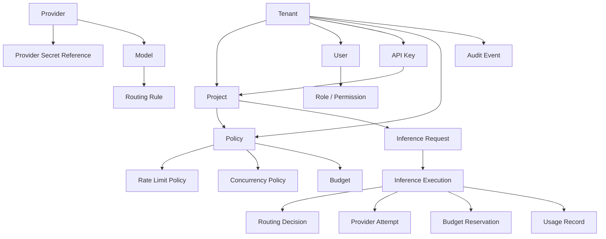
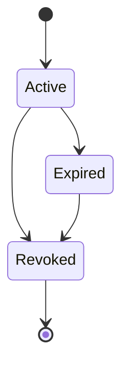
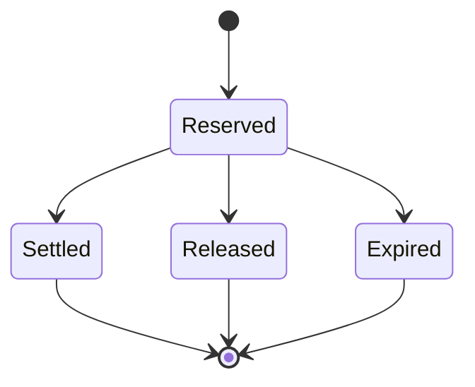
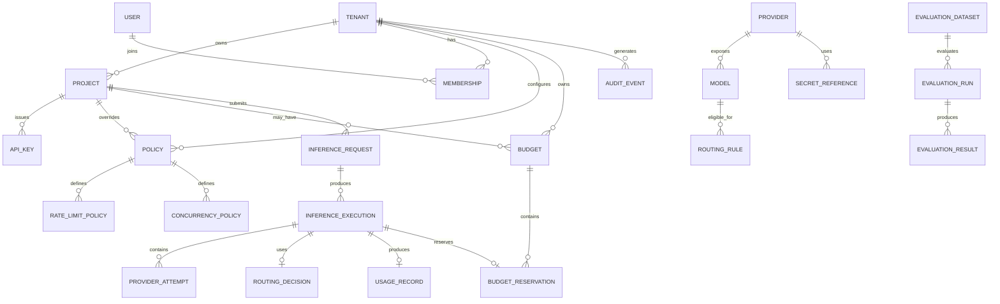

# LLM Gateway — Domain Model

**Version:** 1.0  
**Status:** Draft  
**Project:** `llm-gateway`  
**Architecture:** Clean Architecture  
**Implementation:** Rust

---

## 1. Purpose

This document defines the core domain model for the LLM Gateway.

It describes:

- Domain boundaries.
- Entities and value objects.
- Aggregates and aggregate roots.
- Entity relationships.
- Business invariants.
- State transitions.
- Domain events.
- Domain service responsibilities.
- Ownership and persistence boundaries.

The domain model represents business concepts, not database tables or HTTP request structures.

Infrastructure-specific concerns such as SQLx models, Redis keys, HTTP DTOs, and provider SDK types must remain outside the domain layer.

---

## 2. Domain Design Principles

The domain follows these principles:

1. Every business entity has a clear identity.
2. Aggregate roots protect business invariants.
3. Value objects are immutable.
4. Financial operations must be auditable.
5. Tenant ownership must be explicit.
6. Secrets are referenced, never represented as plaintext domain data.
7. Rate limits, concurrency quotas, and budgets are independent.
8. Provider-specific models must not leak into the core domain.
9. Domain events represent meaningful business changes.
10. Domain logic must not depend on infrastructure.

---

## 3. Bounded Contexts

The system is divided into the following bounded contexts.

| Bounded Context | Responsibility |
|---|---|
| Tenant Management | Tenants, projects, membership |
| Identity & Access | Users, API keys, roles, permissions |
| Security & Secrets | Secret references and credential lifecycle |
| Policy Management | Policies and model restrictions |
| Traffic Management | Rate limits and concurrency quotas |
| Financial Management | Budgets, reservations, settlements |
| Model Management | Providers, models, capabilities, pricing |
| Inference | Requests, executions, provider attempts |
| Routing | Routing rules and routing decisions |
| Caching | Exact and semantic cache entries |
| Usage Accounting | Token usage and cost records |
| Audit | Security and administrative audit events |
| Evaluation | Datasets, runs, and evaluation results |

These are logical domain boundaries. They do not require a separate microservice for every context.

The initial implementation should be a modular Rust application with explicit module boundaries.

---

## 4. Domain Overview



---

## 5. Shared Value Objects

Value objects represent concepts identified by their attributes rather than a unique database identity.

### 5.1 Identifiers

Use strongly typed identifiers rather than passing arbitrary strings throughout the domain.

```rust
pub struct TenantId(Uuid);
pub struct ProjectId(Uuid);
pub struct UserId(Uuid);
pub struct ApiKeyId(Uuid);
pub struct ProviderId(Uuid);
pub struct ModelId(Uuid);
pub struct PolicyId(Uuid);
pub struct BudgetId(Uuid);
pub struct InferenceRequestId(Uuid);
pub struct ExecutionId(Uuid);
pub struct ReservationId(Uuid);
pub struct UsageRecordId(Uuid);
pub struct AuditEventId(Uuid);
```

Identifiers should be generated using UUIDs or another consistently selected identifier strategy.

### 5.2 Money

Financial values must use decimal arithmetic or integer minor units.

Never use floating-point arithmetic for authoritative financial accounting.

```rust
pub struct Money {
    pub amount_minor: i64,
    pub currency: Currency,
}
```

Example:

```text
amount_minor = 10000
currency = USD
```

Represents USD 100.00.

Pricing calculations must also define precision and rounding rules.

### 5.3 Token Usage

```rust
pub struct TokenUsage {
    pub input_tokens: u64,
    pub output_tokens: u64,
    pub cached_input_tokens: u64,
    pub total_tokens: u64,
}
```

The domain must distinguish provider-reported usage from estimated usage.

### 5.4 Time Window

```rust
pub struct TimeWindow {
    pub starts_at: DateTime<Utc>,
    pub ends_at: DateTime<Utc>,
}
```

Used by budgets, rate-limit policies, and reporting periods.

### 5.5 Model Capabilities

```rust
pub enum ModelCapability {
    TextGeneration,
    Streaming,
    ToolCalling,
    StructuredOutput,
    JsonMode,
    Vision,
    Embeddings,
    AudioInput,
    AudioOutput,
}
```

Capabilities must be extensible without changing inference business rules unnecessarily.

### 5.6 Other Value Objects

| Value Object | Responsibility |
|---|---|
| EmailAddress | Validated email |
| ApiKeyPrefix | Non-secret identifier prefix |
| ApiKeyHash | Cryptographic hash of a virtual API key |
| SecretReference | Reference to an external secret |
| ModelName | Provider-independent model identifier |
| ProviderName | Provider identifier |
| IdempotencyKey | Client-supplied request deduplication key |
| RequestFingerprint | Normalized request hash |
| RoutingReason | Explanation of model selection |
| Latency | Duration measurement |
| CostEstimate | Estimated inference cost |
| CostBreakdown | Input/output/cached token cost |
| TokenLimit | Maximum allowed token count |
| SimilarityScore | Semantic cache similarity score |

---

# 6. Tenant Management Context

## 6.1 Tenant

A tenant represents an organization or customer using the gateway.

**Attributes**

| Attribute | Type |
|---|---|
| id | TenantId |
| name | String |
| slug | String |
| status | TenantStatus |
| created_at | DateTime |
| updated_at | DateTime |

**TenantStatus**

```rust
pub enum TenantStatus {
    Active,
    Suspended,
    Disabled,
}
```

**Invariants**

- Tenant slug must be unique.
- A suspended tenant cannot execute new inference requests.
- Tenant-owned resources must not be accessible by another tenant.
- Tenant deletion must respect retention and audit requirements.

## 6.2 Project

A project groups API keys, configurations, usage, and inference workloads inside a tenant.

**Attributes**

| Attribute | Type |
|---|---|
| id | ProjectId |
| tenant_id | TenantId |
| name | String |
| description | Option<String> |
| status | ProjectStatus |
| created_at | DateTime |

**ProjectStatus**

```rust
pub enum ProjectStatus {
    Active,
    Suspended,
    Archived,
}
```

**Invariants**

- Every project belongs to exactly one tenant.
- Project ownership cannot be changed through ordinary updates.
- Suspended projects cannot execute inference requests.

## 6.3 Membership

Represents a user's membership in a tenant.

Attributes:

- id
- tenant_id
- user_id
- status
- joined_at

A user may belong to multiple tenants.

---

# 7. Identity and Access Context

## 7.1 User

Represents a human administrator or developer.

Attributes:

- id
- email
- display_name
- status
- created_at
- updated_at

The initial API key authentication flow does not require the user to be present in every inference request. The API key resolves to its associated tenant and project identity.

## 7.2 Role

Defines a named set of permissions.

Initial roles:

| Role | Scope |
|---|---|
| PlatformAdmin | Platform |
| TenantAdmin | Tenant |
| ProjectAdmin | Project |
| Developer | Project |
| Auditor | Tenant or project |

Roles should be assigned at an explicit scope.

## 7.3 Permission

Represents an authorized action.

Examples:

```text
inference:create
inference:read
apikey:create
apikey:revoke
budget:read
budget:update
policy:read
policy:update
model:read
model:update
audit:read
tenant:manage
```

Authorization must verify both the permission and the resource scope.

## 7.4 ApiKey

Represents a virtual API credential issued by the gateway.

Attributes:

| Attribute | Type |
|---|---|
| id | ApiKeyId |
| tenant_id | TenantId |
| project_id | ProjectId |
| name | String |
| key_prefix | ApiKeyPrefix |
| key_hash | ApiKeyHash |
| scopes | Set<Permission> |
| status | ApiKeyStatus |
| expires_at | Option<DateTime> |
| last_used_at | Option<DateTime> |
| created_at | DateTime |
| revoked_at | Option<DateTime> |

**ApiKeyStatus**

```rust
pub enum ApiKeyStatus {
    Active,
    Expired,
    Revoked,
}
```

**Invariants**

- Raw API keys are shown only once at creation.
- Only the hash is persisted.
- Revoked keys cannot authenticate requests.
- Expired keys cannot authenticate requests.
- An API key belongs to one project and one tenant.
- Scopes cannot exceed the permissions granted by the issuing administrator.

**Lifecycle**



---

# 8. Security and Secret Management Context

## 8.1 SecretReference

Represents the location of a provider credential in an external secret manager.

Attributes:

| Attribute | Type |
|---|---|
| id | UUID |
| provider_id | ProviderId |
| secret_name | String |
| secret_version | Option<String> |
| status | SecretReferenceStatus |
| created_at | DateTime |
| updated_at | DateTime |

**SecretReferenceStatus**

```rust
pub enum SecretReferenceStatus {
    Active,
    RotationPending,
    Disabled,
}
```

Important distinction:

- `ApiKey` represents a virtual credential issued to gateway customers.
- `SecretReference` represents a reference to a provider credential.
- The actual provider credential is not a domain entity and must not be persisted in the gateway's ordinary domain tables.

## 8.2 SecurityPolicy

Represents security constraints applicable to a tenant or project.

Examples:

- Allowed data regions.
- PII redaction requirements.
- Prompt logging restrictions.
- Provider restrictions.
- Retention requirements.
- Sensitive-data handling rules.

---

# 9. Policy Management Context

## 9.1 Policy

A policy defines operational and business constraints.

Attributes:

- id
- tenant_id
- project_id
- name
- version
- status
- effective_from
- created_at
- updated_at

Policy types:

```rust
pub enum PolicyType {
    ModelAccess,
    ProviderAccess,
    Security,
    Routing,
    RateLimit,
    Concurrency,
    Budget,
    Cache,
    Retention,
}
```

A policy may contain multiple typed rules, but rule validation and execution must remain explicit.

**Invariants**

- Policy versions must be identifiable.
- Changes must be auditable.
- A request must use a consistent policy version for its admission decision.
- A policy must not silently expand permissions.

## 9.2 PolicyDecision

A policy decision is an immutable result of evaluating a request against applicable rules.

Attributes:

- id
- request_id
- policy_version
- outcome
- reason_codes
- evaluated_at

```rust
pub enum PolicyOutcome {
    Allow,
    Deny,
}
```

A decision must provide machine-readable reason codes.

---

# 10. Traffic Management Context

Traffic management includes two independent concepts: rate limiting and concurrency control.

## 10.1 RateLimitPolicy

Defines how frequently requests or tokens may be consumed.

Attributes:

- id
- scope
- scope_id
- dimension
- capacity
- refill_rate
- window
- algorithm
- enabled

**RateLimitDimension**

```rust
pub enum RateLimitDimension {
    Requests,
    InputTokens,
    OutputTokens,
    TotalTokens,
}
```

**RateLimitAlgorithm**

```rust
pub enum RateLimitAlgorithm {
    TokenBucket,
    SlidingWindow,
}
```

Example:

```text
Scope: Project
Dimension: Requests
Capacity: 300
Window: 60 seconds
Algorithm: Token Bucket
```

The domain describes the rule. Redis implements distributed admission state.

## 10.2 RateLimitDecision

Attributes:

- request_id
- outcome
- remaining_capacity
- retry_after
- evaluated_at

```rust
pub enum AdmissionOutcome {
    Allowed,
    Rejected,
}
```

## 10.3 ConcurrencyPolicy

Defines the maximum number of simultaneous executions.

Attributes:

- id
- scope
- scope_id
- max_concurrent_requests
- enabled

Example:

```text
Tenant: tenant-001
Maximum concurrent requests: 100
```

## 10.4 ConcurrencyLease

Represents temporary ownership of one concurrency permit.

Attributes:

- id
- request_id
- scope_id
- acquired_at
- expires_at
- released_at

A lease must be released on completion, failure, or cancellation.

Expired leases require recovery so crashed workers do not permanently consume capacity.

**Important distinction**

| Concept | Controls | Example |
|---|---|---|
| Rate limit | Consumption over time | 100 requests/min |
| Concurrency | Simultaneous execution | 20 active requests |
| Budget | Financial expenditure | $500/month |

None of these controls should be treated as a substitute for another.

---

# 11. Financial Management Context

## 11.1 Budget

Represents an authorized financial spending limit.

Attributes:

| Attribute | Type |
|---|---|
| id | BudgetId |
| tenant_id | TenantId |
| project_id | Option<ProjectId> |
| name | String |
| limit | Money |
| period | BudgetPeriod |
| spent_amount | Money |
| reserved_amount | Money |
| status | BudgetStatus |
| starts_at | DateTime |
| ends_at | DateTime |

**BudgetPeriod**

```rust
pub enum BudgetPeriod {
    Daily,
    Weekly,
    Monthly,
    Custom,
}
```

**BudgetStatus**

```rust
pub enum BudgetStatus {
    Active,
    Suspended,
    Exhausted,
    Expired,
}
```

**Budget invariants**

- A budget cannot authorize spending beyond its configured limit.
- Reservations must be atomic.
- Settlements must be idempotent.
- Releasing a reservation must not create negative reserved balances.
- Currency must be consistent within an individual budget.
- Budget updates must be auditable.

Available amount:

\[
Available = Limit - Spent - Reserved
\]

A new reservation is allowed only when the required amount does not exceed the available amount, subject to the configured overage policy.

## 11.2 BudgetReservation

Represents a temporary financial commitment for an inference execution.

Attributes:

- id
- budget_id
- execution_id
- estimated_cost
- actual_cost
- status
- reserved_at
- settled_at

**ReservationStatus**

```rust
pub enum ReservationStatus {
    Reserved,
    Settled,
    Released,
    Expired,
}
```

Lifecycle:



**Financial invariants**

- A reservation must exist before provider execution when budget enforcement is required.
- Settlement must be idempotent.
- A reservation must not be settled twice.
- The estimated cost and actual cost must be distinguishable.
- Failed executions must follow a defined reservation release or reconciliation policy.
- Budget settlement must be transactionally consistent with usage accounting.

## 11.3 BudgetThreshold

Defines warning thresholds.

Examples:

- 50% consumed.
- 80% consumed.
- 95% consumed.
- 100% consumed.

Threshold notifications should be event-driven.

---

# 12. Model Management Context

## 12.1 Provider

Represents an external or internal inference provider.

Attributes:

- id
- name
- provider_type
- status
- base_endpoint
- region
- secret_reference_id
- created_at

**ProviderType**

```rust
pub enum ProviderType {
    OpenAI,
    Anthropic,
    Vllm,
    Ollama,
    Custom,
}
```

**ProviderStatus**

```rust
pub enum ProviderStatus {
    Active,
    Degraded,
    Unavailable,
    Disabled,
}
```

Provider endpoint configuration must be validated and controlled. Secret values are resolved separately.

## 12.2 Model

Represents a model exposed through a provider.

Attributes:

- id
- provider_id
- model_name
- display_name
- capabilities
- context_window
- max_output_tokens
- status
- pricing_id

**ModelStatus**

```rust
pub enum ModelStatus {
    Active,
    Deprecated,
    Disabled,
}
```

A provider may expose multiple models.

## 12.3 ModelPricing

Represents a versioned pricing configuration.

Attributes:

- id
- model_id
- currency
- input_price_per_million_tokens
- output_price_per_million_tokens
- cached_input_price_per_million_tokens
- effective_from
- effective_until

Pricing changes must be versioned so historical inference costs can be explained.

Actual provider billing information may differ from estimates. The accounting model must preserve that distinction.

## 12.4 ProviderHealth

Represents the operational health of a provider or model endpoint.

Attributes:

- provider_id
- model_id
- health_status
- consecutive_failures
- last_success_at
- last_failure_at
- updated_at

Health status:

```rust
pub enum HealthStatus {
    Healthy,
    Degraded,
    Unavailable,
    Unknown,
}
```

Operational health state may be stored in Redis, with durable historical records retained when required.

---

# 13. Routing Context

## 13.1 RoutingRule

Defines the conditions under which a model may be selected.

Attributes:

- id
- tenant_id
- project_id
- priority
- conditions
- preferred_models
- fallback_models
- status
- version

Possible routing dimensions:

- Task type.
- Model capability.
- Context length.
- Maximum cost.
- Latency objective.
- Quality requirement.
- Data residency.
- Provider health.
- Tenant policy.

## 13.2 RoutingDecision

Represents an immutable model-selection result.

Attributes:

- id
- execution_id
- selected_provider_id
- selected_model_id
- candidate_models
- rejected_candidates
- routing_reason
- estimated_cost
- policy_version
- decided_at

Routing decisions should explain why the selected model was eligible and why relevant alternatives were rejected.

Example:

```text
Selected model: Model B

Reasons:
- Supports required tool calling.
- Satisfies context-window requirement.
- Provider is healthy.
- Within tenant budget.
- Meets configured latency objective.

Rejected:
- Model A: context window insufficient.
- Model C: provider unavailable.
- Model D: exceeds maximum cost.
```

---

# 14. Inference Context

## 14.1 InferenceRequest

Represents the normalized request submitted by a client.

Attributes:

- id
- tenant_id
- project_id
- api_key_id
- idempotency_key
- requested_model
- request_fingerprint
- request_status
- created_at

The request may contain prompt and generation parameters in a protected request payload, but domain identity and metadata should remain separate.

## 14.2 InferenceExecution

Represents an actual attempt to fulfill an inference request.

A request can have one or more executions when the idempotency and retry policies permit it.

Attributes:

- id
- request_id
- routing_decision_id
- execution_status
- started_at
- completed_at
- latency
- usage_record_id

**ExecutionStatus**

```rust
pub enum ExecutionStatus {
    Pending,
    Running,
    Completed,
    Failed,
    Cancelled,
    TimedOut,
    PartiallyCompleted,
}
```

## 14.3 ProviderAttempt

Represents an individual call to a provider.

Attributes:

- id
- execution_id
- provider_id
- model_id
- attempt_number
- status
- provider_request_id
- error_code
- started_at
- completed_at
- latency

A single execution may contain multiple provider attempts when retries or fallbacks are allowed.

## 14.4 IdempotencyRecord

Prevents unintended duplicate execution for repeated client requests.

Attributes:

- id
- tenant_id
- project_id
- idempotency_key
- request_fingerprint
- request_id
- status
- expires_at

**Invariants**

- An idempotency key must be scoped to a tenant and project.
- Reusing the same key with a different request fingerprint must be rejected.
- Concurrent requests using the same key must not produce duplicate execution.
- The system must define behavior for requests still in progress.
- Idempotency retention must be configurable.

Idempotency is not a guarantee of exactly-once execution at the external provider. The gateway must account for uncertain provider outcomes and avoid unsafe retries.

---

# 15. Cache Context

## 15.1 CacheEntry

Represents a reusable inference response.

Attributes:

- id
- tenant_id
- project_id
- cache_type
- request_fingerprint
- response_reference
- model_id
- model_configuration_hash
- expires_at
- created_at

**CacheType**

```rust
pub enum CacheType {
    Exact,
    Semantic,
}
```

For semantic cache entries, additional metadata may include:

- embedding model version.
- similarity threshold.
- embedding reference.
- normalized request representation.

**Cache invariants**

- Cache lookup must respect tenant and project isolation.
- Authorization must be verified before serving cached data.
- Model and generation parameters must be compatible.
- Sensitive data must not enter cache unless explicitly permitted.
- Expired entries cannot be served.
- Cache invalidation must account for model and prompt configuration changes.

---

# 16. Usage Accounting Context

## 16.1 UsageRecord

Represents consumption associated with an inference execution.

Attributes:

| Attribute | Type |
|---|---|
| id | UsageRecordId |
| execution_id | ExecutionId |
| tenant_id | TenantId |
| project_id | ProjectId |
| provider_id | ProviderId |
| model_id | ModelId |
| token_usage | TokenUsage |
| estimated_cost | Money |
| actual_cost | Option<Money> |
| cost_source | CostSource |
| recorded_at | DateTime |

**CostSource**

```rust
pub enum CostSource {
    Estimated,
    ProviderReported,
    Reconciled,
}
```

**Invariants**

- Usage records must reference an execution.
- Usage records must not be duplicated during retry or event replay.
- Estimated and actual costs must be distinguishable.
- Historical usage must retain the pricing version used for calculation.
- Corrections must be auditable.

---

# 17. Audit Context

## 17.1 AuditEvent

Represents a security-sensitive or administrative action.

Attributes:

- id
- tenant_id
- actor_type
- actor_id
- action
- resource_type
- resource_id
- outcome
- correlation_id
- metadata
- occurred_at

Examples:

```text
API_KEY_CREATED
API_KEY_REVOKED
POLICY_UPDATED
BUDGET_UPDATED
SECRET_REFERENCE_ROTATED
TENANT_SUSPENDED
AUTHORIZATION_DENIED
MODEL_CONFIGURATION_CHANGED
```

Audit events should be append-oriented.

Ordinary application updates must not silently rewrite historical audit events.

---

# 18. Evaluation Context

## 18.1 EvaluationDataset

Represents a versioned collection of evaluation examples.

Attributes:

- id
- name
- version
- description
- dataset_type
- created_at

## 18.2 EvaluationRun

Represents a batch evaluation execution.

Attributes:

- id
- dataset_id
- dataset_version
- model_id
- evaluation_status
- started_at
- completed_at
- configuration_version

## 18.3 EvaluationResult

Represents the result of evaluating an inference output.

Attributes:

- id
- evaluation_run_id
- execution_id
- metric_name
- score
- threshold
- outcome
- evaluated_at

Possible metrics:

- Answer relevance.
- Faithfulness.
- Context relevance.
- Toxicity.
- Safety.
- Structured output validity.
- Task-specific correctness.

Evaluation scores must be interpreted according to the metric definition and dataset version. An LLM judge score is not proof of correctness.

---

# 19. Aggregate Boundaries

Aggregates define transactional consistency boundaries.

| Aggregate Root | Owned Concepts | Primary Invariants |
|---|---|---|
| Tenant | Tenant configuration | Tenant lifecycle |
| Project | Project configuration | Tenant ownership |
| ApiKey | Key metadata and scopes | Key lifecycle and revocation |
| Policy | Policy rules and versions | Valid policy transitions |
| Budget | Reservations and settlements | No unauthorized overspending |
| Provider | Provider configuration and model references | Provider configuration validity |
| Model | Model capabilities and pricing references | Valid model configuration |
| InferenceRequest | Request identity and idempotency | Duplicate request protection |
| InferenceExecution | Provider attempts and execution lifecycle | Valid execution transitions |
| RoutingDecision | Candidate evaluation and selection | Explainable selection |
| EvaluationRun | Evaluation results | Consistent evaluation lifecycle |

Some large collections, such as usage records and audit events, should not be loaded into aggregates. They should be handled through dedicated repositories and application services.

Aggregate boundaries are logical consistency boundaries, not instructions to create one SQL table per aggregate.

---

# 20. Domain Relationships



---

# 21. Core Domain Invariants

The following invariants must be enforced regardless of the API endpoint or infrastructure implementation.

## Security invariants

1. A request must be authenticated before execution.
2. Authentication does not imply authorization.
3. Tenant and project ownership must be checked.
4. Revoked or expired API keys cannot authenticate.
5. Provider credentials must not be exposed to clients.
6. Secret values must not appear in logs, traces, or audit metadata.
7. Cross-tenant cache access is prohibited.

## Admission invariants

1. Required validation must complete before provider execution.
2. Rate-limit admission must succeed.
3. Required concurrency capacity must be acquired.
4. Required policy checks must pass.
5. Required budget reservation must succeed.
6. Idempotency must be checked before creating duplicate executions.

## Financial invariants

1. Budget reservations must be atomic.
2. Budget settlement must be idempotent.
3. Actual usage must be reconciled.
4. Historical cost calculations must be reproducible.
5. Financial values must not rely on floating-point arithmetic.

## Inference invariants

1. Each execution has a unique identifier.
2. Every provider attempt belongs to an execution.
3. Provider errors must be normalized.
4. Fallback decisions must be traceable.
5. Streaming cancellation must release resources.
6. Provider retries must respect duplicate-execution risks.

---

# 22. Domain Events

Domain events represent significant business state changes.

| Event | Trigger |
|---|---|
| TenantCreated | New tenant |
| TenantSuspended | Tenant suspended |
| ProjectCreated | New project |
| ApiKeyCreated | New virtual API key |
| ApiKeyRevoked | API key revoked |
| PolicyUpdated | Policy version changed |
| BudgetCreated | New budget |
| BudgetReservationCreated | Funds reserved |
| BudgetReservationSettled | Actual cost reconciled |
| BudgetThresholdReached | Threshold exceeded |
| RateLimitExceeded | Request rejected |
| InferenceRequested | Request accepted |
| InferenceCompleted | Execution succeeded |
| InferenceFailed | Execution failed |
| ProviderAttemptFailed | Provider attempt failed |
| RoutingDecisionMade | Model selected |
| UsageRecorded | Usage persisted |
| SecretReferenceRotated | Provider credential reference changed |
| EvaluationRequested | Evaluation scheduled |
| EvaluationCompleted | Evaluation finished |

Example event:

```rust
pub struct InferenceCompleted {
    pub execution_id: ExecutionId,
    pub tenant_id: TenantId,
    pub project_id: ProjectId,
    pub provider_id: ProviderId,
    pub model_id: ModelId,
    pub usage_record_id: UsageRecordId,
    pub completed_at: DateTime<Utc>,
}
```

Domain events should contain identifiers and necessary metadata, not raw prompts, responses, or credentials by default.

---

# 23. Domain Services

Some business operations span multiple aggregates and therefore belong in domain or application services.

| Service | Responsibility |
|---|---|
| AuthorizationService | Evaluate scoped permissions |
| PolicyEvaluationService | Evaluate applicable policy rules |
| RateLimitEvaluationService | Evaluate rate-limit policy |
| ConcurrencyAdmissionService | Acquire and release concurrency capacity |
| BudgetReservationService | Reserve and settle budget |
| CostCalculationService | Calculate estimated and actual cost |
| ModelEligibilityService | Determine eligible models |
| RoutingDecisionService | Select a model and explain the decision |
| IdempotencyService | Prevent duplicate execution |
| CacheEligibilityService | Determine whether caching is permitted |
| UsageAccountingService | Record and reconcile usage |

Infrastructure adapters implement persistence and distributed coordination. These services should depend on application ports rather than directly on Redis, PostgreSQL, or HTTP clients.

---

# 24. Domain-to-Infrastructure Mapping

| Domain Concept | Infrastructure Implementation |
|---|---|
| Tenant / Project | PostgreSQL |
| User / Membership | PostgreSQL |
| ApiKey | PostgreSQL, hash only |
| Role / Permission | PostgreSQL and authorization service |
| SecretReference | PostgreSQL metadata + external secret manager |
| Policy | PostgreSQL |
| RateLimitPolicy | PostgreSQL configuration + Redis counters |
| ConcurrencyPolicy | PostgreSQL configuration + Redis leases |
| Budget | PostgreSQL |
| BudgetReservation | PostgreSQL transactions |
| Provider / Model | PostgreSQL |
| ProviderHealth | Redis operational state + optional historical storage |
| RoutingDecision | PostgreSQL and telemetry |
| InferenceRequest | PostgreSQL |
| InferenceExecution | PostgreSQL |
| ProviderAttempt | PostgreSQL |
| CacheEntry | Redis or dedicated cache infrastructure |
| UsageRecord | PostgreSQL |
| AuditEvent | Durable append-oriented storage |
| EvaluationDataset | PostgreSQL or versioned dataset storage |
| EvaluationResult | PostgreSQL |

This mapping is a starting point. Physical schema design belongs in `docs/data-model.md`.

---

# 25. Definition of Done

The domain model is ready for implementation when:

- [ ] Bounded contexts are documented.
- [ ] Entities and value objects are defined.
- [ ] Strongly typed identifiers are established.
- [ ] Aggregate roots and boundaries are documented.
- [ ] Tenant ownership rules are explicit.
- [ ] API key lifecycle is defined.
- [ ] Provider credentials are separated from virtual API keys.
- [ ] Rate limits are separated from concurrency limits.
- [ ] Budgets and reservations have explicit invariants.
- [ ] Model and provider relationships are defined.
- [ ] Routing decisions are explainable.
- [ ] Inference request and execution lifecycles are defined.
- [ ] Idempotency rules are documented.
- [ ] Cache isolation rules are explicit.
- [ ] Usage and audit records are defined.
- [ ] Domain events are identified.
- [ ] Domain services are identified.
- [ ] Infrastructure dependencies remain outside the domain layer.

---

## 26. Next Document

The next specification is `docs/api-contracts.md`.

It will define:

- API conventions and versioning.
- Authentication headers.
- Inference endpoints.
- Streaming endpoints.
- API key management.
- Tenant and project administration.
- Model registry endpoints.
- Budget and usage endpoints.
- Rate-limit responses.
- Error response format.
- Idempotency behavior.
- Request and response JSON schemas.
- OpenAPI contract expectations.
