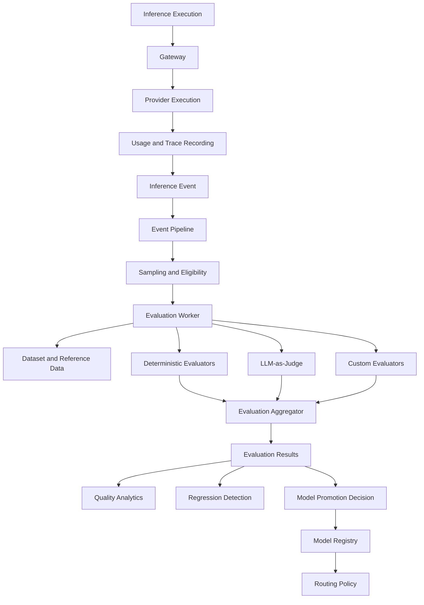
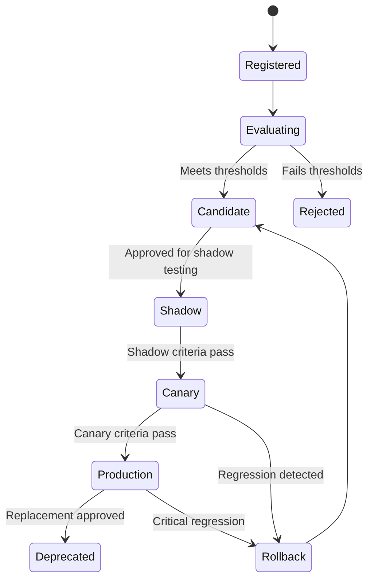

# LLM Gateway — Evaluation Strategy

**File:** `docs/evaluation-strategy.md`  
**Version:** 1.0  
**Status:** Draft  
**Project:** `llm-gateway`  
**Implementation:** Rust gateway + Python evaluation worker  
**Architecture:** Clean Architecture

---

# 1. Purpose

This document defines the evaluation framework for measuring and continuously improving the quality, reliability, safety, and cost-effectiveness of LLM inference.

The gateway must not select models based only on price or latency.

It must have measurable evidence that selected models satisfy task-specific quality requirements.

The evaluation system provides:

- Offline model evaluations.
- Routing strategy evaluations.
- Model comparison and benchmarking.
- LLM-as-judge evaluation.
- Deterministic quality checks.
- Production sampling.
- Regression detection.
- Quality-based routing constraints.
- Model promotion and rollback evidence.

## 1.1 Objectives

| ID | Objective | Description |
|---|---|---|
| EVAL-001 | Quality measurement | Measure model output quality |
| EVAL-002 | Model comparison | Compare models on identical datasets |
| EVAL-003 | Routing validation | Verify routing decisions |
| EVAL-004 | Regression detection | Detect quality degradation |
| EVAL-005 | Safety evaluation | Evaluate harmful or policy-violating output |
| EVAL-006 | Cost-quality optimization | Compare quality against inference cost |
| EVAL-007 | Production evaluation | Evaluate sampled production executions |
| EVAL-008 | Reproducibility | Version datasets, evaluators, and configurations |
| EVAL-009 | Model promotion | Require evidence before production rollout |
| EVAL-010 | Auditability | Preserve evaluation decisions and results |

---

# 2. Evaluation Architecture

The evaluation system is asynchronous and must not block the ordinary inference path.



## 2.1 Components

| Component | Responsibility |
|---|---|
| Evaluation Dataset Registry | Stores versioned datasets |
| Evaluation Runner | Executes evaluation jobs |
| Evaluation Worker | Runs evaluators asynchronously |
| Evaluator Registry | Registers supported evaluators |
| LLM Judge | Evaluates semantic quality |
| Result Aggregator | Aggregates metric results |
| Regression Detector | Identifies quality degradation |
| Benchmark Runner | Compares models and routing strategies |
| Model Promotion Controller | Records promotion decisions |
| Evaluation Analytics | Exposes evaluation results |

---

# 3. Evaluation Types

The platform supports four evaluation categories.

## 3.1 Offline Evaluation

Run before deployment or routing-policy changes.

Purpose:

- Compare candidate models.
- Validate model capabilities.
- Measure quality.
- Measure latency.
- Estimate cost.
- Detect regressions.

Example:

```text
Dataset: customer-support-v1

Models:
- Model A
- Model B
- Model C

Metrics:
- Answer relevance
- Faithfulness
- Correctness
- Safety
- Latency
- Cost

Output:
- Evaluation report
- Model comparison
- Promotion recommendation
```

## 3.2 Online Evaluation

Run on sampled production executions.

Purpose:

- Detect quality degradation.
- Identify provider-specific behavior changes.
- Detect task-specific weaknesses.
- Validate offline assumptions.

Online evaluation must be asynchronous.

## 3.3 Regression Evaluation

Run when a relevant component changes.

Examples:

- Routing policy changes.
- Prompt changes.
- Provider adapter changes.
- Model version changes.
- Evaluator changes.
- Dataset changes.

## 3.4 Benchmark Evaluation

Measure performance under controlled conditions.

Measure:

- Throughput.
- p50, p95, and p99 latency.
- Time to first token.
- Token consumption.
- Cost per request.
- Success rate.
- Quality metrics.
- Fallback frequency.

---

# 4. Evaluation Dataset Management

Datasets are the foundation of reproducible evaluations.

## 4.1 Dataset Structure

Suggested structure:

```text
evals/
├── datasets/
│   ├── general/
│   │   └── general-v1.jsonl
│   ├── reasoning/
│   │   └── reasoning-v1.jsonl
│   ├── customer_support/
│   │   └── customer-support-v1.jsonl
│   ├── rag/
│   │   └── rag-quality-v1.jsonl
│   └── safety/
│       └── safety-v1.jsonl
│
├── evaluators/
├── configs/
├── reports/
└── benchmarks/
```

## 4.2 Dataset Record

Example:

```json
{
  "id": "support-001",
  "dataset_id": "customer-support",
  "dataset_version": "1.0",
  "task_type": "customer_support",
  "input": {
    "messages": [
      {
        "role": "user",
        "content": "I want to return an item purchased 10 days ago."
      }
    ]
  },
  "expected": {
    "key_facts": [
      "The purchase was made 10 days ago."
    ],
    "expected_behavior": [
      "Explain the applicable return process."
    ]
  },
  "metadata": {
    "difficulty": "medium",
    "risk": "low",
    "category": "returns"
  }
}
```

Do not assume every task has a single correct answer.

Datasets may contain:

- Exact expected outputs.
- Reference answers.
- Expected facts.
- Required behaviors.
- Prohibited behaviors.
- Context documents.
- Human annotations.
- Pairwise preferences.

## 4.3 Dataset Versioning

Every dataset must have:

- Unique dataset ID.
- Version.
- Description.
- Creation date.
- Owner.
- Source.
- Evaluation purpose.
- Record count.
- Data classification.
- Change history.

Evaluation results must reference the exact dataset version.

Dataset modifications must create a new version.

## 4.4 Dataset Quality

Datasets should include:

- Representative tasks.
- Easy and difficult examples.
- Edge cases.
- Adversarial cases.
- High-risk scenarios.
- Different input lengths.
- Different languages where relevant.
- Expected failure cases.

Avoid overfitting routing policies to a small synthetic dataset.

---

# 5. Evaluator Architecture

Evaluators should implement a common interface.

```python
from abc import ABC, abstractmethod
from dataclasses import dataclass
from typing import Any


@dataclass
class EvaluationInput:
    input_data: dict[str, Any]
    actual_output: str
    expected_output: dict[str, Any] | None


@dataclass
class EvaluationResult:
    metric_name: str
    score: float
    passed: bool
    reason: str | None = None


class Evaluator(ABC):

    @abstractmethod
    def evaluate(
        self,
        evaluation_input: EvaluationInput,
    ) -> EvaluationResult:
        pass
```

This is a conceptual Python interface for the evaluation worker.

## 5.1 Evaluator Categories

| Category | Examples |
|---|---|
| Deterministic | Exact match, schema validation |
| Semantic | Relevance, similarity |
| Groundedness | Faithfulness, citation correctness |
| Safety | Toxicity, policy violations |
| Performance | Latency, throughput |
| Financial | Cost per execution |
| Human | Expert review, pairwise preference |

## 5.2 Evaluator Registry

The evaluation worker should support configurable evaluators.

Example:

```yaml
evaluation:
  evaluators:
    - name: answer_relevance
      type: llm_judge
      enabled: true

    - name: schema_validity
      type: deterministic
      enabled: true

    - name: toxicity
      type: safety
      enabled: true

    - name: faithfulness
      type: rag
      enabled: true
```

Evaluator versions and configurations must be recorded for every run.

---

# 6. Quality Metrics

Evaluation must be task-specific.

A universal quality score is insufficient.

## 6.1 Answer Relevance

Measures whether the response addresses the user's request.

Possible scale:

- 0: Irrelevant.
- 1: Partially relevant.
- 2: Mostly relevant.
- 3: Fully relevant.

Normalize scores when aggregating across datasets.

## 6.2 Faithfulness

Measures whether an answer is supported by supplied context.

Important for RAG applications.

A faithful response should not introduce unsupported claims.

## 6.3 Correctness

Measures factual or task-specific correctness against an appropriate reference.

Use deterministic checks where possible.

For open-ended questions, combine expert review, references, and calibrated semantic evaluators.

## 6.4 Completeness

Measures whether the answer covers required facts or steps.

Useful for structured workflows and customer-support applications.

## 6.5 Safety

Measures whether the response violates applicable safety or policy requirements.

Safety checks must include deterministic policy checks where possible.

An LLM judge alone is not a sufficient safety control.

## 6.6 Format Compliance

Measures adherence to output constraints:

- JSON schema.
- Required fields.
- Tool-call schema.
- Structured output.
- Maximum response length.

## 6.7 Evaluation Metric Summary

| Metric | Evaluation Type | Typical Use |
|---|---|---|
| Relevance | Semantic | General assistance |
| Faithfulness | Context-based | RAG |
| Correctness | Deterministic / expert / semantic | Factual tasks |
| Completeness | Semantic / rule-based | Workflows |
| Safety | Rule-based / classifier / expert | Safety-sensitive tasks |
| Format compliance | Deterministic | Structured output |
| Latency | Performance | Operational quality |
| Cost | Financial | FinOps |

---

# 7. LLM-as-Judge

LLM-as-judge is useful for evaluating semantic properties that are difficult to measure with deterministic rules.

It must be treated as an imperfect measurement instrument.

## 7.1 Judge Responsibilities

The judge may evaluate:

- Relevance.
- Completeness.
- Faithfulness.
- Answer quality.
- Pairwise model preference.
- Instruction following.

## 7.2 Judge Input

A judge should receive:

- Evaluation criteria.
- User input.
- Model output.
- Reference answer or context when required.
- Scoring rubric.
- Required structured response schema.

Example:

```text
You are evaluating an assistant response.

Evaluate:
1. Relevance
2. Completeness
3. Factual correctness

Return:
- Score from 0 to 1
- Pass or fail
- Brief justification

Do not reward unsupported claims.
```

## 7.3 Structured Judge Output

```json
{
  "scores": {
    "relevance": 0.92,
    "completeness": 0.85,
    "correctness": 0.90
  },
  "passed": true,
  "reason": "The response addresses the request and covers the required information."
}
```

Validate judge output against a schema.

Malformed or unavailable judge responses must be recorded as evaluation failures, not converted into passing scores.

## 7.4 Judge Calibration

Before using a judge for production decisions:

1. Create a human-annotated calibration dataset.
2. Run the judge on the same examples.
3. Compare judge scores with human judgments.
4. Measure agreement and disagreement.
5. Analyze bias toward particular models or response styles.
6. Adjust the rubric.
7. Record evaluator version.
8. Repeat calibration after significant changes.

Use human review for high-impact promotion and safety decisions.

## 7.5 Judge Bias

Potential issues:

- Position bias.
- Verbosity bias.
- Model-family preference.
- Self-preference.
- Prompt sensitivity.
- Inconsistent scoring.
- False confidence.

For pairwise comparisons, randomize answer order and repeat a sample of comparisons.

---

# 8. Routing Evaluation

The evaluation system must test whether routing policies select appropriate models.

## 8.1 Candidate Comparison

Example:

| Model | Quality | Cost | Latency |
|---|---:|---:|---:|
| Model A | 0.94 | 0.030 | 1.8 s |
| Model B | 0.91 | 0.012 | 1.2 s |
| Model C | 0.87 | 0.006 | 0.8 s |

Illustrative values only.

If the minimum quality threshold is 0.90, Model C is ineligible.

Model B may be selected if it satisfies all other constraints.

## 8.2 Routing Objective

The primary routing objective is:

\[
M^* = \arg\min_{m \in E(r)} Cost(m,r)
\]

Where \(E(r)\) contains only candidates that satisfy mandatory requirements for request \(r\).

Eligibility may depend on:

- Task capability.
- Quality threshold.
- Security and residency.
- Context capacity.
- Provider health.
- Tenant policy.
- Budget.
- Latency SLO.

## 8.3 Routing Strategies to Evaluate

- Cheapest eligible model.
- Lowest-latency eligible model.
- Quality-first.
- Balanced cost and quality.
- Explicit model selection.
- Capability-based routing.
- Fallback routing.

## 8.4 Routing Metrics

- Quality pass rate.
- Cost per successful task.
- Latency per successful task.
- Model selection frequency.
- Fallback success rate.
- Quality regression rate.
- Percentage of requests with no eligible model.

The objective is not simply to select the cheapest model. It is to minimize cost while meeting quality and operational requirements.

---

# 9. Production Evaluation

Production evaluation must be asynchronous and policy-controlled.

## 9.1 Sampling

Example:

```yaml
evaluation:
  production_sampling:
    enabled: true
    default_rate: 0.05
    high_risk_rate: 1.0
    failed_request_rate: 1.0
```

These are illustrative settings.

Sampling must respect:

- Tenant configuration.
- Data classification.
- Privacy requirements.
- Consent and contractual restrictions.
- Evaluation cost budgets.
- Data retention rules.

High-risk requests should not automatically be captured in full. Evaluation eligibility must still comply with data governance policies.

## 9.2 Production Workflow

1. Inference completes.
2. Gateway emits a canonical inference event.
3. Sampling policy evaluates eligibility.
4. Eligible execution is queued.
5. Evaluation worker retrieves authorized evaluation data.
6. Evaluators execute.
7. Results are persisted.
8. Analytics aggregates metrics.
9. Regression detector evaluates thresholds.
10. Alerts or promotion recommendations are generated.

## 9.3 Sampling Bias

Production samples must be analyzed for representativeness.

Track:

- Task distribution.
- Model distribution.
- Provider distribution.
- Tenant distribution.
- Risk category.
- Language.
- Request size.
- Success and failure status.

Do not interpret a biased sample as representative of all production traffic.

---

# 10. Model Benchmarking

Benchmarking must compare models under equivalent conditions.

## 10.1 Benchmark Dimensions

| Dimension | Measurement |
|---|---|
| Quality | Task-specific scores |
| Latency | p50/p95/p99 |
| TTFT | First-token latency |
| Throughput | Requests and tokens per second |
| Cost | Cost per request and successful task |
| Reliability | Error and timeout rate |
| Stability | Variation across repeated runs |
| Capability | Feature support |

## 10.2 Benchmark Controls

Control for:

- Dataset version.
- Prompt version.
- Model version.
- Generation parameters.
- Provider region.
- Concurrency.
- Time period.
- Network conditions.
- Pricing version.

Record deviations from benchmark conditions.

## 10.3 Cost-Quality Frontier

A useful model comparison is the cost-quality frontier.

A model is dominated if another eligible model provides equal or better quality at equal or lower cost, with no worse required operational characteristics.

Do not compare models using a single aggregate score without showing the underlying metrics.

---

# 11. Regression Detection

Regression detection identifies quality or performance degradation.

## 11.1 Regression Categories

- Quality regression.
- Safety regression.
- Cost regression.
- Latency regression.
- Reliability regression.
- Routing regression.
- Output-format regression.

## 11.2 Threshold Configuration

Example:

```yaml
regression:
  thresholds:
    answer_relevance:
      minimum_score: 0.90
      allowed_drop: 0.02

    faithfulness:
      minimum_score: 0.92
      allowed_drop: 0.02

    safety:
      maximum_violation_rate: 0.001

    latency:
      maximum_p95_ms: 5000

    cost:
      maximum_cost_increase_percent: 15
```

Values are examples and must be calibrated against the task and dataset.

## 11.3 Statistical Considerations

A small score difference may be noise.

Use:

- Sufficient sample sizes.
- Confidence intervals.
- Stratified comparisons.
- Repeated evaluations.
- Paired comparisons when appropriate.
- Human review for ambiguous regressions.

Safety thresholds should be treated separately from average quality scores.

---

# 12. Model Promotion Lifecycle

Models should move through an evidence-based lifecycle.



## 12.1 Promotion Gates

A model must satisfy:

1. Capability compatibility.
2. Minimum quality thresholds.
3. Safety requirements.
4. Cost constraints.
5. Latency requirements.
6. Reliability requirements.
7. Security and residency requirements.
8. Successful integration and contract tests.

## 12.2 Shadow Testing

Run a candidate model alongside production traffic without returning its response to the user.

Use shadow testing only when:

- Tenant policy permits it.
- Additional provider cost is approved.
- Data sharing restrictions are satisfied.
- Side effects are prevented.
- Results are isolated from the live response.

## 12.3 Canary Rollout

Gradually increase traffic to a candidate model.

Example:

```text
Stage 1: 1%
Stage 2: 5%
Stage 3: 10%
Stage 4: 25%
Stage 5: 50%
Stage 6: 100%
```

Advance only after the configured observation window and promotion criteria pass.

## 12.4 Rollback

Rollback when:

- Safety violations exceed policy.
- Quality drops below a hard threshold.
- Provider reliability degrades.
- Latency exceeds the configured SLO.
- Cost increases beyond an approved limit.
- Integration failures occur.

Rollback must be auditable and must not silently change tenant-specific model constraints.

---

# 13. Evaluation Data Model

Suggested logical entities:

| Entity | Responsibility |
|---|---|
| EvaluationDataset | Dataset identity |
| DatasetVersion | Immutable dataset version |
| EvaluationCase | Individual test case |
| EvaluatorDefinition | Evaluator configuration |
| EvaluatorVersion | Evaluator implementation version |
| EvaluationRun | Execution of an evaluation |
| EvaluationExecution | Individual model evaluation |
| EvaluationResult | Metric result |
| BenchmarkRun | Comparative benchmark |
| RegressionFinding | Detected regression |
| PromotionDecision | Model lifecycle decision |

The complete persistence schema belongs in `docs/data-model.md`.

## 13.1 Evaluation Run Status

```python
from enum import Enum


class EvaluationStatus(str, Enum):
    PENDING = "pending"
    RUNNING = "running"
    COMPLETED = "completed"
    FAILED = "failed"
    CANCELLED = "cancelled"
    PARTIALLY_COMPLETED = "partially_completed"
```

## 13.2 Evaluation Result Requirements

Every result must reference:

- Evaluation run ID.
- Dataset ID and version.
- Case ID.
- Model ID and version.
- Provider ID.
- Evaluator ID and version.
- Prompt/configuration version.
- Metric name.
- Score.
- Pass/fail result.
- Timestamp.

---

# 14. Python Evaluation Worker

Python is the evaluation runtime; Rust remains the primary gateway implementation.

Suggested structure:

```text
services/
└── evaluation-worker/
    ├── pyproject.toml
    ├── src/
    │   └── evaluation_worker/
    │       ├── __init__.py
    │       ├── main.py
    │       ├── consumer.py
    │       ├── runner.py
    │       ├── datasets/
    │       ├── evaluators/
    │       │   ├── base.py
    │       │   ├── deterministic.py
    │       │   ├── llm_judge.py
    │       │   ├── safety.py
    │       │   └── rag.py
    │       ├── aggregation/
    │       ├── regression/
    │       └── persistence/
    └── tests/
```

## 14.1 Candidate Libraries

| Library | Purpose |
|---|---|
| DeepEval | LLM evaluation metrics and test workflows |
| RAGAS | RAG-specific evaluation |
| Pydantic | Structured evaluation schemas |
| Pandas | Result analysis |
| SciPy | Statistical analysis |
| scikit-learn | Classification and statistical utilities |

Use libraries behind an internal evaluator interface. Do not make the gateway depend directly on evaluation-framework APIs.

---

# 15. Evaluation Cost Governance

Evaluation itself consumes provider resources.

The evaluation system must have separate cost controls.

Requirements:

- Evaluation-specific budget.
- Maximum concurrent judge requests.
- Maximum tokens per evaluation.
- Configurable sampling.
- Cached evaluation results where valid.
- Judge-model selection policy.
- Cost attribution to evaluation runs.
- Cancellation of excessive or stalled runs.

Evaluation costs must be visible separately from production inference costs.

---

# 16. Security and Data Governance

Evaluation datasets and production samples may contain sensitive information.

Required controls:

- Tenant authorization.
- Dataset access control.
- Data classification.
- PII detection and redaction.
- Retention enforcement.
- Encryption at rest and in transit.
- Audit logging.
- Provider data-sharing policy enforcement.
- Restricted evaluator credentials.
- Prompt and response content access controls.

Evaluation data must not be sent to an external judge provider unless the applicable tenant and platform policies permit it.

---

# 17. Testing Strategy

## Unit Tests

- Dataset schema validation.
- Dataset version validation.
- Evaluator registration.
- Metric normalization.
- Threshold evaluation.
- Regression calculation.
- Promotion rules.
- Result serialization.

## Integration Tests

- Event consumption.
- Evaluation execution.
- LLM judge invocation.
- Result persistence.
- Evaluation retry.
- Duplicate event handling.
- Evaluation cancellation.
- Outbox and event delivery.

## Quality Tests

- Judge calibration.
- Evaluator repeatability.
- False-positive regression detection.
- False-negative regression detection.
- Dataset representativeness.
- Safety evaluator validation.

## Performance Tests

- Evaluation throughput.
- Worker concurrency.
- Judge rate limits.
- Large dataset processing.
- Result aggregation.
- Queue backlog recovery.

---

# 18. Definition of Done

## Dataset Management

- [ ] Dataset registry implemented.
- [ ] Immutable dataset versions supported.
- [ ] Dataset schema validated.
- [ ] Data classification enforced.
- [ ] Dataset access controlled.

## Evaluation Engine

- [ ] Evaluator interface implemented.
- [ ] Deterministic evaluators supported.
- [ ] LLM-as-judge supported.
- [ ] Evaluator versions recorded.
- [ ] Evaluation runs persisted.
- [ ] Evaluation retries bounded.

## Routing and Benchmarking

- [ ] Model comparison supported.
- [ ] Routing strategy comparison supported.
- [ ] Cost-quality analysis supported.
- [ ] Capability requirements evaluated.
- [ ] Quality thresholds enforced.

## Production Evaluation

- [ ] Asynchronous sampling implemented.
- [ ] Tenant policy enforced.
- [ ] Production evaluation cost controlled.
- [ ] Results linked to execution IDs.
- [ ] Sampling bias monitored.

## Model Lifecycle

- [ ] Promotion gates defined.
- [ ] Shadow testing supported.
- [ ] Canary rollout supported.
- [ ] Rollback criteria defined.
- [ ] Promotion decisions audited.

---

# 19. Architectural Decisions

Proposed ADRs:

| ADR | Decision |
|---|---|
| ADR-046 | Use Python for the asynchronous evaluation worker |
| ADR-047 | Version evaluation datasets immutably |
| ADR-048 | Support deterministic and LLM-based evaluators |
| ADR-049 | Calibrate LLM judges against human annotations |
| ADR-050 | Keep evaluation outside the synchronous inference path |
| ADR-051 | Use task-specific quality thresholds |
| ADR-052 | Require evaluation evidence for model promotion |
| ADR-053 | Apply independent budget controls to evaluation workloads |

Reconcile identifiers with the existing ADR index.

---

# 20. Architectural Invariants

1. Every evaluation result references an immutable dataset version.
2. Every evaluation result identifies the evaluator version.
3. Evaluation must not block ordinary inference.
4. LLM-as-judge scores are not treated as ground truth.
5. Safety requirements cannot be overridden by average quality scores.
6. Model routing must use quality evidence appropriate to the task.
7. Production sampling must respect tenant and privacy policies.
8. Evaluation costs must be controlled and attributed.
9. Promotion decisions must be auditable.
10. Rollback must preserve tenant policy constraints.

---

# 21. Related Documents

- `docs/product.md`
- `docs/architecture.md`
- `docs/domain-model.md`
- `docs/data-model.md`
- `docs/routing-policy.md`
- `docs/provider-integration.md`
- `docs/reliability.md`
- `docs/observability.md`
- `docs/budget-and-usage-accounting.md`
- `docs/security.md`
- `docs/deployment.md`


