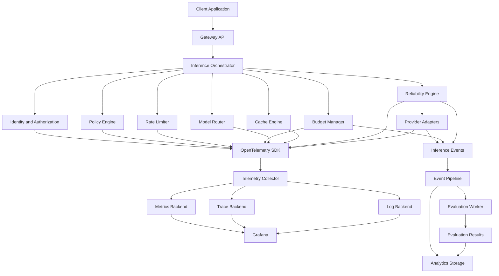

# LLM Gateway — Observability Specification

**File:** `docs/observability.md`  
**Version:** 1.0  
**Status:** Draft  
**Project:** `llm-gateway`  
**Implementation:** Rust  
**Architecture:** Clean Architecture

---

# 1. Purpose

This document defines how `llm-gateway` collects, processes, stores, and exposes operational and AI-specific telemetry.

The gateway must provide visibility into:

- Request lifecycle and execution paths.
- Model and provider selection.
- Provider latency and availability.
- Token consumption and inference costs.
- Rate limiting and budget enforcement.
- Cache performance.
- Retry, fallback, and circuit-breaker decisions.
- Streaming performance.
- Model output quality.
- Security events and administrative actions.

Observability is a platform capability, not an optional logging feature.

## 1.1 Objectives

| ID | Objective | Description |
|---|---|---|
| OBS-001 | Distributed tracing | Trace inference requests across components |
| OBS-002 | Metrics | Measure gateway and provider performance |
| OBS-003 | Structured logging | Produce searchable operational logs |
| OBS-004 | Cost visibility | Attribute inference cost to tenants and projects |
| OBS-005 | Provider visibility | Compare provider reliability and latency |
| OBS-006 | Routing visibility | Explain routing and fallback decisions |
| OBS-007 | Quality visibility | Connect evaluation results to inference executions |
| OBS-008 | Security visibility | Audit sensitive operations without exposing secrets |
| OBS-009 | Alerting | Detect operational and financial anomalies |
| OBS-010 | Tenant isolation | Restrict telemetry access by authorization scope |

---

# 2. Observability Architecture



## 2.1 Technology Stack

| Capability | Technology | Responsibility |
|---|---|---|
| Instrumentation | OpenTelemetry | Standard telemetry APIs |
| Rust instrumentation | `tracing` | Structured application instrumentation |
| Trace propagation | W3C Trace Context | Cross-service trace correlation |
| Telemetry collection | OpenTelemetry Collector | Receive, process, export telemetry |
| Metrics | Prometheus | Time-series metrics |
| Dashboards | Grafana | Visualization and exploration |
| Trace storage | Tempo or Jaeger | Distributed trace storage |
| Log storage | Loki | Log aggregation |
| AI observability | Langfuse | LLM-specific tracing and analysis |
| Evaluation | DeepEval / RAGAS | Offline and sampled quality evaluation |
| Event delivery | Redis Streams initially | Asynchronous event processing |
| Financial records | PostgreSQL | Authoritative usage and cost data |

These are initial technology choices. The architecture should remain replaceable through stable interfaces.

---

# 3. Three Pillars of Observability

## 3.1 Metrics

Metrics answer:

- How many requests are being processed?
- What is the p95 latency?
- Which provider has the highest failure rate?
- How many requests are rejected?
- How much inference cost is being generated?
- How often does fallback occur?

Metrics should be aggregated and inexpensive to collect.

## 3.2 Distributed Traces

Traces answer:

- What happened during a particular inference execution?
- Which component introduced latency?
- Which provider was selected?
- How many attempts occurred?
- Why was a fallback selected?
- Was the response served from cache?

Traces represent the lifecycle of individual requests.

## 3.3 Structured Logs

Logs answer:

- What happened at a specific point in time?
- Which policy decision was applied?
- What error occurred?
- Which configuration version was active?
- What operational action was performed?

Logs provide detailed diagnostic context.

---

# 4. Distributed Tracing

Every inference request must have a distributed trace.

## 4.1 Trace Hierarchy

Recommended span hierarchy:

```text
gateway.request
│
├── authentication
├── authorization
├── request.validation
├── abuse.protection
├── rate_limit.check
├── concurrency.acquire
├── policy.evaluate
├── budget.reserve
├── cache.lookup
│
├── routing.evaluate
│   ├── capability.match
│   ├── quality.evaluate
│   ├── health.evaluate
│   └── candidate.rank
│
├── reliability.execute
│   ├── provider.attempt
│   ├── retry.evaluate
│   ├── circuit_breaker.evaluate
│   └── fallback.select
│
├── response.normalize
├── usage.reconcile
├── budget.settle
└── telemetry.publish
```

Not every operation needs an individual span. Instrument operations that provide meaningful diagnostic value.

## 4.2 Trace Context

Use W3C Trace Context propagation.

Required identifiers:

| Identifier | Purpose |
|---|---|
| `trace_id` | Distributed request correlation |
| `span_id` | Individual operation correlation |
| `request_id` | Public gateway request identifier |
| `execution_id` | Logical inference execution |
| `attempt_id` | Individual provider attempt |
| `tenant_id` | Tenant attribution |
| `project_id` | Project attribution |
| `provider_id` | Provider identification |
| `model_id` | Gateway model identification |

Do not treat trace IDs, request IDs, and execution IDs as interchangeable.

## 4.3 Span Attributes

Example:

```json
{
  "gateway.request_id": "req_123",
  "gateway.execution_id": "exec_456",
  "gateway.tenant_id": "tenant_123",
  "gateway.project_id": "project_456",
  "gateway.provider": "provider_a",
  "gateway.model": "model_x",
  "gateway.cache_hit": false,
  "gateway.retry_count": 1,
  "gateway.fallback_used": true,
  "gateway.routing_strategy": "balanced"
}
```

Use internal identifiers where possible.

Avoid putting API keys, raw prompts, raw responses, or personally identifiable information in span attributes.

## 4.4 Trace Sampling

Tracing every request at full detail may be expensive.

Initial policy:

```yaml
observability:
  tracing:
    enabled: true
    sampling:
      strategy: parent_based
      ratio: 0.10
      always_sample_errors: true
      always_sample_fallbacks: true
      always_sample_slow_requests: true
```

A 10% sampling ratio is an initial configuration, not a universal target.

Tail-based sampling is preferable when infrastructure supports it because the collector can retain traces based on observed outcomes.

High-value traces should include:

- Failed requests.
- Provider fallback.
- Circuit-breaker transitions.
- Slow requests.
- Budget admission failures.
- Security events.
- Streaming interruptions.

Do not let trace sampling disable financial accounting or mandatory security auditing.

---

# 5. Metrics Architecture

Metrics must be designed around operational questions.

## 5.1 Gateway Metrics

| Metric | Type | Description |
|---|---|---|
| `gateway_requests_total` | Counter | Total inference requests |
| `gateway_request_duration_seconds` | Histogram | End-to-end latency |
| `gateway_active_requests` | Gauge | Active requests |
| `gateway_request_errors_total` | Counter | Failed requests |
| `gateway_requests_rejected_total` | Counter | Rejected requests |
| `gateway_request_size_bytes` | Histogram | Request size |
| `gateway_response_size_bytes` | Histogram | Response size |

## 5.2 Provider Metrics

| Metric | Type | Description |
|---|---|---|
| `gateway_provider_requests_total` | Counter | Provider attempts |
| `gateway_provider_duration_seconds` | Histogram | Provider latency |
| `gateway_provider_errors_total` | Counter | Provider failures |
| `gateway_provider_timeouts_total` | Counter | Provider timeouts |
| `gateway_provider_tokens_total` | Counter | Tokens processed |
| `gateway_provider_cost_total` | Counter | Recorded provider cost |
| `gateway_provider_health` | Gauge | Provider health state |

## 5.3 Routing Metrics

| Metric | Type | Description |
|---|---|---|
| `gateway_routing_decisions_total` | Counter | Routing decisions |
| `gateway_routing_duration_seconds` | Histogram | Routing evaluation time |
| `gateway_fallbacks_total` | Counter | Fallback decisions |
| `gateway_model_selections_total` | Counter | Selected models |
| `gateway_routing_rejections_total` | Counter | Requests without eligible candidates |

## 5.4 Budget Metrics

| Metric | Type | Description |
|---|---|---|
| `gateway_budget_reserved_total` | Counter | Reserved amount |
| `gateway_budget_spent_total` | Counter | Settled amount |
| `gateway_budget_reservation_active` | Gauge | Active reservations |
| `gateway_budget_rejections_total` | Counter | Budget rejections |
| `gateway_budget_reconciliation_errors_total` | Counter | Reconciliation failures |

Financial metrics are operational aggregates. PostgreSQL remains authoritative for financial reporting and reconciliation.

## 5.5 Cache Metrics

| Metric | Type | Description |
|---|---|---|
| `gateway_cache_requests_total` | Counter | Cache lookups |
| `gateway_cache_hits_total` | Counter | Cache hits |
| `gateway_cache_misses_total` | Counter | Cache misses |
| `gateway_cache_duration_seconds` | Histogram | Lookup duration |
| `gateway_cache_evictions_total` | Counter | Cache evictions |

## 5.6 Reliability Metrics

| Metric | Type | Description |
|---|---|---|
| `gateway_retries_total` | Counter | Retry attempts |
| `gateway_circuit_breaker_state` | Gauge | Circuit state |
| `gateway_circuit_breaker_transitions_total` | Counter | State changes |
| `gateway_fallback_attempts_total` | Counter | Fallback attempts |
| `gateway_unknown_outcomes_total` | Gauge | Uncertain executions |
| `gateway_recovery_jobs_total` | Counter | Recovery operations |

---

# 6. Metric Cardinality

Metric labels must remain bounded.

Good labels:

- Provider.
- Model family.
- Request outcome.
- Error category.
- Routing strategy.
- Environment.
- Region.

Avoid high-cardinality labels:

- Raw API keys.
- User IDs.
- Request IDs.
- Execution IDs.
- Trace IDs.
- Raw prompts.
- Arbitrary metadata.

Tenant-level operational analytics should use an appropriate event or analytical storage system rather than unbounded Prometheus labels.

---

# 7. Structured Logging

All gateway services must use structured JSON logging.

## 7.1 Log Levels

| Level | Usage |
|---|---|
| ERROR | Operation failed and requires investigation |
| WARN | Degraded operation or recoverable failure |
| INFO | Important lifecycle or administrative events |
| DEBUG | Diagnostic information |
| TRACE | Detailed development instrumentation |

Production defaults should normally use INFO, with controlled DEBUG activation.

## 7.2 Log Schema

Example:

```json
{
  "timestamp": "2026-11-03T15:30:00Z",
  "level": "INFO",
  "service": "gateway-api",
  "environment": "production",
  "trace_id": "trace_123",
  "request_id": "req_123",
  "execution_id": "exec_456",
  "tenant_id": "tenant_123",
  "event": "provider.fallback.selected",
  "provider_id": "provider_b",
  "model_id": "model_y",
  "reason": "primary_provider_timeout"
}
```

## 7.3 Sensitive Data Redaction

Never log:

- Raw virtual API keys.
- Provider API keys.
- Authorization headers.
- Secret-manager responses.
- Passwords.
- Authentication tokens.
- Unredacted payment information.

Prompt and completion logging must be disabled by default.

If content capture is enabled for an approved evaluation or debugging workflow, require:

- Explicit tenant policy.
- Data classification.
- Redaction.
- Retention limits.
- Access control.
- Audit trail.

---

# 8. LLM-Specific Observability

Traditional infrastructure metrics are insufficient for LLM systems.

The gateway must capture model-specific information.

## 8.1 Inference Event

Canonical event structure:

```json
{
  "event_type": "inference.completed",
  "event_version": "1.0",
  "event_id": "evt_123",
  "timestamp": "2026-11-03T15:30:00Z",
  "request_id": "req_123",
  "execution_id": "exec_456",
  "tenant_id": "tenant_123",
  "project_id": "project_456",
  "provider_id": "provider_a",
  "model_id": "model_x",
  "routing_strategy": "balanced",
  "input_tokens": 1200,
  "output_tokens": 350,
  "total_tokens": 1550,
  "estimated_cost": "0.0045",
  "actual_cost": "0.0048",
  "cache_hit": false,
  "retry_count": 0,
  "fallback_used": false,
  "duration_ms": 2400,
  "status": "succeeded"
}
```

This is an illustrative schema.

The event should reference identifiers and normalized metadata rather than embed raw prompt or completion content.

## 8.2 Token Metrics

Track:

- Input tokens.
- Output tokens.
- Cached input tokens.
- Reasoning tokens, when reported.
- Image and audio usage, when supported.
- Total tokens.
- Estimated versus provider-reported usage.

Keep token usage source and normalization version available for auditability.

## 8.3 Cost Metrics

Track:

- Estimated cost.
- Actual reconciled cost.
- Cost per request.
- Cost per tenant.
- Cost per project.
- Cost per provider.
- Cost per model.
- Cost per successful response.
- Cache-related cost avoidance estimates.

Do not describe estimated cache savings as realized financial savings unless supported by a defined comparison methodology.

## 8.4 Latency Metrics

Track:

- Gateway admission latency.
- Routing latency.
- Provider connection latency.
- Time to first token (TTFT).
- Inter-token latency, where practical.
- Total generation latency.
- End-to-end request latency.

For streaming requests, TTFT and total generation latency must be reported separately.

---

# 9. Evaluation Observability

Evaluation results must be linked to inference executions.

The evaluation worker should emit versioned evaluation events.

Example:

```json
{
  "event_type": "evaluation.completed",
  "event_version": "1.0",
  "execution_id": "exec_456",
  "dataset_id": "support-quality-v1",
  "dataset_version": "1.0",
  "evaluation_run_id": "eval_123",
  "evaluator_version": "1.2",
  "metrics": {
    "relevance": 0.94,
    "faithfulness": 0.91,
    "toxicity": 0.01
  },
  "status": "completed"
}
```

The evaluation system must record:

- Dataset and version.
- Evaluator and version.
- Metric definitions.
- Model/provider used for judging, when applicable.
- Evaluation timestamp.
- Result and threshold.
- Sampling method.

Evaluation results must not be treated as proof of correctness. They are evidence with known limitations.

---

# 10. Telemetry Pipeline

## 10.1 Synchronous and Asynchronous Responsibilities

The inference path must not wait for expensive observability processing.

Synchronous operations:

- Generate trace and span context.
- Increment in-process metrics.
- Record essential request metadata.
- Persist required financial and audit records.
- Publish durable events through an outbox when required.

Asynchronous operations:

- Export traces.
- Aggregate logs.
- Process analytical events.
- Run sampled evaluations.
- Generate quality reports.
- Build dashboards and alerts.

Do not make financial accounting dependent on best-effort telemetry delivery.

## 10.2 Transactional Outbox

For events that must be delivered reliably:

1. Persist the business operation.
2. Persist the corresponding outbox event in the same database transaction.
3. A background publisher reads pending events.
4. Publish to the event broker.
5. Mark events delivered.
6. Retry failed publication with bounded backoff.

Consumers must be idempotent.

---

# 11. Dashboards

Grafana should provide the following dashboards.

## 11.1 Gateway Overview

Show:

- Request throughput.
- Error rate.
- p50/p95/p99 latency.
- Active requests.
- Rejected requests.
- Overall availability.
- Gateway resource utilization.

## 11.2 Provider Health

Show:

- Requests by provider.
- Provider success rate.
- Provider latency.
- Provider timeouts.
- HTTP 429 frequency.
- Circuit-breaker state.
- Fallback frequency.

## 11.3 Cost and Usage

Show:

- Daily spend.
- Spend by tenant.
- Spend by project.
- Spend by model.
- Spend by provider.
- Input/output token consumption.
- Budget utilization.
- Reservation reconciliation failures.

Access must be restricted to authorized users.

## 11.4 Routing Performance

Show:

- Model selection distribution.
- Routing strategy distribution.
- Fallback rate.
- Model latency comparison.
- Cost per successful request.
- Quality results by model and task.

## 11.5 Cache Performance

Show:

- Cache hit ratio.
- Cache lookup latency.
- Cache misses.
- Evictions.
- Estimated avoided cost.
- Cache errors.

## 11.6 Evaluation Quality

Show:

- Evaluation volume.
- Evaluation success rate.
- Relevance.
- Faithfulness.
- Safety metrics.
- Quality threshold failures.
- Quality trends by model version.

---

# 12. Alerting Strategy

Alerts should identify actionable conditions.

Example initial rules:

| Alert | Condition | Severity |
|---|---|---|
| Gateway high error rate | Error rate exceeds agreed threshold | Critical |
| Gateway latency elevated | p95 exceeds SLO | Warning |
| Provider unavailable | Circuit remains open | Critical |
| Provider rate limited | Sustained 429 increase | Warning |
| Budget reconciliation failure | Persistent settlement failures | Critical |
| Unknown outcomes increasing | Uncertain executions exceed threshold | Critical |
| Redis unavailable | Required admission controls degraded | Critical |
| Telemetry pipeline backlog | Outbox or collector backlog increasing | Warning |
| Evaluation quality regression | Metric falls below task threshold | Warning |
| Budget anomaly | Spend deviates from expected range | Warning |

Alert thresholds must be calibrated using production-like workload tests.

## 12.1 Alert Routing

Suggested destinations:

- Platform operations.
- Provider integration owners.
- FinOps administrators.
- AI quality engineers.
- Security operations.

Avoid sending every warning to every team.

---

# 13. SLO and SLA Framework

Define internal Service Level Objectives independently from external contractual SLAs.

Initial proposed targets:

| Indicator | Initial Target |
|---|---|
| Gateway availability | 99.9% |
| Gateway-added latency | p95 below 50 ms, excluding provider execution |
| Exact cache lookup | p95 below 15 ms under defined load |
| Telemetry delivery | 99% delivered within agreed processing window |
| Financial settlement | 99.9% successfully reconciled within defined window |

These are engineering targets, not demonstrated results.

Provider generation latency must be measured separately from gateway-added latency.

## 13.1 Error Budget

For an availability SLO:

\[
Error\ Budget = 1 - SLO
\]

At 99.9% availability, the allowed error budget is 0.1% over the measurement period.

Use error-budget consumption to guide release risk and reliability improvements.

---

# 14. Tenant-Aware Observability

Tenant-specific observability must enforce authorization at every query boundary.

Required capabilities:

- Tenant usage reports.
- Project usage reports.
- Provider and model usage reports.
- Budget utilization.
- Request-level trace access, subject to permissions.
- Evaluation result access.
- Administrative audit history.

Do not expose internal platform telemetry or other tenants' information to tenant administrators.

Use tenant and project identifiers for attribution, but avoid unbounded metric labels.

---

# 15. Retention and Data Governance

Retention must distinguish telemetry types.

| Data | Suggested Treatment |
|---|---|
| Aggregated metrics | Retain according to operational requirements |
| Distributed traces | Shorter configurable retention |
| Application logs | Configurable retention |
| Financial ledger | Long-term retention under applicable obligations |
| Audit events | Protected retention and controlled deletion |
| Prompt/completion content | Disabled by default; explicit policy required |
| Evaluation results | Retain according to dataset and governance requirements |

Retention durations must be configurable and reviewed against legal, privacy, and operational requirements.

Data deletion policies must account for derived telemetry and exported content.

---

# 16. Rust Implementation Design

Suggested logical structure:

```text
crates/
└── telemetry/
    └── src/
        ├── lib.rs
        ├── bootstrap.rs
        ├── tracing/
        │   ├── mod.rs
        │   ├── context.rs
        │   └── spans.rs
        ├── metrics/
        │   ├── mod.rs
        │   ├── gateway.rs
        │   ├── provider.rs
        │   ├── routing.rs
        │   └── budget.rs
        ├── logging/
        │   ├── mod.rs
        │   └── redaction.rs
        ├── events/
        │   ├── mod.rs
        │   └── inference.rs
        └── exporters/
            ├── mod.rs
            └── otlp.rs
```

## 16.1 Rust Dependencies

| Crate | Purpose |
|---|---|
| `tracing` | Structured instrumentation |
| `tracing-subscriber` | Subscriber configuration |
| `tracing-opentelemetry` | Trace integration |
| `opentelemetry` | Telemetry API |
| `opentelemetry_sdk` | SDK |
| `opentelemetry-otlp` | OTLP export |
| `metrics` or `opentelemetry` metrics | Metric instrumentation |
| `serde` | Event serialization |
| `uuid` | Correlation identifiers |

Select compatible dependency versions and maintain them through Cargo.lock.

## 16.2 Instrumentation Example

```rust
use tracing::{info, instrument};

#[instrument(
    skip(request),
    fields(
        execution_id = %execution_id,
        provider_id = %provider_id,
        model_id = %model_id
    )
)]
pub async fn execute_inference(
    execution_id: &str,
    provider_id: &str,
    model_id: &str,
    request: InferenceRequest,
) -> Result<InferenceResponse, GatewayError> {
    info!("Starting inference execution");

    // Execute inference workflow.

    todo!()
}
```

Do not add sensitive request contents to tracing fields.

---

# 17. Testing Strategy

## Unit Tests

- Trace context propagation.
- Metric recording.
- Metric label validation.
- Log redaction.
- Event schema validation.
- Evaluation event serialization.

## Integration Tests

- OTLP export.
- Prometheus scraping.
- Trace correlation across components.
- Structured JSON log output.
- Event publication.
- Outbox retry behavior.
- Tenant-aware query authorization.
- Telemetry backend outage.

## Performance Tests

- Instrumentation overhead.
- Trace sampling behavior.
- Metrics cardinality.
- Export queue saturation.
- High-volume event publication.
- Collector backpressure.

## Security Tests

- Secret redaction.
- Cross-tenant trace access.
- Unauthorized dashboard access.
- Prompt-content leakage.
- Audit log integrity.
- Telemetry retention enforcement.

---

# 18. Definition of Done

## Instrumentation

- [ ] OpenTelemetry initialized.
- [ ] W3C trace propagation supported.
- [ ] Gateway spans implemented.
- [ ] Provider spans implemented.
- [ ] Retry and fallback spans implemented.
- [ ] Request and execution IDs correlated.

## Metrics

- [ ] Gateway metrics exposed.
- [ ] Provider metrics exposed.
- [ ] Routing metrics exposed.
- [ ] Budget metrics exposed.
- [ ] Cache metrics exposed.
- [ ] Reliability metrics exposed.
- [ ] Cardinality controls implemented.

## Logging

- [ ] Structured JSON logging implemented.
- [ ] Sensitive fields redacted.
- [ ] Log levels configurable.
- [ ] Correlation identifiers included.

## LLM Observability

- [ ] Token usage recorded.
- [ ] Cost attribution implemented.
- [ ] TTFT measured.
- [ ] Streaming metrics implemented.
- [ ] Evaluation results correlated with executions.

## Operations

- [ ] Grafana dashboards created.
- [ ] Alerting rules created.
- [ ] SLO metrics defined.
- [ ] Telemetry retention configured.
- [ ] Tenant isolation tested.
- [ ] Telemetry outage behavior tested.

---

# 19. Architectural Decisions

Proposed ADRs:

| ADR | Decision |
|---|---|
| ADR-038 | Adopt OpenTelemetry as the instrumentation standard |
| ADR-039 | Use W3C Trace Context propagation |
| ADR-040 | Use structured JSON logging |
| ADR-041 | Keep financial accounting independent of best-effort telemetry |
| ADR-042 | Apply bounded trace sampling |
| ADR-043 | Use asynchronous telemetry export |
| ADR-044 | Enforce tenant-aware telemetry access |
| ADR-045 | Disable prompt and completion logging by default |

Reconcile identifiers with the existing ADR index.

---

# 20. Architectural Invariants

1. Every inference execution has a unique execution ID.
2. Trace IDs, request IDs, and execution IDs remain distinct.
3. Financial accounting never depends on trace sampling.
4. Telemetry export must not block ordinary inference indefinitely.
5. Sensitive information must be redacted.
6. Metric cardinality must be bounded.
7. Tenant telemetry access must be authorized.
8. Provider and gateway latency must be distinguishable.
9. Evaluation results must identify dataset and evaluator versions.
10. Observability failure must not silently corrupt financial records.

---

# 21. Related Documents

- `docs/product.md`
- `docs/architecture.md`
- `docs/domain-model.md`
- `docs/data-model.md`
- `docs/security.md`
- `docs/routing-policy.md`
- `docs/provider-integration.md`
- `docs/reliability.md`
- `docs/budget-and-usage-accounting.md`
- `docs/evaluation-strategy.md`
- `docs/deployment.md`


