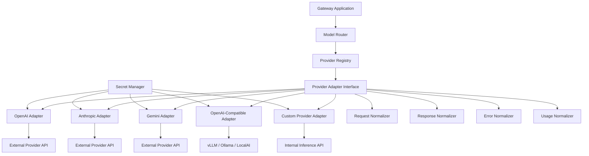
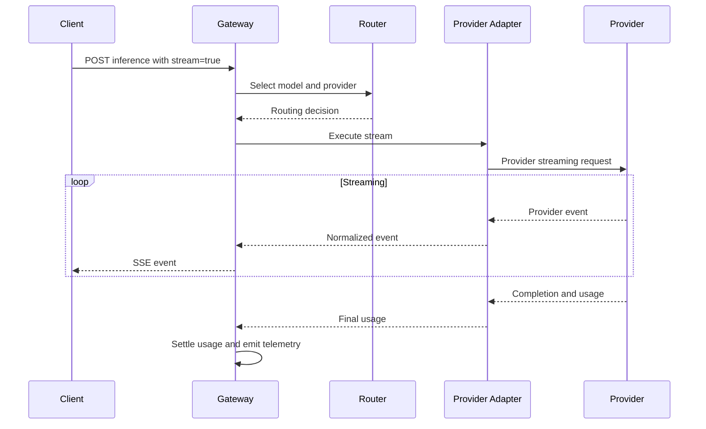
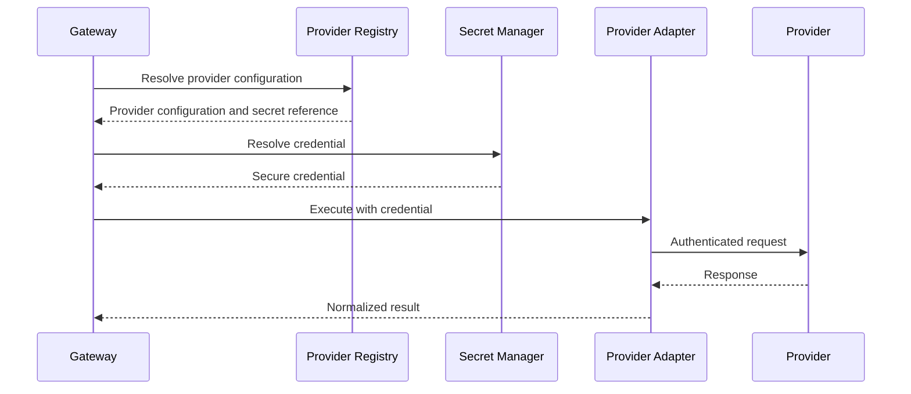

# LLM Gateway — Provider Integration Specification

**File:** `docs/provider-integration.md`  
**Version:** 1.0  
**Status:** Draft  
**Project:** `llm-gateway`  
**Implementation:** Rust  
**Architecture:** Clean Architecture

---

# 1. Purpose

This document defines how `llm-gateway` integrates external and self-hosted LLM providers.

The provider integration layer must:

- Abstract provider-specific APIs.
- Support multiple LLM vendors.
- Normalize requests and responses.
- Support streaming and non-streaming inference.
- Normalize provider errors.
- Normalize token usage and cost metadata.
- Integrate with secret management.
- Support provider-specific configuration.
- Support provider health monitoring.
- Enable model routing and fallback.
- Prevent vendor-specific dependencies from leaking into the domain layer.

The gateway must allow a new provider to be integrated without modifying the core routing and budget-management logic.

# 2. Supported Provider Categories

The architecture must support three provider categories.

## 2.1 Commercial Providers

Examples:

- OpenAI.
- Anthropic.
- Google Gemini.
- Other commercial LLM APIs.

Each provider may have its own:

- Authentication mechanism.
- API format.
- Model identifiers.
- Token usage format.
- Error structure.
- Streaming protocol.
- Pricing model.
- Rate limits.

## 2.2 OpenAI-Compatible Providers

Examples:

- vLLM.
- Ollama.
- LocalAI.
- Other OpenAI-compatible inference servers.

These providers may support compatible chat-completion endpoints, but compatibility must be verified capability by capability.

Do not assume that every OpenAI-compatible server supports every OpenAI API feature.

## 2.3 Self-Hosted Providers

The architecture should support internal inference endpoints and self-hosted model infrastructure.

Examples include:

- Private vLLM deployments.
- Internal inference clusters.
- GPU-backed model-serving endpoints.

Provider configuration must support private networking, authentication, TLS, and controlled outbound connectivity.

# 3. Provider Integration Architecture



## 3.1 Architectural Responsibilities

| Component | Responsibility |
|---|---|
| Provider Registry | Discover and manage configured providers |
| Provider Adapter | Communicate with one provider API |
| Request Mapper | Convert internal requests to provider requests |
| Response Mapper | Normalize provider responses |
| Stream Mapper | Normalize streaming events |
| Error Mapper | Normalize provider failures |
| Usage Mapper | Normalize token usage |
| Credential Resolver | Retrieve provider credentials |
| Provider Health | Track availability and failure state |
| Capability Mapper | Report supported provider features |

Provider adapters belong in the infrastructure layer.

The model router must depend on provider abstractions, not vendor SDKs.

# 4. Provider Domain Abstraction

The gateway needs a common internal provider contract.

## 4.1 Provider Identifier

```rust
#[derive(Debug, Clone, PartialEq, Eq, Hash)]
pub struct ProviderId(pub String);
```

Provider identifiers must be stable and independent of display names.

## 4.2 Provider Definition

```rust
pub struct ProviderDefinition {
    pub id: ProviderId,
    pub name: String,
    pub provider_type: ProviderType,
    pub base_url: Option<String>,
    pub enabled: bool,
    pub supported_capabilities: Vec<ModelCapability>,
    pub configuration_version: String,
}
```

## 4.3 Provider Types

```rust
pub enum ProviderType {
    OpenAi,
    Anthropic,
    Gemini,
    OpenAiCompatible,
    Custom,
}
```

Provider-specific settings should be stored separately from domain entities.

Do not place API keys directly inside `ProviderDefinition`.

# 5. Provider Adapter Interface

The provider abstraction must support both ordinary and streaming inference.

A possible initial interface:

```rust
#[async_trait::async_trait]
pub trait ProviderAdapter: Send + Sync {
    async fn execute(
        &self,
        request: ProviderRequest,
        credentials: ProviderCredentials,
    ) -> Result<ProviderResponse, ProviderError>;

    async fn execute_stream(
        &self,
        request: ProviderRequest,
        credentials: ProviderCredentials,
    ) -> Result<ProviderStream, ProviderError>;

    async fn health_check(
        &self,
    ) -> Result<ProviderHealthResult, ProviderError>;
}
```

The stream type should expose a typed stream of normalized events.

The exact Rust implementation should use `futures::Stream` and appropriate pinned stream types.

## 5.1 Interface Design Principles

- No vendor SDK types in domain interfaces.
- No HTTP response objects in domain interfaces.
- No provider-specific error types outside adapters.
- No provider API keys in request objects.
- Support cancellation.
- Support execution deadlines.
- Support structured errors.
- Support streaming.
- Preserve provider request identifiers.
- Normalize usage information.

The adapter should receive credentials through a secure credential-resolution boundary.

# 6. Canonical Inference Request

The gateway needs a provider-independent request representation.

```rust
pub struct ProviderRequest {
    pub execution_id: ExecutionId,
    pub model: ProviderModelId,
    pub messages: Vec<ProviderMessage>,
    pub parameters: GenerationParameters,
    pub response_format: Option<ResponseFormat>,
    pub tools: Vec<ToolDefinition>,
    pub stream: bool,
    pub timeout: Duration,
}
```

## 6.1 Message Types

```rust
pub enum MessageRole {
    System,
    Developer,
    User,
    Assistant,
    Tool,
}

pub struct ProviderMessage {
    pub role: MessageRole,
    pub content: Vec<ContentPart>,
}
```

## 6.2 Content Types

```rust
pub enum ContentPart {
    Text(String),
    Image(ImageReference),
    Audio(AudioReference),
}
```

The initial release may support text and image inputs only if the selected provider adapters implement them.

Audio and additional modalities should be introduced through explicit capability extensions.

## 6.3 Generation Parameters

```rust
pub struct GenerationParameters {
    pub temperature: Option<f32>,
    pub top_p: Option<f32>,
    pub max_output_tokens: Option<u32>,
    pub stop_sequences: Vec<String>,
    pub seed: Option<u64>,
}
```

Not every provider supports every parameter.

The adapter must validate unsupported parameters rather than silently pretending they were applied.

# 7. Canonical Provider Response

```rust
pub struct ProviderResponse {
    pub execution_id: ExecutionId,
    pub provider_request_id: Option<String>,
    pub provider_model: String,
    pub content: String,
    pub finish_reason: Option<FinishReason>,
    pub usage: Option<ProviderUsage>,
    pub provider_metadata: ProviderMetadata,
}
```

## 7.1 Finish Reasons

```rust
pub enum FinishReason {
    Stop,
    Length,
    ToolCalls,
    ContentFilter,
    Unknown,
}
```

Provider-specific finish reasons must be mapped into the canonical representation.

The original provider value may be retained in restricted diagnostic metadata.

# 8. Streaming Architecture

Streaming is a core requirement for an enterprise LLM gateway.

The gateway must support Server-Sent Events (SSE) at its public API boundary.

## 8.1 Internal Streaming Events

```rust
pub enum ProviderStreamEvent {
    Started {
        provider_request_id: Option<String>,
    },
    ContentDelta {
        text: String,
    },
    ToolCallDelta {
        index: u32,
        content: String,
    },
    Usage {
        usage: ProviderUsage,
    },
    Completed {
        finish_reason: Option<FinishReason>,
    },
}
```

Provider adapters convert vendor-specific streaming events into this representation.

## 8.2 Streaming Flow



## 8.3 Streaming Requirements

- Preserve event ordering.
- Propagate client cancellation.
- Enforce execution deadlines.
- Normalize provider events.
- Capture final usage when available.
- Record partial execution failures.
- Release concurrency permits on termination.
- Reconcile budget reservations.
- Prevent duplicate output.
- Handle malformed or incomplete provider streams.

## 8.4 Streaming Fallback

Before the first response token is delivered, a provider failure may permit fallback.

After content has been delivered, the gateway must not transparently restart generation on another provider.

The stream must terminate with a structured error when continuation is impossible.

The gateway must preserve partial usage and accounting information.

# 9. Provider Error Normalization

Every provider adapter must translate errors into a canonical error taxonomy.

## 9.1 Canonical Error Types

```rust
pub enum ProviderErrorKind {
    Authentication,
    Authorization,
    InvalidRequest,
    ModelNotFound,
    UnsupportedCapability,
    RateLimited,
    ContextLengthExceeded,
    Timeout,
    ConnectionFailure,
    ProviderUnavailable,
    ContentFiltered,
    InternalError,
    Unknown,
}
```

## 9.2 Provider Error Structure

```rust
pub struct ProviderError {
    pub provider_id: ProviderId,
    pub kind: ProviderErrorKind,
    pub retryable: bool,
    pub retry_after: Option<Duration>,
    pub provider_status_code: Option<u16>,
    pub provider_request_id: Option<String>,
    pub safe_message: String,
}
```

Do not expose raw provider responses, credentials, or sensitive internal diagnostics to clients.

## 9.3 Error Mapping

| HTTP Status | Canonical Interpretation | Default Retry |
|---|---|---|
| 400 | Invalid request | No |
| 401 | Authentication failure | No |
| 403 | Authorization failure | No |
| 404 | Model or resource missing | No |
| 408 | Timeout | Conditional |
| 413 | Context or payload too large | No |
| 429 | Rate limited | Yes, bounded |
| 500 | Internal provider error | Conditional |
| 502 | Provider gateway failure | Conditional |
| 503 | Provider unavailable | Yes, bounded |
| 504 | Provider timeout | Conditional |

The adapter must consider provider-specific error codes and headers rather than relying only on HTTP status.

# 10. Usage Normalization

Provider usage formats differ.

The gateway must normalize them.

```rust
pub struct ProviderUsage {
    pub input_tokens: Option<u64>,
    pub output_tokens: Option<u64>,
    pub cached_input_tokens: Option<u64>,
    pub reasoning_tokens: Option<u64>,
    pub total_tokens: Option<u64>,
    pub usage_source: UsageSource,
}
```

```rust
pub enum UsageSource {
    ProviderReported,
    GatewayEstimated,
    Reconciled,
}
```

## 10.1 Usage Rules

- Preserve provider-reported values.
- Do not invent missing usage values.
- Use token estimation only when provider usage is unavailable and policy permits it.
- Distinguish estimated from confirmed usage.
- Avoid double-counting cached tokens.
- Preserve provider request IDs.
- Feed normalized usage into the budget manager.
- Keep pricing calculations outside provider adapters.

The provider adapter reports usage. The budget manager calculates financial cost.

# 11. Secret Management Integration

Provider credentials must never be embedded in source code, Docker images, or model configuration files.

## 11.1 Credential Resolution

```rust
pub struct ProviderCredentials {
    pub api_key: SecretString,
    pub organization_id: Option<String>,
}
```

The credential object should use a secret-safe type whose Debug output is redacted.

## 11.2 Secret Resolution Flow



## 11.3 Credential Requirements

- Resolve secrets at execution time or through a controlled cache.
- Support credential rotation.
- Support credential revocation.
- Avoid logging credentials.
- Redact credentials from errors.
- Restrict secret access by provider and environment.
- Support local development secrets.
- Support production secret managers.

Provider adapters must not independently load arbitrary environment variables or access secret storage directly.

# 12. Provider Configuration

Provider configuration should be versioned and validated.

Example:

```yaml
providers:
  openai:
    type: openai
    enabled: true
    base_url: null
    secret_reference: secrets/llm-gateway/openai

    timeout_ms: 30000
    max_retries: 2

  anthropic:
    type: anthropic
    enabled: true
    secret_reference: secrets/llm-gateway/anthropic

    timeout_ms: 30000
    max_retries: 2

  local-vllm:
    type: openai_compatible
    enabled: true
    base_url: http://vllm:8000/v1
    secret_reference: secrets/llm-gateway/vllm

    timeout_ms: 60000
    max_retries: 1
```

Requirements:

- Validate provider type.
- Validate endpoint URLs.
- Validate TLS configuration.
- Validate model capabilities.
- Validate secret references.
- Validate timeout and retry policies.
- Prevent arbitrary untrusted endpoint configuration.
- Audit provider configuration changes.

# 13. Provider Registry

The registry manages available provider adapters.

```rust
#[async_trait::async_trait]
pub trait ProviderRegistry: Send + Sync {
    async fn get_adapter(
        &self,
        provider_id: &ProviderId,
    ) -> Result<Arc<dyn ProviderAdapter>, RegistryError>;

    async fn list_enabled(
        &self,
    ) -> Result<Vec<ProviderDefinition>, RegistryError>;
}
```

The registry must support:

- Provider activation.
- Provider deactivation.
- Adapter lookup.
- Configuration versions.
- Health information.
- Capability discovery.
- Controlled configuration reload.

An inactive provider must not receive new requests.

Existing executions must be handled according to a documented shutdown and draining policy.

# 14. Model and Capability Mapping

Provider model names must not be used as the gateway's internal model identity.

Example:

```yaml
models:
  - id: model-fast
    provider_id: openai
    provider_model_name: provider-model-identifier
    capabilities:
      - text_generation
      - streaming
      - tool_calling
    context_window: 128000

  - id: model-local
    provider_id: local-vllm
    provider_model_name: local-model-identifier
    capabilities:
      - text_generation
      - streaming
    context_window: 32768
```

These identifiers and limits are illustrative.

The model registry must distinguish:

- Internal model ID.
- Provider model identifier.
- Model version.
- Capabilities.
- Context window.
- Output limits.
- Supported parameters.
- Pricing version.
- Evaluation profile.

Provider adapters must not independently decide which models are authorized for a tenant.

That remains the responsibility of the policy and routing layers.

# 15. Provider Reliability Integration

Provider adapters must expose normalized errors and health information to the reliability engine.

Responsibilities include:

- Request timeout.
- Connection timeout.
- Bounded retry support.
- Connection pooling.
- Cancellation.
- Circuit-breaker integration.
- Provider health reporting.
- Retry-After interpretation.

The reliability engine owns retry and fallback decisions.

Provider adapters should not implement uncontrolled internal retry loops that conflict with gateway-wide retry policies.

## 15.1 Timeout Layers

Define separate timeouts:

| Timeout | Purpose |
|---|---|
| Connection timeout | Establish network connection |
| Request timeout | Bound provider request |
| First-token timeout | Bound time before initial streaming output |
| Idle stream timeout | Detect stalled streaming |
| Overall deadline | Bound complete execution |

All timeouts must respect the original gateway execution deadline.

# 16. HTTP Client Architecture

Use shared HTTP clients with connection pooling.

Recommended Rust technologies:

- `reqwest` for HTTP communication.
- `tokio` for asynchronous execution.
- `futures` for stream processing.
- `serde` for serialization.
- `serde_json` for JSON.
- `rustls` for TLS where appropriate.
- `tracing` for structured diagnostics.

Avoid creating a new HTTP client for every request.

Connection pools should have configurable limits and timeouts.

Do not disable TLS certificate verification in production.

# 17. Rust Workspace Structure

Suggested logical structure:

```text
crates/
├── provider-core/
│   └── src/
│       ├── lib.rs
│       ├── adapter.rs
│       ├── request.rs
│       ├── response.rs
│       ├── stream.rs
│       ├── error.rs
│       ├── usage.rs
│       └── capability.rs
│
├── provider-registry/
│   └── src/
│       ├── lib.rs
│       ├── registry.rs
│       ├── definition.rs
│       └── configuration.rs
│
└── provider-adapters/
    └── src/
        ├── lib.rs
        ├── openai/
        │   ├── mod.rs
        │   ├── adapter.rs
        │   ├── request_mapper.rs
        │   ├── response_mapper.rs
        │   ├── stream_mapper.rs
        │   └── error_mapper.rs
        ├── anthropic/
        │   └── ...
        ├── gemini/
        │   └── ...
        ├── openai_compatible/
        │   └── ...
        └── custom/
            └── ...
```

The exact crate boundaries should be reconciled with the existing Rust workspace.

Do not create unnecessary crates for every mapper or small internal module.

# 18. Testing Strategy

## 18.1 Unit Tests

- Request mapping.
- Response mapping.
- Error mapping.
- Usage mapping.
- Capability validation.
- Parameter validation.
- Streaming event normalization.
- Credential redaction.
- Model identifier mapping.

## 18.2 Contract Tests

Each adapter must pass a shared provider contract test suite.

Required tests:

- Successful inference.
- Invalid request.
- Authentication failure.
- Rate limit.
- Provider timeout.
- Model not found.
- Context overflow.
- Streaming success.
- Streaming interruption.
- Usage extraction.
- Cancellation.

## 18.3 Integration Tests

Use:

- Mock HTTP servers.
- Provider sandbox environments where available.
- Local vLLM or Ollama for development.
- Recorded fixtures for deterministic response mapping tests.

Do not require paid provider API access for ordinary unit tests.

Live provider tests should be opt-in and isolated from CI by default.

## 18.4 Security Tests

- Secret redaction.
- TLS verification.
- SSRF prevention.
- Endpoint allowlisting.
- Malformed response handling.
- Oversized response protection.
- Redirect handling.
- Provider credential rotation.
- Sensitive error-data leakage.

# 19. Observability

Recommended metrics:

| Metric | Description |
|---|---|
| `gateway_provider_requests_total` | Provider attempts |
| `gateway_provider_errors_total` | Provider errors |
| `gateway_provider_request_duration_seconds` | Provider request duration |
| `gateway_provider_first_token_seconds` | Time to first token |
| `gateway_provider_stream_interruptions_total` | Interrupted streams |
| `gateway_provider_retries_total` | Provider retry attempts |
| `gateway_provider_usage_tokens_total` | Normalized token usage |
| `gateway_provider_health` | Provider health state |

Trace attributes should include:

- Provider ID.
- Internal model ID.
- Provider model name where safe.
- Execution ID.
- Provider request ID.
- Attempt number.
- Response status.
- Token usage.

Never include API keys or unredacted secrets in telemetry.

Prompt and response capture must follow the gateway's data-classification and retention policies.

# 20. Security Requirements

- All provider credentials use the secret manager.
- All external provider communication uses verified TLS.
- Provider endpoints are validated against SSRF policies.
- Provider redirects are disabled by default or validated explicitly.
- Provider errors are sanitized.
- Request and response sizes are bounded.
- Credentials are never logged.
- Provider adapters enforce configured timeouts.
- Client cancellation propagates to provider execution.
- Provider configuration changes are audited.
- Only enabled and authorized providers receive requests.
- Provider-specific metadata cannot bypass gateway policies.

# 21. Definition of Done

## Provider Abstraction

- [ ] Provider interface defined.
- [ ] Canonical request model implemented.
- [ ] Canonical response model implemented.
- [ ] Streaming event model implemented.
- [ ] Canonical error taxonomy implemented.
- [ ] Usage normalization implemented.
- [ ] Capability mapping implemented.

## Provider Adapters

- [ ] First commercial provider implemented.
- [ ] Second commercial provider implemented.
- [ ] OpenAI-compatible adapter implemented.
- [ ] Provider configuration validated.
- [ ] Provider registry implemented.
- [ ] Provider activation/deactivation supported.

## Reliability and Security

- [ ] Secret manager integrated.
- [ ] Credential rotation supported.
- [ ] HTTP connection pooling configured.
- [ ] Timeouts enforced.
- [ ] Client cancellation supported.
- [ ] Provider health integration implemented.
- [ ] Error normalization tested.
- [ ] Streaming interruption tested.
- [ ] SSRF controls tested.

## Quality

- [ ] Shared contract tests implemented.
- [ ] Unit tests pass.
- [ ] Integration tests pass.
- [ ] Mock provider tests pass.
- [ ] Security tests pass.
- [ ] Provider metrics available.

# 22. Architectural Decisions

Proposed ADRs:

| ADR | Decision |
|---|---|
| ADR-024 | Provider-independent canonical request and response models |
| ADR-025 | Provider adapters isolated in infrastructure |
| ADR-026 | Shared HTTP client with connection pooling |
| ADR-027 | Normalized provider error taxonomy |
| ADR-028 | Normalized provider usage representation |
| ADR-029 | Streaming through typed asynchronous events |
| ADR-030 | Provider credentials resolved through SecretProvider |

Reconcile these numbers with the existing ADR index.

# 23. Architectural Invariants

1. Core routing logic never depends on vendor SDK types.
2. Provider adapters never own tenant authorization.
3. Provider credentials never enter ordinary inference request objects.
4. Provider usage is normalized before accounting.
5. Pricing calculation belongs to the budget manager.
6. Provider errors are normalized before reliability decisions.
7. Provider retries are controlled by the reliability engine.
8. Streaming cancellation propagates to the provider.
9. Provider capability claims must be verified.
10. New provider integrations must pass the shared contract test suite.
11. Provider configuration must be validated before activation.
12. Provider failures must not bypass budget reconciliation.

# 24. Related Documents

- `docs/architecture.md`
- `docs/domain-model.md`
- `docs/data-model.md`
- `docs/api-contracts.md`
- `docs/security.md`
- `docs/routing-policy.md`
- `docs/rate-limiting-and-concurrency.md`
- `docs/budget-and-usage-accounting.md`
- `docs/reliability.md`
- `docs/observability.md`
- `docs/deployment.md`


