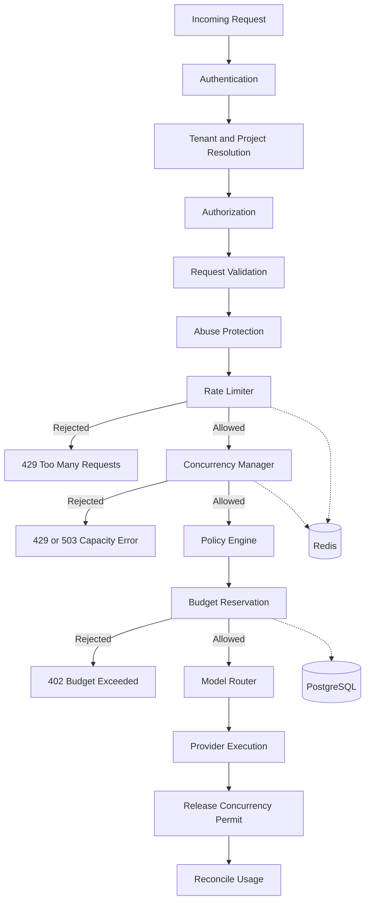
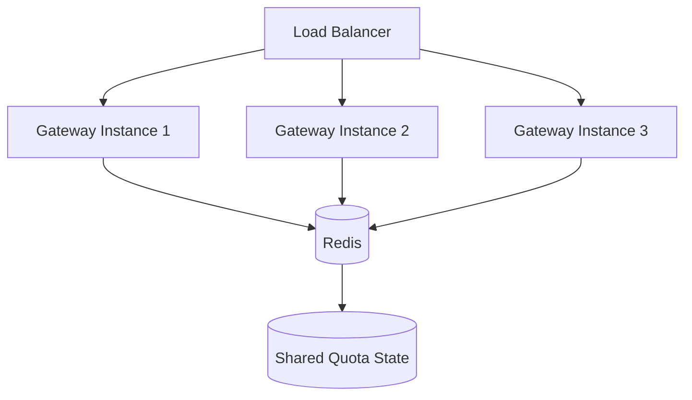
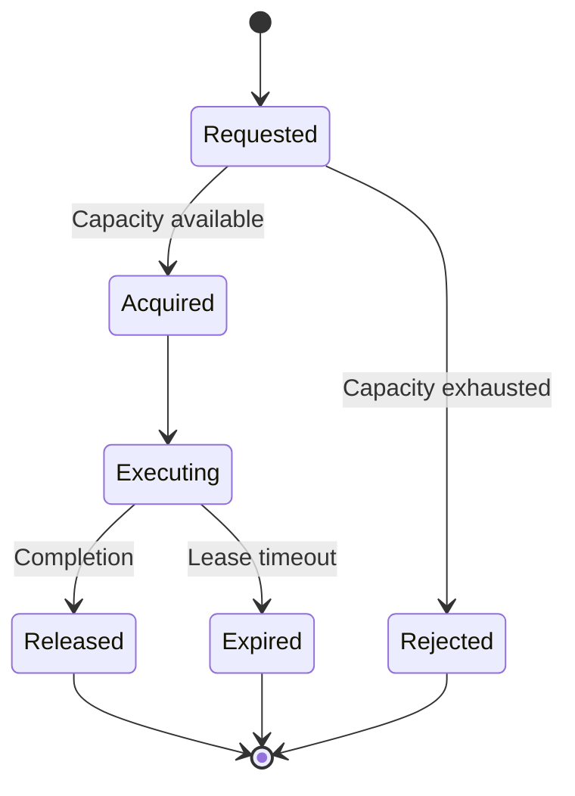

# LLM Gateway — Rate Limiting and Concurrency Control

**File:** `docs/rate-limiting-and-concurrency.md`  
**Version:** 1.0  
**Status:** Draft  
**Project:** `llm-gateway`  
**Implementation:** Rust  
**Architecture:** Clean Architecture

---

# 1. Purpose

This document defines the rate-limiting and concurrency-control architecture for `llm-gateway`.

The gateway must protect:

- Public API endpoints.
- Individual API keys.
- Tenants and projects.
- Model providers.
- Individual models.
- Shared infrastructure.
- Database and Redis resources.
- Financial exposure caused by uncontrolled inference requests.

The design must support distributed gateway instances, configurable limits, atomic admission decisions, and production observability.

## 1.1 Design Objectives

| ID | Objective | Description |
|---|---|---|
| RL-001 | Request protection | Limit request volume |
| RL-002 | Token protection | Limit token consumption |
| RL-003 | Tenant isolation | Prevent one tenant from exhausting shared capacity |
| RL-004 | Provider protection | Respect provider-specific limits |
| RL-005 | Concurrency control | Bound simultaneous inference executions |
| RL-006 | Distributed enforcement | Enforce limits across gateway instances |
| RL-007 | Configurability | Support platform, tenant, project, and API-key policies |
| RL-008 | Observability | Record allowed and rejected requests |
| RL-009 | Fairness | Prevent noisy-neighbor behavior |
| RL-010 | Reliability | Define behavior during Redis or dependency failures |

---

# 2. Rate Limiting vs. Concurrency vs. Budget

These controls must remain logically independent.

| Control | What it limits | Example |
|---|---|---|
| Rate limiting | Requests or tokens over time | 100 requests/minute |
| Concurrency control | Simultaneous executions | 10 active requests |
| Budget management | Financial expenditure | $100/day |
| Provider quota | Provider-specific consumption | 50 requests/minute |
| Abuse protection | Suspicious or malicious activity | Repeated invalid requests |

Example:

A tenant may have:

- 100 requests per minute.
- 20,000 tokens per minute.
- 10 concurrent requests.
- $100 daily budget.

A request can pass the rate limit but fail concurrency admission. It can also pass both and fail budget admission.

Passing one control never implies passing another.

---

# 3. Architecture



## 3.1 Architectural Components

| Component | Responsibility |
|---|---|
| Rate Limiter | Enforce request and token quotas |
| Concurrency Manager | Control active inference executions |
| Quota Policy Repository | Load configured limits |
| Redis Adapter | Provide distributed atomic operations |
| Admission Controller | Coordinate admission decisions |
| Usage Meter | Track consumption |
| Metrics Collector | Record enforcement outcomes |
| Configuration Service | Manage versioned policies |

The domain layer defines policies and decisions. Infrastructure adapters implement distributed storage and atomic operations.

---

# 4. Rate Limiting Dimensions

Rate limits must support multiple scopes.

## 4.1 Scope Hierarchy

```text
Platform
   |
   +-- Provider
   |
   +-- Tenant
         |
         +-- Project
               |
               +-- API Key
```

A request may be subject to several applicable limits.

The gateway must evaluate all applicable limits.

For example:

| Scope | Limit |
|---|---|
| Platform | 10,000 requests/minute |
| Tenant | 500 requests/minute |
| Project | 200 requests/minute |
| API key | 100 requests/minute |
| Provider | 1,000 requests/minute |
| Model | 300 requests/minute |

The effective admission decision must satisfy every applicable limit.

## 4.2 Supported Dimensions

| Dimension | Unit | Purpose |
|---|---|---|
| Request count | Requests | Prevent request flooding |
| Input tokens | Tokens | Control input consumption |
| Output tokens | Tokens | Control generation capacity |
| Total tokens | Tokens | Control combined token consumption |
| Estimated cost | Currency | Financial admission |
| Concurrent requests | Active executions | Bound resource usage |
| Provider requests | Requests | Respect provider quotas |
| Provider tokens | Tokens | Respect provider token quotas |

Cost limits belong to the budget manager. Rate limiting may use cost-based admission signals, but the financial ledger remains authoritative.

---

# 5. Rate-Limiting Algorithms

The system should support different algorithms according to the enforcement requirement.

## 5.1 Token Bucket

<badge color="success">Recommended default</badge>

Token Bucket is the default algorithm for request and token rate limits.

It supports controlled bursts while maintaining an average rate.

Parameters:

- Capacity: maximum bucket size.
- Refill rate: tokens added per second.
- Current balance: available tokens.
- Last refill timestamp.

Example:

```yaml
rate_limits:
  algorithm: token_bucket

  requests:
    capacity: 100
    refill_rate: 2
    refill_interval: second
```

This permits a burst of up to 100 requests, with the bucket replenishing at two requests per second.

### Advantages

- Supports controlled bursts.
- Efficient implementation.
- Suitable for distributed enforcement.
- Simple configuration.
- Good fit for API traffic.

### Trade-offs

- Allows bursts up to configured capacity.
- Requires atomic updates.
- Redis state must be managed carefully.

## 5.2 Sliding Window

Sliding Window provides more accurate rolling-window enforcement.

Example:

```yaml
rate_limits:
  requests:
    algorithm: sliding_window
    limit: 100
    window_seconds: 60
```

This limits the number of requests in the preceding 60 seconds.

Suitable for:

- Strict API quotas.
- Provider limits.
- Contractual usage restrictions.

Trade-offs:

- More storage and computation than a simple counter.
- Requires atomic updates.
- A sorted-set implementation can become expensive at high volume.

## 5.3 Fixed Window

Fixed Window uses a counter for each time interval.

Example:

```yaml
rate_limits:
  requests:
    algorithm: fixed_window
    limit: 100
    window_seconds: 60
```

It is simple but can allow boundary bursts.

For example, a client might issue 100 requests immediately before the minute boundary and another 100 immediately afterward.

Use only where this behavior is acceptable.

## 5.4 Algorithm Selection

| Use Case | Recommended Algorithm |
|---|---|
| General API request limits | Token Bucket |
| Strict rolling quotas | Sliding Window |
| Simple administrative quotas | Fixed Window |
| Concurrent execution limits | Semaphore |
| Provider concurrency | Distributed Semaphore |

---

# 6. Distributed Rate Limiting

The gateway must support multiple Rust instances.

Local in-memory counters are insufficient for globally enforced tenant and provider quotas.

Example deployment:



All gateway instances must enforce shared limits consistently.

## 6.1 Redis Responsibilities

Redis stores short-lived operational enforcement state:

- Token bucket balances.
- Refill timestamps.
- Sliding-window entries.
- Concurrency counters or permits.
- Provider quota state.
- Temporary admission metadata.

PostgreSQL remains the authoritative store for quota configuration and policy history.

## 6.2 Atomic Operations

Rate-limit decisions must be atomic.

A naive implementation is unsafe:

1. Read current balance.
2. Check whether capacity exists.
3. Decrement balance.
4. Write updated balance.

Two gateway instances can read the same balance and both admit requests.

Use Redis Lua scripts or another atomic Redis operation to perform the complete decision.

Conceptual operation:

```text
consume_tokens(key, requested_amount, capacity, refill_rate):

    read current state
    calculate refill
    calculate available balance

    if available >= requested_amount:
        deduct requested amount
        update timestamp
        return ALLOWED

    calculate retry_after
    persist updated state
    return REJECTED
```

The production implementation must handle missing keys, expired state, Redis errors, and clock behavior explicitly.

## 6.3 Redis Key Design

Use versioned and scoped keys.

Examples:

```text
lg:rl:v1:platform:requests
lg:rl:v1:tenant:{tenant_id}:requests
lg:rl:v1:project:{project_id}:requests
lg:rl:v1:apikey:{key_id}:requests
lg:rl:v1:provider:{provider_id}:requests
lg:rl:v1:model:{model_id}:tokens
```

Requirements:

- Avoid raw API keys in Redis keys.
- Use internal identifiers.
- Apply appropriate expiration.
- Prevent unbounded key creation.
- Include a version prefix.
- Avoid placing sensitive customer data in keys.

---

# 7. Token-Based Rate Limiting

LLM workloads require token-aware quotas because request sizes vary significantly.

A request with 100 tokens and one with 100,000 tokens should not consume the same quota.

## 7.1 Token Quotas

Support:

- Input tokens per minute.
- Output tokens per minute.
- Combined tokens per minute.
- Optional daily token quotas.

Example:

```yaml
token_limits:
  input_tokens_per_minute: 50000
  output_tokens_per_minute: 30000
  total_tokens_per_minute: 80000
```

## 7.2 Admission Estimation

Before provider execution:

1. Estimate input tokens.
2. Read requested maximum output tokens.
3. Calculate the admission reservation.
4. Consume the appropriate token quota.
5. Execute inference.
6. Record actual token usage.

Example:

```text
Estimated input tokens: 2,000
Reserved output tokens: 1,000
Admission amount: 3,000 tokens
```

This is a conservative admission model.

If the provider supports trustworthy usage reporting, actual consumption should be recorded after execution.

## 7.3 Reconciliation

There are two separate concepts:

- Rate-limit consumption.
- Financial budget reservation.

They must not be confused.

For rate limiting, the gateway may reserve estimated tokens and reconcile the reservation against actual consumption according to the quota policy.

For budgets, the gateway reserves estimated monetary cost and settles the actual monetary cost through the usage ledger.

A rate-limit policy must define whether unused token reservations are returned or retained as conservative quota consumption.

---

# 8. Concurrency Control

Concurrency control limits the number of simultaneous inference executions.

It protects:

- Gateway memory.
- Network connections.
- Provider quotas.
- Tenant fairness.
- Shared resources.
- Provider concurrency restrictions.

## 8.1 Concurrency Scopes

| Scope | Example Limit |
|---|---:|
| Platform | 1,000 active requests |
| Tenant | 50 active requests |
| Project | 20 active requests |
| API key | 10 active requests |
| Provider | 200 active requests |
| Model | 100 active requests |

These are illustrative configuration values, not production recommendations.

A request must acquire every applicable concurrency permit before execution.

## 8.2 Semaphore Model

A semaphore controls the number of active executions.

Example:

```text
Maximum concurrent executions: 10

Active permits: 10

New request:
    No permit available
    Reject or queue according to policy
```

For distributed gateway instances, shared limits require distributed coordination.

A local Tokio semaphore is still useful for protecting each individual process, but it cannot enforce global tenant or provider limits by itself.

## 8.3 Distributed Semaphore

A distributed permit must contain:

- Permit ID.
- Scope identifier.
- Owner instance.
- Execution ID.
- Acquisition timestamp.
- Expiration or lease deadline.
- Permit state.

Example:

```rust
pub struct ConcurrencyPermit {
    pub permit_id: PermitId,
    pub execution_id: ExecutionId,
    pub scope_id: String,
    pub acquired_at: DateTime<Utc>,
    pub expires_at: DateTime<Utc>,
}
```

## 8.4 Permit Lifecycle



Permits must be released on:

- Successful completion.
- Provider failure.
- Request cancellation.
- Client disconnect.
- Timeout.
- Internal execution failure.

A lease expiration mechanism must recover permits when a gateway instance crashes.

However, lease expiration must not cause a permit to be reused while the original execution is still consuming provider capacity.

Where possible, use fencing tokens or execution ownership checks to prevent stale permit owners from updating current state.

---

# 9. Queueing and Backpressure

Rejecting every request immediately may be undesirable.

The gateway may support bounded queueing for selected workloads.

Example:

```yaml
concurrency:
  max_active_requests: 10

  queue:
    enabled: true
    max_waiting_requests: 50
    max_wait_time_ms: 3000
```

Queueing rules:

- Queue size must be bounded.
- Waiting time must be bounded.
- Requests must retain their original deadline.
- Cancelled requests must be removed.
- Tenant fairness must be maintained.
- Queue overflow must be rejected.
- High-priority traffic must not starve other tenants.

The default policy should be immediate rejection when capacity is exhausted. Queueing should be enabled selectively for workloads that tolerate additional latency.

## 9.1 Backpressure

The gateway must apply backpressure before resources are exhausted.

Signals include:

- Global concurrency utilization.
- Per-provider concurrency utilization.
- Queue depth.
- Request latency.
- Redis latency.
- Connection-pool saturation.
- Gateway memory pressure.

Backpressure may result in:

- Request rejection.
- Queueing.
- Reduced admission rates.
- Temporary provider exclusion.

---

# 10. Provider-Specific Limits

Providers often impose different limits.

The gateway must support independent provider and model quotas.

Example:

```yaml
providers:
  provider-a:
    rate_limits:
      requests_per_minute: 1000
      tokens_per_minute: 1000000
    concurrency:
      max_active_requests: 100

  provider-b:
    rate_limits:
      requests_per_minute: 500
      tokens_per_minute: 500000
    concurrency:
      max_active_requests: 50
```

These values are illustrative.

The provider adapter must normalize provider rate-limit responses.

Where available, the gateway should interpret provider headers such as:

- Remaining requests.
- Remaining tokens.
- Reset time.
- Retry-After.

Provider-reported limits should inform admission control, but they must not override stricter internal limits.

---

# 11. Admission Control

The admission controller coordinates the different controls.

## 11.1 Admission Sequence

Recommended sequence:

1. Authenticate request.
2. Resolve tenant, project, and API key.
3. Authorize operation.
4. Validate request.
5. Apply abuse protection.
6. Evaluate request-rate limits.
7. Evaluate token-rate limits.
8. Acquire concurrency permits.
9. Evaluate policy constraints.
10. Estimate cost.
11. Reserve budget.
12. Continue to model routing and provider execution.

The gateway should perform cheap validation before acquiring expensive resources.

The router must select an eligible model before applying provider-specific admission controls.

For example, provider-specific concurrency and rate quotas should be checked against the selected provider.

## 11.2 Admission Decision

```rust
pub enum AdmissionDecision {
    Allowed {
        permits: AdmissionPermits,
    },
    RateLimited {
        retry_after: Duration,
    },
    ConcurrencyLimited {
        retry_after: Option<Duration>,
    },
    BudgetExceeded,
    PolicyRejected {
        reason: String,
    },
    DependencyUnavailable {
        dependency: String,
    },
}
```

The admission controller must coordinate permit cleanup when a later admission step fails.

If budget reservation fails after concurrency permits have been acquired, those permits must be released.

## 11.3 Atomicity Considerations

Redis and PostgreSQL do not share a transaction.

Therefore, the gateway cannot assume that rate-limit consumption, concurrency acquisition, and budget reservation form one globally atomic transaction.

Use explicit reservation and compensation:

- Acquire rate-limit capacity.
- Acquire concurrency permits.
- Reserve budget.
- If a later step fails, release reversible permits.
- Record irreversible quota consumption according to policy.
- Ensure every operation is idempotent where possible.

The admission workflow must tolerate partial failures and process crashes.

---

# 12. API Error Responses

## 12.1 HTTP 429 — Rate Limit Exceeded

Example:

```json
{
  "error": {
    "type": "rate_limit_error",
    "code": "rate_limit_exceeded",
    "message": "Request rate limit exceeded.",
    "retry_after_seconds": 10
  }
}
```

Response headers may include:

```http
Retry-After: 10
X-RateLimit-Limit: 100
X-RateLimit-Remaining: 0
X-RateLimit-Reset: 1730000000
```

Only expose headers that accurately represent the relevant scope and quota.

## 12.2 Concurrency Limit Exceeded

A concurrency rejection may also use HTTP 429.

Example:

```json
{
  "error": {
    "type": "concurrency_error",
    "code": "concurrency_limit_exceeded",
    "message": "Maximum concurrent executions reached."
  }
}
```

HTTP 503 may be appropriate for temporary platform-wide capacity exhaustion rather than a tenant-specific quota.

## 12.3 Budget Exceeded

Budget rejection remains a separate error:

```json
{
  "error": {
    "type": "budget_error",
    "code": "budget_exceeded",
    "message": "The configured budget limit has been reached."
  }
}
```

Use HTTP 402 according to the API contract.

---

# 13. Configuration Management

Quota configuration must be versioned and auditable.

Example:

```yaml
rate_limiting:
  enabled: true
  default_algorithm: token_bucket

  platform:
    requests_per_second: 1000
    max_concurrent_requests: 1000

  tenant:
    requests_per_minute: 500
    tokens_per_minute: 100000
    max_concurrent_requests: 50

  project:
    requests_per_minute: 200
    tokens_per_minute: 50000
    max_concurrent_requests: 20

  api_key:
    requests_per_minute: 100
    max_concurrent_requests: 10

  provider:
    enforce_provider_quotas: true

concurrency:
  lease_duration_seconds: 60
  heartbeat_interval_seconds: 15
  queue_enabled: false
  default_queue_timeout_ms: 3000
```

The lease and heartbeat values are starting configuration examples. They must be tuned to request duration and execution lifecycle.

Configuration requirements:

- Validate before activation.
- Support tenant-specific overrides.
- Support project-specific overrides.
- Audit administrative changes.
- Preserve configuration history.
- Reject invalid or contradictory configurations.
- Retain the last known valid configuration if a reload fails.

---

# 14. Redis Failure Strategy

Redis is a critical dependency for distributed admission control.

The gateway must define explicit failure behavior.

| Control | Recommended Failure Behavior |
|---|---|
| Platform abuse protection | Fail closed |
| Tenant rate limiting | Fail closed for strict quotas |
| Provider quota | Fail closed or use a conservative local safety limit |
| Tenant concurrency | Fail closed for strict global caps |
| Local process concurrency | Continue enforcing locally |
| Budget enforcement | PostgreSQL remains authoritative |
| Non-critical telemetry | Buffer or degrade asynchronously |

A local fallback must never be described as globally enforcing a distributed quota.

For strict financial or contractual controls, fail-open behavior must not silently bypass the configured restriction.

## 14.1 Redis Operational Requirements

- Authentication enabled.
- TLS in production.
- Network isolation.
- Memory limits.
- Eviction policy suitable for operational state.
- Monitoring and alerting.
- Replication and recovery strategy.
- Connection pooling.
- Command timeouts.
- Atomic Lua scripts.
- Key expiration policies.

Redis eviction must not silently remove active concurrency permits or quota state in a way that allows uncontrolled admission.

---

# 15. Rust Implementation Design

Suggested logical module structure:

```text
crates/
├── rate-limiter/
│   └── src/
│       ├── lib.rs
│       ├── algorithm/
│       │   ├── mod.rs
│       │   ├── token_bucket.rs
│       │   ├── sliding_window.rs
│       │   └── fixed_window.rs
│       ├── policy.rs
│       ├── scope.rs
│       ├── decision.rs
│       ├── service.rs
│       ├── repository.rs
│       └── error.rs
│
├── concurrency-manager/
│   └── src/
│       ├── lib.rs
│       ├── permit.rs
│       ├── semaphore.rs
│       ├── lease.rs
│       ├── manager.rs
│       ├── repository.rs
│       └── error.rs
│
└── gateway-core/
    └── src/
        ├── admission/
        │   ├── mod.rs
        │   ├── controller.rs
        │   └── decision.rs
        └── execution/
```

## 15.1 Rate Limiter Interface

```rust
#[async_trait::async_trait]
pub trait RateLimiter: Send + Sync {
    async fn check_and_consume(
        &self,
        request: RateLimitRequest,
    ) -> Result<RateLimitDecision, RateLimitError>;
}
```

## 15.2 Concurrency Manager Interface

```rust
#[async_trait::async_trait]
pub trait ConcurrencyManager: Send + Sync {
    async fn acquire(
        &self,
        request: ConcurrencyRequest,
    ) -> Result<ConcurrencyPermit, ConcurrencyError>;

    async fn release(
        &self,
        permit: ConcurrencyPermit,
    ) -> Result<(), ConcurrencyError>;
}
```

The implementation must make permit release idempotent.

A lease renewal operation should also be supported for long-running requests.

## 15.3 Infrastructure Adapters

Suggested adapters:

```text
infrastructure/
├── redis/
│   ├── redis_rate_limiter.rs
│   ├── redis_concurrency_manager.rs
│   └── scripts/
│       ├── token_bucket.lua
│       ├── sliding_window.lua
│       ├── acquire_permit.lua
│       └── release_permit.lua
└── config/
    └── quota_config_repository.rs
```

Keep Redis-specific code outside the domain layer.

---

# 16. Observability

The gateway must expose rate-limiting and concurrency metrics.

## 16.1 Metrics

| Metric | Type | Description |
|---|---|---|
| `gateway_rate_limit_allowed_total` | Counter | Allowed requests |
| `gateway_rate_limit_rejected_total` | Counter | Rejected requests |
| `gateway_rate_limit_check_duration_seconds` | Histogram | Enforcement latency |
| `gateway_concurrency_active` | Gauge | Active executions |
| `gateway_concurrency_rejected_total` | Counter | Concurrency rejections |
| `gateway_concurrency_permit_duration_seconds` | Histogram | Permit holding duration |
| `gateway_concurrency_lease_expired_total` | Counter | Expired permits |
| `gateway_admission_rejected_total` | Counter | Admission failures |
| `gateway_queue_depth` | Gauge | Waiting requests |
| `gateway_redis_errors_total` | Counter | Redis failures |

Avoid using raw API keys, request IDs, or tenant IDs as unrestricted metric labels because they create high-cardinality metrics.

Use structured logs and traces for individual execution details.

## 16.2 Alerting

Initial alert conditions:

- Redis unavailable.
- Elevated rate-limit rejection rate.
- Unexpected concurrency growth.
- High number of expired permits.
- Provider quota exhaustion.
- Queue depth approaching maximum.
- Admission latency above target.
- Repeated admission dependency failures.

Thresholds must be calibrated from load tests and operational baselines.

---

# 17. Testing Strategy

## 17.1 Unit Tests

- Token bucket refill.
- Token bucket exhaustion.
- Sliding-window boundaries.
- Fixed-window boundaries.
- Quota hierarchy.
- Policy override resolution.
- Concurrency acquisition.
- Permit release.
- Permit expiration.
- Idempotent release.
- Retry-after calculation.

## 17.2 Integration Tests

- Two gateway instances sharing one Redis quota.
- Multiple tenants with independent quotas.
- Project and API-key quota enforcement.
- Provider-specific rate limits.
- Concurrent permit acquisition.
- Client cancellation.
- Provider timeout.
- Redis disconnection.
- Redis recovery.
- Configuration changes.

## 17.3 Concurrency Tests

Verify that simultaneous requests cannot exceed the configured global limit.

Example:

```text
Configured concurrency: 10
Simultaneous incoming requests: 100

Expected:
    Maximum active permits: 10
    Admitted requests: 10
    Rejected requests: 90
```

The exact result assumes no requests complete while the 100 requests are being admitted.

## 17.4 Load Tests

Test:

- Sustained traffic.
- Sudden bursts.
- High-cardinality API keys.
- Multiple tenants.
- Provider-specific throttling.
- Redis latency.
- Redis failure.
- Long-running streaming requests.
- Gateway instance restarts.

---

# 18. Security Requirements

- Rate-limit keys must use internal identifiers, never raw secrets.
- Quota configuration changes must be audited.
- Tenant boundaries must be enforced before quota lookup.
- Clients must not control their own quota values.
- Redis must be network-isolated.
- Redis scripts must validate their arguments.
- Admission operations must resist replay and duplicate execution.
- Permit IDs must be unpredictable or securely generated.
- Expired permits must not be reused unsafely.
- Rate-limit responses must not expose another tenant's quota information.
- Administrative quota APIs must enforce RBAC.
- Quota exhaustion must not bypass budget enforcement.

---

# 19. Definition of Done

## Rate Limiting

- [ ] Token Bucket implemented.
- [ ] Sliding Window implemented or explicitly deferred.
- [ ] Fixed Window support evaluated.
- [ ] Platform-level limits configured.
- [ ] Tenant-level limits configured.
- [ ] Project-level limits configured.
- [ ] API-key-level limits configured.
- [ ] Provider-level limits configured.
- [ ] Token-based quotas implemented.
- [ ] Redis atomic operations implemented.
- [ ] Redis failure behavior tested.
- [ ] Quota configuration versioned.

## Concurrency

- [ ] Local process semaphore implemented.
- [ ] Distributed concurrency permits implemented.
- [ ] Tenant concurrency limits enforced.
- [ ] Project concurrency limits enforced.
- [ ] API-key concurrency limits enforced.
- [ ] Provider concurrency limits enforced.
- [ ] Permit lifecycle implemented.
- [ ] Idempotent permit release implemented.
- [ ] Lease expiration and recovery implemented.
- [ ] Client cancellation handled.
- [ ] Streaming requests accounted for.
- [ ] Bounded queueing supported or explicitly deferred.

## Integration and Operations

- [ ] Admission controller implemented.
- [ ] Budget manager integration implemented.
- [ ] Provider quota integration implemented.
- [ ] Metrics and structured logs available.
- [ ] Integration tests pass.
- [ ] Distributed concurrency tests pass.
- [ ] Load tests pass.
- [ ] Security tests pass.

---

# 20. Architectural Decisions

The following decisions should be captured as ADRs:

| ADR | Decision |
|---|---|
| ADR-011 | Token Bucket as the default request rate-limit algorithm |
| ADR-012 | Redis for distributed rate-limit state |
| ADR-013 | Separate rate limiting from financial budget management |
| ADR-014 | Distributed concurrency permits with leases |
| ADR-015 | Bounded queueing disabled by default |
| ADR-016 | Explicit fail-open and fail-closed policies |

These ADR numbers must be reconciled with the existing ADR index before adoption.

---

# 21. Key Architectural Invariants

1. All applicable rate-limit scopes must be enforced.
2. Distributed limits must not rely solely on local process memory.
3. Rate-limit checks must use atomic operations.
4. Concurrency permits must have a defined lifecycle.
5. Permit release must be idempotent.
6. Gateway crashes must not permanently leak concurrency permits.
7. Provider quotas must be independent from tenant quotas.
8. Financial budgets must remain authoritative in the budget manager.
9. Queueing must always be bounded.
10. Redis failures must follow explicit enforcement policies.
11. Every admission rejection must be observable.
12. No provider request may execute without successful admission.

---

# 22. Related Documents

- `docs/architecture.md`
- `docs/domain-model.md`
- `docs/data-model.md`
- `docs/api-contracts.md`
- `docs/security.md`
- `docs/routing-policy.md`
- `docs/budget-and-usage-accounting.md`
- `docs/reliability.md`
- `docs/observability.md`


