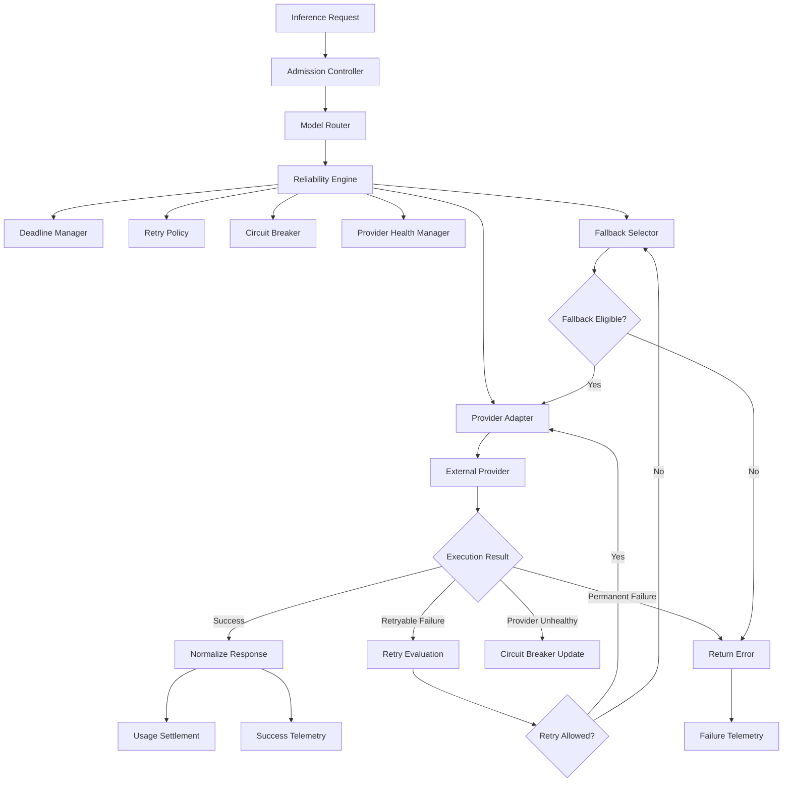
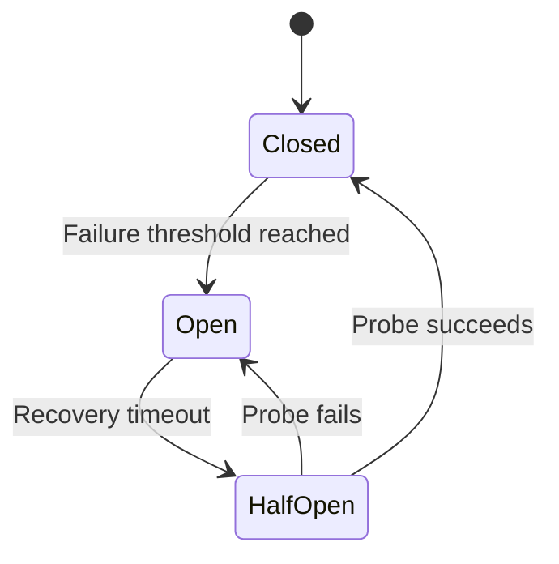
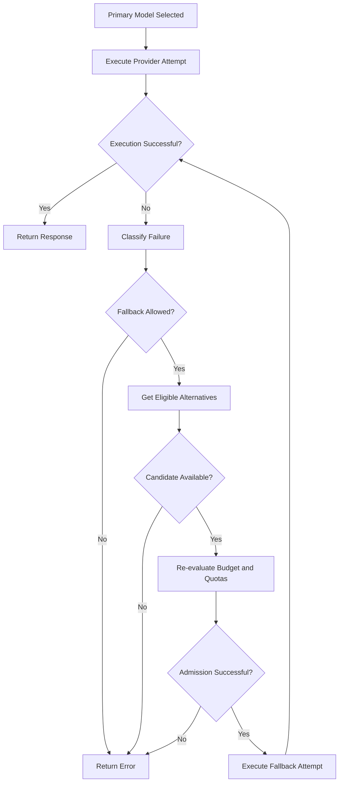

# LLM Gateway — Reliability and Resilience Specification

**File:** `docs/reliability.md`  
**Version:** 1.0  
**Status:** Draft  
**Project:** `llm-gateway`  
**Implementation:** Rust  
**Architecture:** Clean Architecture

---

# 1. Purpose

This document defines the reliability and resilience architecture for `llm-gateway`.

The gateway must remain predictable and recoverable when:

- An LLM provider becomes unavailable.
- A provider returns HTTP 429.
- A provider experiences elevated latency.
- Network connections fail.
- Requests time out.
- Streaming connections are interrupted.
- Redis becomes unavailable.
- PostgreSQL becomes unavailable.
- A gateway instance crashes.
- A provider returns malformed responses.
- A request produces an uncertain execution outcome.

The objective is not to eliminate failures. It is to detect, contain, recover from, and explain them.

## 1.1 Reliability Objectives

| ID | Objective | Description |
|---|---|---|
| REL-001 | Fault isolation | Prevent one provider failure from destabilizing the gateway |
| REL-002 | Bounded retries | Prevent retry storms |
| REL-003 | Circuit breaking | Stop sending requests to unhealthy providers |
| REL-004 | Controlled fallback | Select alternative eligible models |
| REL-005 | Deadline enforcement | Bound request execution time |
| REL-006 | Streaming resilience | Handle interrupted streams safely |
| REL-007 | Failure classification | Distinguish retryable and permanent errors |
| REL-008 | Resource protection | Prevent connection and concurrency exhaustion |
| REL-009 | Recovery | Recover from transient infrastructure failures |
| REL-010 | Observability | Make reliability decisions traceable |

---

# 2. Reliability Architecture



## 2.1 Component Responsibilities

| Component | Responsibility |
|---|---|
| Reliability Engine | Coordinate retry and fallback decisions |
| Retry Policy | Decide whether an attempt may be retried |
| Circuit Breaker | Isolate unhealthy providers |
| Provider Health Manager | Maintain health observations |
| Deadline Manager | Enforce request deadlines |
| Fallback Selector | Select alternative eligible models |
| Timeout Manager | Enforce network and execution timeouts |
| Failure Classifier | Normalize and classify failures |
| Recovery Worker | Resolve uncertain and incomplete executions |

The reliability engine orchestrates these capabilities but does not replace the model router, provider adapters, budget manager, or concurrency manager.

---

# 3. Reliability Principles

The following principles are mandatory:

1. Every retry must be bounded.
2. Every request must have an overall deadline.
3. Permanent errors must not be retried.
4. Provider failures must be isolated.
5. Fallback candidates must satisfy original security and policy constraints.
6. Streaming output must never be duplicated by transparent fallback.
7. Financial reservations must be reconciled after failures.
8. Provider health must be based on observed behavior.
9. Retries must respect provider rate limits.
10. Failure handling must be observable.

---

# 4. Failure Classification

The gateway must normalize provider failures before applying retry policies.

## 4.1 Failure Categories

```rust
pub enum FailureCategory {
    Authentication,
    Authorization,
    InvalidRequest,
    UnsupportedCapability,
    ModelUnavailable,
    RateLimited,
    ContextOverflow,
    Timeout,
    ConnectionFailure,
    ProviderUnavailable,
    ServerError,
    ContentFiltered,
    Cancelled,
    InternalError,
    Unknown,
}
```

## 4.2 Retry Classification

| Failure | Retry | Fallback | Notes |
|---|---|---|---|
| Invalid request | No | No | Request must be corrected |
| Authentication failure | No | Usually no | Investigate credentials |
| Authorization failure | No | No | Security rejection |
| Unsupported capability | No | Possible | Only if another model satisfies requirements |
| Model not found | No | Possible | Requires configuration correction or approved alternative |
| HTTP 429 | Conditional | Yes | Respect Retry-After |
| Context overflow | No blind retry | Possible | Re-evaluate eligible context capacity |
| Connection failure | Conditional | Yes | Bounded retry |
| Provider timeout | Conditional | Yes | Execution outcome may be uncertain |
| HTTP 500 | Conditional | Yes | Depends on provider behavior |
| HTTP 502 | Yes | Yes | Bounded retry |
| HTTP 503 | Yes | Yes | Bounded retry |
| HTTP 504 | Conditional | Yes | Consider duplicate execution risk |
| Content filtered | No | Policy-dependent | Do not bypass safety controls |
| Client cancellation | No | No | Stop work and reconcile |
| Internal gateway error | Depends | Depends | Do not retry programming errors blindly |

A fallback must never be used to bypass an authorization, security, or content policy rejection.

---

# 5. Retry Policy

Retries handle transient failures.

They must not become an uncontrolled source of additional provider load or financial expenditure.

## 5.1 Retry Configuration

Example:

```yaml
reliability:
  retry:
    enabled: true
    max_attempts: 2
    initial_backoff_ms: 200
    max_backoff_ms: 2000
    multiplier: 2.0
    jitter: true
    respect_retry_after: true
```

`max_attempts` includes the initial provider attempt.

For example, `max_attempts: 2` means one initial attempt and at most one retry.

## 5.2 Exponential Backoff

\[
D_n = \min(D_{max}, D_{initial} \times 2^n)
\]

Where:

- \(D_n\): delay for retry attempt \(n\).
- \(D_{initial}\): initial delay.
- \(D_{max}\): maximum delay.

Apply jitter to prevent synchronized retry bursts.

Example:

```text
Initial delay: 200 ms
Attempt 1 retry: approximately 200 ms
Attempt 2 retry: approximately 400 ms
Attempt 3 retry: approximately 800 ms
```

Actual delays should include configured jitter and must not exceed the execution deadline.

## 5.3 Retry-After

When a provider returns `Retry-After`:

1. Parse the provider value.
2. Validate the value.
3. Compare it with the remaining request deadline.
4. Respect it if the request can still complete within the deadline.
5. Otherwise evaluate an eligible fallback or return an error.

Do not repeatedly retry a provider before its requested recovery interval.

## 5.4 Retry Budget

Introduce a gateway-wide retry budget to prevent retry amplification.

Example:

```yaml
reliability:
  retry_budget:
    enabled: true
    max_retry_ratio: 0.10
    evaluation_window_seconds: 60
```

A retry ratio of 10% is illustrative.

The retry budget limits additional attempts relative to original requests over a defined window.

When the retry budget is exhausted:

- Stop additional retries.
- Consider an eligible fallback.
- Otherwise return the normalized failure.

---

# 6. Retry Safety and Idempotency

A provider timeout does not prove that the provider did not process the request.

Example:

1. Gateway sends an inference request.
2. Provider receives and processes it.
3. Provider generates output.
4. Network connection fails.
5. Gateway does not receive the response.

Retrying may create a second provider execution and a second charge.

## 6.1 Retry Rules

- Retry connection failures only when execution is known not to have started, or when the duplicate-execution risk is explicitly accepted.
- Use provider idempotency support where available.
- Record each provider attempt separately.
- Preserve provider request identifiers.
- Track uncertain outcomes.
- Reconcile usage before releasing financial reservations.
- Do not claim exactly-once provider execution.

## 6.2 Attempt Identity

Each provider attempt must have:

- Attempt ID.
- Execution ID.
- Provider ID.
- Model ID.
- Attempt number.
- Start time.
- Completion time.
- Outcome.
- Provider request ID.
- Error classification.

A retry is a new provider attempt associated with the same gateway execution.

---

# 7. Circuit Breaker

The circuit breaker protects the gateway from repeatedly calling unhealthy providers.

## 7.1 States



| State | Behavior |
|---|---|
| Closed | Requests may execute normally |
| Open | Requests are blocked from the provider |
| Half-Open | Limited recovery probes are allowed |

## 7.2 Circuit Breaker Configuration

Example:

```yaml
circuit_breaker:
  enabled: true

  failure_threshold: 5
  evaluation_window_seconds: 30

  open_duration_seconds: 20
  half_open_max_requests: 2

  minimum_requests: 10
```

These values are initial examples and must be tuned through load testing.

## 7.3 Failure Signals

Possible signals:

- Connection failures.
- Provider timeouts.
- HTTP 5xx responses.
- Repeated HTTP 429 responses.
- Excessive latency.
- Failed health checks.

Do not count every provider error as a circuit-breaker failure.

For example:

- Invalid client requests should not open a circuit.
- Tenant budget rejection should not affect provider health.
- Authorization failures should not affect provider health.

## 7.4 Circuit Breaker Scope

Use separate circuit breakers for:

- Provider.
- Provider region, where operationally meaningful.
- Model endpoint, when failure isolation is required.

Avoid creating a circuit breaker for every tenant or API key without a clear operational reason.

## 7.5 Half-Open Behavior

When a circuit enters Half-Open:

1. Permit a small number of probe requests.
2. Observe the results.
3. Close the circuit after sufficient successful probes.
4. Reopen it after qualifying failures.

Probe requests must be subject to ordinary security, budget, and provider quota controls.

---

# 8. Provider Health Management

The provider health manager tracks operational signals.

## 8.1 Health States

```rust
pub enum ProviderHealth {
    Healthy,
    Degraded,
    Unhealthy,
    Disabled,
}
```

## 8.2 Health Signals

- Request success rate.
- Timeout rate.
- Error rate.
- Rate-limit frequency.
- p50 latency.
- p95 latency.
- p99 latency.
- Circuit-breaker state.
- Recent health-check results.

## 8.3 Health Evaluation

Health evaluation should use rolling windows and minimum observation counts.

One failed request must not automatically mark a provider unhealthy.

A provider may be considered degraded when:

- Latency is significantly elevated.
- Error rate is increasing.
- Rate limits are frequent.
- Capacity is constrained.

A disabled provider is administratively unavailable and must not be selected by routing.

---

# 9. Fallback Strategy

Fallback allows the gateway to continue inference using another eligible model.

The model router initially selects a primary model. The reliability engine can request a new eligible candidate after a qualifying failure.

## 9.1 Fallback Flow



## 9.2 Fallback Constraints

Every fallback model must satisfy:

- Tenant authorization.
- Project policy.
- Data residency.
- Required capabilities.
- Context-window requirements.
- Quality threshold.
- Budget constraints.
- Provider health requirements.
- Provider quota.
- Concurrency availability.

Fallback must not silently weaken security or quality requirements.

## 9.3 Fallback Configuration

```yaml
fallback:
  enabled: true

  max_attempts: 3
  max_provider_switches: 2

  allow_cross_provider: true

  strategies:
    - provider_failure
    - timeout
    - rate_limited
    - model_unavailable
```

A fallback attempt may have a different cost.

The budget manager must reserve or authorize the incremental exposure before the fallback provider executes.

A previous reservation must not be counted twice.

---

# 10. Streaming Reliability

Streaming requires stricter recovery rules.

## 10.1 Failure Before First Token

If a provider fails before any content has been delivered:

- Classify the failure.
- Apply bounded retry where safe.
- Consider fallback.
- Re-evaluate budget and concurrency admission.
- Continue within the original deadline.

## 10.2 Failure After First Token

Once response content has been delivered:

- Do not transparently restart on another model.
- Do not duplicate previously delivered content.
- Terminate the stream.
- Emit a structured error where the transport permits it.
- Record partial output and usage information.
- Reconcile the reservation.
- Release concurrency permits.

## 10.3 Client Cancellation

When a client disconnects:

1. Detect cancellation.
2. Cancel provider execution where supported.
3. Stop reading the provider stream.
4. Release concurrency permits.
5. Record partial usage if available.
6. Reconcile or retain the reservation according to outcome certainty.
7. Emit cancellation telemetry.

The gateway must not assume cancellation prevents provider billing.

---

# 11. Timeout Hierarchy

Timeouts must be layered.

| Timeout | Purpose |
|---|---|
| Admission timeout | Bound admission-control operations |
| Connection timeout | Establish provider connection |
| Request timeout | Bound provider request |
| First-token timeout | Bound streaming startup |
| Idle-stream timeout | Detect stalled streams |
| Attempt timeout | Bound one provider attempt |
| Overall execution deadline | Bound complete inference execution |

Example:

```yaml
timeouts:
  admission_ms: 500
  connection_ms: 3000
  first_token_ms: 10000
  idle_stream_ms: 30000
  provider_attempt_ms: 60000
  overall_execution_ms: 90000
```

These values are illustrative.

Every retry and fallback attempt must consume the same overall deadline.

The gateway must not reset the overall deadline when switching providers.

---

# 12. Bulkheads and Resource Isolation

Bulkheads prevent failures in one area from exhausting resources elsewhere.

Recommended isolation boundaries:

- Per-provider connection pools.
- Per-provider concurrency limits.
- Global gateway concurrency limits.
- Per-tenant concurrency limits.
- Separate pools for administrative operations.
- Bounded background-worker concurrency.

Example:

```yaml
bulkheads:
  gateway:
    max_concurrent_requests: 1000

  providers:
    provider-a:
      max_concurrent_requests: 100

    provider-b:
      max_concurrent_requests: 50

  background_workers:
    max_concurrent_jobs: 20
```

Values must be tuned against actual resource capacity.

One slow provider must not consume all gateway connections or worker capacity.

---

# 13. Failure Handling by Dependency

| Dependency | Failure Behavior |
|---|---|
| PostgreSQL | Reject new financially controlled inference when required durable admission cannot be completed |
| Redis rate limiter | Apply configured fail-open/fail-closed policy |
| Redis concurrency | Enforce local limits and reject strict globally controlled admission if global state is unavailable |
| Secret manager | Do not call provider without valid credentials |
| Provider | Retry or fallback according to policy |
| Telemetry backend | Buffer or degrade telemetry without blocking ordinary inference where safe |
| Evaluation worker | Continue inference; evaluation is asynchronous |
| Event broker | Use transactional outbox for durable event delivery |

The system must distinguish dependencies required for safe inference from optional asynchronous processing services.

---

# 14. Recovery and Uncertain Execution

The gateway must maintain execution state.

Example:

```rust
pub enum ExecutionStatus {
    Created,
    Admitted,
    Running,
    Streaming,
    Succeeded,
    Failed,
    Cancelled,
    UnknownOutcome,
    ReconciliationPending,
}
```

Recovery must handle:

- Gateway crash after provider submission.
- Provider response received but database settlement failed.
- Client disconnect during streaming.
- Provider timeout with uncertain billing.
- Duplicate completion events.
- Expired concurrency leases.
- Failed usage reconciliation.

A background recovery worker should identify incomplete executions and apply documented recovery rules.

Never assume a failed database write means the provider request was not executed.

---

# 15. Rust Implementation Design

Suggested logical structure:

```text
crates/
└── reliability-engine/
    └── src/
        ├── lib.rs
        ├── engine.rs
        ├── failure_classifier.rs
        ├── retry/
        │   ├── mod.rs
        │   ├── policy.rs
        │   ├── backoff.rs
        │   └── budget.rs
        ├── circuit_breaker/
        │   ├── mod.rs
        │   ├── state.rs
        │   ├── policy.rs
        │   └── storage.rs
        ├── health/
        │   ├── mod.rs
        │   ├── monitor.rs
        │   └── evaluator.rs
        ├── fallback/
        │   ├── mod.rs
        │   └── selector.rs
        ├── deadline/
        │   ├── mod.rs
        │   └── manager.rs
        ├── recovery/
        │   ├── mod.rs
        │   └── worker.rs
        └── errors.rs
```

## 15.1 Reliability Interface

```rust
#[async_trait::async_trait]
pub trait ReliabilityEngine: Send + Sync {
    async fn execute(
        &self,
        request: ExecutionRequest,
    ) -> Result<ExecutionResult, ReliabilityError>;
}
```

The implementation should depend on abstractions for:

- Provider execution.
- Model routing.
- Budget management.
- Concurrency management.
- Provider health.
- Execution persistence.
- Telemetry.

## 15.2 Rust Dependencies

Potential dependencies:

| Crate | Purpose |
|---|---|
| `tokio` | Async execution and cancellation |
| `reqwest` | Provider HTTP communication |
| `futures` | Stream handling |
| `tower` | Middleware and service abstractions |
| `tracing` | Structured diagnostics |
| `chrono` | Timestamps |
| `serde` | Configuration and serialization |
| `uuid` | Execution and attempt identifiers |

Avoid introducing a dependency for every resilience pattern. Keep policy logic explicit and testable.

---

# 16. Observability

Reliability decisions must be measurable.

## 16.1 Metrics

| Metric | Type | Description |
|---|---|---|
| `gateway_provider_attempts_total` | Counter | Provider attempts |
| `gateway_provider_retries_total` | Counter | Retry attempts |
| `gateway_provider_fallbacks_total` | Counter | Fallback executions |
| `gateway_circuit_breaker_state` | Gauge | Circuit state |
| `gateway_circuit_breaker_transitions_total` | Counter | State transitions |
| `gateway_provider_timeouts_total` | Counter | Provider timeouts |
| `gateway_provider_failures_total` | Counter | Provider failures |
| `gateway_execution_duration_seconds` | Histogram | End-to-end duration |
| `gateway_retry_budget_exhausted_total` | Counter | Retry budget exhaustion |
| `gateway_unknown_outcomes_total` | Gauge | Uncertain executions |
| `gateway_recovery_jobs_total` | Counter | Recovery jobs |

## 16.2 Trace Attributes

Include:

- Execution ID.
- Provider ID.
- Model ID.
- Attempt number.
- Failure category.
- Retry decision.
- Circuit-breaker state.
- Fallback decision.
- Overall deadline.
- Provider request ID.

Do not log raw credentials or unnecessary prompt content.

---

# 17. Testing Strategy

## 17.1 Unit Tests

- Failure classification.
- Retry eligibility.
- Backoff calculation.
- Jitter boundaries.
- Retry budget.
- Circuit-breaker transitions.
- Health evaluation.
- Deadline enforcement.
- Fallback eligibility.
- Attempt accounting.

## 17.2 Integration Tests

- Provider connection failure.
- Provider timeout.
- HTTP 429 with Retry-After.
- HTTP 500.
- HTTP 503.
- Circuit breaker opening.
- Circuit breaker recovery.
- Half-open probe failure.
- Fallback to another provider.
- All providers unavailable.
- Client cancellation.
- Streaming interruption.
- Redis failure.
- PostgreSQL failure.
- Secret manager failure.

## 17.3 Chaos Tests

Simulate:

- Provider latency spikes.
- Random network failures.
- DNS resolution failures.
- Provider outage.
- Redis disconnection.
- PostgreSQL failover.
- Gateway process termination.
- Partial streaming responses.
- Duplicate completion events.

Verify that failures do not cause uncontrolled retries, duplicate output, budget leakage, or permanent concurrency permit leakage.

---

# 18. Security Requirements

- Retry operations must preserve authorization context.
- Fallback must preserve all mandatory security constraints.
- Provider credentials must be re-resolved through authorized secret access.
- Retry logs must not expose secrets.
- Provider error bodies must be sanitized.
- Circuit-breaker administration must be permission-controlled.
- Recovery workers must use authenticated service identities.
- Execution state must be tenant-isolated.
- Retry and fallback limits must be centrally controlled.
- Uncertain execution outcomes must be auditable.

---

# 19. Definition of Done

## Retry

- [ ] Failure taxonomy implemented.
- [ ] Retryable failures identified.
- [ ] Permanent failures excluded.
- [ ] Exponential backoff implemented.
- [ ] Jitter implemented.
- [ ] Retry-After supported.
- [ ] Retry budget implemented.
- [ ] Overall deadline enforced.
- [ ] Duplicate-execution risks handled.

## Circuit Breaker

- [ ] Closed state implemented.
- [ ] Open state implemented.
- [ ] Half-Open state implemented.
- [ ] Failure thresholds configurable.
- [ ] Recovery probes supported.
- [ ] Provider isolation implemented.
- [ ] State transitions observable.

## Fallback

- [ ] Alternative candidates re-evaluated.
- [ ] Tenant policies preserved.
- [ ] Quality constraints preserved.
- [ ] Budget admission rechecked.
- [ ] Provider quotas enforced.
- [ ] Streaming restrictions implemented.

## Recovery and Operations

- [ ] Execution state persisted.
- [ ] Unknown outcomes represented.
- [ ] Recovery worker implemented.
- [ ] Usage reconciliation integrated.
- [ ] Concurrency permits released safely.
- [ ] Reliability metrics exposed.
- [ ] Integration tests pass.
- [ ] Chaos tests pass.

---

# 20. Architectural Decisions

Proposed ADRs:

| ADR | Decision |
|---|---|
| ADR-031 | Bounded exponential backoff with jitter |
| ADR-032 | Circuit breaker per provider failure boundary |
| ADR-033 | One overall deadline across retries and fallback |
| ADR-034 | No transparent streaming fallback after first emitted content |
| ADR-035 | Explicit unknown execution outcome |
| ADR-036 | Retry budget to prevent retry amplification |
| ADR-037 | Provider fallback must preserve mandatory policy constraints |

Reconcile these identifiers with the existing ADR index.

---

# 21. Architectural Invariants

1. Every request has an overall deadline.
2. Every retry is bounded.
3. Permanent failures are not retried.
4. Provider failures are isolated.
5. Circuit breakers do not count client-policy failures as provider failures.
6. Fallback cannot bypass tenant or security policies.
7. Fallback requires valid budget admission.
8. Streaming cannot transparently restart after content delivery.
9. Provider timeouts do not imply zero financial cost.
10. Unknown execution outcomes are represented explicitly.
11. Concurrency permits are released or recovered safely.
12. Reliability decisions are observable and auditable.

---

# 22. Related Documents

- `docs/architecture.md`
- `docs/domain-model.md`
- `docs/data-model.md`
- `docs/security.md`
- `docs/routing-policy.md`
- `docs/rate-limiting-and-concurrency.md`
- `docs/budget-and-usage-accounting.md`
- `docs/provider-integration.md`
- `docs/observability.md`
- `docs/deployment.md`


