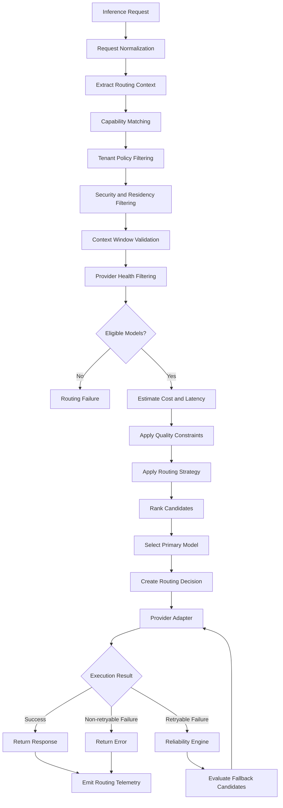

# LLM Gateway — Routing Policy Specification

**Version:** 1.0  
**Status:** Draft  
**Project:** `llm-gateway`  
**Implementation:** Rust  
**Architecture:** Clean Architecture

---

# 1. Purpose

This document defines how the gateway selects an LLM provider and model for each inference request.

The routing engine must balance:

- Model capabilities.
- Task requirements.
- Quality requirements.
- Cost.
- Latency.
- Provider availability.
- Context-window constraints.
- Data residency.
- Security policies.
- Tenant preferences.
- Provider-specific limits.

The routing engine must be deterministic, explainable, configurable, measurable, and independently testable.

## 1.1 Primary Objective

Select the lowest-cost eligible model that satisfies all mandatory constraints.

\[
M^* = \arg\min_{m \in E(r)} Cost(m,r)
\]

Where:

- \(r\) = inference request.
- \(M\) = registered models.
- \(E(r)\) = eligible models for request \(r\).
- \(Cost(m,r)\) = estimated inference cost.

Eligibility is determined before optimization.

A cheap model that violates a mandatory security, capability, quality, or reliability constraint must never be selected.

---

# 2. Routing Architecture



---

# 3. Routing Responsibilities

The routing subsystem contains the following responsibilities.

| Component | Responsibility |
|---|---|
| Routing Context Builder | Extract request and tenant constraints |
| Task Classifier | Identify task category |
| Complexity Estimator | Estimate request difficulty |
| Capability Matcher | Filter models by capabilities |
| Policy Evaluator | Apply tenant and platform restrictions |
| Provider Health Selector | Exclude unhealthy providers |
| Cost Estimator | Estimate inference expenditure |
| Latency Estimator | Estimate expected response time |
| Candidate Ranker | Apply optimization strategy |
| Routing Decision Engine | Produce the final decision |
| Fallback Selector | Select alternative eligible models |
| Routing Explainer | Record why a model was selected |

These components should be separated logically. They do not all need to become independent Rust crates.

---

# 4. Routing Context

The routing engine must not make decisions using only the raw prompt.

It should receive a normalized routing context.

Example:

```rust
pub struct RoutingContext {
    pub tenant_id: TenantId,
    pub project_id: ProjectId,
    pub requested_model: ModelSelection,
    pub task_type: TaskType,
    pub complexity: ComplexityLevel,
    pub required_capabilities: Vec<ModelCapability>,
    pub estimated_input_tokens: u32,
    pub requested_max_output_tokens: u32,
    pub quality_requirement: QualityRequirement,
    pub latency_requirement: LatencyRequirement,
    pub data_classification: DataClassification,
    pub residency_requirement: Option<String>,
    pub budget_constraint: Option<BudgetConstraint>,
}
```

The routing context is derived from:

- Client request.
- Authenticated identity.
- Tenant configuration.
- Project configuration.
- Gateway policy.
- Model registry.
- Request analysis.

Client-supplied metadata must not override trusted tenant policies.

---

# 5. Model Registry

The routing engine needs a registry of available models.

Each model must have structured metadata.

## 5.1 Model Definition

```rust
pub struct ModelDefinition {
    pub id: ModelId,
    pub provider_id: ProviderId,
    pub model_name: String,
    pub capabilities: Vec<ModelCapability>,
    pub context_window: u32,
    pub max_output_tokens: u32,
    pub pricing: ModelPricing,
    pub quality_profile: Option<QualityProfile>,
    pub latency_profile: Option<LatencyProfile>,
    pub supported_regions: Vec<String>,
    pub enabled: bool,
}
```

## 5.2 Model Capabilities

Initial capability taxonomy:

```rust
pub enum ModelCapability {
    TextGeneration,
    Streaming,
    ToolCalling,
    StructuredOutput,
    JsonMode,
    Vision,
    AudioInput,
    AudioOutput,
    Embeddings,
    LongContext,
}
```

A model must explicitly advertise supported capabilities.

Do not infer tool-calling or multimodal support from model names.

## 5.3 Model Pricing

Pricing must support separate input and output rates.

```rust
pub struct ModelPricing {
    pub currency: String,
    pub input_cost_per_million_tokens: Decimal,
    pub output_cost_per_million_tokens: Decimal,
    pub effective_from: DateTime<Utc>,
}
```

Additional pricing dimensions may be required:

- Cached input tokens.
- Batch inference.
- Image tokens.
- Audio tokens.
- Provider-specific surcharges.

Pricing must be versioned so historical usage can be reconciled against the correct price schedule.

---

# 6. Model Eligibility

Eligibility filtering must happen before candidate ranking.

A model is eligible only if all mandatory conditions are satisfied.

## 6.1 Eligibility Rules

| Rule | Condition | Result |
|---|---|---|
| Model enabled | Model is active | Required |
| Provider enabled | Provider is active | Required |
| Capability | All required capabilities supported | Required |
| Context window | Input and output fit | Required |
| Tenant policy | Tenant permits model | Required |
| Project policy | Project permits model | Required |
| Budget | Estimated request cost can be admitted | Required |
| Residency | Region satisfies policy | Required when configured |
| Data classification | Model is approved for data class | Required |
| Provider health | Provider is sufficiently healthy | Required |
| Quality | Model meets required quality threshold | Required when configured |

If no candidate remains, return a clear routing error.

Never silently relax mandatory constraints.

## 6.2 Context Window Validation

Required capacity:

\[
T_{required} =
T_{input} + T_{reserved\_output}
\]

Eligibility condition:

\[
T_{required} \leq T_{context}
\]

The gateway should reserve room for system messages, tool definitions, and provider-specific token overhead.

Token estimation is not always exact. The provider adapter must handle provider-reported context overflow as a structured error.

---

# 7. Task Classification

Task classification provides useful routing information.

Initial task categories:

```rust
pub enum TaskType {
    GeneralConversation,
    Summarization,
    Classification,
    Extraction,
    CodeGeneration,
    CodeReasoning,
    Reasoning,
    QuestionAnswering,
    Translation,
    Embedding,
    Multimodal,
}
```

Classification may use:

- Request structure.
- Endpoint type.
- Explicit client task metadata.
- Configured deterministic rules.
- Optional lightweight classifier.

The classification result must not replace mandatory capability or security checks.

For example:

- An embedding endpoint requires embedding capability.
- A vision request requires vision capability.
- Tool execution requires an explicitly supported and authorized tool-calling path.

---

# 8. Complexity Estimation

Complexity estimation helps rank eligible candidates.

Initial levels:

| Level | Description | Example |
|---|---|---|
| Low | Simple extraction or classification | Extract an order number |
| Medium | Multi-step explanation or summarization | Summarize a support case |
| High | Complex reasoning or code analysis | Diagnose a distributed-system failure |

Possible signals:

- Input token count.
- Number of messages.
- Required output length.
- Tool definitions.
- Task type.
- Structured output constraints.
- Explicit reasoning requirements.

Complexity estimation must be treated as a heuristic.

A short prompt can be difficult. A long prompt can be simple.

Do not route solely according to prompt length.

---

# 9. Quality Constraints

Quality is not a universal property of a model. It depends on the task and evaluation dataset.

Define task-specific quality profiles.

Example:

```rust
pub struct QualityProfile {
    pub task_type: TaskType,
    pub minimum_score: Option<Decimal>,
    pub evaluation_dataset_version: String,
    pub evaluation_method: String,
}
```

Possible quality metrics:

| Task | Metric |
|---|---|
| Classification | Accuracy, F1 |
| Extraction | Precision, recall |
| Question answering | Correctness, groundedness |
| Summarization | Factual consistency |
| Code generation | Test pass rate |
| Tool calling | Tool selection and argument accuracy |

Quality profiles should be derived from repeatable evaluation experiments.

Do not assume a model is production-eligible because of a vendor benchmark or a single LLM-as-judge score.

## 9.1 Quality Constraints

A tenant may require:

```yaml
quality:
  task: question_answering
  minimum_score: 0.90
  evaluation_dataset: support-qa-v3
```

Only models with a valid evaluation result meeting the configured threshold are eligible.

If quality evidence is missing, the policy must specify whether the model is excluded or allowed under an explicitly defined exception.

The default for strict production policies should be exclusion.

---

# 10. Cost Estimation

The gateway estimates the expected cost before executing inference.

## 10.1 Formula

\[
C =
\frac{T_{in} \times P_{in}}{1,000,000}
+
\frac{T_{out} \times P_{out}}{1,000,000}
\]

Where:

- \(T_{in}\): estimated input tokens.
- \(T_{out}\): requested maximum output tokens or an estimated output amount.
- \(P_{in}\): input cost per million tokens.
- \(P_{out}\): output cost per million tokens.

The system must distinguish:

1. Estimated cost.
2. Reserved budget.
3. Actual provider-reported cost.
4. Reconciled cost.

All financial calculations must use decimal arithmetic.

## 10.2 Budget Admission

Before execution:

1. Calculate estimated cost.
2. Apply configured safety margin.
3. Reserve budget atomically.
4. Reject if the reservation cannot be admitted.
5. Reconcile after execution.

Example:

```yaml
cost:
  reservation:
    safety_margin_percent: 15
    max_reservation_amount: 2.00
```

The safety margin is configurable and must be calibrated using actual provider usage.

---

# 11. Latency Estimation

Latency constraints are based on historical observations.

Track:

- Provider time to first token.
- Total completion latency.
- Input token count.
- Output token count.
- Model.
- Region.
- Request type.
- Streaming versus non-streaming.

Example policy:

```yaml
latency:
  max_time_to_first_token_ms: 1500
  max_total_latency_ms: 10000
```

The router should use rolling percentiles rather than a single average.

For example:

- p50 for typical performance.
- p95 for service-level objectives.
- p99 for tail latency analysis.

Latency estimates must be treated as predictions, not guarantees.

---

# 12. Provider Health

Provider health is a routing constraint.

The reliability engine should expose provider health information to the router.

Signals:

- Success rate.
- Timeout rate.
- Error rate.
- Rate-limit frequency.
- Circuit-breaker state.
- Latency percentiles.
- Recent connection failures.

Initial provider states:

```rust
pub enum ProviderHealth {
    Healthy,
    Degraded,
    Unhealthy,
    Disabled,
}
```

Rules:

| State | Routing Behavior |
|---|---|
| Healthy | Eligible |
| Degraded | Eligible with penalty or policy restriction |
| Unhealthy | Excluded |
| Disabled | Excluded |

A provider's health must be determined using rolling observations and explicit circuit-breaker rules.

---

# 13. Routing Strategies

The gateway should support configurable strategies.

## 13.1 Cheapest Eligible

Select the lowest estimated cost among eligible candidates.

Best for:

- Cost-sensitive workloads.
- Classification.
- Simple extraction.
- High-volume applications.

## 13.2 Lowest Latency

Select the candidate with the lowest expected latency among eligible models.

Best for:

- Interactive assistants.
- Time-sensitive applications.
- Real-time support.

## 13.3 Quality First

Select the highest validated task-specific quality score among eligible candidates.

Best for:

- High-risk responses.
- Complex reasoning.
- Sensitive workflows.

## 13.4 Balanced

Apply weighted ranking across cost, latency, quality, and health.

Example:

\[
Score(m) =
w_q Q(m)
-
w_c C(m)
-
w_l L(m)
+
w_h H(m)
\]

Where:

- \(Q\): normalized quality.
- \(C\): normalized cost.
- \(L\): normalized latency.
- \(H\): provider health score.
- \(w\): configured weights.

The balanced strategy is a ranking strategy, not a substitute for hard eligibility constraints.

Weights must be calibrated and documented.

## 13.5 Explicit Model Selection

If the client specifies a model:

- Validate that the model exists.
- Validate tenant permissions.
- Validate capability support.
- Validate budget and context constraints.
- Apply security and residency policies.

An explicitly requested model must not bypass mandatory gateway policies.

---

# 14. Routing Configuration

Routing configuration should be versioned.

Example:

```yaml
routing:
  default_strategy: cheapest_eligible

  fallback:
    enabled: true
    max_attempts: 2
    allow_cross_provider: true

  constraints:
    enforce_capabilities: true
    enforce_context_window: true
    enforce_tenant_policy: true
    enforce_data_residency: true
    enforce_quality_threshold: true

  task_profiles:
    classification:
      strategy: cheapest_eligible
      allowed_models:
        - model-small
        - model-medium

    reasoning:
      strategy: quality_first
      allowed_models:
        - model-reasoning-a
        - model-reasoning-b

    code_generation:
      strategy: balanced
      allowed_models:
        - model-code-a
        - model-code-b
```

The gateway must validate configuration before activation.

Invalid configurations must not replace the last known valid configuration.

---

# 15. Routing Decision

Every inference execution must produce an auditable routing decision.

Example:

```rust
pub struct RoutingDecision {
    pub execution_id: ExecutionId,
    pub selected_model: ModelId,
    pub selected_provider: ProviderId,
    pub strategy: RoutingStrategy,
    pub policy_version: String,
    pub candidate_count: usize,
    pub excluded_candidates: Vec<ExcludedCandidate>,
    pub selection_reason: String,
    pub estimated_cost: Decimal,
    pub estimated_latency_ms: Option<u64>,
}
```

The routing decision should record:

- Selected provider.
- Selected model.
- Strategy.
- Policy version.
- Candidate set or candidate summary.
- Exclusion reasons.
- Estimated cost.
- Estimated latency.
- Quality evidence version.
- Timestamp.

Avoid storing raw prompts in routing decision records.

---

# 16. Fallback Policy

Fallback is used when the selected provider or model cannot complete inference.

## 16.1 Retryable Failures

Potential retryable failures:

- Connection failure.
- Provider timeout.
- HTTP 429.
- HTTP 502.
- HTTP 503.
- HTTP 504.

Potential non-retryable failures:

- Invalid request.
- Unsupported capability.
- Invalid credentials.
- Authorization failure.
- Context overflow without a valid alternative.
- Budget rejection.
- Policy rejection.

Provider error classification must normalize provider-specific responses.

## 16.2 Retry Rules

- Respect `Retry-After`.
- Use bounded exponential backoff with jitter.
- Enforce total request deadlines.
- Limit retry attempts.
- Do not retry permanent failures.
- Use idempotency where supported.
- Avoid duplicate execution when provider outcome is uncertain.
- Re-evaluate provider health before another attempt.

## 16.3 Streaming Fallback

Streaming introduces a special constraint.

Before the first token is emitted, fallback may be possible.

After response content has been delivered, transparent fallback is generally unsafe because switching models may produce duplicate or inconsistent output.

Therefore:

- Pre-token failures may use eligible fallback models.
- Post-token failures must terminate the stream with a structured error.
- Partial usage and provider attempts must be recorded.
- Budget reservations must be reconciled.

---

# 17. Fallback Candidate Selection

Fallback candidates must satisfy the original mandatory constraints.

A fallback must not bypass:

- Tenant permissions.
- Data residency.
- Model capabilities.
- Context requirements.
- Quality thresholds.
- Budget limits.
- Security policies.

Example:

```yaml
fallback:
  max_attempts: 2
  candidates:
    - model-primary
    - model-secondary
    - model-tertiary
```

Fallback ordering may be based on cost, quality, latency, or an explicit administrative priority.

Cross-provider fallback should be configurable because different providers can have different data-processing and residency characteristics.

---

# 18. Routing Explainability

Every routing decision must be explainable to operators.

Example:

```json
{
  "selected_model": "model-small",
  "strategy": "cheapest_eligible",
  "reason": "Lowest-cost model satisfying all required capabilities and tenant policies.",
  "candidate_summary": {
    "eligible": 3,
    "excluded": 2
  },
  "exclusions": [
    {
      "model": "model-large",
      "reason": "Exceeded maximum request cost."
    },
    {
      "model": "model-vision",
      "reason": "Provider is unhealthy."
    }
  ]
}
```

Do not expose sensitive internal routing data to ordinary inference clients.

Administrative access to routing explanations must be permission-controlled.

---

# 19. Rust Domain Interfaces

The routing engine should expose a domain-level abstraction.

```rust
pub trait ModelRouter: Send + Sync {
    async fn route(
        &self,
        context: &RoutingContext,
    ) -> Result<RoutingDecision, RoutingError>;
}
```

Separate candidate evaluation from provider execution.

Suggested logical modules:

```text
crates/model-router/src/
├── lib.rs
├── context.rs
├── classifier.rs
├── complexity.rs
├── eligibility.rs
├── scoring.rs
├── cost_estimator.rs
├── latency_estimator.rs
├── health.rs
├── decision.rs
├── fallback.rs
└── errors.rs
```

Use dependency injection for:

- Model registry.
- Policy evaluator.
- Pricing repository.
- Provider health repository.
- Quality profile repository.
- Routing configuration.

The domain should not depend directly on Redis, PostgreSQL, HTTP clients, or vendor SDKs.

---

# 20. Routing Evaluation

Routing quality must be evaluated using reproducible workloads.

## 20.1 Evaluation Dataset

Include:

- Simple classification.
- Extraction.
- Summarization.
- General conversation.
- Complex reasoning.
- Code generation.
- Tool calling.
- Long-context requests.
- Multimodal requests where supported.

Each test case should define:

- Input.
- Task type.
- Expected output criteria.
- Required capabilities.
- Quality threshold.
- Maximum cost.
- Maximum latency.

## 20.2 Routing Metrics

| Metric | Description |
|---|---|
| Routing accuracy | Correct eligibility and selection |
| Average cost | Mean cost per execution |
| Cost per successful task | Cost adjusted for task success |
| Quality score | Task-specific evaluation result |
| p50 latency | Median completion latency |
| p95 latency | Tail completion latency |
| Fallback rate | Percentage of executions requiring fallback |
| Provider failure rate | Provider failures divided by attempts |
| Policy rejection rate | Requests rejected by routing policies |

## 20.3 Baseline Comparison

Compare:

1. Single fixed model.
2. Cheapest eligible model.
3. Balanced routing.
4. Quality-first routing.

Measure all strategies using the same workload and evaluation dataset.

Do not claim cost savings without an equivalent quality and reliability comparison.

---

# 21. Routing Security Requirements

- Client metadata cannot override platform policies.
- Model permissions are tenant-scoped.
- Routing decisions cannot expose provider secrets.
- Residency constraints are mandatory when configured.
- Fallback cannot bypass security restrictions.
- Routing configuration changes are audited.
- Pricing changes are versioned.
- Quality profiles are versioned.
- Routing decisions are correlated with inference executions.
- Model allowlists are enforced before ranking.

---

# 22. Definition of Done

- [ ] Routing context is defined.
- [ ] Model registry metadata is defined.
- [ ] Model capabilities are defined.
- [ ] Model eligibility rules are defined.
- [ ] Task classification is defined.
- [ ] Complexity estimation is defined.
- [ ] Quality constraints are defined.
- [ ] Cost estimation is defined.
- [ ] Budget admission integration is defined.
- [ ] Latency estimation is defined.
- [ ] Provider health integration is defined.
- [ ] Routing strategies are defined.
- [ ] Routing configuration is versioned.
- [ ] Routing decisions are explainable.
- [ ] Fallback rules are defined.
- [ ] Streaming fallback constraints are defined.
- [ ] Routing evaluation datasets are planned.
- [ ] Routing metrics are defined.
- [ ] Security restrictions are enforced.
- [ ] Unit and integration tests are specified.

---

# 23. Architectural Invariants

The following rules are mandatory:

1. Eligibility filtering happens before ranking.
2. Security and tenant policies cannot be overridden by routing strategy.
3. Budget reservation happens before provider execution.
4. Fallback candidates must satisfy the original mandatory constraints.
5. Every routing decision is traceable.
6. Every routing configuration is versioned.
7. Historical pricing remains available for usage reconciliation.
8. Provider health affects candidate eligibility.
9. Quality thresholds are based on evaluation evidence.
10. Streaming fallback cannot transparently restart after content has been delivered.

---

# 24. Next Document

The next specification is `docs/domain-model.md`.

It will define the domain entities, value objects, aggregates, domain services, invariants, and relationships for:

- Tenants and projects.
- Users, roles, and permissions.
- API keys.
- Providers and models.
- Secret references.
- Policies and routing rules.
- Rate limits and concurrency limits.
- Budgets and reservations.
- Inference executions.
- Provider attempts.
- Usage accounting.
- Cache entries.
- Audit events.
- Routing decisions.
- Evaluation runs and results.
