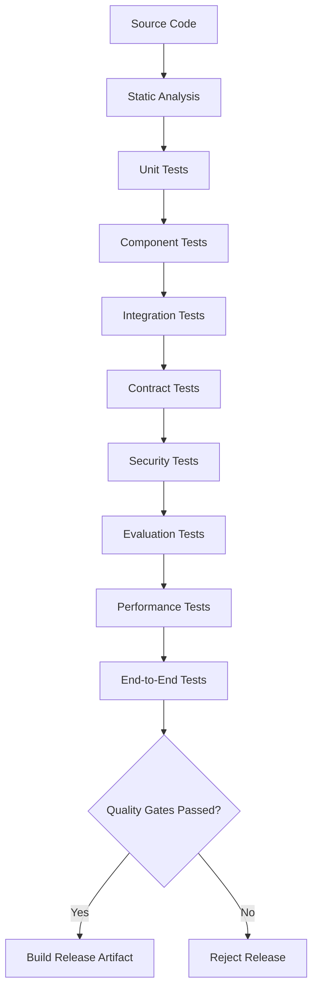

# LLM Gateway — Test Strategy

**File:** `docs/test-strategy.md`  
**Version:** 1.0  
**Status:** Draft  
**Project:** `llm-gateway`  
**Implementation:** Rust + Python  
**Architecture:** Clean Architecture

---

# 1. Purpose

This document defines how `llm-gateway` will be tested throughout development and before production deployment.

The gateway manages inference execution, financial exposure, tenant isolation, provider integrations, and model quality. Testing must therefore validate more than whether individual functions work.

The strategy covers:

- Unit testing.
- Integration testing.
- API contract testing.
- Provider contract testing.
- Database testing.
- Security testing.
- Evaluation testing.
- Performance testing.
- Load testing.
- Stress testing.
- Resilience and chaos testing.
- End-to-end testing.
- CI/CD quality gates.

## 1.1 Testing Objectives

| ID | Objective | Description |
|---|---|---|
| TEST-001 | Functional correctness | Validate domain and application behavior |
| TEST-002 | Integration correctness | Validate component interactions |
| TEST-003 | Contract compatibility | Validate API and provider contracts |
| TEST-004 | Security assurance | Validate authentication and authorization |
| TEST-005 | Financial correctness | Validate budgets, reservations, and settlement |
| TEST-006 | Routing correctness | Validate model eligibility and selection |
| TEST-007 | Reliability | Validate retry, fallback, and recovery |
| TEST-008 | Performance | Validate latency and throughput |
| TEST-009 | Quality | Validate model outputs and evaluation logic |
| TEST-010 | Reproducibility | Ensure deterministic and repeatable tests |

---

# 2. Testing Architecture



## 2.1 Testing Pyramid

| Layer | Scope | Execution Frequency |
|---|---|---|
| Unit | Functions and domain rules | Every commit |
| Component | Individual crates and services | Every commit |
| Integration | Database, Redis, providers | Every pull request |
| Contract | API and provider compatibility | Every pull request |
| Security | Security controls and vulnerabilities | Every pull request and release |
| Evaluation | Model quality and routing | Relevant changes and scheduled runs |
| Performance | Latency and throughput | Scheduled and release |
| End-to-end | Complete user workflows | Pull request and release |
| Chaos | Failure recovery | Scheduled and pre-production |

The majority of tests should be fast and deterministic.

---

# 3. Test Environments

Use isolated environments.

| Environment | Purpose |
|---|---|
| Local | Developer testing |
| CI | Automated validation |
| Integration | Real database and Redis integration |
| Evaluation | Model quality experiments |
| Performance | Controlled load testing |
| Staging | Production-like validation |
| Production | Monitoring and controlled verification |

## 3.1 Local Environment

Use Docker Compose for infrastructure dependencies.

Suggested services:

- PostgreSQL.
- Redis.
- Mock LLM provider.
- OpenTelemetry Collector.
- Prometheus.
- Grafana.
- Optional Langfuse.
- Optional vector database for semantic cache testing.

External provider credentials must not be required for the default test suite.

## 3.2 Test Data

Use synthetic data for:

- Tenants.
- Projects.
- API keys.
- Provider configurations.
- Model registry.
- Budgets.
- Usage records.
- Inference requests.
- Evaluation datasets.

Never use production secrets or customer prompts in ordinary test fixtures.

---

# 4. Unit Testing

Unit tests validate isolated behavior without external infrastructure.

## 4.1 Rust Unit Testing

Use Rust's built-in test framework.

Recommended libraries:

| Library | Purpose |
|---|---|
| `cargo test` | Unit and integration tests |
| `mockall` | Trait mocking |
| `proptest` | Property-based testing |
| `rstest` | Parameterized tests |
| `tokio::test` | Async tests |
| `assert_matches` | Result and enum assertions |

## 4.2 Domain Tests

Test domain invariants independently of infrastructure.

Examples:

### Budget Manager

- Cannot reserve beyond available budget.
- Cannot settle the same execution twice.
- Released reservations cannot be settled as active reservations.
- Actual cost is recorded even when it exceeds the reservation.

### Model Router

- Reject models without required capabilities.
- Reject models that violate data residency.
- Reject unhealthy providers.
- Reject models exceeding context limits.
- Select the lowest-cost eligible model under the configured strategy.

### Rate Limiter

- Token bucket capacity is respected.
- Refill behavior is correct.
- Concurrent requests do not exceed configured limits.

### Reliability Engine

- Permanent errors are not retried.
- Retry count never exceeds the configured maximum.
- Circuit breaker transitions are correct.
- Fallback preserves mandatory constraints.

### Cache Engine

- Identical canonical requests produce identical keys.
- Different response-affecting parameters produce different keys.
- Tenant namespaces remain isolated.
- Expired entries are rejected.

## 4.3 Property-Based Testing

Use property-based tests for important invariants.

Examples:

- A budget reservation must never increase available budget.
- A settled reservation cannot be settled again.
- Cache-key generation must be deterministic.
- A rate limiter must not exceed configured capacity.
- Retry attempts must remain within configured limits.

Example:

```rust
use proptest::prelude::*;

proptest! {
    #[test]
    fn cache_key_is_deterministic(
        input in ".*"
    ) {
        let first = generate_cache_key(&input);
        let second = generate_cache_key(&input);

        prop_assert_eq!(first, second);
    }
}
```

This example illustrates the testing pattern; adapt the input generator and function to the actual cache-key implementation.

---

# 5. Component Testing

Component tests validate an individual crate or service with mocked dependencies.

Examples:

| Component | Test Scope |
|---|---|
| Identity | API key validation |
| Authorization | Permission enforcement |
| Policy engine | Policy evaluation |
| Rate limiter | Admission decisions |
| Budget manager | Reservation and settlement |
| Model router | Candidate selection |
| Provider adapters | Request and response normalization |
| Reliability engine | Retry and fallback |
| Cache engine | Lookup and invalidation |
| Telemetry | Span and metric generation |
| Evaluation worker | Dataset and evaluator execution |

The objective is to test a component's public behavior without requiring the entire application.

---

# 6. Integration Testing

Integration tests validate interactions with real infrastructure.

Use disposable test containers or isolated Docker Compose services.

## 6.1 PostgreSQL

Test:

- Migrations.
- Transactions.
- Foreign-key constraints.
- Tenant isolation.
- Row-level security, if enabled.
- Budget reservation locking.
- Idempotent settlement.
- Outbox publication.
- Pagination.
- Concurrent updates.

Critical scenario:

Two requests attempt to reserve funds against the same limited budget simultaneously.

Expected behavior:

Only reservations allowed by the available budget are accepted.

## 6.2 Redis

Test:

- Token bucket scripts.
- Distributed rate limiting.
- Concurrency permits.
- Permit expiration.
- Lease recovery.
- Cache lookup.
- Cache invalidation.
- Redis disconnection.
- Redis restart.
- Eviction behavior.

## 6.3 Event Pipeline

Test:

- Event publication.
- Duplicate delivery.
- Consumer idempotency.
- Retry behavior.
- Outbox recovery.
- Consumer crash.
- Event schema compatibility.

Assume at-least-once event delivery unless a specific component provides stronger guarantees.

## 6.4 Integration Test Isolation

Each test should:

- Use a unique test namespace.
- Create its own test data.
- Avoid shared mutable state.
- Clean up after execution.
- Avoid depending on test ordering.

---

# 7. API Contract Testing

API contracts must remain compatible with `docs/api-contracts.md` and the OpenAPI specification.

## 7.1 API Test Coverage

| Endpoint | Test Cases |
|---|---|
| `POST /v1/chat/completions` | Success, validation, authentication, streaming |
| `POST /v1/embeddings` | Valid input, unsupported model, dimension validation |
| `GET /v1/models` | Authentication, authorization, model filtering |
| `GET /v1/models/{model_id}` | Existing and unavailable models |
| API key endpoints | Creation, rotation, revocation |
| Budget endpoints | Usage, limits, access control |
| Provider endpoints | Registration, health, enable/disable |
| Health endpoints | Liveness and readiness |

## 7.2 Error Contract

Validate:

- HTTP status.
- Stable error code.
- Error message.
- Request ID.
- Retryability indication where appropriate.
- No sensitive information.

## 7.3 Streaming Tests

Validate:

- SSE event format.
- Event ordering.
- First-token delivery.
- Usage reporting.
- Client disconnect.
- Provider interruption.
- Partial response errors.
- No transparent fallback after content delivery.

## 7.4 OpenAPI Validation

CI must verify that:

- The OpenAPI document is valid.
- Request and response schemas match implementation.
- Required fields are documented.
- Error responses are represented.
- Breaking API changes are explicitly reviewed.

---

# 8. Provider Contract Testing

Every provider adapter must satisfy a common contract.

## 8.1 Provider Contract

Test:

- Authentication header construction.
- Request serialization.
- Response normalization.
- Usage extraction.
- Finish-reason mapping.
- Error normalization.
- Streaming event mapping.
- Timeout behavior.
- Cancellation behavior.
- Unsupported capability handling.

## 8.2 Mock Provider

Create a deterministic mock provider that can simulate:

- Successful responses.
- HTTP 400.
- HTTP 401.
- HTTP 429.
- HTTP 500.
- HTTP 503.
- Timeouts.
- Connection failures.
- Invalid JSON.
- Malformed streaming events.
- Partial streaming output.
- Missing usage metadata.

The default test suite must use this mock instead of depending on external provider availability.

## 8.3 Provider Compatibility

For each supported provider, maintain:

- Request fixtures.
- Response fixtures.
- Error fixtures.
- Streaming fixtures.
- Usage fixtures.
- Capability tests.

Live provider contract tests may run on a controlled schedule using dedicated test credentials and approved budgets.

---

# 9. Security Testing

Security testing must cover the complete gateway boundary.

## 9.1 Authentication

Test:

- Invalid API keys.
- Expired API keys.
- Revoked API keys.
- Rotated keys.
- Malformed authorization headers.
- Key hashing and verification.
- Authentication rate limiting.

## 9.2 Authorization

Test:

- Cross-tenant access.
- Cross-project access.
- Unauthorized model selection.
- Unauthorized budget modification.
- Unauthorized provider administration.
- Unauthorized trace access.
- Role-based permissions.

## 9.3 Abuse Protection

Test:

- Request flooding.
- Oversized request bodies.
- Excessive token requests.
- Concurrency exhaustion.
- Malformed JSON.
- Repeated invalid credentials.
- SSRF attempts.
- Provider endpoint manipulation.

## 9.4 Data Protection

Test:

- API key redaction.
- Provider secret redaction.
- Prompt and response logging restrictions.
- Cache isolation.
- Tenant-specific telemetry access.
- Sensitive information retention.

## 9.5 Dependency Security

CI should include:

```bash
cargo audit
cargo deny check
```

Also perform:

- Dependency vulnerability scanning.
- Container image scanning.
- Secret scanning.
- SBOM generation.
- License compliance checks.
- Static security analysis.

Tool versions and policies must be pinned and reviewed.

---

# 10. Financial and Accounting Testing

Financial correctness is a critical system invariant.

## 10.1 Budget Reservation

Test:

- Successful reservation.
- Insufficient budget.
- Concurrent reservations.
- Reservation expiration.
- Reservation release.
- Duplicate reservation request.
- Reservation across hierarchical budgets.

## 10.2 Settlement

Test:

- Successful settlement.
- Settlement below reservation.
- Settlement above reservation.
- Duplicate settlement.
- Provider usage missing.
- Provider timeout with unknown outcome.
- Settlement after gateway restart.
- Reconciliation recovery.

## 10.3 Accounting Invariants

1. No provider execution before required budget admission.
2. A reservation cannot be settled twice.
3. Actual provider cost must not be hidden.
4. Financial ledger corrections must be auditable.
5. Unknown provider outcomes must not be treated as zero cost.
6. Cache hits must not create provider usage charges.
7. Evaluation costs must be separately attributed.

Use decimal arithmetic for financial calculations. Avoid binary floating-point arithmetic for monetary ledger values.

---

# 11. Routing and Evaluation Testing

## 11.1 Routing Tests

Test:

- Capability matching.
- Context-window matching.
- Security policy.
- Data residency.
- Quality thresholds.
- Provider health.
- Cost ranking.
- Latency ranking.
- Tenant-specific model restrictions.
- Explicit model selection.
- Fallback eligibility.

## 11.2 Evaluation Dataset Tests

Validate:

- Dataset schema.
- Dataset version.
- Case uniqueness.
- Required metadata.
- Expected reference data.
- Data classification.
- Reproducibility.

## 11.3 Evaluator Tests

Test:

- Deterministic metrics.
- LLM judge schema validation.
- Judge failure handling.
- Metric normalization.
- Threshold calculation.
- Evaluator version tracking.
- Regression detection.

## 11.4 Evaluation Quality Gates

Examples:

| Condition | Expected Behavior |
|---|---|
| Quality below minimum | Reject candidate |
| Safety threshold exceeded | Reject candidate |
| Dataset invalid | Fail evaluation |
| Judge unavailable | Mark evaluation incomplete |
| Cost above threshold | Flag or reject according to policy |
| Insufficient sample size | Do not make a promotion decision |

Do not allow missing evaluation results to become automatic passing results.

---

# 12. Reliability and Resilience Testing

Test the failure-handling policies documented in `docs/reliability.md`.

## 12.1 Retry

- Retryable failure.
- Permanent failure.
- Retry-After.
- Maximum attempts.
- Exponential backoff.
- Jitter.
- Retry budget exhaustion.
- Overall deadline expiration.

## 12.2 Circuit Breaker

- Closed to Open.
- Open to Half-Open.
- Half-Open to Closed.
- Half-Open to Open.
- Concurrent probe handling.
- State persistence where required.
- Recovery after restart.

## 12.3 Fallback

- Primary provider failure.
- Alternative provider success.
- No eligible alternative.
- Insufficient fallback budget.
- Provider quota exhaustion.
- Residency restriction.
- Unsupported capability.
- Streaming failure before first token.
- Streaming failure after first token.

## 12.4 Cancellation

Test cancellation during:

- Admission.
- Provider connection.
- Generation.
- Streaming.
- Usage settlement.
- Event publication.

Verify that concurrency permits and budget reservations are handled safely.

---

# 13. Cache Testing

Test both correctness and performance.

## 13.1 Exact Cache

- Identical requests.
- Different generation parameters.
- Different model versions.
- Different prompt versions.
- Tenant isolation.
- Project isolation.
- TTL expiration.
- Explicit invalidation.
- Corrupted entry.

## 13.2 Semantic Cache

- Similar requests.
- Similar but different intent.
- Different context.
- Different authorization scope.
- Threshold boundaries.
- False-positive detection.
- Embedding model version changes.

## 13.3 Cache Quality

Measure:

- Precision.
- Recall.
- False-positive rate.
- Quality degradation.
- Cost avoidance.
- Latency improvement.

Semantic caching must pass quality tests before production enablement.

---

# 14. Performance Testing

Performance testing validates latency, throughput, and resource utilization.

## 14.1 Performance Dimensions

| Dimension | Measurement |
|---|---|
| Gateway overhead | Gateway-added latency |
| Routing | Routing evaluation latency |
| Cache | Cache lookup latency |
| Admission | Rate-limit and budget admission latency |
| Provider | Provider latency |
| Streaming | Time to first token |
| Throughput | Requests per second |
| Concurrency | Simultaneous executions |
| Memory | Memory usage |
| CPU | CPU utilization |
| Database | Query latency and pool saturation |

## 14.2 Initial Performance Targets

These are targets, not measured results.

| Metric | Target |
|---|---|
| Gateway overhead p95 | Below 50 ms |
| Exact cache lookup p95 | Below 15 ms |
| Baseline concurrency | 1,000 active requests |
| Gateway availability | 99.9% |
| Admission latency | Within configured gateway overhead budget |

Measure these under a defined workload and infrastructure configuration.

Provider generation time must be excluded from gateway-added latency calculations.

## 14.3 Load Testing

Suggested tools:

- k6.
- Locust.
- Criterion for Rust microbenchmarks.
- Custom Tokio-based load generator.

Test:

- Normal traffic.
- Burst traffic.
- Sustained traffic.
- Mixed provider workloads.
- Cache-heavy workloads.
- Budget-heavy workloads.
- Streaming workloads.

## 14.4 Stress Testing

Gradually increase traffic until:

- Latency violates SLO.
- Error rate increases.
- Connection pools saturate.
- Memory grows excessively.
- Admission controls reject traffic.

Identify the system's saturation point.

## 14.5 Soak Testing

Run sustained traffic over an extended period.

Detect:

- Memory leaks.
- Connection leaks.
- Unreleased concurrency permits.
- Growing queues.
- Database pool exhaustion.
- Telemetry backlog.
- Redis memory pressure.

---

# 15. Chaos and Fault Injection Testing

Chaos testing validates recovery under unexpected failures.

## 15.1 Failure Scenarios

| Failure | Expected Behavior |
|---|---|
| Provider unavailable | Retry or fallback |
| Provider latency spike | Deadline enforcement |
| Redis unavailable | Apply documented admission and cache degradation policies |
| PostgreSQL unavailable | Protect financial and authorization invariants |
| Secret manager unavailable | Reject provider execution without valid credentials |
| Event broker unavailable | Preserve required events through outbox |
| Telemetry backend unavailable | Degrade telemetry export without blocking inference indefinitely |
| Gateway instance crashes | Recover incomplete executions |
| Network partition | Bound retries and identify uncertain outcomes |
| Provider stream interruption | Terminate partial stream safely |

## 15.2 Recovery Validation

For every fault injection scenario, verify:

- No cross-tenant access.
- No unauthorized provider execution.
- No unbounded retries.
- No hidden provider costs.
- No permanent concurrency permit leakage.
- No silent loss of required financial records.
- No duplicate externally visible stream output.

---

# 16. End-to-End Testing

End-to-end tests validate complete business workflows.

## Scenario 1: Successful Inference

1. Create tenant.
2. Create project.
3. Create API key.
4. Configure provider.
5. Register model.
6. Submit inference request.
7. Authenticate.
8. Authorize.
9. Apply admission controls.
10. Reserve budget.
11. Route model.
12. Execute provider request.
13. Normalize response.
14. Reconcile usage.
15. Return response.
16. Verify telemetry.

Expected result: successful inference with traceability and correct accounting.

## Scenario 2: Provider Failure and Fallback

1. Submit inference request.
2. Select primary model.
3. Simulate primary provider failure.
4. Apply retry policy.
5. Evaluate circuit breaker.
6. Select eligible alternative.
7. Recheck admission and budget.
8. Execute fallback.
9. Reconcile usage.

Expected result: successful fallback with auditable provider attempts.

## Scenario 3: Budget Exhaustion

1. Create tenant budget.
2. Consume available budget.
3. Submit another inference request.
4. Attempt reservation.

Expected result: reject before provider execution.

## Scenario 4: Cache Hit

1. Submit eligible request.
2. Execute provider.
3. Store validated response.
4. Submit identical request.
5. Perform cache lookup.
6. Return cached response.

Expected result: no second provider execution and no duplicate provider charge.

## Scenario 5: Security Isolation

1. Create two tenants.
2. Create separate projects and API keys.
3. Populate tenant A cache and telemetry.
4. Attempt access from tenant B.

Expected result: access denied.

## Scenario 6: Streaming Cancellation

1. Submit streaming request.
2. Receive initial tokens.
3. Disconnect client.
4. Cancel upstream execution where supported.
5. Release concurrency permits.
6. Reconcile usage.

Expected result: no duplicate output and correct execution accounting.

---

# 17. Test Data and Fixtures

Suggested structure:

```text
tests/
├── fixtures/
│   ├── requests/
│   ├── responses/
│   ├── provider_errors/
│   ├── streaming/
│   ├── models/
│   └── policies/
│
├── unit/
├── component/
├── integration/
├── contract/
├── security/
├── performance/
├── chaos/
└── e2e/
```

Evaluation datasets remain under:

```text
evals/
├── datasets/
├── evaluators/
├── configs/
├── benchmarks/
└── reports/
```

Keep test fixtures deterministic and version-controlled.

Do not commit live credentials or customer data.

---

# 18. CI/CD Quality Gates

Every pull request must pass mandatory quality gates.

## 18.1 Rust Checks

```bash
cargo fmt --all -- --check
cargo clippy --workspace --all-targets --all-features -- -D warnings
cargo test --workspace
cargo audit
cargo deny check
```

## 18.2 Python Checks

```bash
ruff check services/evaluation-worker
ruff format --check services/evaluation-worker
mypy services/evaluation-worker
pytest services/evaluation-worker/tests
```

Use pinned tool versions and a maintained project configuration.

## 18.3 Additional CI Checks

- OpenAPI validation.
- Database migration validation.
- Secret scanning.
- Container scanning.
- SBOM generation.
- License checks.
- Integration tests.
- Provider mock contract tests.
- Evaluation regression tests where applicable.

## 18.4 Release Gates

Before release:

- [ ] All required tests pass.
- [ ] No unresolved critical security findings.
- [ ] Database migrations validated.
- [ ] Provider contracts validated.
- [ ] Evaluation thresholds satisfied.
- [ ] Performance targets verified.
- [ ] Recovery tests passed.
- [ ] Release artifact scanned.
- [ ] Deployment rollback verified.

---

# 19. Test Coverage and Quality Metrics

Coverage is useful but does not prove correctness.

Track:

| Metric | Purpose |
|---|---|
| Line coverage | Executed code |
| Branch coverage | Decision-path coverage |
| Mutation score | Test sensitivity |
| Integration test pass rate | Component interaction reliability |
| Contract test pass rate | Compatibility |
| Security finding count | Risk |
| Evaluation pass rate | Model quality |
| Flaky test rate | Test reliability |
| Mean test duration | CI efficiency |

Prioritize coverage of:

- Authorization.
- Budget reservation and settlement.
- Routing eligibility.
- Retry and fallback.
- Tenant isolation.
- Cache compatibility.
- Financial ledger invariants.

Critical domain logic should receive stronger testing than trivial serialization code.

---

# 20. Rust and Python Testing Responsibilities

| Area | Rust | Python |
|---|---|---|
| Gateway domain logic | Primary | No |
| API and middleware | Primary | No |
| Provider adapters | Primary | No |
| Rate limiting | Primary | No |
| Budget accounting | Primary | No |
| Reliability engine | Primary | No |
| Telemetry instrumentation | Primary | No |
| Evaluation datasets | No | Primary |
| LLM-as-judge | No | Primary |
| RAGAS / DeepEval | No | Primary |
| Statistical evaluation | No | Primary |
| Benchmark analysis | Supporting | Primary |

Avoid duplicating critical business rules across the Rust gateway and Python worker.

The Python evaluation worker consumes gateway events and produces evaluation results. It does not independently authorize production inference.

---

# 21. Definition of Done

## Functional Quality

- [ ] Domain unit tests pass.
- [ ] Component tests pass.
- [ ] Integration tests pass.
- [ ] API contract tests pass.
- [ ] Provider contract tests pass.

## Security

- [ ] Authentication tests pass.
- [ ] Authorization tests pass.
- [ ] Tenant isolation tests pass.
- [ ] Secret redaction tests pass.
- [ ] Dependency security checks pass.

## Financial Correctness

- [ ] Concurrent budget reservation tests pass.
- [ ] Idempotent settlement tests pass.
- [ ] Unknown outcome tests pass.
- [ ] Financial ledger invariants pass.

## Reliability

- [ ] Retry tests pass.
- [ ] Circuit-breaker tests pass.
- [ ] Fallback tests pass.
- [ ] Cancellation tests pass.
- [ ] Recovery tests pass.

## Performance

- [ ] Load tests pass.
- [ ] Stress tests completed.
- [ ] Soak tests completed.
- [ ] Performance targets measured.

## Evaluation

- [ ] Dataset validation passes.
- [ ] Evaluator tests pass.
- [ ] Quality thresholds pass.
- [ ] Regression tests pass.
- [ ] Promotion evidence recorded.

## Release Readiness

- [ ] CI quality gates pass.
- [ ] Container security checks pass.
- [ ] Database migrations validated.
- [ ] Rollback procedure tested.
- [ ] Operational dashboards available.

---

# 22. Architectural Decisions

Proposed ADRs:

| ADR | Decision |
|---|---|
| ADR-062 | Adopt a testing pyramid |
| ADR-063 | Use mock providers for deterministic default tests |
| ADR-064 | Use disposable infrastructure for integration testing |
| ADR-065 | Test financial invariants under concurrent execution |
| ADR-066 | Separate offline evaluation from ordinary gateway tests |
| ADR-067 | Include security testing in CI |
| ADR-068 | Use fault injection for resilience validation |
| ADR-069 | Require evidence-based release gates |

Reconcile identifiers with the existing ADR index.

---

# 23. Architectural Invariants

1. Critical domain rules must be tested independently of infrastructure.
2. Tenant isolation must be tested across all data-access boundaries.
3. Financial operations must be tested under concurrency.
4. Provider integration tests must not depend on external availability by default.
5. Unknown execution outcomes must be tested explicitly.
6. Streaming behavior must be tested before and after first-token delivery.
7. Evaluation failures must never become automatic passing results.
8. Security tests must run as part of the development lifecycle.
9. Performance claims must be supported by repeatable measurements.
10. Release readiness requires evidence, not only successful compilation.

---

# 24. Related Documents

- `docs/product.md`
- `docs/architecture.md`
- `docs/domain-model.md`
- `docs/data-model.md`
- `docs/api-contracts.md`
- `docs/security.md`
- `docs/routing-policy.md`
- `docs/provider-integration.md`
- `docs/reliability.md`
- `docs/rate-limiting-and-concurrency.md`
- `docs/budget-and-usage-accounting.md`
- `docs/observability.md`
- `docs/evaluation-strategy.md`
- `docs/cache-strategy.md`
- `docs/deployment.md`
- `docs/definition-of-done.md`


